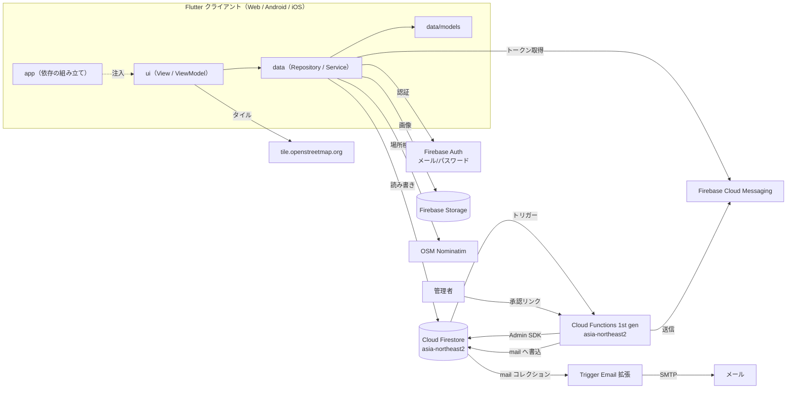
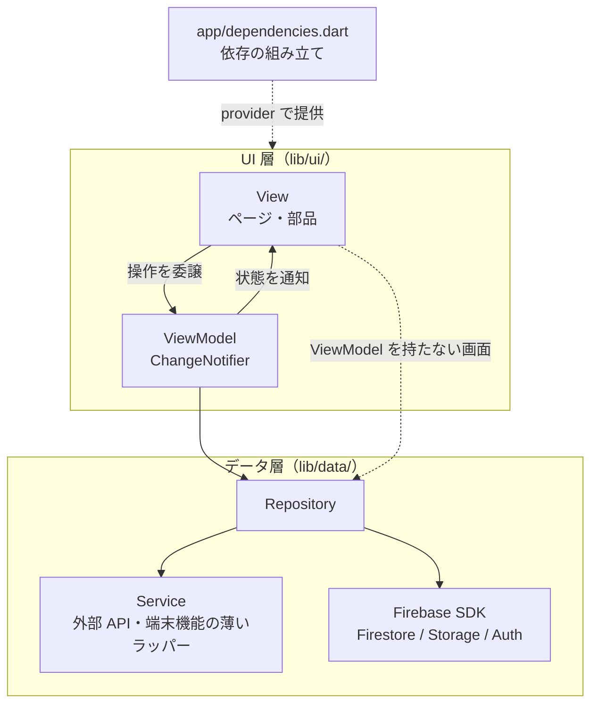
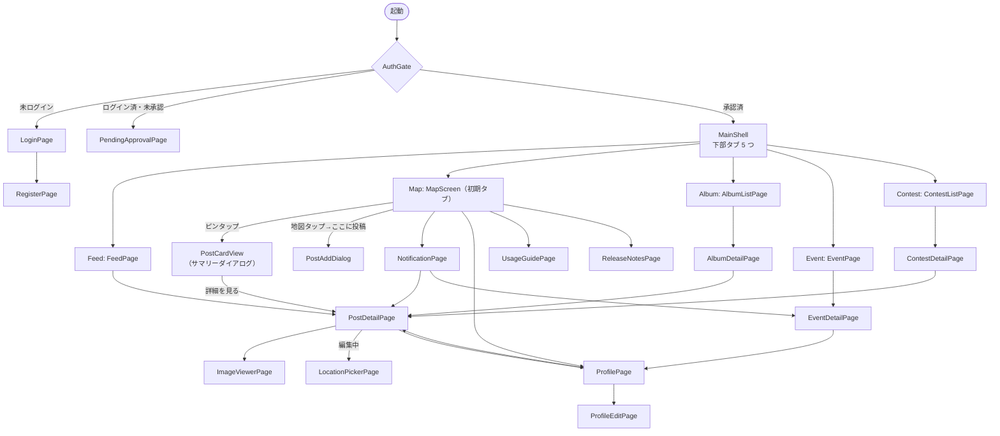
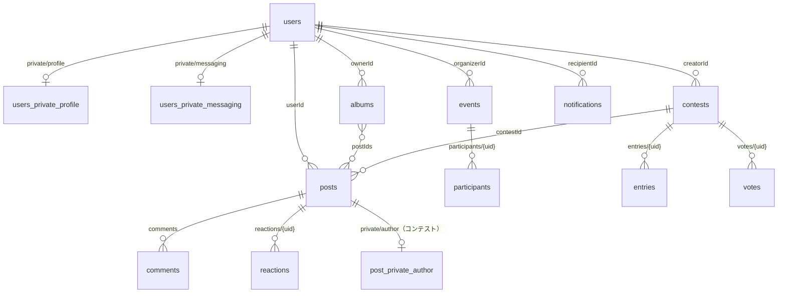

# 00. システム概要・共通設計

## 1. 概要

Afterglow は、地図（OpenStreetMap）上の地点に写真付き投稿をピン留めして共有する、クローズドなコミュニティ向けアプリである。
新規登録したユーザーは管理者の承認を経て利用可能になる。承認済みユーザーだけが投稿・閲覧・交流（コメント・いいね・アルバム・イベント・コンテスト）を行える。

## 2. システム構成



| 区分 | 技術 | 用途 |
|---|---|---|
| クライアント | Flutter（Material 3, フォント NotoSansJP） | Web は GitHub Pages に公開 |
| 地図 | `flutter_map` + OSM タイル / `latlong2` | 地図表示・位置選択 |
| 認証 | Firebase Auth（メール/パスワード） | ログイン・登録 |
| DB | Cloud Firestore（`asia-northeast2`） | 全データ |
| ストレージ | Firebase Storage | 投稿画像・プロフィール画像 |
| サーバー処理 | Cloud Functions 1st gen（TypeScript, `asia-northeast2`） | 承認フロー・通知生成・投票集計・匿名解除・週次メール |
| メール | Trigger Email 拡張（`mail` コレクション） | 承認依頼・週次ダイジェスト |
| プッシュ | FCM（Web は VAPID キー + Service Worker） | 通知配信 |
| ジオコーディング | OSM Nominatim | 地名検索 |
| 端末ローカル | `shared_preferences` | お知らせ既読・ガイド表示済みの記録 |

## 3. レイヤ構成

Flutter 公式の App architecture ガイド（UI 層 = View + ViewModel、データ層 = Repository + Service）に準拠し、ドメイン層（UseCase）は置かない軽量版とする。データ層はレイヤ単位、UI 層は機能単位でまとめる。

### 3.1 レイヤと責務



| レイヤ | ディレクトリ | 責務 | 持ってはいけないもの |
|---|---|---|---|
| View | `lib/ui/<feature>/` | 描画とユーザー操作の受け付け。画面遷移・SnackBar・`TextEditingController`・`PageController` など UI 固有の処理 | 入力検証・送信などの業務ロジック（ViewModel がある画面） |
| ViewModel | `lib/ui/<feature>/*_view_model.dart` | 1 画面（または 1 ダイアログ）の状態・入力検証・送信中フラグ。Repository を組み合わせて画面の操作を実現する | `BuildContext`、ウィジェット |
| Repository | `lib/data/repositories/` | データの正典。コレクション名定数、`fromSnapshot` 変換、整合性判定（応募条件等）、例外の `bool`/`null` への変換 | UI の状態、ウィジェット |
| Service | `lib/data/services/` | Firebase 以外の外部 API・端末機能の薄いラッパー（HTTP、位置情報、画像、FCM） | 業務判定、モデルの組み立て |
| モデル | `lib/data/models/` | イミュータブルなデータクラス。`fromSnapshot` で欠損値を既定値に補う | ロジック |

- 依存方向は **View → ViewModel → Repository → Service/SDK** の一方向。逆向きは禁止する。
- Firebase SDK（`FirebaseFirestore` 等）は薄いラッパー Service を作らず、Repository がコンストラクタで受け取る（既定値は `.instance`）。テストはモック（`fake_cloud_firestore` 等）を渡す。
- 状態管理は `ChangeNotifier` + `provider`。View は ViewModel を `initState` で生成して `dispose` で破棄し、`ListenableBuilder` で再描画する。
- ViewModel から View への一時的な通知（SnackBar 等）は、戻り値（成功/失敗）か通知用の `Stream` で返す。ViewModel は `BuildContext` に触れない。

### 3.2 依存の注入

- `lib/app/dependencies.dart` の `AppDependencies` が Repository / Service を組み立てる。各インスタンスは初回アクセス時に生成し（`late final`）、Repository 間の依存（例: `ContestRepository` → `PostRepository`）もここで解決する。
- `DependencyScope`（`MultiProvider`）が `MaterialApp` の外側で全インスタンスを提供する。そのため画面遷移先も同じインスタンスを受け取る。
- UI は Repository / Service を自分で生成せず、`context.read<T>()` で受け取る。ウィジェットのコンストラクタに Repository を渡す引数は設けない。
- テストは `test/helpers/dependencies.dart` の `withDependencies` で、モックの Firebase や差し替えた Repository を持つ `AppDependencies` を提供する。

### 3.3 フォルダ構成

```
lib/
  main.dart                      Firebase 初期化 → MyApp
  firebase_options.dart          FlutterFire 生成物
  app/
    app.dart                     DependencyScope + MaterialApp・テーマ
    dependencies.dart            AppDependencies / DependencyScope
    main_shell.dart              下部タブ
  data/
    models/                      post, app_user, album, comment, contest, event, notification, release_note
    repositories/                post, user, auth, album, comment, reaction, event, contest,
                                 notification, release_note, usage_guide
    services/                    geocoding, location, image, push_notification
  ui/
    core/widgets/                機能横断の部品（post_card, contest_entry_badge, comment_section,
                                 reaction_bar, event_schedule_text）
    auth/                        auth_gate, login_page, register_page, pending_approval_page
    map/                         map_screen, location_picker_page, widgets/(map_search_bar, post_location_confirm_bar)
    post/                        post_add_dialog + post_add_view_model, post_detail_page + post_detail_view_model,
                                 image_viewer_page, photo_location_suggestion, widgets/(post_detail_view, post_widget)
    feed/                        feed_page
    album/                       album_list_page, album_detail_page, widgets/(album_edit_dialog)
    event/                       event_page, event_detail_page, widgets/(event_edit_dialog)
    contest/                     contest_list_page, contest_detail_page, widgets/(contest_edit_dialog)
    notification/                notification_page, widgets/(notification_bell)
    profile/                     profile_page, profile_edit_page
    info/                        release_notes_page, usage_guide_page, widgets/(release_note_*, usage_guide_*)
test/                            lib/ と同じ構成（data/models, data/repositories, data/services, ui/<feature>）
  helpers/dependencies.dart      テスト用の依存提供
```

- その機能専用の部品は機能フォルダの `widgets/` に置き、2 つ以上の機能から使う部品だけを `ui/core/widgets/` に置く。
- ViewModel を持つ画面は `xxx_view_model.dart` を同じ機能フォルダに置く。

### 3.4 ViewModel の適用状況

| 画面 | ViewModel | 備考 |
|---|---|---|
| 投稿作成（`PostAddDialog`） | `PostAddViewModel` | 画像・撮影場所の提案・タグ・コンテスト応募・入力検証・送信 |
| 投稿詳細（`PostDetailView`） | `PostDetailViewModel` | 編集/削除の権限判定・編集中の画像と位置・保存・削除 |
| 上記以外 | なし | View が `StreamBuilder` で Repository を直接購読する（表示中心で状態が少ないため）。状態や入力検証が増えた画面から ViewModel を切り出す |

### 3.5 残課題

| 課題 | 内容 |
|---|---|
| ViewModel のない画面 | 3.4 の「上記以外」は View が Repository を直接呼ぶ。編集ダイアログ（アルバム・イベント・コンテスト）やプロフィール編集など、入力検証や送信を持つ画面は順次 ViewModel へ移す |
| Repository の責務 | `PostRepository` などは Firestore/Storage の I/O と整合性判定（応募条件の検証等）を同じクラスで持つ。肥大化した時点で分割を検討する |

## 4. 画面遷移



- `MainShell` は `IndexedStack` で各タブの状態（スクロール位置など）を保持する。
- 通知ベル・使い方・フィードバック・お知らせ・プロフィールは Map タブの AppBar から開く。

## 5. データモデル（Firestore）



| パス | 内容 | 主な書き手 | 詳細 |
|---|---|---|---|
| `users/{uid}` | 公開プロフィール（username, bio, profileImageUrl, role, approved, createdAt） | 本人 / Functions | 01, 09 |
| `users/{uid}/private/profile` | email, emailNotification | 本人 | 01, 08 |
| `users/{uid}/private/messaging` | FCM tokens[], updatedAt | 本人 / Functions | 08 |
| `posts/{postId}` | 投稿本体 | 投稿者 / Functions | 02, 03, 07 |
| `posts/{postId}/private/author` | コンテスト投稿の実投稿者 userId | 投稿者 | 07 |
| `posts/{postId}/comments/{id}` | コメント | 承認済みユーザー | 04 |
| `posts/{postId}/reactions/{uid}` | いいね（1 人 1 件） | 本人 | 04 |
| `albums/{albumId}` | アルバム | 所有者 | 05 |
| `events/{eventId}` | イベント | 主催者 | 06 |
| `events/{eventId}/participants/{uid}` | 参加表明 | 本人 | 06 |
| `contests/{contestId}` | コンテスト | 作成者 | 07 |
| `contests/{contestId}/entries/{uid}` | 応募者と投稿の対応（1 人 1 投稿） | 本人 / Functions | 07 |
| `contests/{contestId}/votes/{uid}` | 投票（コンテスト単位で 1 人 1 票） | 本人 | 07 |
| `notifications/{id}` | アプリ内通知 | Functions のみ | 08 |
| `registrationApprovals/{uid}` | 承認トークン（一時） | Functions のみ | 01 |
| `mail/{id}` | メール送信キュー | Functions のみ | 01, 08 |

複合インデックスは `notifications(recipientId ASC, createdAt DESC)` の 1 つだけである。それ以外の「`where` + 並べ替え」は、インデックスを要しないようクライアント側で並べ替える。

### Storage パス

| パス | 内容 | 制約（storage.rules） |
|---|---|---|
| `posts/{userId}/{postId}_{index}.jpg` | 投稿画像（JPEG 圧縮済み・`Cache-Control: public, max-age=31536000, immutable`） | 読取: ログイン済み / 書込: 本人・10MB 未満・`image/*` |
| `profiles/{uid}/avatar.jpg` | プロフィール画像 | 同上 |

## 6. 権限モデル

| 主体 | 判定 | できること |
|---|---|---|
| 未ログイン | `request.auth == null` | ログイン・登録のみ |
| 未承認ユーザー | `users/{uid}.approved == false` | 自分の users ドキュメントの読み書き（`approved`/`role` は変更不可）。アプリ本体には入れない |
| 承認済みユーザー | `approved == true` | 投稿・閲覧・コメント・いいね・アルバム・イベント・コンテスト。更新・削除は自分の所有物のみ |
| 管理者 | `users/{uid}.role == 'admin'` | 他人の投稿・コメント・アルバム・イベント・コンテストの更新・削除、users の更新・削除 |
| Cloud Functions | Admin SDK（ルール対象外） | 承認・通知生成・`voteCount` 集計・匿名解除・コンテスト削除の後処理 |

- 管理者権限の付与（`role: 'admin'`）に UI はない。Firestore を直接編集して付与する。
- UI 側にも所有者判定（`isOwnedBy` / `isOrganizedBy` 等）を置き、操作ボタンの表示を出し分ける。最終的な拒否はルールで担保する。

## 7. 共通方針

| 項目 | 方針 |
|---|---|
| リアルタイム反映 | 一覧・詳細は Firestore の `snapshots()` を `StreamBuilder` で購読する |
| エラー処理 | Repository の更新系は例外を `bool` / `null` に変換して返す。UI は失敗時に赤い SnackBar を出す |
| 二重送信防止 | 送信中フラグ（View の `_isSubmitting` 等、ViewModel の `isPosting` / `isSaving`）でボタンを無効化する |
| 日時表示 | `intl` を使わず `yyyy/MM/dd HH:mm` に手動で整形する |
| 画像表示 | `CachedNetworkImage` でディスクキャッシュする。サムネイルは `cacheWidth` で縮小デコードする（[ADR 0001](../adr/0001-thumbnail-preview-cachewidth.md)） |
| 地図操作 | 回転ジェスチャーのみ無効（Issue #57） |
| 文言 | UI 文言・コメントは日本語 |

## 8. 非機能

| 項目 | 実装 |
|---|---|
| 画像形式 | jpg / jpeg / png / bmp / heic のみ選択可 |
| 画像サイズ | 元画像は 1 枚 30MB 以下・合計 100MB 以下、圧縮後は 1 枚 10MB 未満（いずれもクライアント検証。Issue #99）。Storage ルールでも 10MB 未満 |
| 画像圧縮 | アップロード前に短辺 2048px・品質 85% の JPEG へ縮小する |
| フィードのページング | 20 件/ページ。先頭ページは購読、続きは `startAfterDocument` で取得 |
| 画像プリロード | 地図画面で全投稿画像を `precacheImage`（URL ごとに 1 回） |
| CI/CD | `main` への push で Web を GitHub Pages に、Firestore ルールを本番にデプロイ |
