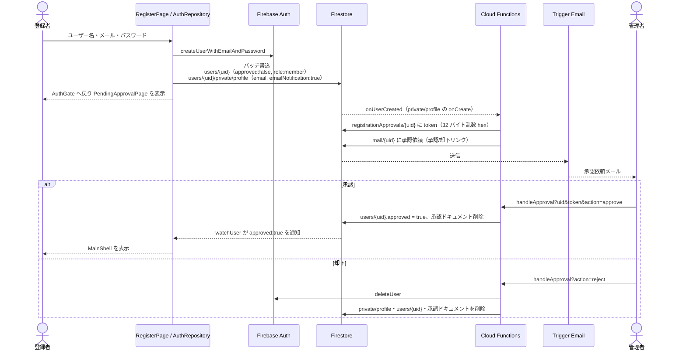

# 01. 認証・ユーザー登録承認

## 1. 概要

メールアドレスとパスワードで登録・ログインする。新規登録したユーザーは未承認状態で作成され、管理者がメールのリンクから承認すると自動でアプリ本体に入れる。却下するとアカウントごと削除される。

| 項目 | 内容 |
|---|---|
| 関連要件 | FR_01（トップページ）/ FR_08（ユーザー登録）/ PS_09（ロール管理）/ NFR_01 |
| 画面 | `AuthGate`, `LoginPage`, `RegisterPage`, `PendingApprovalPage` |
| データ層 | `AuthRepository`, `UserRepository` |
| Functions | `onUserCreated`, `handleApproval` |

## 2. 画面・コンポーネント構成

| 画面 / 部品 | ファイル | 役割 |
|---|---|---|
| AuthGate | `lib/ui/auth/auth_gate.dart` | 認証状態と承認状態を購読し、ルート画面を切り替える |
| LoginPage | `lib/ui/auth/login_page.dart` | メール・パスワード入力。新規登録画面への導線 |
| RegisterPage | `lib/ui/auth/register_page.dart` | ユーザー名・メール・パスワード入力 |
| PendingApprovalPage | `lib/ui/auth/pending_approval_page.dart` | 承認待ちの案内とログアウト |

### AuthGate の切り替え条件

| Auth 状態 | `users/{uid}` | 表示画面 |
|---|---|---|
| 確認中 | — | ローディング |
| 未ログイン | — | LoginPage |
| ログイン済み | 存在しない / `approved == false` | PendingApprovalPage |
| ログイン済み | `approved == true` | MainShell |

`authStateChanges` と `UserRepository.watchUser(uid)` の 2 つのストリームを入れ子で購読する。承認されると `approved` の変化を検知し、再ログインなしで MainShell に切り替わる。

## 3. 処理フロー

### 3.1 新規登録から承認まで

- `onUserCreated` は公開ドキュメントではなく `private/profile` の作成をトリガーにする。両者は同じバッチで作るため、発火時点で公開ドキュメントも存在する。
- 既に `approved == true` のユーザー（管理者が直接作成した等）にはメールを送らない。
- 承認リンクの URL は 1st gen 関数の固定形式 `https://asia-northeast2-<project>.cloudfunctions.net/handleApproval` である。
- 管理者のメールアドレスは環境変数 `ADMIN_EMAIL` で上書きできる。

### 3.2 ログイン・ログアウト

1. `LoginPage` がフォームを検証し、`AuthRepository.signIn` を呼ぶ。
2. 成功時の画面遷移は AuthGate が行う（ログイン画面は遷移処理を持たない）。
3. ログアウトは `AuthRepository.signOut`。プロフィール画面からは `popUntil(isFirst)` で AuthGate まで戻す。

## 4. データ設計

| パス | フィールド | 型 | 既定値 / 備考 |
|---|---|---|---|
| `users/{uid}` | id | string | uid |
| | username | string | 登録時入力 |
| | bio | string | `''` |
| | profileImageUrl | string? | null |
| | role | string | `'member'`（管理者は `'admin'`） |
| | approved | bool | `false` |
| | createdAt | Timestamp | 登録時刻 |
| `users/{uid}/private/profile` | email | string | 登録メール |
| | emailNotification | bool | `true` |
| `registrationApprovals/{uid}` | token, email, username, createdAt | — | Functions のみが読み書きする |
| `mail/{uid}` | to, message.subject, message.html | — | Trigger Email 拡張が送信する |

メールアドレスを公開プロフィールに置かないのは、`users/{uid}` が投稿者名の表示のためログイン済みユーザー全員に公開されるからである。

## 5. 権限・セキュリティ

| 対象 | ルール |
|---|---|
| `users/{uid}` 読取 | ログイン済みなら誰でも可 |
| `users/{uid}` 作成 | 本人のみ。`approved == false` かつ `role == 'member'` を強制 |
| `users/{uid}` 更新 | 本人は `approved` / `role` を変更しない更新のみ。管理者は全て可 |
| `users/{uid}` 削除 | 管理者のみ |
| `users/{uid}/private/**` | 本人のみ読み書き可 |
| `registrationApprovals`, `mail` | クライアントからは一切不可 |
| `handleApproval` | uid と token の一致で認可。処理後に token を削除するため、リンクは 1 回限り有効 |

HTML メール本文に埋め込む値は `escapeHtml` でエスケープする。

## 6. 入力チェック・エラー処理

| 項目 | チェック | メッセージ |
|---|---|---|
| ユーザー名 | 空白除去後に必須 | ユーザー名を入力してください |
| メール | 必須・`^[\w.+-]+@[\w-]+\.[\w.-]+$` | メールアドレスの形式が正しくありません |
| パスワード | 必須・8 文字以上 | パスワードは8文字以上で入力してください |

`FirebaseAuthException` は `authErrorMessage` で日本語に変換する（例: `email-already-in-use` → このメールアドレスは既に登録されています、`too-many-requests` → 試行回数が多すぎます）。

| `handleApproval` の応答 | 条件 |
|---|---|
| 400 無効なリクエストです | uid・token が無い、または action が approve / reject 以外 |
| 403 リンクが無効か、既に処理済みです | 承認ドキュメントが無い、または token 不一致 |
| 200 承認しました / 却下しました | 正常 |

## 7. 既知の制約・課題

- メールドメインの制限はクライアント・ルールのどちらにも実装されていない。クローズド運用は管理者承認だけで担保している。
- パスワード再設定・メール確認の機能はない。
- 却下時、Storage 上のファイルや他コレクションのデータは削除しない（承認前は投稿できないため通常は存在しない）。
- `registrationApprovals` の token に有効期限はない。
