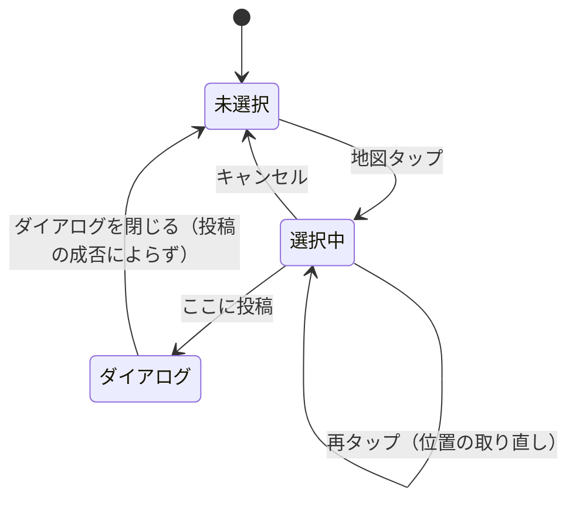
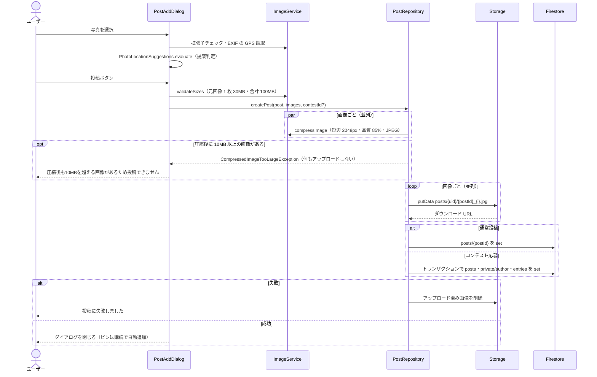

# 02. 地図・投稿作成

## 1. 概要

地図タブ（初期表示）に全投稿をピンで表示する。地図をタップして位置を選び、確認バーの「ここに投稿」から投稿ダイアログを開く。写真（最大 10 枚）・説明・場所名・タグを入力して投稿する。写真に撮影位置（EXIF の GPS）があれば、その位置への差し替えを提案する。

| 項目 | 内容 |
|---|---|
| 関連要件 | FR_03（地図ページ）/ FR_07（投稿ページ）/ PS_01（写真投稿）/ PS_03（タグ）/ PS_04（地図連携）/ NFR_02 |
| 画面 | `MapScreen`, `PostAddDialog`, `PostLocationConfirmBar`, `MapSearchBar` |
| ViewModel | `PostAddViewModel`（`lib/ui/post/post_add_view_model.dart`） |
| データ層 | `PostRepository`, `ContestRepository`, `ImageService`, `LocationService`, `GeocodingService` |
| 判定ロジック | `PhotoLocationSuggestions`（`lib/ui/post/photo_location_suggestion.dart`） |

## 2. 画面・コンポーネント構成

### 2.1 MapScreen（`lib/ui/map/map_screen.dart`）

| 要素 | 内容 |
|---|---|
| AppBar | 通知ベル・使い方・フィードバック・お知らせ・プロフィール |
| 地図 | `FlutterMap`。OSM タイル。初期中心 34.669478, 133.951104（岡山）、ズーム 14 |
| 投稿ピン | 赤い `location_on`（40px）。タップでサマリーダイアログ（[03](03_フィード・投稿詳細.md)） |
| 現在地 | 青丸（18px・白縁・影）。タップを透過し、その場所への投稿を妨げない |
| 選択マーカー | テーマ色の `add_location_alt`。最前面に描画し、タップは透過 |
| 検索バー | 画面上部に重ねる `MapSearchBar` |
| 確認バー | 位置選択中だけ `bottomSheet` に `PostLocationConfirmBar`（ここに投稿 / キャンセル） |
| FAB | 現在地へ移動。取得中はスピナーを表示し無効化 |

描画順は「タイル → 現在地 → 投稿ピン → 選択マーカー」である。

### 2.2 PostAddDialog（`lib/ui/post/post_add_dialog.dart`）

選択画像・撮影場所の提案・タグ・コンテスト応募・送信中フラグと、入力検証・送信は `PostAddViewModel` が持つ。ダイアログは描画と、画像選択（`ImagePicker`）・ページ送り・キーボード表示時のスクロール補正だけを扱い、ViewModel が流す通知（`notices`）を SnackBar で表示する。

| 入力 | 内容 |
|---|---|
| 写真 | 複数選択。プレビュー（PageView）・個別削除・サムネイルのドラッグ並び替え（2 枚以上のとき、1 枚目がサムネイル） |
| 撮影場所バナー | 提案中は「撮影場所に変更」「無視」、採用中はその旨を表示 |
| 説明 | 自由入力（caption） |
| 場所名 | 自由入力（任意） |
| タグ | `#タグ` を空白・カンマ・読点で区切って複数追加。重複は除外。チップで個別削除 |
| コンテスト | 「コンテストに応募する」スイッチ → 応募受付中のコンテストを選択（[07](07_コンテスト.md)） |
| 投稿ボタン | 写真 0 枚または送信中は無効 |

キーボード表示時は画像プレビューを縮め、フォーカス中の入力欄が見えるようスクロールを補正する（モバイルブラウザ対策・Issue #38）。並び替えのドラッグは、タッチ端末では長押し、マウス端末では即時に開始する。

## 3. 処理フロー

### 3.1 投稿位置の選択

場所検索で地図を移動しても、投稿位置の選択状態は変えない。

### 3.2 投稿作成

- 投稿 ID はクライアントで `DateTime.now().millisecondsSinceEpoch` の文字列を採番する。
- 投稿位置は「採用した撮影場所」があればそれ、なければタップ地点を使う。
- `likeCount` と `commentCount` は 0 で作成する。

### 3.3 撮影場所の提案（Issue #46）

`PhotoLocationSuggestions.evaluate` は、写真の並び順で最初の GPS 付き写真を候補にする。

| 判定 | 結果 |
|---|---|
| 採用中の場所に一致する写真が無くなった | タップ地点に戻す（SnackBar で通知） |
| GPS 付き写真が無い | 提案しない |
| 候補がタップ地点・無視した場所・採用中の場所から 50m 以内 | 提案しない（採用中なら採用状態を維持） |
| 上記以外 | 「n 枚目の撮影場所（約 350m / 約 1.2km 先）」として提案する |

EXIF は緯度・経度が 3 要素の有理数で、分・秒が 60 未満、範囲内で (0, 0) でない場合だけ有効とする。

### 3.4 現在地取得

`LocationService.getCurrentLocation` は次の順に確認する。失敗しても例外は投げず、理由を返す。

1. 位置情報サービスが有効か → 無効なら `serviceDisabled`
2. 権限を確認し、未許可なら要求する → `permissionDenied` / `permissionDeniedForever`
3. 高精度で取得する（15 秒でタイムアウト → `timeout`）

失敗時は理由ごとの文言を SnackBar に出す。永久拒否のときだけ「設定を開く」を添える。

### 3.5 場所検索（Issue #39）

- 入力確定（Enter・検索ボタン）時だけ Nominatim `/search` を呼ぶ。1 文字ごとの補完はしない（利用ポリシー対応）。
- パラメータ: `format=jsonv2`, `limit=5`, `accept-language=ja`, User-Agent `afterglow_app`。タイムアウトは 10 秒。
- 表示名が同じ候補は先頭の 1 件にまとめる。
- 候補を選ぶと地図をズーム 16 で移動する。

## 4. データ設計

`posts/{postId}`（通常投稿の作成時）

| フィールド | 型 | 値 |
|---|---|---|
| userId | string | 投稿者 UID（コンテスト応募時は `''`） |
| caption | string | 説明 |
| imageUrls | string[] | ダウンロード URL（並び順 = 表示順、先頭がサムネイル） |
| latitude / longitude | number | 投稿位置 |
| locationName | string? | 場所名（空なら null） |
| tags | string[] | タグ（`#` なし） |
| likeCount / commentCount | int | 0 |
| createdAt | Timestamp | 投稿時刻 |
| updatedAt | Timestamp? | 編集時のみ（[03](03_フィード・投稿詳細.md)） |
| contestId / stayAnonymous / voteCount | — | コンテスト応募時のみ（[07](07_コンテスト.md)） |

## 5. 権限・セキュリティ

| 対象 | ルール |
|---|---|
| `posts` 読取 | 承認済みユーザー |
| `posts` 作成（通常） | 承認済みかつ `userId == 自分` かつ `contestId` 無し |
| Storage `posts/{userId}/**` 書込 | 本人のみ・10MB 未満・`image/*` |

## 6. 入力チェック・エラー処理

| 項目 | チェック | メッセージ |
|---|---|---|
| 拡張子 | jpg / jpeg / png / bmp / heic | JPEG / PNG / BMP / HEIC 形式の画像のみ選択できます |
| 枚数 | 通常 10 枚、コンテストは `maxImages` まで。超過分は切り捨て | 画像は最大n枚までです |
| サイズ（元画像） | 1 枚 30MB 以下 | 1枚あたり30MBを超える画像は投稿できません |
| 合計サイズ（元画像） | 100MB 以下 | 画像の合計サイズが100MBを超えています |
| サイズ（圧縮後） | 1 枚 10MB 未満（アップロード前に全画像を検証し、1 枚でも超えたら何もアップロードしない） | 圧縮後も10MBを超える画像があるため投稿できません |
| ログイン | UID が取れること | ログインが必要です |
| 投稿失敗 | `createPost` が false | 投稿に失敗しました |

## 7. 既知の制約・課題

- 地図は `posts` コレクション全件を件数制限なしで購読し、全画像をプリロードする。投稿数の増加に比例して通信量とメモリが増える。
- 地図の初期中心は固定値で、起動時に現在地へは移動しない（FAB 押下時のみ）。
- 投稿 ID がミリ秒時刻のため、同一ミリ秒の同時投稿で衝突しうる。
- 説明（caption）は空でも投稿できる。
