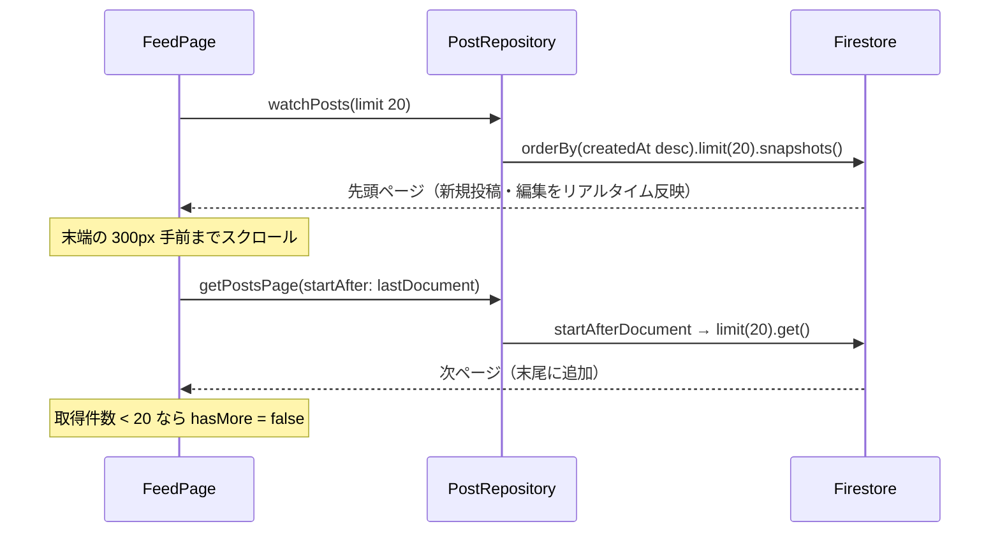
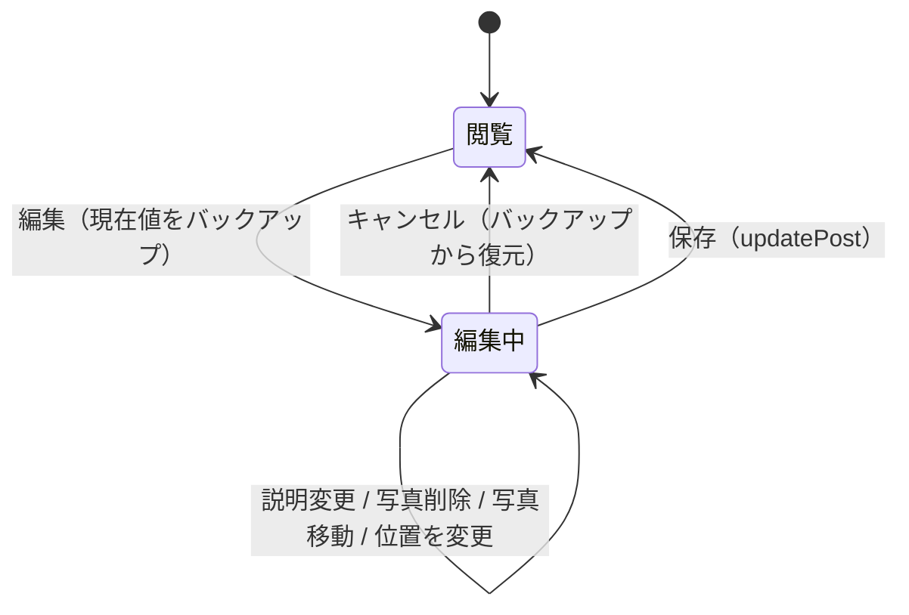

# 03. フィード・投稿詳細

## 1. 概要

フィードタブは全投稿を新しい順にカードで並べ、無限スクロールで続きを読み込む。投稿は 2 種類の表示で開く。地図のピンからは軽量なサマリーダイアログ、フィード・プロフィール・アルバム・コンテスト・通知からはフルページの詳細画面である。投稿者本人は詳細画面で説明文・写真・位置を編集し、投稿を削除できる。

| 項目 | 内容 |
|---|---|
| 関連要件 | FR_02（フィード）/ FR_04（投稿詳細）/ PS_08（投稿管理）/ NFR_02 |
| 画面 | `FeedPage`, `PostDetailPage`, `PostCardView`, `ImageViewerPage`, `LocationPickerPage` |
| 部品 | `PostCard`, `PostDetailView`, `ReactionBar`, `CommentSection`, `ContestEntryBadge` |
| ViewModel | `PostDetailViewModel`（`lib/ui/post/post_detail_view_model.dart`） |
| データ層 | `PostRepository`, `UserRepository`, `ContestRepository` |

## 2. 画面・コンポーネント構成

### 2.1 FeedPage / PostCard

| 要素 | 内容 |
|---|---|
| カード | 先頭画像のサムネイル・投稿者名・説明・タグ・コンテストバッジ・いいね（カード上でトグル可）・コメント数 |
| 投稿者名 | `users/{userId}` を購読。取得前は空欄（UID は表示しない） |
| コメント数 | `comments` サブコレクションの件数を購読。購読開始前は `commentCount` を表示 |
| タップ | `PostDetailPage` を開く |
| 状態表示 | 初回読込中 / 「まだ投稿がありません」/「投稿を読み込めませんでした」 |

### 2.2 表示モード（PostDetailView）

`PostDetailView` を共通の中身とし、表示モードで出し分ける。編集/削除の権限判定、編集中の画像一覧・並び順・位置、保存・削除の送信は `PostDetailViewModel` が持ち、`PostDetailView` は描画と画面遷移・SnackBar 表示を担う。

| 項目 | summary（地図ピン → ダイアログ） | full（詳細ページ） |
|---|---|---|
| 写真ギャラリー | ○（枠線あり） | ○（枠線なし） |
| 投稿者・説明・タグ | ○ | ○ |
| いいね・コメント | ○ | ○ |
| 場所名・地図ミニプレビュー | ×（地図上で開くため冗長） | ○ |
| 編集・削除 | × | ○（権限がある場合） |
| 「詳細を見る」 | ○ | — |
| レイアウト | 常に 1 カラム | 幅 900px 以上なら写真と情報の 2 カラム（最大幅 1400px） |
| 地図ミニプレビュー | — | 高さ 160px・ズーム 15・操作不可 |

### 2.3 ImageViewerPage（Issue #45）

写真を全画面に `BoxFit.contain` で表示する。ピンチとダブルタップで拡大でき、拡大中はスワイプによるページ送りを止めてドラッグを写真の移動に使う。複数枚は左右スワイプと矢印ボタンで送る。

## 3. 処理フロー

### 3.1 フィードのページング

- 表示リストは「先頭ページ + 追加取得分」で、先頭ページと ID が重なる投稿は除外する。
- `limit` は `startAfterDocument` の後に付ける（カーソル適用前に件数が切られる実装への対策）。

### 3.2 編集

| 編集項目 | 仕様 |
|---|---|
| 説明 | テキスト変更 |
| 写真の削除 | 表示中の写真を削除。最低 1 枚は残す。追加はできない（投稿時のみ） |
| 写真の移動 | 表示中の写真を任意の位置へ移動。先頭がサムネイルになる（Issue #80） |
| 位置 | `LocationPickerPage` で地図から選び直す（Issue #37）。変更したときだけ緯度経度を送る |

`PostRepository.updatePost` の処理:

1. `posts/{postId}` の caption・imageUrls・（変更時のみ）latitude/longitude・updatedAt を更新する。
2. 削除した写真を、ダウンロード URL から `refFromURL` で Storage から消す。失敗しても成功扱いにする。

### 3.3 削除

1. 確認ダイアログを出す。
2. `PostRepository.deletePost` が `posts/{postId}` を削除する。
3. `posts/{authorId}/{postId}_{0..n-1}.jpg` を Storage から削除する（失敗しても成功扱い）。
4. ダイアログなら閉じ、ページなら前画面へ戻る。一覧と地図は購読で自動更新される。

### 3.4 編集・削除の権限判定（UI）

| 投稿 | 判定 |
|---|---|
| 通常投稿 | `post.userId == ログイン中 UID`（同期判定） |
| コンテスト投稿 | （`getAuthorId` の実投稿者 == 自分 または 管理者）かつ 応募受付中 |

## 4. データ設計

参照のみ。投稿の構造は [02](02_地図・投稿作成.md) を参照。編集では `updatedAt` を追加する。

## 5. 権限・セキュリティ

| 操作 | ルール |
|---|---|
| 更新 | 承認済みかつ（投稿者本人 / 管理者 / いいね数のみの ±1 / 応募受付中のコンテスト投稿の実投稿者）。`userId`・`contestId`・`stayAnonymous`・`voteCount` は変更不可 |
| 削除 | 承認済みかつ（投稿者本人 / 管理者 / 応募受付中のコンテスト投稿の実投稿者） |

## 6. 入力チェック・エラー処理

| 状況 | メッセージ |
|---|---|
| 最後の 1 枚を削除しようとした | 写真は最低1枚必要です |
| 更新成功 / 失敗 | 投稿を更新しました / 更新に失敗しました |
| 削除失敗 | 削除に失敗しました |
| フィード取得失敗 | 投稿を読み込めませんでした：(エラー) |

## 7. 既知の制約・課題

- 削除時の Storage 削除はファイル名の連番（`_0`〜`_{n-1}`）で行う。編集で途中の写真を消したり並べ替えたりした投稿では、URL と連番が一致せず、残すべきでないファイルが Storage に残る。
- `posts.commentCount` は更新されないため、件数表示はサブコレクションを数えている。カードごとにコメントを全件購読するため、件数が多いと読取コストが増える。
- フィードの 2 ページ目以降はリアルタイム更新されない（先頭ページのみ購読）。
- 管理者はルール上いつでもコンテスト投稿を削除できるが、UI は応募受付中しか編集・削除ボタンを出さない。
