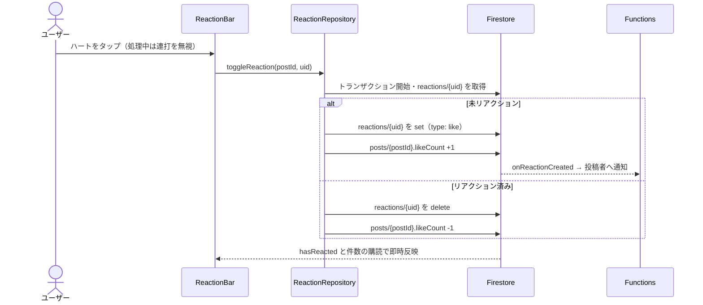

# 04. コメント・リアクション

## 1. 概要

投稿にテキストのコメントを付け、いいね（リアクション）を付け外しできる。コメントは本人が編集・削除できる。いいねは 1 ユーザー 1 投稿につき 1 件である。どちらも投稿者への通知を生む（[08](08_通知.md)）。

| 項目 | 内容 |
|---|---|
| 関連要件 | PS_05（コメント・リアクション） |
| 部品 | `CommentSection`, `ReactionBar` |
| データ層 | `CommentRepository`, `ReactionRepository` |
| Functions | `onCommentCreated`, `onReactionCreated` |

## 2. 画面・コンポーネント構成

| 部品 | 配置 | 内容 |
|---|---|---|
| CommentSection | 投稿詳細・サマリーのコメント欄 | 古い順のコメント一覧（アイコン・名前・本文・日時）と投稿フォーム。自分のコメントだけ編集・削除メニューを出す。名前タップでプロフィールへ |
| ReactionBar | 投稿詳細・サマリー（通常）、フィードのカード（compact） | ハートのトグルといいね数 |

## 3. 処理フロー

### 3.1 コメント

| 操作 | 処理 |
|---|---|
| 一覧 | `posts/{postId}/comments` を `createdAt` 昇順で購読 |
| 投稿 | 空文字・未ログインなら何もしない。`addComment` で作成（ID は自動採番） |
| 編集 | ダイアログで本文を変更 → `text` と `updatedAt` を更新 |
| 削除 | 確認ダイアログ → 削除 |
| 件数 | サブコレクションのドキュメント数を購読（`getCommentCount`） |

### 3.2 いいね

- 表示するいいね数は `reactions` サブコレクションの実数。購読開始前だけ `likeCount` を表示してちらつきを防ぐ。
- トランザクションでは `likeCount` 以外のフィールドを更新してはならない（他人の投稿へのいいねがルールで拒否されるため・Issue #62）。

## 4. データ設計

| パス | フィールド | 型 | 備考 |
|---|---|---|---|
| `posts/{postId}/comments/{commentId}` | postId | string | 親投稿 |
| | userId | string | コメント投稿者 |
| | text | string | 本文（テキストのみ） |
| | createdAt | Timestamp | |
| | updatedAt | Timestamp? | 編集時のみ |
| `posts/{postId}/reactions/{userId}` | userId | string | ドキュメント ID と同じ |
| | type | string | `'like'` のみ |
| | createdAt | Timestamp | |

## 5. 権限・セキュリティ

| 対象 | ルール |
|---|---|
| comments 読取 | 承認済みユーザー |
| comments 作成 | 承認済みかつ `userId == 自分` |
| comments 更新・削除 | 承認済みかつ（本人 / 管理者） |
| reactions 読取 | 承認済みユーザー |
| reactions 書込 | 承認済みかつドキュメント ID == 自分 |
| posts.likeCount | 他人の投稿でも `likeCount` 単独の ±1 更新だけ許可 |

コンテスト投稿のコメント主は匿名化しない（ADR 0002 §6）。

## 6. 入力チェック・エラー処理

| 状況 | メッセージ |
|---|---|
| コメント送信・更新・削除の失敗 | コメントの送信に失敗しました / コメントの更新に失敗しました / コメントの削除に失敗しました |
| いいね失敗 | いいねに失敗しました |

## 7. 既知の制約・課題

- コメントに文字数の上限はない。
- `likeCount` は ±1 の更新を他人にも許すため、正確な値は保証されない。表示は実数を使うため画面上の影響はない。
- 投稿を削除しても `comments` / `reactions` サブコレクションは残る（Firestore はサブコレクションを連鎖削除しない）。
