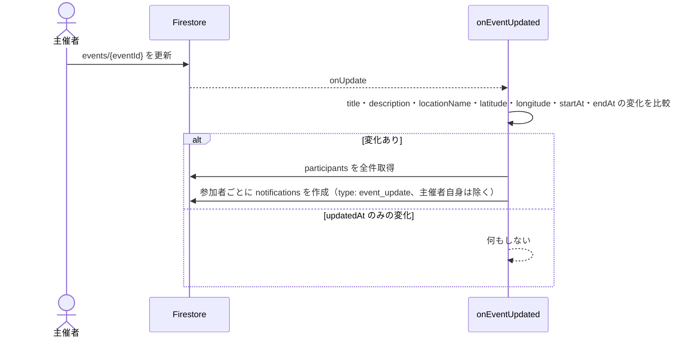

# 06. イベント

## 1. 概要

撮影会などのイベントを作成し、承認済みユーザーが参加表明する。主催者がイベント内容を変更すると、参加表明者に通知が届く（[08](08_通知.md)）。

| 項目 | 内容 |
|---|---|
| 関連要件 | FR_05（イベントページ）/ PS_06（イベント参加管理） |
| 画面 | `EventPage`, `EventDetailPage` |
| 部品 | `EventEditDialog`, `EventScheduleText` |
| データ層 | `EventRepository`, `UserRepository` |
| Functions | `onEventUpdated` |

## 2. 画面・コンポーネント構成

| 画面 / 部品 | 内容 |
|---|---|
| EventPage（Event タブ） | 全イベントを開催日時の昇順で表示。各行は日時・タイトル・主催者名・集合場所。FAB で作成 |
| EventDetailPage | タイトル・日時・主催者・集合場所（地図ミニプレビュー、操作不可）・説明・参加ボタン・参加者一覧。主催者には編集ボタン |
| 参加ボタン | 未参加なら参加コメント（任意）を尋ねてから参加。参加済みなら確認のうえ取消 |
| 参加者一覧 | 参加表明順にアイコン・名前・参加コメント。タップでプロフィール |
| EventEditDialog | イベント名（必須）・説明・集合場所名・開始日時・終了日時（任意）・地図での集合場所指定 |
| EventScheduleText | `2026/07/20 13:00 〜 17:00`。日をまたぐときは終了側も日付から表示 |

## 3. 処理フロー

| 操作 | サービス呼び出し | 備考 |
|---|---|---|
| 一覧 | `getEvents()` | `startAt` 昇順で購読 |
| 作成 | `createEvent(event)` | 開始日時の初期値は翌日 10:00。`organizerId` = 自分 |
| 更新 | `updateEvent(event)` | `organizerId` と `createdAt` は書き換えない。`updatedAt` を現在時刻に更新 |
| 参加・取消 | `toggleParticipation(eventId, uid, comment)` | ドキュメントがあれば削除、なければ作成。未入力コメントは null で保存 |
| 参加状態 | `watchIsParticipating` | ボタン表示に使う |
| 参加者 | `getParticipants` | `joinedAt` 昇順 |

### 更新通知

## 4. データ設計

| パス | フィールド | 型 | 備考 |
|---|---|---|---|
| `events/{eventId}` | organizerId | string | 主催者 UID |
| | title | string | 必須 |
| | description | string | `''` |
| | locationName | string | `''` |
| | latitude / longitude | number? | 地図で指定したときのみ。両方ある場合だけミニプレビューを表示 |
| | startAt | Timestamp | 欠損時は createdAt |
| | endAt | Timestamp? | 任意 |
| | createdAt / updatedAt | Timestamp | updatedAt 欠損時は createdAt |
| `events/{eventId}/participants/{userId}` | userId | string | ドキュメント ID と同じ |
| | comment | string? | 参加コメント |
| | joinedAt | Timestamp | |

参加状態はドキュメントの有無で表す。

## 5. 権限・セキュリティ

| 対象 | ルール |
|---|---|
| events 読取 | 承認済みユーザー |
| events 作成 | 承認済みかつ `organizerId == 自分` |
| events 更新・削除 | 承認済みかつ（主催者 / 管理者） |
| participants 読取 | 承認済みユーザー |
| participants 書込 | 承認済みかつドキュメント ID == 自分 |

## 6. 入力チェック・エラー処理

| 状況 | 動作 / メッセージ |
|---|---|
| イベント名未入力 | イベント名を入力してください |
| 終了日時 ≦ 開始日時 | 終了日時は開始日時より後にしてください |
| 開始日時を終了日時以降に変更 | 終了日時を取り消す |
| 保存失敗 | イベントの作成に失敗しました / イベントの更新に失敗しました |

## 7. 既知の制約・課題

- イベント削除の UI はない（ルール上は主催者・管理者が削除できる）。
- 過去のイベントも一覧に残り、開催日時の昇順で先頭に並ぶ。
- 参加の定員・締切はない。
- 参加表明の取消は主催者に通知しない。
