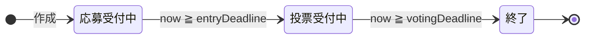
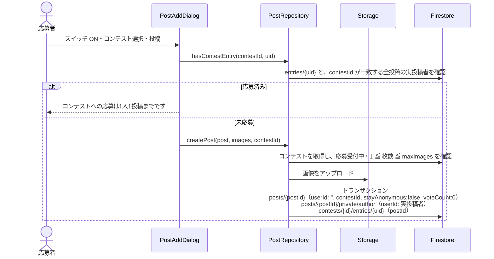
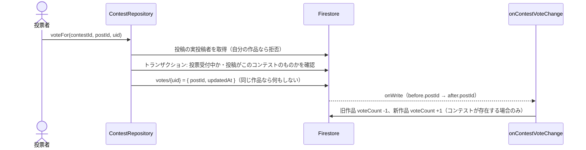

# 07. コンテスト

## 1. 概要

承認済みユーザーなら誰でも写真コンテストを開ける。応募は通常の投稿作成ダイアログから行い、応募作品は通常投稿として `posts` に保存されてフィード・地図にも表示される。応募期間中は投稿者名を伏せ（匿名）、投票期間に 1 人 1 票で投票し、投票締切後に投稿者名を公開する。

| 項目 | 内容 |
|---|---|
| 関連 | Issue #69 / #89 / #90、[ADR 0002](../adr/0002-contest-feature-design.md) |
| 画面 | `ContestListPage`, `ContestDetailPage`, `PostAddDialog`（応募欄） |
| 部品 | `ContestEditDialog`, `ContestEntryBadge` |
| データ層 | `ContestRepository`, `PostRepository` |
| Functions | `onContestVoteChange`, `revealContestAuthors`, `onContestDeleted` |

## 2. フェーズ

フェーズは保存せず、締切日時と現在時刻から都度算出する（`Contest.phaseAt`。ルールも同じ境界で判定）。

| フェーズ | 条件 | 応募 | 応募作品の編集・削除 | 投票 | 投稿者名 |
|---|---|---|---|---|---|
| 応募受付中 | now < entryDeadline | 可 | 本人・管理者 | 不可 | 匿名 |
| 投票受付中 | entryDeadline ≦ now < votingDeadline | 不可 | 管理者の削除のみ（ルール上） | 可（変更可） | 匿名 |
| 終了 | votingDeadline ≦ now | 不可 | 管理者の削除のみ（ルール上） | 不可 | 公開（最大 30 分遅れ） |

## 3. 画面・コンポーネント構成

| 画面 / 部品 | 内容 |
|---|---|
| ContestListPage（Contest タブ） | 全コンテストを応募締切の昇順で表示。各行はタイトル・フェーズ・応募締切。FAB で作成 |
| ContestDetailPage | タイトル・「応募は1人1投稿まで・写真は最大n枚」・フェーズ・説明・応募締切・投票締切・応募作品一覧。作成者と管理者には編集・削除 |
| 応募作品一覧 | `PostCard` を新しい順に並べる。投票受付中は各作品の下に「この投稿に投票」/「投票済み」ボタン |
| ContestEditDialog | コンテスト名（必須）・説明・写真枚数上限（1〜10 枚）・応募締切・投票締切 |
| PostAddDialog の応募欄 | 「コンテストに応募する」スイッチ → 応募受付中のコンテストをドロップダウンで選択。選択時は「コンテスト終了後に投稿者名が公開されます」を表示 |
| ContestEntryBadge | カード・詳細に「{タイトル}参加中・n票」、終了後は「{タイトル}応募作品・n票」。表示中に投票締切を迎えたらタイマーで再描画する |
| 匿名表示 | `userId` が空の投稿は投稿者名を「匿名」と表示する |

## 4. 処理フロー

### 4.1 応募

- 送信を始めた時点の選択コンテストを保持する。送信中に一覧が更新されて選択が消えても、通常投稿には切り替えない。
- トランザクション内で応募条件を再確認する。前回の応募投稿が既に削除済みなら再応募できる。

### 4.2 投票

票は 1 コンテストにつき 1 人 1 票で、別の作品に投票すると票が移る。`voteCount` はクライアントから書けず、Functions だけが更新する。

### 4.3 匿名解除（`revealContestAuthors`・30 分ごと・Asia/Tokyo）

1. 移行処理: `entryLimitVersion != 1` の旧コンテストについて、既存の応募投稿から `entries/{uid}` を作る。全件の投稿者を復元できたら `entryLimitVersion: 1` にする。移行が終わるまで、ルールが新規応募を止める。
2. `votingDeadline <= 現在` のコンテストの、`userId == ''` の投稿を取得する。
3. `private/author.userId` を `posts.userId` に書き戻し、`stayAnonymous: false` にする（450 件ごとにバッチ commit）。

`userId` が空の投稿だけを対象にするため、再実行しても重複更新しない。

### 4.4 コンテスト削除（`onContestDeleted`）

1. 作成者または管理者が削除する（確認文: 応募投稿と写真は通常投稿として残り、投稿者名が公開されます）。
2. 各応募投稿について、`userId` に実投稿者を復元し、`contestId`・`stayAnonymous`・`voteCount` を削除する。
3. `votes` と `entries` サブコレクションを再帰削除する。

投稿者を復元できない投稿があると例外を投げ、`failurePolicy: true` で再試行する。

## 5. データ設計

| パス | フィールド | 型 | 備考 |
|---|---|---|---|
| `contests/{contestId}` | creatorId | string | 作成者 UID |
| | title / description | string | |
| | entryDeadline | Timestamp | 新規作成時の初期値は 7 日後の 23:59 |
| | votingDeadline | Timestamp | entryDeadline より後 |
| | maxImages | int | 1〜10。既定 1 |
| | entryLimitVersion | int | 1（応募数制限の仕組みに対応済みの印） |
| | createdAt / updatedAt | Timestamp | |
| `contests/{id}/entries/{uid}` | postId | string | 応募者と応募投稿の対応 |
| `contests/{id}/votes/{uid}` | postId, updatedAt | — | 投票先 |
| `posts/{postId}`（応募作品） | userId | string | 匿名期間は `''`、解除後は実投稿者 |
| | contestId | string | 応募先 |
| | stayAnonymous | bool | 常に false |
| | voteCount | int | 得票数（Functions が更新） |
| `posts/{postId}/private/author` | userId | string | 実投稿者 |

## 6. 権限・セキュリティ

| 対象 | ルール |
|---|---|
| contests 読取 | 承認済みユーザー |
| contests 作成 | 承認済みかつ `creatorId == 自分`・maxImages は 1〜10 の整数・`entryLimitVersion == 1` |
| contests 更新 | 承認済みかつ（作成者 / 管理者）。`creatorId`・`entryLimitVersion` は変更不可 |
| contests 削除 | 承認済みかつ（作成者 / 管理者） |
| entries 読取 | 本人 / 管理者 |
| entries 作成・更新 | 本人・応募受付中・`postId` のみ・既存応募が無いか元投稿が削除済み・同一コミットで投稿と `private/author` を作る場合のみ。削除は不可 |
| votes 読取 | 本人 / 管理者（誰が誰に投票したかは非公開） |
| votes 作成・更新 | 本人・投票受付中・同コンテストの投稿・自分の作品でない |
| votes 削除 | 本人・投票受付中 |
| posts 作成（応募） | `userId == ''`・`voteCount == 0`・`stayAnonymous == false`・応募受付中・枚数が範囲内・同一コミットで `private/author` と `entries` を作る |
| posts/{id}/private/author | 読取: 本人 / 管理者。作成: 応募時のみ。更新・削除: 不可 |
| posts 更新（応募作品） | `imageUrls` を変えるなら枚数を再検証。実投稿者による編集は応募受付中のみ |

## 7. 入力チェック・エラー処理

| 状況 | メッセージ |
|---|---|
| コンテスト名未入力 | コンテスト名を入力してください |
| 投票締切 ≦ 応募締切 | 投票締切は応募締切より後にしてください（応募締切を後ろにずらした場合は投票締切を +7 日に自動補正） |
| 応募先未選択 | 応募するコンテストを選択してください |
| 応募済み | コンテストへの応募は1人1投稿までです |
| 応募状況の確認失敗 | 応募状況を確認できませんでした |
| 募集中のコンテストが無い | 募集中のコンテストがありません |
| 自分の作品へ投票 | 自分の投稿には投票できません。 |
| 期間外の投票 | 投票期間外です。 |
| 削除失敗 | コンテストの削除に失敗しました |

## 8. 既知の制約・課題

- **匿名期間中も画像 URL から投稿者が分かる。** 応募画像も `posts/{実投稿者UID}/...` に保存されるため、`imageUrls` のパスに UID が含まれる。
- ADR 0002 の「匿名のまま」（`stayAnonymous: true`）は現在選べない。全応募作品が終了後に公開される。
- フェーズの UI 判定は端末の時計を使う。端末時刻がずれていると、ボタンの表示とルールの判定が食い違う。
- 匿名解除はスケジュール実行のため、投票締切から最大 30 分ほど匿名のまま残る。
- `hasContestEntry` は、そのコンテストの全応募投稿について実投稿者を 1 件ずつ取得する。応募数に比例して読取が増える。
- ADR 0002 は投票集計をクライアントのトランザクションで行う案だったが、実装は Functions（`onContestVoteChange`）で集計する。
- 投票の取消 UI はない（ルール上は投票期間中に取消できる）。
- 応募作品一覧は新しい順で、得票順の並びや結果発表の表示はない。
