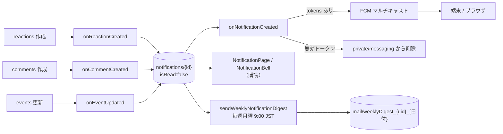

# 08. 通知

## 1. 概要

いいね・コメント・参加イベントの更新が起きると、Cloud Functions が受信者宛ての通知を作る。通知は 3 経路で届く。アプリ内の通知一覧（ベルのバッジ付き）、端末へのプッシュ通知（FCM）、週 1 回のまとめメールである。

| 項目 | 内容 |
|---|---|
| 関連要件 | PS_07（通知機能） |
| 画面 | `NotificationPage` |
| 部品 | `NotificationBell` |
| データ層 | `NotificationRepository`, `PushNotificationService` |
| Functions | `onReactionCreated`, `onCommentCreated`, `onEventUpdated`, `onNotificationCreated`, `sendWeeklyNotificationDigest` |

## 2. 通知の発生条件

| 種別（type） | 発生トリガー | 受信者 | actorId | sourceId | 文面 |
|---|---|---|---|---|---|
| reaction | `posts/{id}/reactions/{uid}` 作成 | 投稿者 | いいねした人 | postId | {名前}さんがあなたの投稿にいいねしました |
| comment | `posts/{id}/comments/{id}` 作成 | 投稿者 | コメントした人 | postId | {名前}さんがあなたの投稿にコメントしました |
| event_update | `events/{id}` の内容項目の更新 | 全参加表明者 | 主催者 | eventId | 参加予定のイベントが更新されました |

- 受信者と actor が同じとき（自分の投稿への自分のいいね等）は作らない。
- 匿名期間中のコンテスト作品は `private/author` から実投稿者を解決して通知する。
- いいねの取消・コメントの編集や削除では通知しない。

## 3. 全体フロー

## 4. 画面・コンポーネント構成

| 部品 | 内容 |
|---|---|
| NotificationBell | Map タブの AppBar。未読件数をバッジで表示し、タップで通知一覧 |
| NotificationPage 上部 | プッシュ通知（「有効にする」ボタン / 有効なら緑のチェック）と週次メール通知のスイッチ |
| 一覧 | 自分宛てを新しい順に最大 50 件。未読は背景色・太字・ドット。種別ごとにアイコン（ハート / 吹き出し / カレンダー） |
| タップ | 既読にしてから、投稿詳細またはイベント詳細を開く。投稿が削除済みなら「対象の投稿は削除されています」 |
| AppBar | すべて既読にする |

## 5. 処理フロー

### 5.1 プッシュ通知の登録

| タイミング | 処理 |
|---|---|
| MainShell 起動時 | 許可済みならトークンを取得・保存し、トークン更新も保存する（許可ダイアログは出さない） |
| 「有効にする」押下 | ブラウザ・OS の許可を求め、許可されたらトークンを保存する（ユーザー操作を起点にする） |
| フォアグラウンド受信 | SnackBar に本文と「見る」（通知一覧へ） |
| 通知タップで起動（モバイル） | 通知一覧を開く |
| バックグラウンド受信 | Web は `web/firebase-messaging-sw.js`、モバイルは OS が表示する |

Web では `--dart-define=FCM_VAPID_KEY=...` が無いとプッシュ通知を無効として扱い、設定欄を出さない。アプリ内通知は引き続き動く。

### 5.2 プッシュ送信（`onNotificationCreated`）

1. 受信者の `private/messaging.tokens` を読む。空なら終了する。
2. タイトル「Afterglow」、本文は種別ごとの文面で `sendEachForMulticast` する。Web はクリックでアプリ URL を開き、アイコンを付ける。
3. `registration-token-not-registered` / `invalid-registration-token` のトークンを配列から削除する。

### 5.3 週次メール（`sendWeeklyNotificationDigest`）

1. 承認済みユーザーを全件取得する。
2. `emailNotification == false` またはメール未登録のユーザーは飛ばす。
3. 未読通知のうち直近 7 日分を新しい順に並べる。0 件なら送らない。
4. 最大 20 件を本文に並べ、残りは「ほか n 件」とする。
5. `mail/weeklyDigest_{uid}_{YYYY-MM-DD}` を `create` する。同じ日に再実行されても既存ドキュメントで失敗し、二重送信しない。

## 6. データ設計

| パス | フィールド | 型 | 備考 |
|---|---|---|---|
| `notifications/{id}` | recipientId | string | 受信者 |
| | actorId | string | 操作した人 |
| | type | string | reaction / comment / event_update |
| | sourceId | string | postId または eventId |
| | isRead | bool | false で作成 |
| | createdAt | Timestamp | サーバー時刻 |
| `users/{uid}/private/messaging` | tokens | string[] | FCM トークン（arrayUnion で追加） |
| | updatedAt | Timestamp | サーバー時刻 |
| `users/{uid}/private/profile` | emailNotification | bool | 未設定は true 扱い |

インデックス: `notifications(recipientId ASC, createdAt DESC)`。

## 7. 権限・セキュリティ

| 対象 | ルール |
|---|---|
| notifications 読取 | 承認済みかつ受信者本人 |
| notifications 更新 | 受信者本人が `isRead` を true にする更新のみ |
| notifications 作成・削除 | クライアント不可（Functions のみ） |
| private/messaging, private/profile | 本人のみ |

トークンは送信先を特定できる情報のため、本人だけが読める非公開ドキュメントに置く。

## 8. 既知の制約・課題

- 通知は削除されず、`notifications` は増え続ける。一覧は最新 50 件しか表示しない。
- ログアウトしてもその端末のトークンを削除しないため、同じ端末に過去のユーザー宛てのプッシュが届きうる。
- 未読バッジの件数は未読通知を全件購読して数える。
- 週次メールは承認済みユーザー全員を毎回走査する。
- 通知の文面はクライアント（`NotificationPage`）と Functions（`notificationMessage`）に二重に定義されている。
