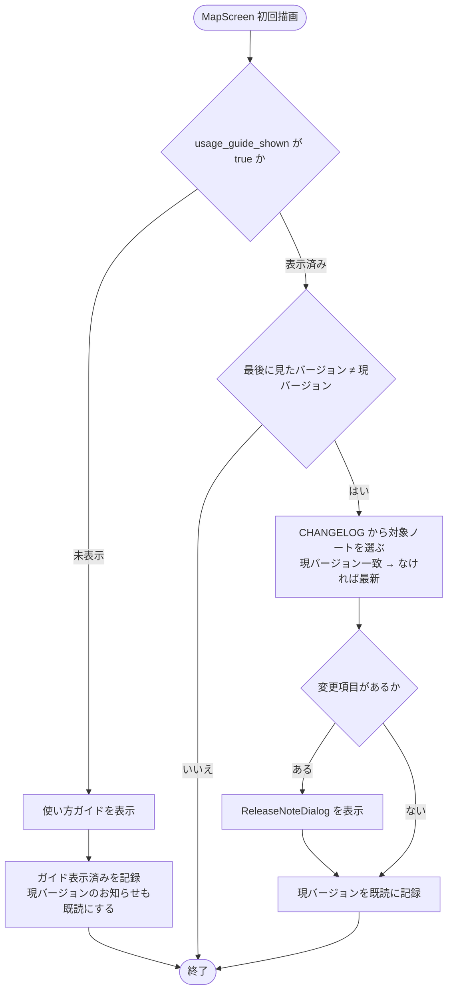

# 10. お知らせ・使い方ガイド・フィードバック

## 1. 概要

アプリの案内機能をまとめる。初回起動時の使い方ガイド、アップデート後の初回起動時に出す更新内容のお知らせ（リリースノート）、外部フォームへのフィードバック導線の 3 つである。いずれも Map タブの AppBar から開け、サーバーのデータは使わない。

| 項目 | 内容 |
|---|---|
| 関連 | Issue #47（使い方ガイド）ほか |
| 画面 | `UsageGuidePage`, `ReleaseNotesPage` |
| 部品 | `UsageGuideDialog`, `UsageGuideView`, `ReleaseNoteDialog`, `ReleaseNoteView` |
| データ層 | `UsageGuideRepository`, `ReleaseNoteRepository` |
| モデル | `ReleaseNote`, `ReleaseNoteSection` |

## 2. 画面・コンポーネント構成

| 部品 | 内容 |
|---|---|
| UsageGuideDialog | 初回起動時に 1 回だけ出すガイド |
| UsageGuidePage | AppBar の「?」から開く。ダイアログと同じ内容（`UsageGuideView`） |
| ReleaseNoteDialog | 1 バージョン分の変更内容（What's New） |
| ReleaseNotesPage | AppBar の「お知らせ」から開く。全バージョンを新しい順に表示 |
| ReleaseNoteView | カテゴリーを日本語にして表示（Added → 新機能、Changed → 変更、Deprecated → 非推奨、Removed → 削除、Fixed → 修正、Security → セキュリティ） |
| フィードバック | 確認ダイアログ → Google フォーム（`https://forms.gle/5xaCtzyDeqFVBF9D7`）を外部ブラウザで開く |

## 3. 処理フロー

### 3.1 起動時の案内（MapScreen の初回描画後）

新規ユーザーには過去の変更履歴が不要なため、ガイドを出した回はお知らせを出さず既読にする。どちらも失敗してもアプリの利用を妨げないよう、例外は握りつぶす。

### 3.2 CHANGELOG の解析

アセットとして同梱した `CHANGELOG.md`（Keep a Changelog 形式）を `ReleaseNote.parseChangelog` で解析する。

| 行 | 解釈 |
|---|---|
| `## [1.0.0+1] - 2026-06-26` | バージョンと日付。`[Unreleased]` は対象外 |
| `### Added` 等 | カテゴリー |
| `- ` / `* ` で始まる行 | 変更項目 |

項目が 1 つも無いカテゴリーは捨てる。現バージョンは `package_info_plus` の `version+buildNumber` で、CHANGELOG の見出しと同じ形式にする。

## 4. データ設計（端末ローカル）

| キー（shared_preferences） | 型 | 内容 |
|---|---|---|
| `usage_guide_shown` | bool | 使い方ガイドを自動表示済みか |
| `release_note_last_seen_version` | string | 最後にお知らせを表示したバージョン |

## 5. 権限・セキュリティ

サーバーへのアクセスは無い。フィードバックは外部サイトへ移ることを確認してから開く。

## 6. エラー処理

| 状況 | 動作 |
|---|---|
| 起動時の案内の読込失敗 | 何も出さない |
| お知らせ一覧の読込失敗 / 0 件 | お知らせを読み込めませんでした / お知らせはまだありません |
| フォームを開けない | フォームを開けませんでした |

## 7. 既知の制約・課題

- 記録は端末（ブラウザ）ごとのため、端末を変えるとガイドとお知らせが再表示される。
- お知らせはリリース時に `CHANGELOG.md` へ見出しを確定させないと表示されない（`[Unreleased]` は対象外）。
