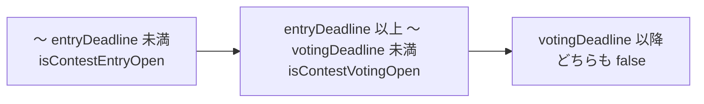
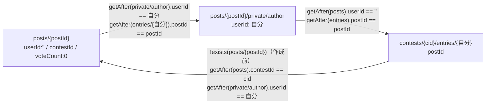

# firestore.rules

| 項目 | 内容 |
|---|---|
| ファイル | `firestore.rules` |
| 基本設計 | [00 システム概要・共通設計](../../00_システム概要.md) の 5 章（データモデル）・6 章（権限モデル） |
| 関連する基本設計 | [01 認証・ユーザー登録承認](../../01_認証・ユーザー登録承認.md) 5 章、[02 地図・投稿作成](../../02_地図・投稿作成.md)、[03 フィード・投稿詳細](../../03_フィード・投稿詳細.md)、[04 コメント・リアクション](../../04_コメント・リアクション.md)、[05 アルバム](../../05_アルバム.md)、[06 イベント](../../06_イベント.md)、[07 コンテスト](../../07_コンテスト.md) 6 章、[08 通知](../../08_通知.md) 7 章 |
| レイヤ | Rules |
| 主な依存先 | なし（`rules_version = '2'`。`users/{uid}`・`contests/{id}`・`posts/{id}` 等を `get` / `exists` / `getAfter` で参照） |
| 主な利用元 | Cloud Firestore（全クライアントアクセスを評価）。デプロイは `firebase.json` の `firestore.rules` と `.github/workflows/firestore-rules.yml`（`main` への push で `--only firestore:rules,storage`） |
| テスト | `test/rules/users.test.mjs`, `test/rules/posts.test.mjs`, `test/rules/notifications.test.mjs`（Firestore エミュレータ上で評価。`npm --prefix test/rules test`） |

## 1. 責務

クライアント（Firebase SDK）からの Firestore アクセスを認可する。

- ログイン済み・承認済み（`users/{uid}.approved == true`）・管理者（`role == 'admin'`）の 3 段階で読み書きを制御する。
- 更新・削除は所有者フィールド（`userId` / `ownerId` / `organizerId` / `creatorId`）の一致か管理者に限る。
- 本人が `approved` / `role` を書き換える権限昇格を防ぐ。
- コンテストの匿名応募（`userId == ''` + `private/author`）、1 人 1 応募（`entries`）、投票期間・自作品への投票禁止を強制する。
- Functions 専用のデータ（`notifications` 作成、`registrationApprovals`、`mail`、`voteCount`）へのクライアント書き込みを禁止する。Cloud Functions は Admin SDK のためルールの対象外。

## 2. 構成要素（クラス・関数・定数の一覧）

### トップレベルのヘルパー関数（`match /databases/{database}/documents` 直下）

| 関数 | 定義 | 用途 |
|---|---|---|
| `isSignedIn()` | `request.auth != null` | ログイン済み |
| `userDoc(uid)` | `get(/users/$(uid)).data` | ユーザードキュメントの取得 |
| `isApproved()` | `isSignedIn() && exists(/users/$(request.auth.uid)) && userDoc(request.auth.uid).approved == true` | 承認済み |
| `isAdmin()` | `isSignedIn() && exists(/users/$(request.auth.uid)) && userDoc(request.auth.uid).role == 'admin'` | 管理者（承認状態は見ない） |
| `contestPath(contestId)` | `/contests/$(contestId)` | パス生成 |
| `contestEntryPath(contestId, uid)` | `/contests/$(contestId)/entries/$(uid)` | パス生成 |
| `validContestImages(data)` | `data.imageUrls is list && size() >= 1 && size() <= get(contestPath(data.contestId)).data.get('maxImages', 1)` | 応募作品の写真枚数 |
| `postPath(postId)` | `/posts/$(postId)` | パス生成 |
| `postAuthorPath(postId)` | `/posts/$(postId)/private/author` | パス生成 |
| `isContestEntryOpen(contestId)` | `exists(contest) && request.time < contest.entryDeadline` | 応募受付中 |
| `isContestVotingOpen(contestId)` | `exists(contest) && contest.entryDeadline <= request.time && request.time < contest.votingDeadline` | 投票受付中 |
| `isContestPost(postData)` | `postData.get('contestId', null) is string` | コンテスト投稿か |
| `isPostAuthor(postId, uid)` | `exists(post) && (post.userId == uid \|\| (post.userId == '' && exists(author) && author.userId == uid))`（`userId` は `get('userId', '')`） | 実投稿者か（匿名期間も含む） |

（表中のパスは `/databases/$(database)/documents` を省略）

### `match` 内のローカル関数

| 場所 | 関数 | 定義 |
|---|---|---|
| `posts/{postId}` | `isLikeCountOnlyUpdate()` | 変更キーが `likeCount` のみ、かつ新値が `resource.data.get('likeCount', 0)` の ±1 |
| `posts/{postId}` | `isContestAuthorEditing()` | `isContestPost(resource.data) && exists(private/author) && author.userId == request.auth.uid && isContestEntryOpen(resource.data.contestId)` |
| `contests/{contestId}` | `validImageLimit()` | `let limit = request.resource.data.get('maxImages', 1); limit is int && 1 <= limit <= 10` |

### `match` ブロック

`users/{userId}`（+ `private/{document=**}`）、`posts/{postId}`（+ `private/{document}`・`comments/{commentId}`・`reactions/{reactionUserId}`）、`contests/{contestId}`（+ `entries/{uid}`・`votes/{userId}`）、`albums/{albumId}`、`events/{eventId}`（+ `participants/{participantId}`）、`notifications/{notificationId}`、`registrationApprovals/{userId}`、`mail/{mailId}`。

## 3. 公開インターフェース（コンストラクタ引数・プロパティ・メソッドのシグネチャと説明）

ルールのため該当なし。クライアントから見た許可条件は 5 章の表を参照。

## 4. 内部状態（フィールド・状態遷移）

なし（ルールは状態を持たない）。判定に使う状態は Firestore 上の `users/{uid}.approved` / `role`、コンテストの `entryDeadline` / `votingDeadline` / `maxImages` / `entryLimitVersion`、`posts/{id}/private/author`、`contests/{id}/entries/{uid}`。

コンテストの期間判定（`request.time` による）:

## 5. 処理詳細（メソッドごとの手順・分岐・呼び出す Repository/SDK）

以下「承認済み」= `isApproved()`、「本人」= `request.auth.uid` がパスの ID と一致、`req` = `request.resource.data`、`res` = `resource.data`。

### 5.1 `users/{userId}`

| 操作 | 条件 |
|---|---|
| read | `isSignedIn()`（未承認でも全ユーザーを読める。投稿者名の表示に必要） |
| create | ログイン済み・本人・`req.approved == false`・`req.role == 'member'` |
| update | （ログイン済み・本人・`req.approved == res.approved`・`req.role == res.role`）または `isAdmin()` |
| delete | `isAdmin()` |

#### `users/{userId}/private/{document=**}`

| 操作 | 条件 |
|---|---|
| read, write | `isSignedIn() && request.auth.uid == userId`（本人のみ。管理者も不可。承認は不要） |

`private/profile`（email, emailNotification）・`private/messaging`（FCM tokens）が該当する。

### 5.2 `posts/{postId}`

| 操作 | 条件 |
|---|---|
| read | 承認済み |
| create | 承認済み かつ（通常投稿 または コンテスト応募）。下記 |
| update | 承認済み かつ 不変条件 かつ 権限条件。下記 |
| delete | 承認済み かつ（`res.userId == 自分` または `isAdmin()` または `isContestAuthorEditing()`） |

**create — 通常投稿**: `req.userId == request.auth.uid` かつ `req.get('contestId', null) == null`。

**create — コンテスト応募**（すべて満たす）:

1. `req.contestId is string`
2. `req.userId == ''`（匿名）
3. `req.voteCount == 0`
4. `isContestEntryOpen(req.contestId)`
5. コンテストの `entryLimitVersion`（既定 0）`== 1`（旧コンテストは移行完了まで応募不可）
6. `req.get('stayAnonymous', false) == false`
7. `validContestImages(req)`（1 枚以上 `maxImages` 以下）
8. `getAfter(posts/{postId}/private/author).userId == 自分`（同一コミットで作成）
9. `getAfter(contests/{contestId}/entries/{自分}).postId == postId`（同一コミットで作成）
10. 既存の `entries/{自分}` が無い、または それが指す投稿が既に存在しない（削除後の再応募は可）

**update — 不変条件**（すべて満たす）:

| 条件 | 意味 |
|---|---|
| `req.get('contestId', null) == res.get('contestId', null)` | 応募先を変更できない |
| `req.userId == res.userId` | 投稿者を変更できない |
| `req.get('stayAnonymous', false) == res.get('stayAnonymous', false)` | 匿名フラグを変更できない |
| `req.get('voteCount', 0) == res.get('voteCount', 0)` | 得票数を変更できない（Functions のみ） |
| `!isContestPost(res) \|\| imageUrls を変更しない \|\| validContestImages(req)` | 応募作品の写真を変えるなら枚数を再検証 |

**update — 権限条件**（いずれか）: `res.userId == 自分` / `isAdmin()` / `isLikeCountOnlyUpdate()`（他人の投稿でも `likeCount` の ±1 のみ可。Issue #62） / `isContestAuthorEditing()`（匿名期間中の実投稿者は応募受付中のみ編集可）。

#### `posts/{postId}/private/{document}`

| 操作 | 条件 |
|---|---|
| read | `isAdmin()` または（`isSignedIn()` かつ `res.userId == 自分`） |
| create | 承認済み・`req.userId == 自分`・`document == 'author'`・`getAfter(posts/{postId}).userId == ''`・`getAfter(contests/{投稿の contestId}/entries/{自分}).postId == postId` |
| update, delete | 不可（`false`） |

#### `posts/{postId}/comments/{commentId}`

| 操作 | 条件 |
|---|---|
| read | 承認済み |
| create | 承認済み・`req.userId == 自分` |
| update, delete | 承認済み・（`res.userId == 自分` または `isAdmin()`） |

#### `posts/{postId}/reactions/{reactionUserId}`

| 操作 | 条件 |
|---|---|
| read | 承認済み |
| write（create / update / delete） | 承認済み・`reactionUserId == 自分`（1 ユーザー 1 ドキュメント） |

### 5.3 `contests/{contestId}`

| 操作 | 条件 |
|---|---|
| read | 承認済み |
| create | 承認済み・`validImageLimit()`・`req.get('entryLimitVersion', 0) == 1`・`req.creatorId == 自分` |
| update | 承認済み・`validImageLimit()`・`entryLimitVersion` 不変（既定 0 で比較）・`creatorId` 不変・（`res.creatorId == 自分` または `isAdmin()`） |
| delete | 承認済み・（`res.creatorId == 自分` または `isAdmin()`） |

#### `contests/{contestId}/entries/{uid}`

| 操作 | 条件 |
|---|---|
| read | 承認済み・（本人 または `isAdmin()`） |
| create, update | 承認済み・本人・`isContestEntryOpen(contestId)`・`req.keys().hasOnly(['postId'])`・`req.postId is string`・（既存 entry が無い または 既存 entry の投稿が存在しない）・`!exists(posts/{req.postId})`（新規投稿であること）・`getAfter(posts/{req.postId}).contestId == contestId`・`getAfter(posts/{req.postId}/private/author).userId == uid` |
| delete | 不可（`false`） |

#### `contests/{contestId}/votes/{userId}`

| 操作 | 条件 |
|---|---|
| read | `isAdmin()` または（`isSignedIn()` かつ本人） |
| create, update | 承認済み・本人・`req.postId is string`・`exists(posts/{req.postId})`・その投稿の `contestId == contestId`・`isContestVotingOpen(contestId)`・`!isPostAuthor(req.postId, 自分)` |
| delete | 承認済み・本人・`isContestVotingOpen(contestId)` |

### 5.4 `albums/{albumId}`

| 操作 | 条件 |
|---|---|
| read | 承認済み |
| create | 承認済み・`req.ownerId == 自分` |
| update, delete | 承認済み・（`res.ownerId == 自分` または `isAdmin()`） |

### 5.5 `events/{eventId}`

| 操作 | 条件 |
|---|---|
| read | 承認済み |
| create | 承認済み・`req.organizerId == 自分` |
| update, delete | 承認済み・（`res.organizerId == 自分` または `isAdmin()`） |

#### `events/{eventId}/participants/{participantId}`

| 操作 | 条件 |
|---|---|
| read | 承認済み |
| write | 承認済み・`participantId == 自分` |

### 5.6 `notifications/{notificationId}`

| 操作 | 条件 |
|---|---|
| read | 承認済み・`res.recipientId == 自分` |
| update | 承認済み・`res.recipientId == 自分`・変更キーが `isRead` のみ・`req.isRead == true`（既読化のみ） |
| create, delete | 不可（Functions のみ） |

### 5.7 Functions 専用

| パス | 条件 |
|---|---|
| `registrationApprovals/{userId}` | read, write とも不可 |
| `mail/{mailId}` | read, write とも不可 |

### 5.8 コンテスト応募の同一コミット検証

応募はクライアント（`PostRepository.createPost`）が 1 トランザクションで 3 ドキュメントを書き、ルールは `getAfter` で互いの存在を検証する。

## 6. データ仕様（読み書きする Firestore/Storage のパス・フィールド、定数値）

ルールが参照するフィールド:

| パス | フィールド | 用途 |
|---|---|---|
| `users/{uid}` | approved, role | `isApproved` / `isAdmin`、本人更新時の不変条件 |
| `posts/{id}` | userId, contestId, voteCount, stayAnonymous, imageUrls, likeCount | 所有者判定・不変条件・応募検証 |
| `posts/{id}/private/author` | userId | 実投稿者 |
| `contests/{id}` | creatorId, entryDeadline, votingDeadline, maxImages（既定 1・1〜10）, entryLimitVersion（既定 0・新規は 1） | 期間・枚数・権限 |
| `contests/{id}/entries/{uid}` | postId（唯一のキー） | 1 人 1 応募 |
| `contests/{id}/votes/{uid}` | postId | 投票先 |
| `posts/{id}/comments/{id}` | userId | 所有者 |
| `albums/{id}` | ownerId | 所有者 |
| `events/{id}` | organizerId | 所有者 |
| `notifications/{id}` | recipientId, isRead | 受信者・既読化 |

定数: `role` の値 `'member'` / `'admin'`、`maxImages` の範囲 1〜10、`entryLimitVersion == 1`。

## 7. 例外・エラー処理（例外の扱い・戻り値・表示メッセージ）

- 条件を満たさない操作は `PERMISSION_DENIED` で拒否される。クライアント側の Repository はこれを `false` / `null` に変換して返し、UI が SnackBar 等で表示する。
- 存在しないドキュメントへの `get(...).data.x` は評価エラーとなり、その条件は拒否側に倒れる（`exists` を先に評価して回避している箇所: `isApproved`, `isAdmin`, `isContestEntryOpen`, `isPostAuthor` 等）。
- トランザクション・バッチでは 1 件でも拒否されると全体が失敗する（Issue #62 で `likeCount` の例外を設けた理由）。

## 8. テスト観点（既存テストが確認していること / 未テストの観点）

既存:

- `users.test.mjs`: 未承認でも他人の users を読める／未ログインは不可、本人が未承認・member で作成可／承認済み・admin・他人 UID での作成不可、本人更新可（未承認でも可）／`approved`・`role` の自己変更不可、他人の更新不可、管理者の承認可、一般ユーザーの削除不可、`private/profile` の本人のみ読み書き（管理者も不可）、未承認ユーザーは投稿・アルバム・イベントを読めず投稿できない、承認済みは読める、未ログインは投稿を読めない、通知の本人のみ読取・クライアント書き込み不可、`registrationApprovals`・`mail` は管理者でも不可。
- `posts.test.mjs`: 他人の投稿へのいいね（reaction 作成 + `likeCount` ±1）、`likeCount` の無い旧投稿、未承認の増加不可、`likeCount` 以外・±2 以上・任意値の更新不可、他人の投稿の削除不可、投稿者・管理者の編集削除、`userId` 詐称不可、応募期間中の匿名応募と二重応募不可、締切後の応募不可、写真枚数（0 枚・上限超過）と `stayAnonymous` 検証・削除後の再応募、主催者と管理者だけがコンテスト削除可・`maxImages` 1〜10、旧コンテスト（`entryLimitVersion` 無し）への応募不可、`private/author` は本人と管理者のみ読める、投票期間中の他人作品への投票、`voteCount` の直接更新不可、自作品への投票不可、他人の投稿へのコメント、コメント投稿者の `commentCount` 更新不可、他人のコメントの編集削除不可、自分の UID の reaction のみ書ける。
- `notifications.test.mjs`: 受信者本人の読取・既読化、他人宛ての読取・既読化不可、`isRead` 以外の変更不可、作成・削除不可。

未テスト:

- アルバム・イベントの作成・更新・削除権限、参加表明（`participants`）の本人限定。
- `entries` の直接作成・更新（単独書き込みの拒否）と削除不可。
- 投票の削除（期間内のみ）、投票期間前（応募期間中）の投票拒否、管理者による他人の投票の読取。
- コンテストの `creatorId` / `entryLimitVersion` 変更不可。
- 匿名期間中の実投稿者による編集・削除（応募受付中のみ）。

## 9. 備考・既知の課題

- `users` の read は `isSignedIn()` のため、未承認ユーザーも全ユーザーの公開プロフィール（username, bio, role, approved 等）を読める。基本設計 00 の 6 章「未承認ユーザー: 自分の users ドキュメントの読み書き」より広い。
- 本人の users 更新は `approved` / `role` 以外のフィールドを制限しない（`createdAt` 等も書き換え可能）。
- 通常投稿の create はフィールドを検証しない（`voteCount` や `likeCount` を任意値で作成できる。作成後は `voteCount` を変更できない）。
- コメントの update は `res.userId == 自分` のみを見るため、所有者がコメントの `userId` を他人に書き換えられる。同様にアルバムの `ownerId`、イベントの `organizerId` も所有者による変更を禁止していない。
- `reactions` / `participants` / `votes` は書き込み内容のキーを制限しない（`votes` は `postId` の型のみ検証）。
- `isAdmin()` は承認状態を見ない（`role == 'admin'` かつ `approved == false` でも管理者として扱う。ただし多くのルールは `isApproved()` と併用）。
- コンテストの `entryDeadline` / `votingDeadline` の妥当性（順序・型）はルールで検証しない（クライアントの入力チェックのみ）。
- `get` / `exists` を多用するため、1 リクエストあたりのドキュメント参照数の上限に注意が要る（コンテスト応募の create は投稿・`private/author`・`entries` の 3 書き込みでそれぞれ複数参照する）。
