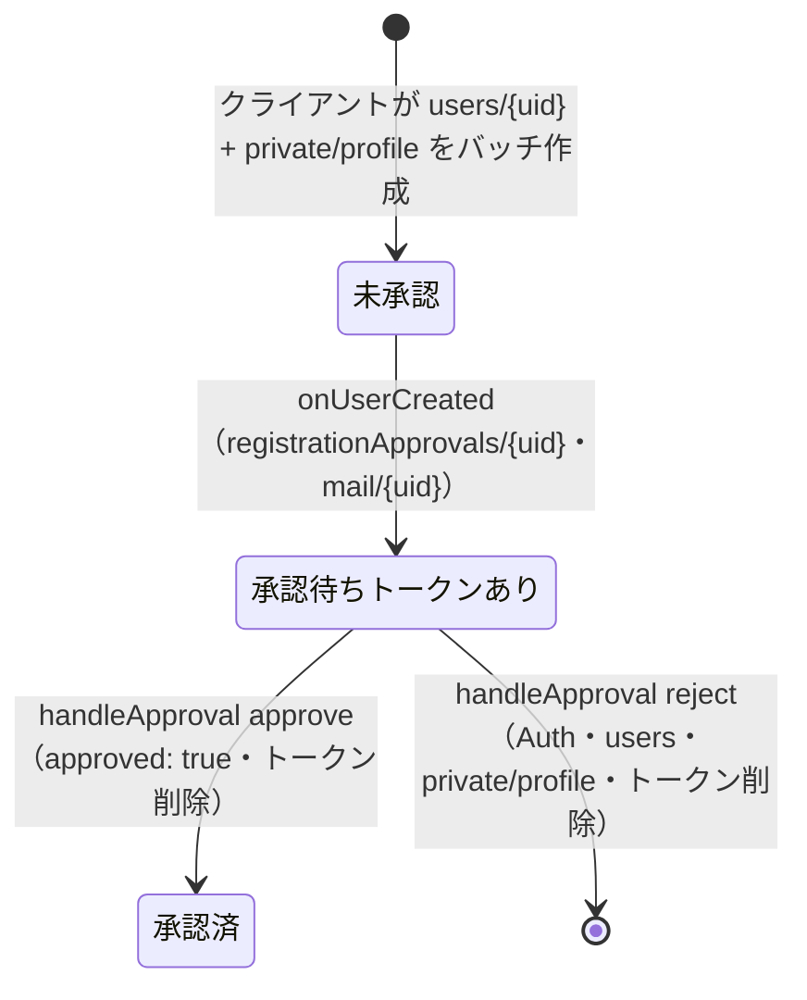
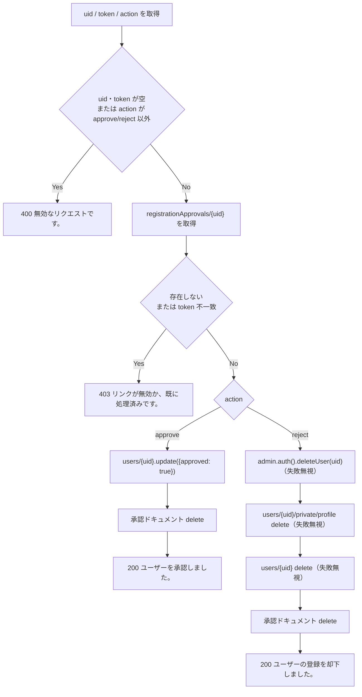

# functions/src/index.ts

| 項目 | 内容 |
|---|---|
| ファイル | `functions/src/index.ts` |
| 基本設計 | [00 システム概要・共通設計](../../00_システム概要.md) の 2 章（Cloud Functions 1st gen・Trigger Email）・6 章（Cloud Functions の権限） |
| 関連する基本設計 | [01 認証・ユーザー登録承認](../../01_認証・ユーザー登録承認.md) 3.1 節（`onUserCreated` / `handleApproval`）、[04 コメント・リアクション](../../04_コメント・リアクション.md)（通知のトリガー元）、[06 イベント](../../06_イベント.md)（`onEventUpdated`）、[07 コンテスト](../../07_コンテスト.md) 4.2〜4.4 節（`onContestVoteChange` / `revealContestAuthors` / `onContestDeleted`）、[08 通知](../../08_通知.md) 2 章・5.2〜5.3 節（通知生成・`onNotificationCreated`・`sendWeeklyNotificationDigest`） |
| レイヤ | Functions |
| 主な依存先 | `firebase-functions/v1`（`^5.1.1`）、`firebase-admin`（`^12.6.0`）、Node.js `crypto`（`randomBytes`）。ランタイムは Node 20（`functions/package.json`） |
| 主な利用元 | Firebase（トリガー・スケジューラ・HTTPS）。クライアントからの直接呼び出しはない。`handleApproval` は承認依頼メールのリンクから管理者がアクセスする |
| テスト | `functions/test/contest.test.cjs`（`revealContestAuthors` / `onContestDeleted` / `onContestVoteChange` を Firestore エミュレータ上で実行。`npm --prefix test/rules test` から起動） |

## 1. 責務

Admin SDK（セキュリティルールの対象外）で行うサーバー側処理をまとめる。

- ユーザー登録の承認フロー（承認依頼メール送信・承認/却下リンクの処理）
- コンテストの投票数集計・匿名解除・旧データ移行・削除時の後処理
- アプリ内通知の生成（いいね・コメント・イベント更新）と FCM プッシュ送信
- 週次の未読通知ダイジェストメール

メール送信は `mail` コレクションへの書き込みで行い、実際の SMTP 送信は Trigger Email 拡張が担う。

## 2. 構成要素（クラス・関数・定数の一覧）

### エクスポートされる Cloud Functions（すべて 1st gen・`asia-northeast2`）

| 関数 | トリガー | 概要 |
|---|---|---|
| `onUserCreated` | Firestore `onCreate`: `users/{uid}/private/profile` | 承認トークン生成・承認依頼メール |
| `handleApproval` | HTTPS `onRequest` | 承認/却下リンクの処理 |
| `revealContestAuthors` | Pub/Sub スケジュール `every 30 minutes`（`Asia/Tokyo`） | 旧コンテストの応募履歴移行・投票締切後の匿名解除 |
| `onContestDeleted` | Firestore `onDelete`: `contests/{contestId}`（`failurePolicy: true`） | 応募投稿を通常投稿へ戻し、votes / entries を削除 |
| `onContestVoteChange` | Firestore `onWrite`: `contests/{contestId}/votes/{voterId}` | 投稿の `voteCount` を増減 |
| `onReactionCreated` | Firestore `onCreate`: `posts/{postId}/reactions/{userId}` | 投稿者へ `reaction` 通知 |
| `onCommentCreated` | Firestore `onCreate`: `posts/{postId}/comments/{commentId}` | 投稿者へ `comment` 通知 |
| `onEventUpdated` | Firestore `onUpdate`: `events/{eventId}` | 参加表明者へ `event_update` 通知 |
| `onNotificationCreated` | Firestore `onCreate`: `notifications/{notificationId}` | 受信者の端末へ FCM 送信・無効トークン削除 |
| `sendWeeklyNotificationDigest` | Pub/Sub スケジュール `every monday 09:00`（`Asia/Tokyo`） | 未読通知の週次メール |

### 内部ヘルパー関数

| 関数 | シグネチャ | 概要 |
|---|---|---|
| `createNotification` | `(recipientId: string, actorId: string, type: NotificationType, sourceId: string): Promise<void>` | `notifications` に 1 件追加。自分自身への通知は作らない |
| `resolvePostAuthorId` | `(postId: string): Promise<string \| null>` | 投稿の実投稿者 UID（匿名期間は `private/author` から解決） |
| `isSameValue` | `(a: unknown, b: unknown): boolean` | `Timestamp` 同士は `isEqual`、それ以外は `===` |
| `getUsername` | `(uid: string \| undefined): Promise<string>` | `users/{uid}.username`。無ければ `だれか` |
| `notificationMessage` | `(type: string, actorName: string): string` | 通知種別ごとの文面 |
| `createdAtMillis` | `(data: DocumentData): number` | `createdAt` が `Timestamp` ならミリ秒、それ以外は 0 |
| `escapeHtml` | `(value: string): string` | `& < > " '` を実体参照へ |
| `htmlPage` | `(message: string): string` | `handleApproval` の応答 HTML |

### 型

| 名前 | 定義 |
|---|---|
| `NotificationType` | `"reaction" \| "comment" \| "event_update"` |

### 定数

| 定数 | 値 |
|---|---|
| `REGION` | `"asia-northeast2"` |
| `ADMIN_EMAIL` | `process.env.ADMIN_EMAIL ?? "yokochi5123@gmail.com"` |
| `PROJECT_ID` | `process.env.GCLOUD_PROJECT ?? "flutter-afterglow"` |
| `FUNCTION_BASE_URL` | `` `https://${REGION}-${PROJECT_ID}.cloudfunctions.net/handleApproval` `` |
| `MAIL_COLLECTION` | `"mail"` |
| `USERS_COLLECTION` | `"users"` |
| `APPROVALS_COLLECTION` | `"registrationApprovals"` |
| `CONTESTS_COLLECTION` | `"contests"` |
| `POSTS_COLLECTION` | `"posts"` |
| `EVENTS_COLLECTION` | `"events"` |
| `NOTIFICATIONS_COLLECTION` | `"notifications"` |
| `APP_URL` | `process.env.APP_URL ?? "https://yokochi513.github.io/afterglow_app/"` |
| `PRIVATE_PROFILE_DOC` | `"private/profile"` |
| `PRIVATE_MESSAGING_DOC` | `"private/messaging"` |
| `EVENT_NOTIFY_FIELDS` | `["title", "description", "locationName", "latitude", "longitude", "startAt", "endAt"]` |
| `DIGEST_MAX_ITEMS` | `20` |
| `WEEK_MILLIS` | `7 * 24 * 60 * 60 * 1000` |

モジュール読み込み時に `admin.initializeApp()` を実行し、`db = admin.firestore()` を共有する。

## 3. 公開インターフェース（コンストラクタ引数・プロパティ・メソッドのシグネチャと説明）

| 関数 | 入力 | 出力 |
|---|---|---|
| `onUserCreated` | `snapshot`（`private/profile`）、`context.params.uid` | なし（Firestore 書き込み） |
| `handleApproval` | クエリ `uid`, `token`, `action`（`approve` / `reject`） | HTTP 200 / 400 / 403 と `htmlPage` の HTML |
| `revealContestAuthors` | なし（スケジュール） | なし |
| `onContestDeleted` | `snapshot`（削除前のコンテスト）、`context.params.contestId` | なし |
| `onContestVoteChange` | `change.before` / `change.after`（投票ドキュメント）、`context.params.contestId` | なし |
| `onReactionCreated` | `context.params.postId`, `context.params.userId` | なし |
| `onCommentCreated` | `snapshot.data().userId`, `context.params.postId` | なし |
| `onEventUpdated` | `change.before` / `change.after`（イベント）、`context.params.eventId` | なし |
| `onNotificationCreated` | `snapshot`（通知） | なし |
| `sendWeeklyNotificationDigest` | なし（スケジュール） | なし |

承認リンクの URL は 1st gen の固定形式 `https://asia-northeast2-<PROJECT_ID>.cloudfunctions.net/handleApproval` で決定的になる。

## 4. 内部状態（フィールド・状態遷移）

関数インスタンスに状態は持たない（`db` の共有のみ）。永続状態は Firestore 上にある。

承認フローの状態遷移:

コンテスト投稿の匿名状態: `userId == ''`（匿名期間）→ `revealContestAuthors` が投票締切後に実投稿者 UID を書き戻す。コンテスト削除時は `onContestDeleted` が `userId` を復元し `contestId` 等を削除する。

## 5. 処理詳細（メソッドごとの手順・分岐・呼び出す Repository/SDK）

### 5.1 `onUserCreated`

- **トリガー**: `users/{uid}/private/profile` の作成（`.firestore.document("users/{uid}/private/profile").onCreate`）。公開ドキュメント `users/{uid}` ではなく非公開ドキュメントを起点にする。クライアントの `AuthRepository.register` が両者を同一バッチで作るため、発火時点で公開ドキュメントはコミット済み。
- **入力**: `context.params.uid`、`snapshot.data()`（`email`）、`users/{uid}`（`username`, `approved`）。
- **手順**:
  1. `users/{uid}` を読む。
  2. `userData?.approved === true` なら終了する（管理者が直接作成した等）。
  3. `username = userData?.username ?? "(名前未設定)"`、`email = privateData?.email ?? "(メール未設定)"`。
  4. `token = randomBytes(32).toString("hex")`（64 文字）。
  5. `registrationApprovals/{uid}` を `set`: `{token, email, username, createdAt: serverTimestamp()}`。
  6. `approveUrl = FUNCTION_BASE_URL?uid=<uid>&token=<token>&action=approve`、`rejectUrl` は `action=reject`。
  7. HTML 本文を組み立てる（見出し「新規ユーザー登録の承認依頼」、ユーザー名・メールは `escapeHtml`、ボタン「承認する」（`#5b3cc4`）・「却下する」（`#c4423c`））。
  8. `mail/{uid}` を `set`: `{to: [ADMIN_EMAIL], message: {subject: "【Afterglow】新規登録の承認依頼: <username>", html}}`。
- **書き込み先**: `registrationApprovals/{uid}`、`mail/{uid}`。
- **エラー処理**: 例外は捕捉しない（関数の失敗としてログに残る。リトライ設定なし）。

### 5.2 `handleApproval`

- **トリガー**: HTTPS リクエスト（メソッドは問わない）。
- **入力**: `req.query.uid` / `token` / `action` を `String(... ?? "")` で文字列化。
- **手順**:

- **書き込み先**: approve は `users/{uid}`（`approved: true`）と `registrationApprovals/{uid}` の削除。reject は Firebase Auth ユーザー、`users/{uid}/private/profile`、`users/{uid}`、`registrationApprovals/{uid}` の削除。
- **エラー処理**:

| 応答 | 条件 | 本文（`htmlPage` の `<h1>`） |
|---|---|---|
| 400 | `uid` / `token` が空、または `action` が `approve` / `reject` 以外 | `無効なリクエストです。` |
| 403 | 承認ドキュメントが無い、または `token` 不一致 | `リンクが無効か、既に処理済みです。` |
| 200 | 承認成功 | `ユーザーを承認しました。` |
| 200 | 却下成功 | `ユーザーの登録を却下しました。` |

  - 却下時の `deleteUser` / 各ドキュメント削除は `.catch(() => undefined)` で失敗を無視する（承認ドキュメントの削除のみ例外が伝播する）。
  - 承認時に `users/{uid}` が存在しないと `update` が例外になり、ハンドラ外へ伝播する（承認ドキュメントは残る）。
  - 処理後に承認ドキュメントを削除するため、リンクは 1 回限り有効。

### 5.3 `revealContestAuthors`

- **トリガー**: `pubsub.schedule("every 30 minutes").timeZone("Asia/Tokyo")`。
- **手順（1）旧コンテストの応募履歴移行**:
  1. `contests` を全件取得する。
  2. 各コンテストについて `entryLimitVersion === 1` ならスキップ。
  3. `posts where contestId == <contest.id>` を取得し、`complete = true` とする。
  4. 各投稿で `posts/{postId}/private/author` を読み、`uid = post.userId || author.userId` とする。文字列でない・空なら `functions.logger.warn("投稿者を復元できません: <postId>")`、`complete = false` として次へ。
  5. トランザクションでコンテスト・投稿・`contests/{id}/entries/{uid}` を読み、コンテストが存在し投稿の `contestId` が変わっていなければ、`entries/{uid}` が無い場合だけ `{postId}` を `set` する（既存の履歴は上書きしない）。
  6. 全投稿を処理して `complete` なら、トランザクションでコンテストが存在すれば `entryLimitVersion: 1` に更新する。`complete` でなければ次回に持ち越す（ルールは `entryLimitVersion == 1` でないコンテストへの新規応募を拒否する）。
- **手順（2）匿名解除**:
  1. `now = Timestamp.now()`。`contests where votingDeadline <= now` を取得する。
  2. 各コンテストで `posts where contestId == <id> and userId == ""` を取得する。
  3. 各投稿の `private/author.userId` を読み、文字列でない・空ならスキップ。
  4. バッチに `update(post, {userId: authorId, stayAnonymous: false})` を積む。450 件ごとに `commit` して新しいバッチを作る。
  5. 残りがあれば `commit`。
- **書き込み先**: `contests/{id}/entries/{uid}`、`contests/{id}.entryLimitVersion`、`posts/{postId}.userId` / `stayAnonymous`。
- **冪等性**: 匿名解除は `userId == ""` の投稿だけを対象にするため、再実行しても同じ投稿を更新しない。移行は `entries` が無い場合のみ作成する。
- **エラー処理**: 投稿者不明は警告ログ・スキップ。その他の例外は捕捉しない。

### 5.4 `onContestDeleted`

- **トリガー**: `contests/{contestId}` の削除。`runWith({failurePolicy: true})` により失敗時は再試行される。
- **入力**: `snapshot`（削除されたコンテスト）、`context.params.contestId`。
- **手順**:
  1. `posts where contestId == <contestId>` を取得する。
  2. 各投稿をトランザクションで処理する。
     1. 投稿を再取得し、存在しない、または `contestId` が対象と違えば何もしない（再試行時に処理済みの投稿を飛ばす）。
     2. `private/author` を読み、`authorId = current.userId || author.userId`。
     3. `authorId` が文字列でない・空なら `throw new Error("投稿者を復元できません: <postId>")`。
     4. `update(post, {userId: authorId, contestId: delete(), stayAnonymous: delete(), voteCount: delete()})`。
  3. `db.recursiveDelete(contests/{id}/votes)`、続けて `db.recursiveDelete(contests/{id}/entries)`。
- **書き込み先**: `posts/{postId}`（`userId` 復元、`contestId` / `stayAnonymous` / `voteCount` 削除）、`contests/{id}/votes/**`・`entries/**` の削除。写真（`imageUrls`）・コメントは残す。`private/author` は削除しない。
- **エラー処理**: 投稿者を復元できない投稿があると例外で関数が失敗し、`failurePolicy` により再試行される。
- **補足**: votes の削除で `onContestVoteChange` が発火するが、コンテストが既に存在しないため `voteCount` は再作成されない（5.5）。

### 5.5 `onContestVoteChange`

- **トリガー**: `contests/{contestId}/votes/{voterId}` の作成・更新・削除（`onWrite`）。
- **入力**: `before = change.before.exists ? before.postId : undefined`、`after` も同様。
- **手順**:
  1. `before === after` なら終了（投票先の変化なし。`updatedAt` だけの更新等）。
  2. トランザクションで `contests/{contestId}` を読み、存在しなければ終了（削除時の掃除で通常投稿へ `voteCount` を作らない）。
  3. `before` があれば `posts/{before}.voteCount` を `increment(-1)`。
  4. `after` があれば `posts/{after}.voteCount` を `increment(1)`。
- **書き込み先**: `posts/{postId}.voteCount`。クライアントからの `voteCount` 書き込みはルールで禁止されており、このトリガーだけが更新する。
- **エラー処理**: 捕捉しない。対象投稿が存在しないと `update` が失敗してトランザクション全体が失敗する（リトライ設定なし）。

### 5.6 `createNotification`（内部）

1. `recipientId` / `actorId` が空、または `recipientId === actorId` なら何もしない。
2. `notifications` に `add`: `{recipientId, actorId, type, sourceId, isRead: false, createdAt: serverTimestamp()}`。

### 5.7 `resolvePostAuthorId`（内部）

1. `posts/{postId}` を読む。存在しなければ `null`。
2. `userId` が空でない文字列ならそれを返す。
3. そうでなければ `posts/{postId}/private/author.userId` を読み、空でない文字列なら返し、それ以外は `null`。

### 5.8 `onReactionCreated`

- **トリガー**: `posts/{postId}/reactions/{userId}` の作成。
- **手順**: `actorId = context.params.userId`（リアクションのドキュメント ID = いいねした人）。`resolvePostAuthorId(postId)` が非 null なら `createNotification(recipientId, actorId, "reaction", postId)`。
- **書き込み先**: `notifications`。いいね解除（削除）では何もしない。

### 5.9 `onCommentCreated`

- **トリガー**: `posts/{postId}/comments/{commentId}` の作成。
- **手順**: `actorId = snapshot.data()?.userId`。`resolvePostAuthorId(postId)` と `actorId` がともにあれば `createNotification(recipientId, actorId, "comment", postId)`。
- **書き込み先**: `notifications`。

### 5.10 `onEventUpdated`

- **トリガー**: `events/{eventId}` の更新。
- **手順**:
  1. `EVENT_NOTIFY_FIELDS` のいずれかで `!isSameValue(before[field], after[field])` なら変更ありとする。無ければ終了（`updatedAt` 等の付随更新だけでは通知しない）。
  2. `organizerId = after.organizerId ?? ""` を actor とする（更新できるのは主催者か管理者のため）。
  3. `events/{eventId}/participants` を全件取得し、各参加者 ID について `createNotification(participantId, organizerId, "event_update", eventId)` を `Promise.all` で実行する。
- **書き込み先**: `notifications`。主催者自身が参加表明していても、`recipientId === actorId` のため通知されない。

### 5.11 `onNotificationCreated`

- **トリガー**: `notifications/{notificationId}` の作成。
- **手順**:
  1. `recipientId` が無ければ終了。
  2. `users/{recipientId}/private/messaging.tokens`（無ければ `[]`）を読む。空なら終了。
  3. `actorName = getUsername(actorId)`、`body = notificationMessage(type, actorName)`。
  4. `admin.messaging().sendEachForMulticast` で送信:
     - `tokens`
     - `notification: {title: "Afterglow", body}`
     - `data: {notificationId: snapshot.id, type: String(type ?? ""), sourceId: String(sourceId ?? "")}`
     - `webpush: {fcmOptions: {link: APP_URL}, notification: {icon: APP_URL + "icons/Icon-192.png"}}`
  5. 応答のうちエラーコードが `messaging/registration-token-not-registered` または `messaging/invalid-registration-token` のトークンを集め、1 件以上あれば `tokens` から `arrayRemove(...invalid)` する。
- **書き込み先**: `users/{uid}/private/messaging.tokens`（無効トークン削除のみ）。
- **エラー処理**: 送信の個別失敗は応答で扱い、無効トークン以外のエラーは無視する。例外は捕捉しない。

通知文面（`notificationMessage`）:

| type | 文面 |
|---|---|
| `reaction` | `<actorName>さんがあなたの投稿にいいねしました` |
| `comment` | `<actorName>さんがあなたの投稿にコメントしました` |
| `event_update` | `参加予定のイベントが更新されました` |
| その他 | `新しい通知があります` |

`getUsername` は uid が空、ユーザーが無い、`username` が空のとき `だれか` を返す。

### 5.12 `sendWeeklyNotificationDigest`

- **トリガー**: `pubsub.schedule("every monday 09:00").timeZone("Asia/Tokyo")`。
- **手順**:
  1. `now = Date.now()`、`since = now - WEEK_MILLIS`、`dateKey = new Date(now).toISOString().slice(0, 10)`（UTC 日付。日本時間 9:00 = UTC 0:00 のため同日）。
  2. `users where approved == true` を全件取得する。
  3. ユーザーごとに `users/{uid}/private/profile` を読み、`emailNotification === false`、または `email` が空/非文字列ならスキップ（`emailNotification` 未設定は送信対象）。
  4. `notifications where recipientId == uid and isRead == false` を取得する（等価条件のみで複合インデックス不要）。
  5. メモリ上で `createdAtMillis >= since` に絞り、`createdAt` 降順に並べる。0 件ならスキップ。
  6. 先頭 `DIGEST_MAX_ITEMS`（20）件について `notificationMessage(type, await getUsername(actorId))` を作る。`more = 総数 - 20 件`。
  7. HTML を組み立てる: `<username> さん`、`この 1 週間に未読の通知が <n> 件あります。`、各項目の `<li>`（`escapeHtml`）、`more > 0` なら `ほか <more> 件`、ボタン「Afterglow を開く」（`APP_URL`）、フッター `このメールはアプリの「通知」画面の「週次メール通知」で停止できます。`
  8. `mail/weeklyDigest_<uid>_<dateKey>` を `create`: `{to: [email], message: {subject: "【Afterglow】今週の通知（未読 <n> 件）", html}}`。
- **書き込み先**: `mail/weeklyDigest_{uid}_{YYYY-MM-DD}`。
- **エラー処理**: `create` は既存ドキュメントがあると失敗するため、同日の再実行で二重送信しない。`.catch(() => undefined)` で失敗はすべて無視する。

## 6. データ仕様（読み書きする Firestore/Storage のパス・フィールド、定数値）

| パス | 読み | 書き | フィールド |
|---|---|---|---|
| `users/{uid}` | onUserCreated, getUsername, sendWeeklyNotificationDigest | handleApproval（`approved: true` / 削除） | username, approved |
| `users/{uid}/private/profile` | onUserCreated（snapshot）, sendWeeklyNotificationDigest | handleApproval（却下で削除） | email, emailNotification |
| `users/{uid}/private/messaging` | onNotificationCreated | onNotificationCreated（`tokens` の arrayRemove） | tokens |
| `registrationApprovals/{uid}` | handleApproval | onUserCreated（set）, handleApproval（delete） | token, email, username, createdAt |
| `mail/{uid}` | — | onUserCreated | to, message.subject, message.html |
| `mail/weeklyDigest_{uid}_{YYYY-MM-DD}` | — | sendWeeklyNotificationDigest（create） | to, message.subject, message.html |
| `contests/{contestId}` | revealContestAuthors, onContestVoteChange | revealContestAuthors（`entryLimitVersion: 1`） | entryLimitVersion, votingDeadline |
| `contests/{id}/entries/{uid}` | revealContestAuthors | revealContestAuthors（set）, onContestDeleted（再帰削除） | postId |
| `contests/{id}/votes/{uid}` | （トリガー） | onContestDeleted（再帰削除） | postId |
| `posts/{postId}` | 各関数 | revealContestAuthors, onContestDeleted, onContestVoteChange | userId, contestId, stayAnonymous, voteCount |
| `posts/{postId}/private/author` | revealContestAuthors, onContestDeleted, resolvePostAuthorId | — | userId |
| `events/{eventId}/participants` | onEventUpdated | — | （ドキュメント ID = 参加者 UID） |
| `notifications/{id}` | onNotificationCreated（snapshot）, sendWeeklyNotificationDigest | createNotification（add） | recipientId, actorId, type, sourceId, isRead, createdAt |

外部: Firebase Auth（`deleteUser`）、FCM（`sendEachForMulticast`）、Trigger Email 拡張（`mail` を読む）。

## 7. 例外・エラー処理（例外の扱い・戻り値・表示メッセージ）

| 関数 | 方針 |
|---|---|
| handleApproval | 入力不正 400、トークン不一致 403。却下時の削除失敗は無視。その他の例外は未捕捉（500 相当） |
| onContestDeleted | 投稿者を復元できなければ例外 → `failurePolicy: true` で再試行 |
| revealContestAuthors | 投稿者を復元できない投稿は警告ログ・スキップし、移行完了フラグを立てない |
| sendWeeklyNotificationDigest | mail の `create` 失敗はすべて無視 |
| onNotificationCreated | 無効トークンを削除。他の送信エラーは無視 |
| 上記以外 | 例外を捕捉しない（リトライ設定なし。ログに残るのみ） |

HTML に埋め込むユーザー入力（username / email / 通知文面 / `htmlPage` のメッセージ）は `escapeHtml` でエスケープする。メールの件名はエスケープしない（プレーンテキスト）。

## 8. テスト観点（既存テストが確認していること / 未テストの観点）

既存（`functions/test/contest.test.cjs`、Firestore エミュレータ上で Admin SDK を使い `handlers.<関数>.run(...)` で直接実行）:

- `revealContestAuthors`: 投票締切後のコンテスト投稿だけ `userId` を復元し `stayAnonymous: false` にする。締切前は匿名を維持。再実行しても結果が変わらない。
- `revealContestAuthors`: `entryLimitVersion` の無い旧コンテストの投稿から `entries/{uid}` を作り、`entryLimitVersion: 1` にする。投稿の `userId` は空のまま。再実行で履歴を上書きしない。
- `onContestDeleted`: 投稿の `userId` を復元し `contestId` / `stayAnonymous` / `voteCount` を削除、`caption` / `imageUrls` / コメントは保持、votes / entries を削除。再実行しても壊れない。
- `onContestVoteChange`: コンテスト削除後の投票削除で `voteCount` を再作成しない。

未テスト:

- `onUserCreated` / `handleApproval`（承認・却下・400・403、トークン 1 回限り）
- `onContestVoteChange` の通常の増減（投票先の変更で −1/+1）
- `onReactionCreated` / `onCommentCreated` / `onEventUpdated`（自分自身への通知抑止、匿名投稿の投稿者解決、変更項目判定）
- `onNotificationCreated`（FCM 送信・無効トークン削除）
- `sendWeeklyNotificationDigest`（7 日の絞り込み、20 件上限と「ほか n 件」、二重送信防止）

## 9. 備考・既知の課題

- `onUserCreated` のドキュメントコメントは旧名 `AuthService.register` を参照している（現在は `AuthRepository.register`）。
- `handleApproval` は HTTP メソッドを制限しない。メールクライアントやセキュリティスキャナがリンクを事前に GET（プリフェッチ）すると、意図せず承認/却下が実行され得る。
- `handleApproval` の承認時、`users/{uid}` が既に無いと `update` が例外になり、利用者には 500 エラーが返る。
- `revealContestAuthors` は 30 分ごとに全コンテストを走査し、投票締切を過ぎたコンテストも毎回クエリする（終了済みコンテストが増えるほど読み取りが増える）。
- `onContestVoteChange` はリトライ設定がなく、対象投稿が削除済みだとトランザクションごと失敗するため、投票先変更時の +1 も反映されない。`voteCount` は投票実数とずれ得る。
- `onEventUpdated` で `organizerId` が空だと `createNotification` が早期 return し、誰にも通知されない。
- `onNotificationCreated` は `tokens` をそのまま `sendEachForMulticast` に渡すため、1 ユーザーのトークンが 500 件を超えると送信に失敗する（上限超過の分割なし）。
- `sendWeeklyNotificationDigest` は承認済みユーザー全員について profile・未読通知・actor ごとの username を逐次読む（N+1）。`create` の失敗を種類を問わず無視するため、既存以外の失敗も検知できない。
- 通知文面はクライアント（`NotificationPage`）と `notificationMessage` に二重定義されている。
