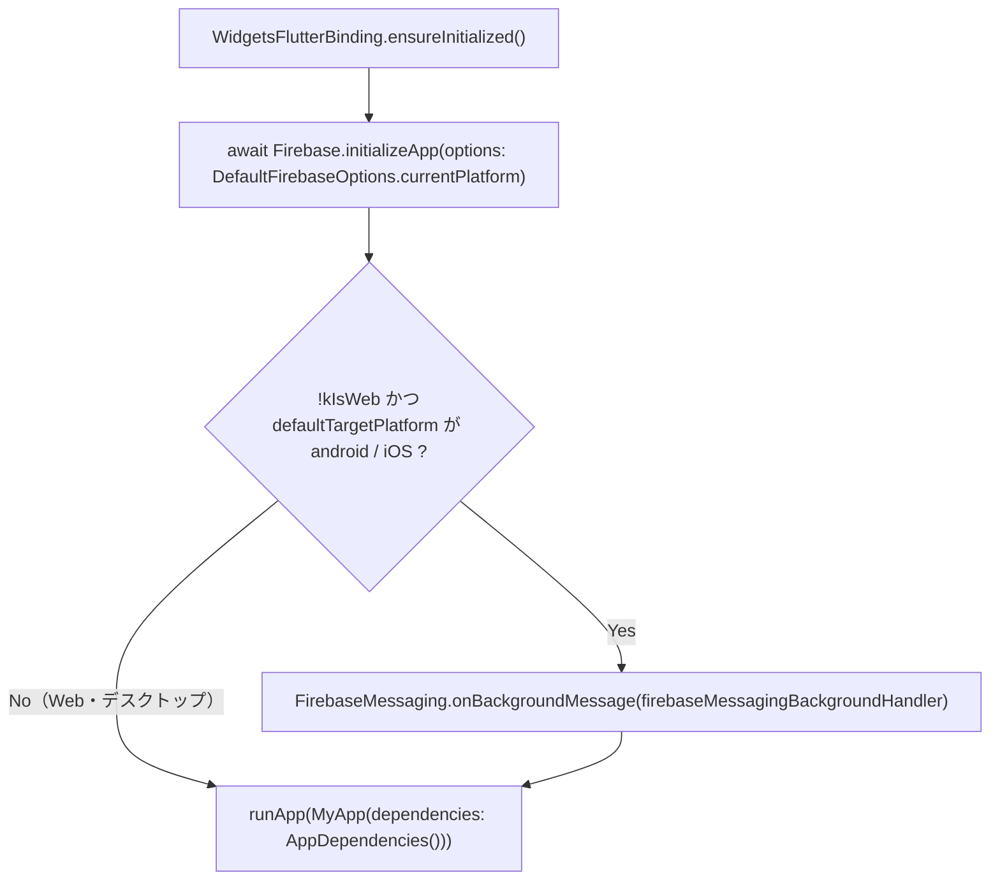

# lib/main.dart

| 項目 | 内容 |
|---|---|
| ファイル | `lib/main.dart` |
| 基本設計 | [00 システム概要・共通設計](../../00_システム概要.md) の 2 章（システム構成）・3.2 節（依存の注入） |
| 関連する基本設計 | [08 通知](../../08_通知.md) 5.1 節（バックグラウンド受信） |
| レイヤ | App |
| 主な依存先 | `lib/app/app.dart`（`MyApp`）、`lib/app/dependencies.dart`（`AppDependencies`）、`lib/data/services/push_notification_service.dart`（`firebaseMessagingBackgroundHandler`）、`lib/firebase_options.dart`（`DefaultFirebaseOptions`）、`firebase_core`、`firebase_messaging`、`flutter/foundation.dart`、`flutter/material.dart` |
| 主な利用元 | なし（Flutter のエントリポイント） |
| テスト | なし |

## 1. 責務

アプリのエントリポイント。Flutter バインディングと Firebase を初期化し、モバイルではバックグラウンドのプッシュ受信ハンドラを登録したうえで、本番用の `AppDependencies` を渡して `MyApp` を起動する。

## 2. 構成要素（クラス・関数・定数の一覧）

| 種別 | 名前 | 概要 |
|---|---|---|
| トップレベル関数 | `main()` | エントリポイント（`async`） |

## 3. 公開インターフェース（コンストラクタ引数・プロパティ・メソッドのシグネチャと説明）

| シグネチャ | 説明 |
|---|---|
| `void main() async` | 起動処理。戻り値なし |

## 4. 内部状態（フィールド・状態遷移）

なし

## 5. 処理詳細（メソッドごとの手順・分岐・呼び出す Repository/SDK）

### `main()`

1. `WidgetsFlutterBinding.ensureInitialized()` で、`runApp` 前にプラットフォームチャネルを使えるようにする。
2. `Firebase.initializeApp(options: DefaultFirebaseOptions.currentPlatform)` を `await` する。以降、各 Repository が既定で使う `FirebaseFirestore.instance` 等が利用可能になる。
3. `kIsWeb` が偽かつ `defaultTargetPlatform` が `TargetPlatform.android` または `TargetPlatform.iOS` のときだけ、`FirebaseMessaging.onBackgroundMessage(firebaseMessagingBackgroundHandler)` を登録する。Web のバックグラウンド受信は `web/firebase-messaging-sw.js`（Service Worker）が担うため登録しない（コード中コメント「PS_07」）。
4. 引数なしの `AppDependencies()` を生成する。Firebase インスタンスを渡さないため、各 Repository / Service は `.instance` を使う。
5. `runApp(MyApp(dependencies: ...))` でウィジェットツリーを起動する。

## 6. データ仕様（読み書きする Firestore/Storage のパス・フィールド、定数値）

なし（Firestore / Storage へのアクセスはしない）。Firebase の接続先は `lib/firebase_options.dart`（生成物、プロジェクト `flutter-afterglow`）による。

## 7. 例外・エラー処理（例外の扱い・戻り値・表示メッセージ）

- `Firebase.initializeApp` の例外は捕捉しない。初期化に失敗すると `runApp` に到達せず、アプリは起動しない。
- バックグラウンドハンドラ `firebaseMessagingBackgroundHandler` は空実装（通知ペイロード付きメッセージは OS が表示する）。

## 8. テスト観点（既存テストが確認していること / 未テストの観点）

- 既存テスト: なし。ウィジェットテストは `main()` を通らず、`test/helpers/dependencies.dart` の `withDependencies` でモックの依存を提供する。
- 未テスト: プラットフォーム判定によるハンドラ登録の分岐、Firebase 初期化失敗時の挙動。

## 9. 備考・既知の課題

- `AppDependencies` はここで 1 回だけ生成され、アプリ全体で共有される（[dependencies.md](dependencies.md)）。
- macOS / Windows / Linux ではバックグラウンド受信ハンドラを登録しない（プッシュ受信の対象外）。
