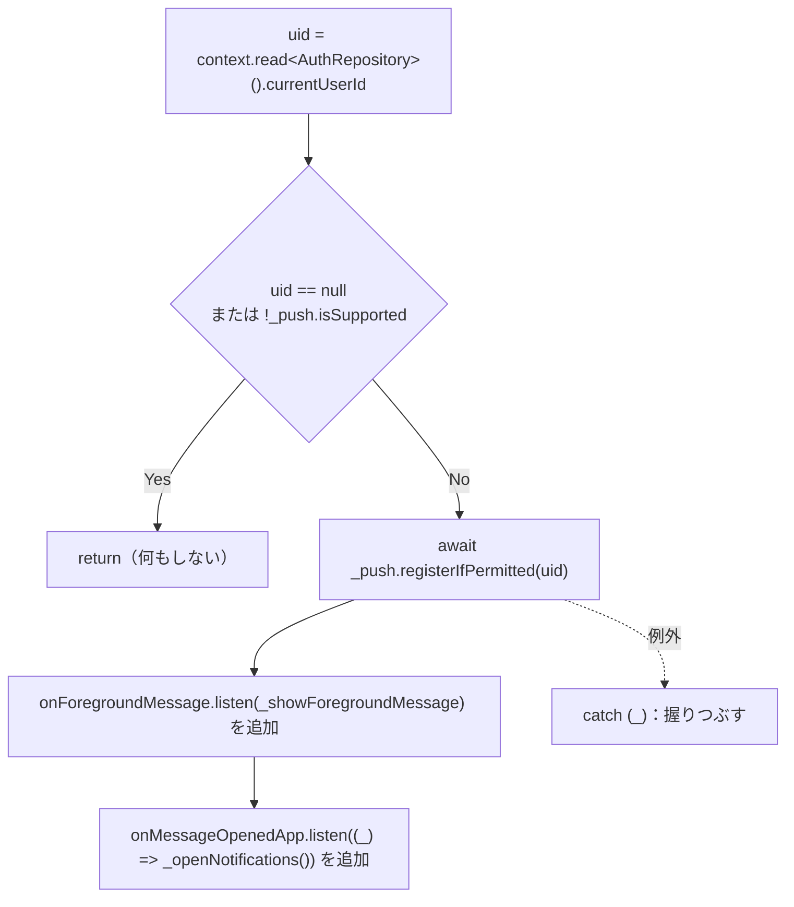

# lib/app/main_shell.dart

| 項目 | 内容 |
|---|---|
| ファイル | `lib/app/main_shell.dart` |
| 基本設計 | [00 システム概要・共通設計](../../00_システム概要.md) の 4 章（画面遷移・下部タブ・`IndexedStack`） |
| 関連する基本設計 | [08 通知](../../08_通知.md) 5.1 節（起動時のトークン登録・フォアグラウンド受信・通知タップ）、[01 認証・ユーザー登録承認](../../01_認証・ユーザー登録承認.md)（`AuthGate` から表示される） |
| レイヤ | View（App） |
| 主な依存先 | `lib/ui/feed/feed_page.dart`, `lib/ui/map/map_screen.dart`, `lib/ui/album/album_list_page.dart`, `lib/ui/event/event_page.dart`, `lib/ui/contest/contest_list_page.dart`, `lib/ui/notification/notification_page.dart`, `lib/data/repositories/auth_repository.dart`, `lib/data/services/push_notification_service.dart`, `provider`, `firebase_messaging`（`RemoteMessage`）, `dart:async` |
| 主な利用元 | `lib/ui/auth/auth_gate.dart`（承認済みユーザーのとき `const MainShell()` を返す） |
| テスト | なし |

`lib/ui/profile/profile_page.dart` を import しているが、コード中では使っていない（ドキュメントコメントの参照のみ）。

## 1. 責務

承認済みユーザー向けのアプリ本体の外枠。

- `BottomNavigationBar` で 5 つのタブ（Feed / Map / Album / Event / Contest）を切り替え、`IndexedStack` で各タブの状態を保持する。
- 表示開始時にプッシュ通知の受信を開始する（許可済みならトークン再登録、フォアグラウンド受信の SnackBar、通知タップで通知一覧を開く）。

## 2. 構成要素（クラス・関数・定数の一覧）

| 種別 | 名前 | 概要 |
|---|---|---|
| クラス | `MainShell extends StatefulWidget` | 公開ウィジェット |
| クラス | `_MainShellState extends State<MainShell>` | タブ状態とプッシュ購読を持つ |
| 定数 | `_MainShellState._mapIndex = 1` | Map タブのインデックス（初期タブ） |
| 定数 | `_MainShellState._pages` | `IndexedStack` に並べるタブ本体（`static const List<Widget>`） |

## 3. 公開インターフェース（コンストラクタ引数・プロパティ・メソッドのシグネチャと説明）

| シグネチャ | 説明 |
|---|---|
| `const MainShell({super.key})` | 引数なし。依存は `context.read` で取得する |
| `State<MainShell> createState()` | `_MainShellState` を返す |

## 4. 内部状態（フィールド・状態遷移）

| フィールド | 型 | 初期値 | 説明 |
|---|---|---|---|
| `_currentIndex` | `int` | `_mapIndex`（1） | 表示中のタブ |
| `_push` | `late final PushNotificationService` | `context.read<PushNotificationService>()`（初回参照時） | プッシュ通知サービス |
| `_pushSubscriptions` | `List<StreamSubscription<RemoteMessage>>` | `[]` | 購読中のメッセージストリーム |

タブ定義（`_pages` と `BottomNavigationBarItem`）:

| index | ページ | ラベル | アイコン |
|---|---|---|---|
| 0 | `FeedPage()` | `Feed` | `Icons.dynamic_feed_outlined` |
| 1 | `MapScreen()` | `Map` | `Icons.map_outlined` |
| 2 | `AlbumListPage()` | `Album` | `Icons.photo_album_outlined` |
| 3 | `EventPage()` | `Event` | `Icons.event_outlined` |
| 4 | `ContestListPage()` | `Contest` | `Icons.emoji_events_outlined` |

状態遷移はタブ選択による `_currentIndex` の変更のみ。

## 5. 処理詳細（メソッドごとの手順・分岐・呼び出す Repository/SDK）

### `initState`

1. `super.initState()`
2. `_startPushNotifications()` を呼ぶ（`await` しない。非同期に進む）。

### `_startPushNotifications()` → `Future<void>`

1. `AuthRepository.currentUserId`（`FirebaseAuth.currentUser?.uid`）を取得する。
2. `uid == null` または `_push.isSupported == false`（Web で `FCM_VAPID_KEY` 未設定）なら終了する。
3. `try` 内で `_push.registerIfPermitted(uid)` を `await` する。許可済みの端末ならトークンを `users/{uid}/private/messaging.tokens` に保存し、トークン更新も保存するようになる。**許可ダイアログは出さない**（許可要求は通知一覧の「有効にする」から行う）。
4. `_push.onForegroundMessage`（`FirebaseMessaging.onMessage`）を `_showForegroundMessage` で購読し、`_pushSubscriptions` に追加する。
5. `_push.onMessageOpenedApp`（`FirebaseMessaging.onMessageOpenedApp`）を購読し、受信時に `_openNotifications()` を呼ぶ。
6. いずれかで例外が出たら `catch (_)` で無視する（通知非対応ブラウザ等。アプリ内通知は引き続き使える）。

### `_showForegroundMessage(RemoteMessage message)`

1. `mounted` でなければ終了する。
2. `body = message.notification?.body ?? ''`。タイトルはアプリ名固定（Functions の `onNotificationCreated` が `"Afterglow"` を送る）のため本文だけを使う。
3. `ScaffoldMessenger.of(context).showSnackBar` で次を表示する。
   - `content`: `body` が空なら `新しい通知があります`、そうでなければ `body`
   - `action`: ラベル `見る`、押下で `_openNotifications`

### `_openNotifications()`

1. `mounted` でなければ終了する。
2. `Navigator.of(context).push(MaterialPageRoute<void>(builder: (_) => const NotificationPage()))`。

### `_onTabTapped(int index)`

1. `index == _currentIndex` なら何もしない（再描画しない）。
2. `setState` で `_currentIndex = index`。

### `build`

`Scaffold` を返す。

- `body`: `IndexedStack(index: _currentIndex, children: _pages)`。全タブを生成したまま非表示のタブも保持する（スクロール位置等を維持）。
- `bottomNavigationBar`: `BottomNavigationBar(currentIndex: _currentIndex, onTap: _onTabTapped, type: BottomNavigationBarType.fixed, items: ...)`（4 章の表）。

### `dispose`

1. `_pushSubscriptions` の各購読を `cancel()` する。
2. `super.dispose()`。

## 6. データ仕様（読み書きする Firestore/Storage のパス・フィールド、定数値）

- 直接の Firestore / Storage アクセスはない。`PushNotificationService.registerIfPermitted` 経由で `users/{uid}/private/messaging`（`tokens` を `arrayUnion`、`updatedAt` をサーバー時刻、`merge: true`）へ書き込む（詳細は [push_notification_service.md](../08_通知/push_notification_service.md)）。
- 定数: `_mapIndex = 1`。

## 7. 例外・エラー処理（例外の扱い・戻り値・表示メッセージ）

| 状況 | 扱い |
|---|---|
| 未ログイン / プッシュ非対応 | 何もしない |
| `registerIfPermitted` や購読開始での例外 | 握りつぶす（表示なし）。例外がトークン登録中に出た場合はストリーム購読も行われない |
| フォアグラウンド受信で本文が空 | SnackBar に `新しい通知があります` |
| 破棄後のコールバック | `mounted` チェックで何もしない |

## 8. テスト観点（既存テストが確認していること / 未テストの観点）

- 既存テスト: なし。
- 未テスト: 初期タブが Map であること、タブ切替で `IndexedStack` の index が変わること、同じタブの再タップで再描画しないこと、フォアグラウンド受信時の SnackBar 文言と「見る」での遷移、`isSupported == false` / 未ログインで購読しないこと、`dispose` で購読解除すること。

## 9. 備考・既知の課題

- ドキュメントコメントの「投稿（FR_07）はタブを持たず、マップ画面の地図タップから開く [ProfilePage] は既存の Profile 導線（本ウィジェット外）から表示する。」は 2 文が混ざった表現になっている（意図は「投稿はタブを持たずマップの地図タップから開く」「ProfilePage はマップ画面の AppBar から開く」）。また「設計書 §4.2」は旧詳細設計（`docs/詳細設計.md`）の節番号。
- `profile_page.dart` の import はコード上未使用（コメント参照のためだけに残っている）。
- `PushNotificationService.registerIfPermitted` が内部で登録する `onTokenRefresh` の購読は Service 側で保持・解除されないため、`MainShell.dispose`（ログアウトで `AuthGate` が `LoginPage` に切り替わる等）後も残る。別ユーザーで再ログインすると旧ユーザー宛てのトークン保存リスナーが残り得る。
- `onMessageOpenedApp` はアプリがバックグラウンドから復帰した場合のみ発火する。終了状態から通知タップで起動したケース（`FirebaseMessaging.getInitialMessage`）は処理していない。
