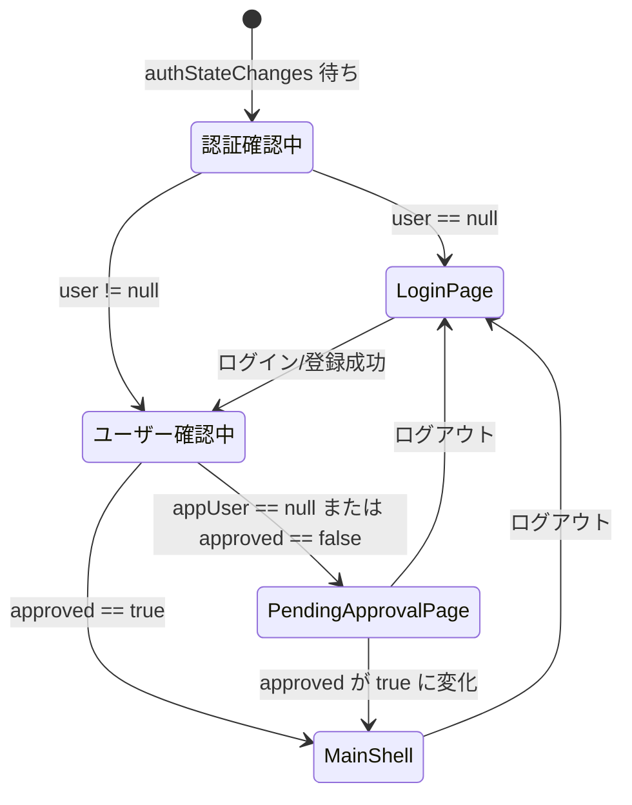

# lib/ui/auth/auth_gate.dart

| 項目 | 内容 |
|---|---|
| ファイル | `lib/ui/auth/auth_gate.dart` |
| 基本設計 | [01 認証・ユーザー登録承認](../../01_認証・ユーザー登録承認.md) の「2. AuthGate の切り替え条件」 |
| 関連する基本設計 | [00 システム概要](../../00_システム概要.md) の「4. 画面遷移」 |
| レイヤ | View |
| 主な依存先 | `lib/data/repositories/auth_repository.dart`, `lib/data/repositories/user_repository.dart`, `lib/data/models/app_user.dart`, `lib/ui/auth/login_page.dart`, `lib/ui/auth/pending_approval_page.dart`, `lib/app/main_shell.dart`、`package:provider`、`package:firebase_auth`（`User`） |
| 主な利用元 | `lib/app/app.dart`（`MaterialApp.home: const AuthGate()`） |
| テスト | なし |

## 1. 責務

アプリのルート画面（`MaterialApp.home`）として、認証状態と承認状態に応じて表示する画面を切り替える。

- 未ログイン → `LoginPage`
- ログイン済み・未承認（ドキュメント不存在を含む） → `PendingApprovalPage`
- ログイン済み・承認済み → `MainShell`

自身は画面遷移（`Navigator.push`）を行わず、ストリームの値に応じて `build` の戻り値を差し替えるだけである。

## 2. 構成要素（クラス・関数・定数の一覧）

| 種別 | 名前 | 概要 |
|---|---|---|
| クラス | `AuthGate`（`StatelessWidget`, 公開） | ゲート本体 |
| クラス | `_LoadingScaffold`（`StatelessWidget`, 非公開） | `Scaffold(body: Center(child: CircularProgressIndicator()))` |

## 3. 公開インターフェース（コンストラクタ引数・プロパティ・メソッドのシグネチャと説明）

```dart
const AuthGate({super.key});
```

引数なし。`AuthRepository` と `UserRepository` は `context.read<T>()` で取得する。

## 4. 内部状態（フィールド・状態遷移）

`StatelessWidget` のためフィールドは持たない。表示状態は 2 つの `StreamBuilder` のスナップショットで決まる。



## 5. 処理詳細（メソッドごとの手順・分岐・呼び出す Repository/SDK）

### `AuthGate.build(context)`

1. `context.read<AuthRepository>()` と `context.read<UserRepository>()` を取得する。
2. 外側 `StreamBuilder<User?>`（`stream: authRepository.authStateChanges`）の builder:
   1. `authSnapshot.connectionState == ConnectionState.waiting` → `const _LoadingScaffold()`。
   2. `authSnapshot.data` が `null` → `const LoginPage()`。
   3. それ以外 → 内側 `StreamBuilder` を返す。
3. 内側 `StreamBuilder<AppUser?>`（`stream: userRepository.watchUser(user.uid)`）の builder:
   1. `userSnapshot.connectionState == ConnectionState.waiting` → `const _LoadingScaffold()`。
   2. `appUser = userSnapshot.data` が非 `null` かつ `appUser.approved == true` → `const MainShell()`。
   3. それ以外 → `PendingApprovalPage(email: user.email ?? '')`。

| Auth | `watchUser` の値 | 表示 |
|---|---|---|
| 待機中 | — | `_LoadingScaffold` |
| `null` | — | `LoginPage` |
| ログイン | 待機中 | `_LoadingScaffold` |
| ログイン | `null`（ドキュメント無し）/ エラー | `PendingApprovalPage` |
| ログイン | `approved == false` | `PendingApprovalPage` |
| ログイン | `approved == true` | `MainShell` |

### `_LoadingScaffold.build`

`Scaffold(body: Center(child: CircularProgressIndicator()))` を返す。

## 6. データ仕様（読み書きする Firestore/Storage のパス・フィールド、定数値）

| パス | 操作 | 使うフィールド |
|---|---|---|
| Firebase Auth | 購読 | `User.uid`, `User.email` |
| `users/{uid}` | 購読（`UserRepository.watchUser`） | `approved` |

書き込みはしない。

## 7. 例外・エラー処理（例外の扱い・戻り値・表示メッセージ）

- エラー専用の分岐は無い。`watchUser` がエラーを流した場合（ルール拒否・通信エラー）は `userSnapshot.data` が `null` となり、`PendingApprovalPage` を表示する。
- `user.email` が `null` の場合は空文字を渡す。

## 8. テスト観点（既存テストが確認していること / 未テストの観点）

既存テスト: なし。

未テストの観点:

- 認証待機中・ユーザー待機中にローディングを表示すること。
- 未ログインで `LoginPage`、未承認・ドキュメント不存在で `PendingApprovalPage`、承認済みで `MainShell` を表示すること。
- `approved` が `false → true` に変わると再ログインなしで `MainShell` に切り替わること。
- ログアウトで `LoginPage` に戻ること。

## 9. 備考・既知の課題

- 内側の `stream: userRepository.watchUser(user.uid)` は `build` のたびに新しい `Stream` を生成する。外側のストリームが同じユーザーで再通知した場合などに再購読が起き、一瞬 `_LoadingScaffold` に戻りうる。
- `MainShell` の下に積まれた画面（プロフィール等）がある状態でログアウトしても、`AuthGate` が差し替えるのはルートだけである。そのため `ProfilePage` はログアウト後に `popUntil(isFirst)` で自分から戻している（[profile_page.md](../09_プロフィール/profile_page.md)）。
- ルール拒否などのエラーも「承認待ち」に見えるため、障害と未承認を画面上で区別できない。
