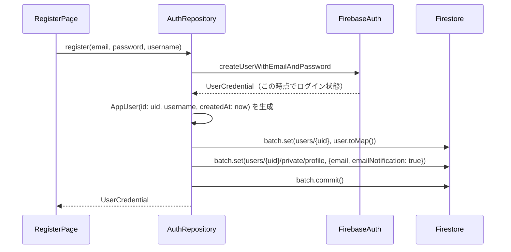

# lib/data/repositories/auth_repository.dart

| 項目 | 内容 |
|---|---|
| ファイル | `lib/data/repositories/auth_repository.dart` |
| 基本設計 | [01 認証・ユーザー登録承認](../../01_認証・ユーザー登録承認.md) の「3.1 新規登録から承認まで」「3.2 ログイン・ログアウト」「4. データ設計」 |
| 関連する基本設計 | [09 プロフィール](../../09_プロフィール.md)（ログアウト）。ほか `currentUserId` を通じて 02〜08 の全機能（所有者判定・投稿者 ID の取得） |
| レイヤ | Repository |
| 主な依存先 | `lib/data/models/app_user.dart`、`package:firebase_auth`、`package:cloud_firestore` |
| 主な利用元 | `lib/app/dependencies.dart`（生成・提供）, `lib/app/main_shell.dart`, `lib/ui/auth/auth_gate.dart`, `lib/ui/auth/login_page.dart`, `lib/ui/auth/register_page.dart`, `lib/ui/auth/pending_approval_page.dart`, `lib/ui/profile/profile_page.dart`, `lib/ui/album/album_detail_page.dart`, `lib/ui/album/widgets/album_edit_dialog.dart`, `lib/ui/contest/contest_detail_page.dart`, `lib/ui/contest/widgets/contest_edit_dialog.dart`, `lib/ui/core/widgets/comment_section.dart`, `lib/ui/core/widgets/reaction_bar.dart`, `lib/ui/event/event_detail_page.dart`, `lib/ui/event/widgets/event_edit_dialog.dart`, `lib/ui/notification/notification_page.dart`, `lib/ui/notification/widgets/notification_bell.dart`, `lib/ui/post/post_add_view_model.dart`, `lib/ui/post/post_detail_view_model.dart` |
| テスト | `test/data/repositories/auth_repository_test.dart` |

## 1. 責務

Firebase Auth（メール/パスワード）の操作と、新規登録時の Firestore ユーザードキュメント作成を担う。

- 認証状態の購読・現在ユーザー（UID）の取得。
- ログイン・ログアウト。
- 新規登録: Auth ユーザー作成後、未承認の公開プロフィール `users/{uid}` と非公開プロフィール `users/{uid}/private/profile` を 1 つのバッチで作成する。この作成が Cloud Functions `onUserCreated` の発火条件になる。

ユーザードキュメントの読み取り・プロフィール更新は [UserRepository](user_repository.md) が担う。

## 2. 構成要素（クラス・関数・定数の一覧）

| 種別 | 名前 | 概要 |
|---|---|---|
| クラス | `AuthRepository` | 認証リポジトリ |
| 定数 | `AuthRepository.usersCollection` | `'users'` |
| 定数 | `AuthRepository.privateProfileDoc` | `'private/profile'`（`users/{uid}` 配下の非公開ドキュメントへの相対パス） |
| ゲッター | `authStateChanges` / `currentUser` / `currentUserId` | 認証状態 |
| メソッド | `signIn` / `register` / `signOut` | 認証操作 |

## 3. 公開インターフェース（コンストラクタ引数・プロパティ・メソッドのシグネチャと説明）

### コンストラクタ

```dart
AuthRepository({FirebaseAuth? auth, FirebaseFirestore? firestore})
```

| 引数 | 既定値 | 説明 |
|---|---|---|
| `auth` | `FirebaseAuth.instance` | テストでは `MockFirebaseAuth` を渡す |
| `firestore` | `FirebaseFirestore.instance` | テストでは `FakeFirebaseFirestore` を渡す |

### プロパティ・メソッド

| シグネチャ | 説明 |
|---|---|
| `static const String usersCollection = 'users'` | ユーザーコレクション名 |
| `static const String privateProfileDoc = 'private/profile'` | 非公開プロフィールの相対パス |
| `Stream<User?> get authStateChanges` | `FirebaseAuth.authStateChanges()` をそのまま返す。ログイン・ログアウトのたびに流れる |
| `User? get currentUser` | `FirebaseAuth.currentUser` |
| `String? get currentUserId` | `currentUser?.uid`。未ログインなら `null` |
| `Future<UserCredential> signIn(String email, String password)` | メール/パスワードでログイン |
| `Future<UserCredential> register(String email, String password, String username)` | 新規登録（Auth 作成 + Firestore 2 ドキュメント作成） |
| `Future<void> signOut()` | ログアウト |

## 4. 内部状態（フィールド・状態遷移）

| フィールド | 型 | 説明 |
|---|---|---|
| `_auth` | `FirebaseAuth`（final） | 注入された Auth |
| `_firestore` | `FirebaseFirestore`（final） | 注入された Firestore |

本クラス自身は可変状態を持たない。ログイン状態は Firebase Auth SDK が保持する。

`AppDependencies` が `late final` で 1 インスタンスだけ生成し、`DependencyScope` が `Provider<AuthRepository>` として全画面に提供する。

## 5. 処理詳細（メソッドごとの手順・分岐・呼び出す Repository/SDK）

### `signIn(email, password)`

1. `_auth.signInWithEmailAndPassword(email: email, password: password)` を呼び、その `Future` をそのまま返す。
2. 入力の整形（`trim` 等）は行わない。呼び出し元の `LoginPage` がメールを `trim()` して渡す。

### `register(email, password, username)`



1. `_auth.createUserWithEmailAndPassword(email:, password:)` で Auth ユーザーを作る。成功すると SDK 上はログイン状態になる。
2. `credential.user!.uid` を取り出す。
3. `AppUser(id: uid, username: username, createdAt: DateTime.now())` を生成する。`bio` は `''`、`profileImageUrl` は `null`、`role` は `'member'`、`approved` は `false`（コンストラクタ既定値）。
4. `_firestore.batch()` を作り、次の 2 件を `set` する。
   - `users/{uid}` ← `user.toMap()`
   - `users/{uid}/private/profile` ← `{'email': email, 'emailNotification': true}`
5. `batch.commit()` を待ち、`credential` を返す。

公開・非公開の 2 ドキュメントを同一バッチで作るため、`private/profile` の作成をトリガーとする `onUserCreated` の発火時点で `users/{uid}` も存在する。

### `signOut()`

`_auth.signOut()` を返す。画面遷移は行わない（`AuthGate` が `authStateChanges` を受けて `LoginPage` に切り替える）。

## 6. データ仕様（読み書きする Firestore/Storage のパス・フィールド、定数値）

`register` が作成するドキュメント:

| パス | フィールド | 値 |
|---|---|---|
| `users/{uid}` | `id` | uid |
| | `username` | 引数 `username`（`RegisterPage` で `trim` 済み） |
| | `bio` | `''` |
| | `profileImageUrl` | `null` |
| | `role` | `'member'` |
| | `approved` | `false` |
| | `createdAt` | `Timestamp.fromDate(DateTime.now())`（クライアント時刻） |
| `users/{uid}/private/profile` | `email` | 引数 `email` |
| | `emailNotification` | `true` |

`firestore.rules` は `users/{uid}` の作成を本人・`approved == false`・`role == 'member'` に限定しており、本メソッドの書き込みはこれを満たす。

## 7. 例外・エラー処理（例外の扱い・戻り値・表示メッセージ）

本クラスは例外を捕捉せず、すべて呼び出し元へ伝播する（他の Repository の「`bool`/`null` に変換」方針の例外。認証エラーの種別を `FirebaseAuthException.code` で画面が判別するため）。

| メソッド | 起こりうる例外 | 呼び出し元での扱い |
|---|---|---|
| `signIn` | `FirebaseAuthException`（`invalid-credential` 等） | `LoginPage` が `authErrorMessage` で日本語化して SnackBar |
| `register`（Auth 作成） | `FirebaseAuthException`（`email-already-in-use`, `weak-password` 等） | `RegisterPage` が同上 |
| `register`（バッチ commit） | `FirebaseException`（権限・通信） | `RegisterPage` が「登録に失敗しました」 |
| `signOut` | 通常は発生しない | 呼び出し元は捕捉していない |

`register` は Auth 作成後に commit が失敗してもロールバックしない（「9. 備考」参照）。

## 8. テスト観点（既存テストが確認していること / 未テストの観点）

既存テスト（`test/data/repositories/auth_repository_test.dart`、`MockFirebaseAuth` + `FakeFirebaseFirestore`）:

- `register` 後に `currentUserId` が新規 uid になること。
- `users/{uid}` が作られ、`username`・`approved: false`・`role: 'member'` を持ち、`email` キーを持たないこと。
- `users/{uid}/private/profile` が作られ、`email` を持つこと。
- `signOut` 後に `currentUserId` が `null` になること。

未テストの観点:

- `signIn` の成功・失敗。
- `emailNotification: true` の書き込み。
- バッチ commit 失敗時の振る舞い。
- ルール上の作成可否（`test/rules/users.test.mjs` がルール側で確認。Dart テストはルールを評価しない）。

## 9. 備考・既知の課題

- Auth ユーザー作成とバッチ commit はアトミックでない。commit が失敗すると Auth ユーザーだけが残ってログイン状態になり、`users/{uid}` が無いため `AuthGate` は承認待ち画面を出し続ける。`onUserCreated` も発火しないので承認メールも届かない。
- `currentUser` ゲッターは `lib/` 内で利用されていない（利用は `currentUserId` のみ）。
- `usersCollection` は `UserRepository.usersCollection` と重複定義されている（値は同じ `'users'`）。
- メールドメインの制限は実装されていない（基本設計 7 章のとおり）。
