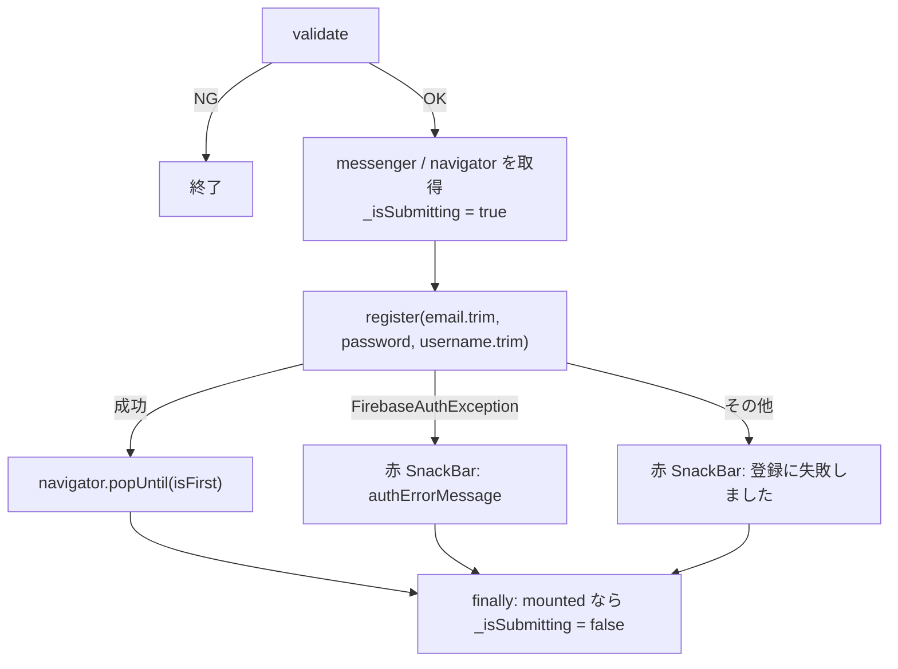

# lib/ui/auth/register_page.dart

| 項目 | 内容 |
|---|---|
| ファイル | `lib/ui/auth/register_page.dart` |
| 基本設計 | [01 認証・ユーザー登録承認](../../01_認証・ユーザー登録承認.md) の「3.1 新規登録から承認まで」「6. 入力チェック・エラー処理」 |
| 関連する基本設計 | なし |
| レイヤ | View（ViewModel なし） |
| 主な依存先 | `lib/data/repositories/auth_repository.dart`, `lib/ui/auth/login_page.dart`（`validateEmail` / `validatePassword` / `authErrorMessage`）、`package:provider`、`package:firebase_auth` |
| 主な利用元 | `lib/ui/auth/login_page.dart`（新規登録ボタンから push） |
| テスト | なし |

## 1. 責務

- ユーザー名・メールアドレス・パスワードのフォームを表示し、検証後に `AuthRepository.register` を呼ぶ。
- 登録成功後はナビゲーションスタックを最下層（`AuthGate`）まで戻す。`AuthGate` はログイン状態になったことを検知して承認待ち画面を表示する。

## 2. 構成要素（クラス・関数・定数の一覧）

| 種別 | 名前 | 概要 |
|---|---|---|
| クラス | `RegisterPage`（`StatefulWidget`） | 新規登録画面 |
| クラス | `_RegisterPageState` | フォーム状態と送信処理 |

## 3. 公開インターフェース（コンストラクタ引数・プロパティ・メソッドのシグネチャと説明）

```dart
const RegisterPage({super.key});
```

引数なし。

## 4. 内部状態（フィールド・状態遷移）

| フィールド | 型 | 初期値 | 説明 |
|---|---|---|---|
| `_formKey` | `GlobalKey<FormState>` | 新規 | |
| `_usernameController` | `TextEditingController` | 新規 | ユーザー名 |
| `_emailController` | `TextEditingController` | 新規 | メール |
| `_passwordController` | `TextEditingController` | 新規 | パスワード |
| `_authRepository` | `AuthRepository`（`late final`） | `context.read<AuthRepository>()` | |
| `_isSubmitting` | `bool` | `false` | 送信中フラグ |

## 5. 処理詳細（メソッドごとの手順・分岐・呼び出す Repository/SDK）

### ライフサイクル

- `initState`: オーバーライドなし。
- `dispose`: 3 つの `TextEditingController` を `dispose` する。

### ウィジェット構成（`build`）

```
Scaffold
├─ AppBar(title: '新規登録')
└─ Center
   └─ SingleChildScrollView(padding: 24)
      └─ ConstrainedBox(maxWidth: 420)
         └─ Form(key: _formKey)
            └─ Column(stretch)
               ├─ TextFormField  label 'ユーザー名'、validator: trim 後が空なら 'ユーザー名を入力してください'
               ├─ SizedBox(16)
               ├─ TextFormField  label 'メールアドレス', keyboardType: emailAddress, validator: validateEmail
               ├─ SizedBox(16)
               ├─ TextFormField  label 'パスワード（8文字以上）', obscureText: true, validator: validatePassword
               ├─ SizedBox(24)
               ├─ ElevatedButton  送信中は無効＋20×20 スピナー / 通常は '登録する'
               ├─ SizedBox(8)
               └─ Text '登録後、管理者の承認が完了するとご利用いただけます。'（fontSize 12, grey, 中央寄せ）
```

### `_submit()`（登録ボタン）



1. `_formKey.currentState!.validate()` が `false` なら終了。
2. `ScaffoldMessenger.of(context)` と `Navigator.of(context)` を先に取得する。
3. `setState(() => _isSubmitting = true)`。
4. `_authRepository.register(_emailController.text.trim(), _passwordController.text, _usernameController.text.trim())` を待つ。
5. 成功 → `navigator.popUntil((route) => route.isFirst)`。登録画面は `LoginPage` から push されているため、最下層の `AuthGate` まで戻す。`AuthGate` は既に承認待ち画面に切り替わっている。
6. `FirebaseAuthException` → 赤 SnackBar に `authErrorMessage(e)`（例: `email-already-in-use` →「このメールアドレスは既に登録されています」）。
7. その他の例外 → 赤 SnackBar「登録に失敗しました」。
8. `finally`: `mounted` なら `_isSubmitting = false`。

## 6. データ仕様（読み書きする Firestore/Storage のパス・フィールド、定数値）

本画面は直接アクセスしない。`AuthRepository.register` 経由で次を作成する（詳細は [auth_repository.md](auth_repository.md)）。

- Firebase Auth ユーザー
- `users/{uid}`（`username` = 入力の `trim` 結果、`approved: false`, `role: 'member'` ほか）
- `users/{uid}/private/profile`（`email` = 入力の `trim` 結果、`emailNotification: true`）

## 7. 例外・エラー処理（例外の扱い・戻り値・表示メッセージ）

| 状況 | 表示 |
|---|---|
| ユーザー名が空白のみ | ユーザー名を入力してください |
| メール未入力 / 形式不正 | メールアドレスを入力してください / メールアドレスの形式が正しくありません |
| パスワード未入力 / 8 文字未満 | パスワードを入力してください / パスワードは8文字以上で入力してください |
| `FirebaseAuthException` | 赤 SnackBar（`authErrorMessage`） |
| その他（Firestore バッチ失敗等） | 赤 SnackBar「登録に失敗しました」 |

## 8. テスト観点（既存テストが確認していること / 未テストの観点）

既存テスト: なし（`AuthRepository.register` 自体は `test/data/repositories/auth_repository_test.dart` で確認）。

未テストの観点:

- ユーザー名の空白のみ入力で検証エラーになること。
- 登録成功で最下層まで戻ること。
- `email-already-in-use` で対応メッセージが出ること。
- 送信中のボタン無効化。

## 9. 備考・既知の課題

- Auth ユーザー作成後に Firestore バッチが失敗した場合、例外で「登録に失敗しました」を出すが、Auth 上はログイン状態になっている。`popUntil` は実行されないため登録画面が残る一方、下層の `AuthGate` は承認待ち画面に切り替わっている。`users/{uid}` が無いため承認メールも送られない（[auth_repository.md](auth_repository.md) の 9 章）。
- ユーザー名の長さ・重複は検証しない。
- 入力検証・送信を持つが ViewModel は無い（基本設計 00 の 3.5）。
