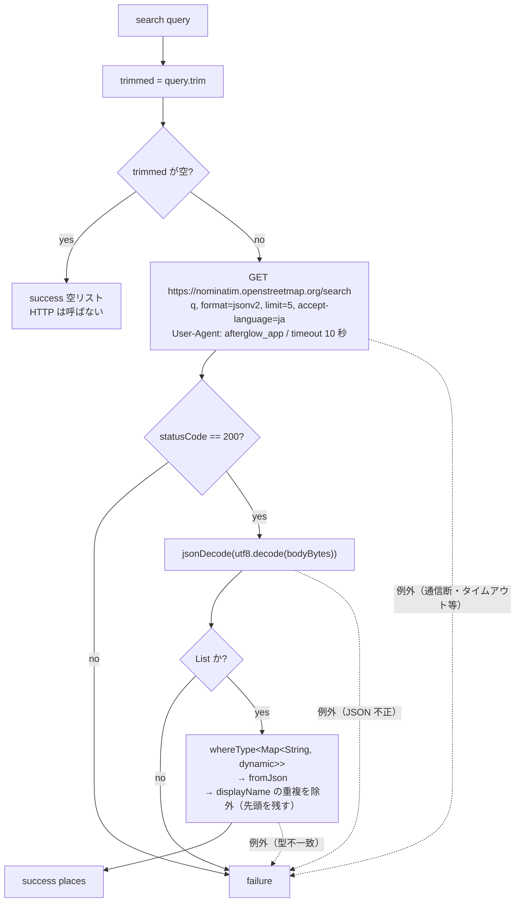

# lib/data/services/geocoding_service.dart

| 項目 | 内容 |
|---|---|
| ファイル | `lib/data/services/geocoding_service.dart` |
| 基本設計 | [02 地図・投稿作成](../../02_地図・投稿作成.md) の 3.5 場所検索 |
| 関連する基本設計 | [00 システム概要](../../00_システム概要.md) の 3.2 依存の注入 |
| レイヤ | Service |
| 主な依存先 | パッケージ `http`（`package:http/http.dart as http`）、`dart:convert`、`dart:async` |
| 主な利用元 | `lib/app/dependencies.dart`（`AppDependencies.geocodingService` を生成し `Provider<GeocodingService>` で提供）、`lib/ui/map/widgets/map_search_bar.dart`（`search` 呼び出し）、`lib/ui/map/map_screen.dart`（`PlaceSearchResult` 型のみ） |
| テスト | `test/data/services/geocoding_service_test.dart`、`test/ui/map/map_search_bar_test.dart` |

## 1. 責務

地名・施設名から座標を得るジオコーディングの薄いラッパー。OSM Nominatim の `/search` API を呼び、結果を `PlaceSearchResult` のリストに変換する。HTTP エラー・タイムアウト・パース失敗などはすべて例外にせず `PlaceSearchResponse.failure()` で返す（`LocationResult` と同じ流儀）。

呼び出し頻度の制御（入力確定時のみ検索）は呼び出し側（`MapSearchBar`）の責務とする。

## 2. 構成要素

| 名前 | 種別 | 概要 |
|---|---|---|
| `PlaceSearchResult` | クラス（イミュータブル） | 検索結果 1 件 |
| `PlaceSearchResponse` | クラス（イミュータブル） | 検索全体の結果（成否 + 候補） |
| `GeocodingService` | クラス | 検索 API の呼び出し |

`GeocodingService` の定数:

| 定数 | 値 | 用途 |
|---|---|---|
| `_host` | `'nominatim.openstreetmap.org'` | API ホスト |
| `_limit` | `5` | 一度に取得する最大候補数 |
| `_timeLimit` | `Duration(seconds: 10)` | リクエストの最大待機時間 |

## 3. 公開インターフェース

### 3.1 `PlaceSearchResult`

| シグネチャ | 説明 |
|---|---|
| `const PlaceSearchResult({required String displayName, required double latitude, required double longitude})` | |
| `factory PlaceSearchResult.fromJson(Map<String, dynamic> json)` | Nominatim の 1 件分から生成 |
| `final String displayName` | 住所を含む表示名（例: 「岡山城, 丸の内, 岡山市, 岡山県, 日本」） |
| `final double latitude` / `final double longitude` | 座標 |

### 3.2 `PlaceSearchResponse`

| シグネチャ | 説明 |
|---|---|
| `const PlaceSearchResponse.success(List<PlaceSearchResult> places)` | `isSuccess = true`。0 件 = 該当なし |
| `const PlaceSearchResponse.failure()` | `places = const []`, `isSuccess = false` |
| `final List<PlaceSearchResult> places` | 候補 |
| `final bool isSuccess` | 成否 |

### 3.3 `GeocodingService`

| シグネチャ | 説明 |
|---|---|
| `GeocodingService({http.Client? client})` | `client` 未指定時は `http.Client()`。テストは `MockClient` を注入する |
| `Future<PlaceSearchResponse> search(String query)` | `query` を検索して候補を返す。例外は投げない |

## 4. 内部状態

| フィールド | 型 | 説明 |
|---|---|---|
| `_client` | `http.Client`（final） | HTTP クライアント。`AppDependencies` で 1 インスタンスだけ生成し、アプリ稼働中は使い回す |

状態遷移なし。

## 5. 処理詳細

### 5.1 `PlaceSearchResult.fromJson`

| フィールド | 変換 |
|---|---|
| `displayName` | `json['display_name'] as String? ?? ''` |
| `latitude` | `double.tryParse(json['lat'] as String? ?? '') ?? 0` |
| `longitude` | `double.tryParse(json['lon'] as String? ?? '') ?? 0` |

Nominatim は `lat` / `lon` を文字列で返すため数値へ変換する。欠損・不正文字列は 0 に落とす。

### 5.2 `search(String query)`

1. `trimmed = query.trim()`。空なら `PlaceSearchResponse.success([])` を返す（API を呼ばない）。
2. `Uri.https(_host, '/search', {'q': trimmed, 'format': 'jsonv2', 'limit': '5', 'accept-language': 'ja'})` を組み立てる。
3. `_client.get(uri, headers: {'User-Agent': 'afterglow_app'}).timeout(_timeLimit)`。
4. `statusCode != 200` なら `failure()`。
5. 本文を `utf8.decode(response.bodyBytes)` してから `jsonDecode`（`Content-Type` の charset に依存せず日本語を正しく読む）。
6. 結果が `List` でなければ `failure()`。
7. 要素のうち `Map<String, dynamic>` だけを `fromJson` で変換し、`seenNames.add(place.displayName)` が true のもの（初出の表示名）だけ残す。同名・同住所の別地物（例: 城の建物と城跡の石碑）を候補一覧で区別できないため、先頭の 1 件に寄せる。
8. `success(places)` を返す。
9. 3〜8 の例外はすべて `catch (_)` で `failure()` にする。

## 6. データ仕様

| 項目 | 値 |
|---|---|
| エンドポイント | `GET https://nominatim.openstreetmap.org/search` |
| クエリ | `q`（trim 済み）, `format=jsonv2`, `limit=5`, `accept-language=ja` |
| ヘッダ | `User-Agent: afterglow_app`（Web ではブラウザが UA を付与するため実際には設定されない） |
| タイムアウト | 10 秒 |
| 使うレスポンス項目 | 配列の各要素の `display_name`（string）, `lat`（string）, `lon`（string） |
| Firestore / Storage | なし |

## 7. 例外・エラー処理

| 状況 | 戻り値 |
|---|---|
| 空クエリ（空白のみ含む） | `success([])` |
| 非 200 | `failure()` |
| 本文が JSON 配列でない | `failure()` |
| 通信例外・タイムアウト（`TimeoutException`）・JSON パース失敗 | `failure()` |
| `lat` / `lon` の文字列が数値でない・欠損 | その候補の座標を 0 にする（成功扱い） |
| `display_name` 欠損 | `''` |

例外は外へ投げない。

## 8. テスト観点

既存テスト（`geocoding_service_test.dart`、`MockClient` を注入）:

- 検索結果をパースして候補を返す。リクエストのホスト・パス・`q`・`format=jsonv2` を確認。
- 空配列は成功かつ 0 件。
- 空クエリ（空白のみ）は API を呼ばずに成功 0 件。
- 非 200 は失敗。
- 本文が JSON 配列でなければ失敗。
- 通信例外でも例外を投げず失敗。
- `display_name` が同じ候補は先頭の 1 件に寄せる。
- `lat` / `lon` が不正な文字列でも 0 にフォールバックする。

未テストの観点:

- `limit=5` / `accept-language=ja` / `User-Agent` の送信。
- タイムアウト（10 秒）で失敗になること。

## 9. 備考・既知の課題

- `lat` / `lon` が文字列以外（数値）で返ると `as String?` のキャストで例外になり、1 件の不正で検索全体が `failure()` になる。
- 座標が 0 にフォールバックした候補（緯度経度 0, 0）も除外されず候補に並ぶ。
- Nominatim の利用ポリシー（1 秒 1 回まで）は本クラスでは制御しない。
- `_client` を `close()` する処理は無い（アプリ全体で 1 インスタンスのため実害は小さい）。
