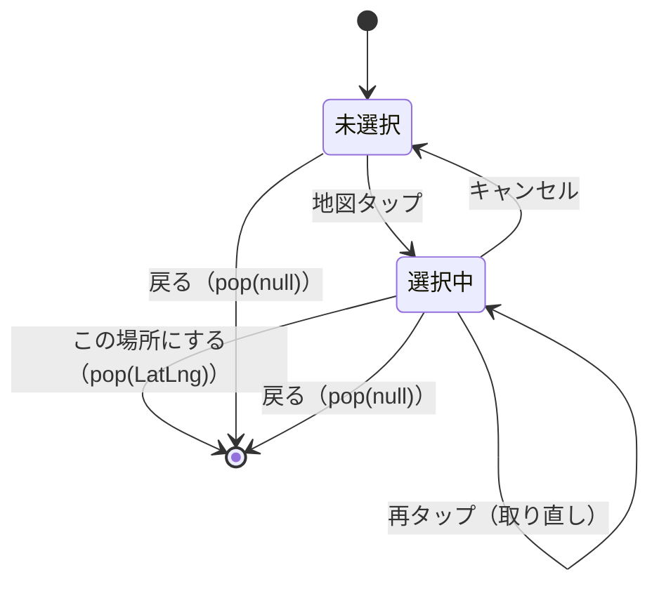

# lib/ui/map/location_picker_page.dart

| 項目 | 内容 |
|---|---|
| ファイル | `lib/ui/map/location_picker_page.dart` |
| 基本設計 | [02 地図・投稿作成](../../02_地図・投稿作成.md) の 3.1 投稿位置の選択（同じ選択 → 確定の操作を流用） |
| 関連する基本設計 | [03 フィード・投稿詳細](../../03_フィード・投稿詳細.md) の 3.2 編集（「位置を変更」から開く。Issue #37） |
| レイヤ | View |
| 主な依存先 | `ui/map/widgets/post_location_confirm_bar.dart`。パッケージ: `flutter_map`, `latlong2` |
| 主な利用元 | `lib/ui/post/widgets/post_detail_view.dart`（`_changeLocation`） |
| テスト | `test/ui/map/location_picker_page_test.dart`、`test/ui/post/post_detail_page_test.dart`（位置変更の結合） |

## 1. 責務

投稿位置を地図から選び直すフルスクリーンページ（Issue #37）。初期位置を中心に地図を開いて現在の位置を赤ピンで示し、地図タップで新しい位置を選択、確認バーで確定すると選んだ `LatLng` を `Navigator.pop` の戻り値で返す。確定せずに戻った場合は null が返る。

Firestore への保存は行わない。呼び出し側（`PostDetailView`）が戻り値を `PostDetailViewModel.changePosition` に渡し、保存時にまとめて書き込む。

## 2. 構成要素

| 名前 | 種別 | 公開 | 概要 |
|---|---|---|---|
| `LocationPickerPage` | `StatefulWidget` | 公開 | 位置選択ページ |
| `_LocationPickerPageState` | `State<LocationPickerPage>` | 非公開 | 選択状態と描画 |

定数: `_LocationPickerPageState._initialZoom = 16.0`（街区が見えるズームで開き、微調整しやすくする）。

## 3. 公開インターフェース

| シグネチャ | 説明 |
|---|---|
| `const LocationPickerPage({super.key, required LatLng initialPosition})` | `initialPosition` は現在の投稿位置。地図の初期中心と赤ピンに使う |
| 戻り値（ルート） | `Navigator.push<LatLng>` の結果として、確定時は選択した `LatLng`、戻る操作では `null` |

呼び出し例（`post_detail_view.dart`）:

```dart
final selected = await Navigator.of(context).push<LatLng>(
  MaterialPageRoute<LatLng>(
    builder: (_) => LocationPickerPage(initialPosition: vm.position),
  ),
);
if (selected == null || !mounted) return;
vm.changePosition(selected);
```

## 4. 内部状態

| フィールド | 型 | 初期値 | 説明 |
|---|---|---|---|
| `_selectedPos` | `LatLng?` | `null` | 地図タップで選択中の新しい位置。null の間は選択マーカーも確認バーも出さない。再タップで置き換わる |



## 5. 処理詳細

### 5.1 ライフサイクル

`initState` / `dispose` はオーバーライドしない。`MapController` も持たない（地図の移動はユーザー操作のみ）。

### 5.2 `_confirmSelection()`

1. `_selectedPos` を `pos` に退避。null なら何もしない。
2. `Navigator.of(context).pop(pos)`。

### 5.3 `_cancelSelection()`

`setState(() => _selectedPos = null)`。マーカーと確認バーが消える。

### 5.4 `build`

| 要素 | 内容 |
|---|---|
| `AppBar` | `title: Text('位置を選び直す')`（戻るボタンは既定。押すと null が返る） |
| `bottomSheet` | `_selectedPos == null` なら null。それ以外は `PostLocationConfirmBar(message: 'この場所に変更しますか？', confirmLabel: 'この場所にする', confirmIcon: Icons.check, onConfirm: _confirmSelection, onCancel: _cancelSelection)` |
| `body` | `FlutterMap`（下記） |

`FlutterMap`:

- `MapOptions(initialCenter: widget.initialPosition, initialZoom: 16.0, interactionOptions: InteractionOptions(flags: InteractiveFlag.all & ~InteractiveFlag.rotate), onTap: ...)`（回転のみ無効。Issue #57）
- `onTap(tapPosition, latLng)`: `setState(() => _selectedPos = latLng)`。
- children（描画順）:
  1. `TileLayer(urlTemplate: 'https://tile.openstreetmap.org/{z}/{x}/{y}.png', userAgentPackageName: 'com.afterglow_app.app')`
  2. 現在の投稿位置: `Marker(point: widget.initialPosition, width/height: 48, child: IgnorePointer(child: Icon(Icons.location_on, color: Colors.red, size: 40)))`。タップは透過する。
  3. `_selectedPos != null` のとき選択マーカー: `Marker(point: _selectedPos!, width/height: 48, child: IgnorePointer(child: Icon(Icons.add_location_alt, color: colorScheme.primary, size: 40)))`。`MapScreen` の選択マーカーと同じスタイル。

`MapScreen` と異なり、検索バー・現在地 FAB・投稿ピン一覧は持たない。

## 6. データ仕様

| 対象 | 内容 |
|---|---|
| Firestore / Storage | なし |
| 外部 URL | OSM タイル `https://tile.openstreetmap.org/{z}/{x}/{y}.png` |
| 定数 | 初期ズーム `16.0` |

## 7. 例外・エラー処理

なし（非同期処理・外部呼び出しを持たない）。未選択で確定することは確認バーが出ないため起こらず、`_confirmSelection` も null ガードを持つ。

## 8. テスト観点

既存テスト（`location_picker_page_test.dart`）:

- 初期状態ではタイトル「位置を選び直す」と赤ピン（`location_on`）1 つだけを表示し、選択マーカー・確認バーは出さない。
- 地図タップで選択マーカーと確認バー（「この場所に変更しますか？」「この場所にする」）が出る。
- 「キャンセル」で選択マーカーと確認バーが消える。
- 確定でタップ位置の `LatLng` が push の戻り値として返る。

既存テスト（`post_detail_page_test.dart`）:

- 編集モードで「位置を変更」ボタンを表示する。
- 位置を選び直して保存すると Firestore の緯度経度が更新される。

未テストの観点:

- 確定せずに戻ると null が返り、呼び出し側の位置が変わらないこと。
- 再タップで選択マーカーが新しい位置へ移ること。

## 9. 備考・既知の課題

- 場所検索・現在地移動が無いため、遠い場所へ動かすにはパン・ズームで地図を移動する必要がある。
- タイル URL・`userAgentPackageName`・回転無効の設定は `MapScreen` と重複して定義している。
