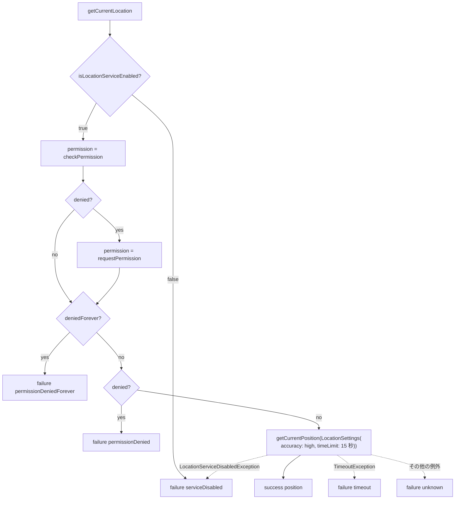

# lib/data/services/location_service.dart

| 項目 | 内容 |
|---|---|
| ファイル | `lib/data/services/location_service.dart` |
| 基本設計 | [02 地図・投稿作成](../../02_地図・投稿作成.md) の 3.4 現在地取得 |
| 関連する基本設計 | [00 システム概要](../../00_システム概要.md) の 3.2 依存の注入 |
| レイヤ | Service |
| 主な依存先 | パッケージ `geolocator`（`Geolocator`, `LocationPermission`, `LocationSettings`, `LocationAccuracy`, `Position`, `LocationServiceDisabledException`）、`dart:async`（`TimeoutException`） |
| 主な利用元 | `lib/app/dependencies.dart`（`AppDependencies.locationService` を生成し `Provider<LocationService>` で提供）、`lib/ui/map/map_screen.dart`（`getCurrentLocation` / `openAppSettings` / `messageFor`） |
| テスト | `test/data/services/location_service_test.dart` |

## 1. 責務

端末の位置情報（GPS）へのアクセスの薄いラッパー。位置情報サービスの有効性・権限を順に確認し、必要なら権限を要求してから現在地を取得する。失敗しても例外を投げず、理由を `LocationErrorType` として `LocationResult` で返す。失敗理由ごとのユーザー向け文言も提供する。

`geolocator` の静的 API を関数としてコンストラクタで受け取り、テストから差し替えられるようにしている。

## 2. 構成要素

| 名前 | 種別 | 概要 |
|---|---|---|
| `LocationErrorType` | enum | 失敗理由 |
| `LocationResult` | クラス（イミュータブル） | 取得結果（成功 = `position`、失敗 = `errorType`） |
| `LocationService` | クラス | 現在地取得・設定画面を開く・文言 |

`LocationErrorType` の値:

| 値 | 意味 |
|---|---|
| `serviceDisabled` | 端末の位置情報サービスが無効 |
| `permissionDenied` | 利用が拒否された（再要求で許可され得る） |
| `permissionDeniedForever` | 永久拒否（端末設定からの許可が必要） |
| `timeout` | 取得がタイムアウト |
| `unknown` | その他の予期しない失敗 |

定数: `LocationService._timeLimit = Duration(seconds: 15)`。

## 3. 公開インターフェース

### 3.1 `LocationResult`

| シグネチャ | 説明 |
|---|---|
| `const LocationResult.success(Position position)` | `errorType = null` |
| `const LocationResult.failure(LocationErrorType errorType)` | `position = null` |
| `final Position? position` | 成功時の位置 |
| `final LocationErrorType? errorType` | 失敗理由 |
| `bool get isSuccess` | `position != null` |

### 3.2 `LocationService`

```dart
LocationService({
  Future<bool> Function()? isLocationServiceEnabled,
  Future<LocationPermission> Function()? checkPermission,
  Future<LocationPermission> Function()? requestPermission,
  Future<Position> Function({LocationSettings? locationSettings})? getCurrentPosition,
  Future<bool> Function()? openAppSettings,
})
```

| 引数 | 既定値 |
|---|---|
| `isLocationServiceEnabled` | `Geolocator.isLocationServiceEnabled` |
| `checkPermission` | `Geolocator.checkPermission` |
| `requestPermission` | `Geolocator.requestPermission` |
| `getCurrentPosition` | `Geolocator.getCurrentPosition` |
| `openAppSettings` | `Geolocator.openAppSettings` |

| メソッド | 説明 |
|---|---|
| `Future<LocationResult> getCurrentLocation()` | 現在地を取得する。例外は投げない |
| `Future<bool> openAppSettings()` | 端末のアプリ設定画面を開く（永久拒否からの復帰導線） |
| `static String messageFor(LocationErrorType type)` | 失敗理由に対応する日本語メッセージ |

## 4. 内部状態

コンストラクタで受けた 5 つの関数を `final` フィールド（`_isLocationServiceEnabled`, `_checkPermission`, `_requestPermission`, `_getCurrentPosition`, `_openAppSettings`）に保持するだけで、可変状態は持たない。

## 5. 処理詳細

### 5.1 `getCurrentLocation()`



1. `_isLocationServiceEnabled()` が false → `failure(serviceDisabled)`。
2. `permission = _checkPermission()`。`LocationPermission.denied` なら `_requestPermission()` の結果で置き換える（`deniedForever` のときは要求しない）。
3. `permission == deniedForever` → `failure(permissionDeniedForever)`。
4. `permission == denied` → `failure(permissionDenied)`。
5. それ以外（`whileInUse` / `always` / `unableToDetermine`）は `_getCurrentPosition(locationSettings: LocationSettings(accuracy: LocationAccuracy.high, timeLimit: Duration(seconds: 15)))` を呼び、`success(position)` を返す。
6. 1〜5 の例外は次のとおり変換する。
   - `TimeoutException` → `failure(timeout)`
   - `LocationServiceDisabledException` → `failure(serviceDisabled)`
   - その他 → `failure(unknown)`

### 5.2 `openAppSettings()`

注入された `_openAppSettings()` をそのまま返す。

### 5.3 `messageFor(LocationErrorType type)`

| type | 文言 |
|---|---|
| `serviceDisabled` | 位置情報サービスが無効です。端末の設定でオンにしてください。 |
| `permissionDenied` | 位置情報の利用が許可されませんでした。 |
| `permissionDeniedForever` | 位置情報の利用が拒否されています。設定から許可してください。 |
| `timeout` | 現在地の取得がタイムアウトしました。時間をおいて再度お試しください。 |
| `unknown` | 現在地を取得できませんでした。 |

`MapScreen` はこの文言を SnackBar に出し、`permissionDeniedForever` のときだけ「設定を開く」アクション（→ `openAppSettings`）を添える。

## 6. データ仕様

| 項目 | 値 |
|---|---|
| 取得精度 | `LocationAccuracy.high` |
| タイムアウト | 15 秒（`LocationSettings.timeLimit`） |
| Firestore / Storage / 端末保存 | なし |

## 7. 例外・エラー処理

`getCurrentLocation` は例外を外へ投げず、すべて `LocationResult.failure` に変換する（5.1 の 6）。`openAppSettings` は注入関数の例外をそのまま伝える（呼び出し側の `MapScreen` は `SnackBarAction.onPressed` に渡すだけで捕捉しない）。

## 8. テスト観点

既存テスト（`location_service_test.dart`、各関数をモックで注入）:

- 位置情報サービスが無効なら `serviceDisabled`。
- 拒否のまま再要求も拒否なら `permissionDenied`。
- 永久拒否なら `permissionDeniedForever`。
- 要求で許可されれば現在地を返す。
- 取得がタイムアウト（`TimeoutException`）なら `timeout`。
- 取得中の `LocationServiceDisabledException` は `serviceDisabled`。
- 予期しない例外は `unknown`。
- `messageFor` が全種別で非空メッセージを返す。

未テストの観点:

- 取得時に渡す `LocationSettings`（精度 high・15 秒）の内容。
- `openAppSettings` が注入関数へ委譲されること。
- `unableToDetermine`（主に Web）のときに取得へ進むこと。

## 9. 備考・既知の課題

- 権限要求後に `deniedForever` へ変わった場合も 3. で正しく永久拒否として扱う。
- `LocationPermission.unableToDetermine` は拒否扱いにせず取得を試みる。失敗すれば例外経由で `unknown` 等になる。
