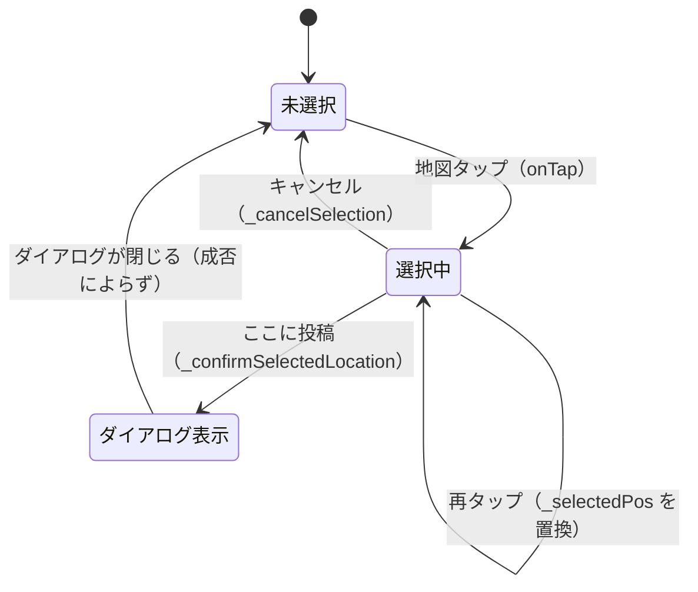
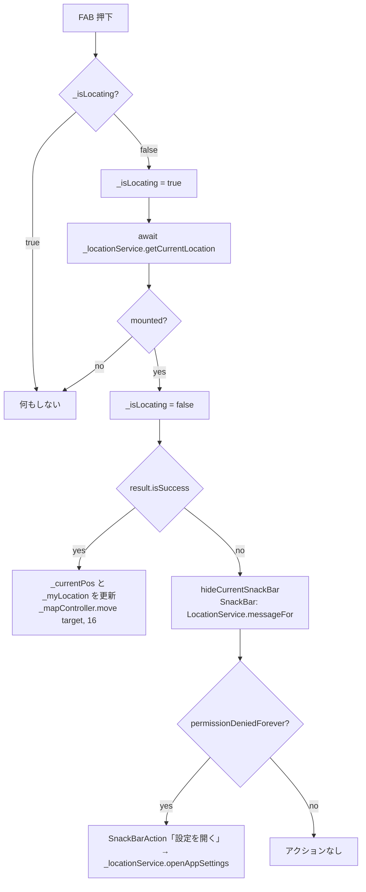

# lib/ui/map/map_screen.dart

| 項目 | 内容 |
|---|---|
| ファイル | `lib/ui/map/map_screen.dart` |
| 基本設計 | [02 地図・投稿作成](../../02_地図・投稿作成.md) の 2.1 MapScreen / 3.1 投稿位置の選択 / 3.4 現在地取得 / 3.5 場所検索 |
| 関連する基本設計 | [03 フィード・投稿詳細](../../03_フィード・投稿詳細.md)（ピンのサマリー・詳細ページ）、[08 通知](../../08_通知.md)（AppBar の通知ベル）、[09 プロフィール](../../09_プロフィール.md)（AppBar のプロフィール）、[10 お知らせ・使い方ガイド](../../10_お知らせ・使い方ガイド.md)（起動時の案内・お知らせ・使い方・フィードバック） |
| レイヤ | View |
| 主な依存先 | `data/models/post.dart`、`data/repositories/post_repository.dart` / `release_note_repository.dart` / `usage_guide_repository.dart`、`data/services/location_service.dart` / `geocoding_service.dart`（`PlaceSearchResult` 型のみ）、`ui/map/widgets/map_search_bar.dart` / `post_location_confirm_bar.dart`、`ui/post/post_add_dialog.dart` / `post_detail_page.dart` / `widgets/post_widget.dart`（`PostCardView`）、`ui/core/widgets/reaction_bar.dart` / `comment_section.dart`、`ui/notification/widgets/notification_bell.dart`、`ui/profile/profile_page.dart`、`ui/info/release_notes_page.dart` / `usage_guide_page.dart` / `widgets/release_note_dialog.dart` / `widgets/usage_guide_dialog.dart`。パッケージ: `provider`, `flutter_map`, `latlong2`, `cached_network_image`, `url_launcher` |
| 主な利用元 | `lib/app/main_shell.dart`（下部タブ index 1「Map」） |
| テスト | なし（`MapScreen` を直接対象とするテストは無い。部品は [map_search_bar.md](map_search_bar.md)・[post_location_confirm_bar.md](post_location_confirm_bar.md) 側でテスト） |

## 1. 責務

地図タブの画面。次をまとめて扱う。

- `posts` 全件を購読し、OSM タイル上に投稿ピンを描画する。ピンのタップでサマリーダイアログ、そこから詳細ページへ遷移する。
- 地図タップで投稿位置を「選択」し、確認バー（`PostLocationConfirmBar`）の「ここに投稿」で `PostAddDialog` を開く（Issue #36）。
- FAB で現在地を取得して地図を移動し、現在地に青丸を描く。失敗時は理由を SnackBar で案内する。
- 画面上部の `MapSearchBar` で選ばれた場所へ地図を移動する（Issue #39）。
- 投稿画像を事前に `precacheImage` する。
- 初回描画後に使い方ガイド／リリースお知らせを出し、AppBar から通知・使い方・フィードバック・お知らせ・プロフィールへ遷移させる。

ViewModel は持たず、View が Repository / Service を `context.read` で直接使う（[00 システム概要](../../00_システム概要.md) 3.4）。

## 2. 構成要素

| 名前 | 種別 | 公開 | 概要 |
|---|---|---|---|
| `MapScreen` | `StatefulWidget` | 公開 | 地図タブの画面 |
| `_MapScreenState` | `State<MapScreen>` | 非公開 | 状態とイベントハンドラ・描画 |
| `_MyLocationDot` | `StatelessWidget` | 非公開 | 現在地の青丸 |

`_MapScreenState` の定数:

| 定数 | 値 | 用途 |
|---|---|---|
| `_defaultLocation` | `LatLng(34.669478, 133.951104)` | 地図の初期中心（岡山） |
| `_defaultZoom` | `14.0` | 初期ズーム |
| `_locatedZoom` | `16.0` | 現在地・検索結果へ移動したときのズーム |
| `_myLocationMarkerSize` | `28.0` | 現在地マーカーの外枠（青丸 18px + 影の余白） |
| `_feedbackFormUrl` | `'https://forms.gle/5xaCtzyDeqFVBF9D7'` | フィードバック用 Google フォーム |

`_MyLocationDot` の定数: `_diameter = 18.0`。

## 3. 公開インターフェース

| シグネチャ | 説明 |
|---|---|
| `const MapScreen({super.key})` | 引数なし。依存はすべて `context.read` で取得する |

## 4. 内部状態

| フィールド | 型 | 初期値 | 説明 |
|---|---|---|---|
| `_mapController` | `MapController` | `MapController()` | 地図の移動（`move`）に使う |
| `_currentPos` | `LatLng` | `_defaultLocation` | `FlutterMap` の `initialCenter`。地図タップ・検索・現在地取得で更新する |
| `_myLocation` | `LatLng?` | `null` | GPS で取得できた現在地。null の間は青丸を描かない |
| `_selectedPos` | `LatLng?` | `null` | 選択中の投稿位置。null の間は選択マーカーも確認バーも出さない |
| `_postRepository` | `PostRepository`（`late final`） | `context.read<PostRepository>()` | 投稿の購読 |
| `_postsStream` | `Stream<List<Post>>`（`late final`） | `_postRepository.getPosts()` | 再ビルドで再購読しないよう 1 度だけ生成 |
| `_releaseNoteRepository` | `ReleaseNoteRepository`（`late final`） | `context.read` | お知らせ判定・既読記録 |
| `_usageGuideRepository` | `UsageGuideRepository`（`late final`） | `context.read` | 使い方ガイドの表示判定・記録 |
| `_locationService` | `LocationService`（`late final`） | `context.read` | 現在地取得・設定画面を開く |
| `_isLocating` | `bool` | `false` | 現在地取得中。FAB を無効化しスピナーを出す |
| `_precachedUrls` | `Set<String>` | `{}` | プリキャッシュ済み画像 URL（重複実行防止） |

投稿位置の選択状態（`_selectedPos`）の遷移:

場所検索（`_moveToPlace`）・現在地移動（`_moveToCurrentLocation`）は `_selectedPos` を変更しない。

## 5. 処理詳細

### 5.1 ライフサイクル

- `initState`: `super.initState()` の後、`WidgetsBinding.instance.addPostFrameCallback` で初回フレーム描画後に `_showStartupDialogs()` を呼ぶ。
- `dispose`: オーバーライドしない（`_mapController` も明示的に破棄しない）。

### 5.2 `_showStartupDialogs()`（`Future<void>`）

1. `await _maybeShowUsageGuide()` が true なら終了（初回利用者には「新しくなりました」を重ねない。Issue #47）。
2. それ以外は `await _maybeAnnounce()`。

### 5.3 `_maybeShowUsageGuide()`（`Future<bool>`）

1. `_usageGuideRepository.shouldShowGuide()` が false なら false を返す。
2. `mounted` でなければ false。
3. `UsageGuideDialog.show(context)` を待つ。
4. `markGuideShown()`、続けて `_releaseNoteRepository.markAnnounced()`（新規ユーザーには過去の履歴を出さない）。
5. true を返す。
6. 例外はすべて捕捉して false を返す。

### 5.4 `_maybeAnnounce()`（`Future<void>`）

1. `_releaseNoteRepository.shouldAnnounce()` が false なら終了。
2. `announcementNote()` を取得し、非 null かつ `mounted` なら `ReleaseNoteDialog.show(context, note)` を待つ。
3. `markAnnounced()`（note が null でも記録する）。
4. 例外はすべて握りつぶす。

### 5.5 `_openSummary(Post post)`

ピンのタップで呼ぶ。`showDialog<void>` で `PostCardView(post, reactionBar: ReactionBar(post: post), commentSection: CommentSection(post: post), onOpenDetail: ...)` を表示する。`onOpenDetail` はダイアログを `Navigator.of(dialogContext).pop()` で閉じてから `_openDetail(post)` を呼ぶ。

### 5.6 `_openDetail(Post post)`

`Navigator.push` で `MaterialPageRoute` → `PostDetailPage(post, reactionBar: ReactionBar(post: post), commentSection: CommentSection(post: post))`。

### 5.7 `_openReleaseNotes()`

`Navigator.push` で `const ReleaseNotesPage()`。

### 5.8 `_openFeedbackForm()`（`Future<void>`）

1. `showDialog<bool>` で確認ダイアログを出す。タイトル「フィードバック」、本文「ご意見・ご要望のフォームを開きます。外部サイト（Google フォーム）へ移動しますか？」、ボタン「キャンセル」（false）／「開く」（true）。
2. 結果が true でない、または `mounted` でなければ終了。
3. `launchUrl(Uri.parse(_feedbackFormUrl), mode: LaunchMode.externalApplication)`。
4. 開けた、または `mounted` でなければ終了。開けなければ SnackBar「フォームを開けませんでした」。

### 5.9 `_confirmSelectedLocation()`（`Future<void>`）

確認バーの「ここに投稿」から呼ぶ。

1. `_selectedPos` をローカル `pos` に退避。null なら何もしない。
2. `showDialog<void>` で `PostAddDialog(pos: pos)` を開き、閉じるまで待つ。
3. `mounted` でなければ終了。
4. `setState` で `_selectedPos = null`（投稿の成否によらずマーカーと確認バーを消す）。新しいピンは `_postsStream` の購読で自動的に増える。

### 5.10 `_cancelSelection()`

`setState(() => _selectedPos = null)`。

### 5.11 `_moveToPlace(PlaceSearchResult place)`

`MapSearchBar.onPlaceSelected` に渡す。`LatLng(place.latitude, place.longitude)` を `_currentPos` に設定し（`setState`）、`_mapController.move(target, _locatedZoom)`。`_selectedPos` は変えない。

### 5.12 `_moveToCurrentLocation()`（`Future<void>`）

### 5.13 `build`

| 要素 | 内容 |
|---|---|
| `AppBar.title` | `Text('Map')` |
| `AppBar.actions` | `NotificationBell()` / `IconButton(help_outline, tooltip '使い方')` → `UsageGuidePage.open(context)` / `IconButton(feedback_outlined, tooltip 'フィードバック')` → `_openFeedbackForm` / `IconButton(campaign_outlined, tooltip 'お知らせ')` → `_openReleaseNotes` / `IconButton(account_circle, tooltip 'プロフィール')` → `Navigator.push(ProfilePage())` |
| `bottomSheet` | `_selectedPos == null` なら null、それ以外は `PostLocationConfirmBar(onConfirm: _confirmSelectedLocation, onCancel: _cancelSelection)`（既定文言「この場所に投稿しますか？」「ここに投稿」）。`bottomSheet` にすることで FAB が自動で押し上げられる |
| `floatingActionButton` | `FloatingActionButton(tooltip: '現在地へ移動')`。`_isLocating` 中は `onPressed: null` で、子は 24x24 の `CircularProgressIndicator(strokeWidth: 2)`。それ以外は `Icon(Icons.my_location)` |
| `body` | `Stack[ _buildMap(), Positioned(top: 8, left: 8, right: 8, child: SafeArea(child: MapSearchBar(onPlaceSelected: _moveToPlace))) ]` |

### 5.14 `_buildMap()`

`StreamBuilder<List<Post>>(stream: _postsStream)`:

1. `connectionState == waiting` の間は `Center(CircularProgressIndicator())`（地図自体を出さない。検索バーは Stack 上に残る）。
2. `posts = snapshot.data ?? []`。
3. 画像プリロード: 全投稿の全 `imageUrls` について、`_precachedUrls.add(url)` が true（初出）のときだけ `precacheImage(CachedNetworkImageProvider(url), context, onError: (_, _) {})`。
4. `FlutterMap` を返す。
   - `mapController: _mapController`
   - `MapOptions(initialCenter: _currentPos, initialZoom: _defaultZoom, interactionOptions: InteractionOptions(flags: InteractiveFlag.all & ~InteractiveFlag.rotate), onTap: ...)`（回転のみ無効。Issue #57）
   - `onTap(tapPosition, latLng)`: `setState` で `_currentPos = latLng; _selectedPos = latLng`。ダイアログは開かない。
   - children（描画順 = 前後関係）:
     1. `TileLayer(urlTemplate: "https://tile.openstreetmap.org/{z}/{x}/{y}.png", userAgentPackageName: 'com.afterglow_app.app')`
     2. `_myLocation != null` のとき現在地 `MarkerLayer`: `Marker(point: _myLocation!, width/height: 28, child: IgnorePointer(child: _MyLocationDot()))`。タップを透過し、現在地への投稿を妨げない。
     3. 投稿ピン `MarkerLayer`: 投稿ごとに `Marker(point: LatLng(post.latitude, post.longitude), width/height: 48, child: GestureDetector(onTap: () => _openSummary(post), child: Icon(Icons.location_on, color: Colors.red, size: 40)))`。
     4. `_selectedPos != null` のとき選択マーカー `MarkerLayer`: `Marker(width/height: 48, child: IgnorePointer(child: Icon(Icons.add_location_alt, color: colorScheme.primary, size: 40)))`。最前面に描き、タップは地図に通す（再タップで取り直せる）。

### 5.15 `_MyLocationDot.build`

`Center` > `Container(18x18)`。`BoxDecoration(color: Color(0xFF1A73E8), shape: circle, border: Border.all(white, width 3), boxShadow: [BoxShadow(black alpha 0.3, blurRadius 4, offset (0, 1))])`。

## 6. データ仕様

| 対象 | 内容 |
|---|---|
| Firestore 読取 | `PostRepository.getPosts()` 経由で `posts` コレクション全件を `snapshots()` 購読（件数制限なし）。詳細は [post_repository.md](post_repository.md) |
| 端末ストレージ | `UsageGuideRepository` / `ReleaseNoteRepository` 経由（[10](../../10_お知らせ・使い方ガイド.md)） |
| 外部 URL | OSM タイル `https://tile.openstreetmap.org/{z}/{x}/{y}.png`、フィードバック `https://forms.gle/5xaCtzyDeqFVBF9D7` |
| 書き込み | なし（投稿作成は `PostAddDialog` が行う） |

## 7. 例外・エラー処理

| 状況 | 扱い |
|---|---|
| 使い方ガイド・お知らせの読込失敗 | 例外を握りつぶし、何も表示しない |
| 現在地取得の失敗 | `LocationResult.errorType` に応じた `LocationService.messageFor` の文言を SnackBar（直前の SnackBar は消す）。永久拒否のときだけ「設定を開く」アクション |
| フィードバックフォームを開けない | SnackBar「フォームを開けませんでした」 |
| プリキャッシュ失敗 | `onError` で無視 |
| 投稿購読のエラー | 個別処理なし。`snapshot.data` が null なら空リストとしてピン 0 件で地図を描く |
| 非同期処理後の画面破棄 | `mounted` を確認して `setState` / SnackBar を行わない |

## 8. テスト観点

既存テスト: `MapScreen` 単体のテストは無い。

未テストの観点:

- 地図タップで選択マーカーと確認バーが出る／キャンセルで消える／「ここに投稿」で `PostAddDialog` が開き、閉じると選択が解除される。
- 投稿ピンのタップでサマリー、「詳細を見る」で詳細ページへ遷移する。
- 現在地取得の成功で青丸が出る、失敗種別ごとの SnackBar と「設定を開く」の有無、取得中の FAB 無効化。
- 検索結果選択で地図が移動し、選択状態が保たれる。
- 起動時に使い方ガイドが出た場合はお知らせを出さない。
- 同一 URL の画像を 2 度プリキャッシュしない。

## 9. 備考・既知の課題

- `_currentPos` は `initialCenter` にしか使われず、初回ビルド後の更新は地図に影響しない（実際の移動は `_mapController.move`）。事実上、書き込みのみの状態になっている。
- `posts` 全件を購読し全画像をプリロードするため、投稿数に比例して通信量・メモリが増える（基本設計 7 章）。`_precachedUrls` も削除された投稿の URL を保持し続ける。
- 起動時は現在地へ自動移動しない（FAB 押下時のみ）。
- 投稿購読が `waiting` の間は地図そのものを描かないため、初回は地図操作も位置選択もできない。
- `geocoding_service.dart` は `PlaceSearchResult` 型のためだけに import している。
