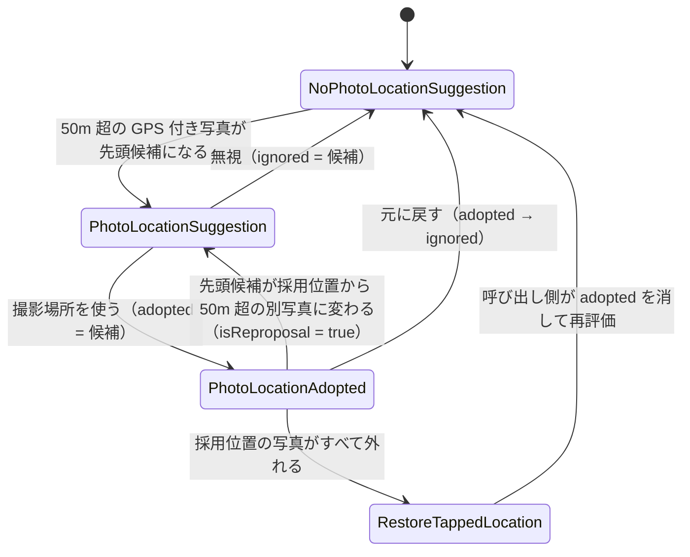

# lib/ui/post/photo_location_suggestion.dart

| 項目 | 内容 |
|---|---|
| ファイル | `lib/ui/post/photo_location_suggestion.dart` |
| 基本設計 | [02 地図・投稿作成](../../02_地図・投稿作成.md) の「3.3 撮影場所の提案（Issue #46）」 |
| 関連する基本設計 | なし |
| レイヤ | ViewModel（ViewModel が使う純粋な判定ロジック。Flutter に依存しない） |
| 主な依存先 | `package:latlong2`（`LatLng`, `Distance`） |
| 主な利用元 | `lib/ui/post/post_add_view_model.dart`（`evaluate`）, `lib/ui/post/post_add_dialog.dart`（結果型の判定・`formatDistance`） |
| テスト | `test/ui/post/photo_location_suggestion_test.dart`（他に `post_add_view_model_test.dart`・`post_add_dialog_test.dart` で間接的に確認） |

## 1. 責務

投稿ダイアログで選んだ写真の撮影位置（EXIF GPS）の並びと、タップ地点・採用中の位置・無視した位置から、「撮影場所を提案するか / 採用を維持するか / タップ地点へ戻すか」を判定する純粋関数を提供する（Issue #46）。結果は sealed クラスで表し、UI は型で分岐する。距離の表示用整形も持つ。

## 2. 構成要素（クラス・関数・定数の一覧）

| 種別 | 名前 | 概要 |
|---|---|---|
| sealed クラス | `PhotoLocationResult` | 判定結果の基底 |
| final クラス | `NoPhotoLocationSuggestion` | 提案も採用もしていない |
| final クラス | `PhotoLocationSuggestion` | 撮影場所への差し替えを提案する |
| final クラス | `PhotoLocationAdopted` | 撮影場所を採用中 |
| final クラス | `RestoreTappedLocation` | 採用写真が無くなりタップ地点へ戻すべき |
| クラス | `PhotoLocationSuggestions` | 判定（`evaluate`）と距離整形（`formatDistance`）の static メソッド群 |
| 定数 | `PhotoLocationSuggestions.thresholdMeters` | `50`（m）。この距離以内は同じ場所とみなす |
| 定数（private） | `PhotoLocationSuggestions._distance` | `Distance(roundResult: false)`（latlong2 の既定アルゴリズム、丸めなし） |

## 3. 公開インターフェース（コンストラクタ引数・プロパティ・メソッドのシグネチャと説明）

### 3.1 結果型

| クラス | コンストラクタ | プロパティ |
|---|---|---|
| `NoPhotoLocationSuggestion` | `const NoPhotoLocationSuggestion()` | なし |
| `PhotoLocationSuggestion` | `const PhotoLocationSuggestion({required LatLng location, required int photoNumber, required double distanceMeters, required bool isReproposal})` | `location`: 提案する撮影場所 / `photoNumber`: 何枚目の写真か（1 始まり）/ `distanceMeters`: **タップ地点**からの距離（m）/ `isReproposal`: 採用中に別の撮影場所へ変わったことによる再提案か |
| `PhotoLocationAdopted` | `const PhotoLocationAdopted(LatLng location)` | `location`: 採用中の位置 |
| `RestoreTappedLocation` | `const RestoreTappedLocation()` | なし |

### 3.2 `PhotoLocationSuggestions`

```dart
static PhotoLocationResult evaluate({
  required List<LatLng?> photoLocations,   // 写真の並び順どおりの撮影位置（無ければ null）
  required LatLng tappedLocation,          // 地図でタップした地点
  LatLng? adoptedLocation,                 // 採用中の撮影場所
  LatLng? ignoredLocation,                 // 「無視」した撮影場所
});

static String formatDistance(double meters);
```

## 4. 内部状態（フィールド・状態遷移）

状態は持たない（static のみ）。判定結果の遷移は呼び出し側（`PostAddViewModel`）が `adoptedLocation` / `ignoredLocation` を更新して再評価することで生じる。



## 5. 処理詳細（メソッドごとの手順・分岐・呼び出す Repository/SDK）

### 5.1 `evaluate`

距離はすべて `_distance(a, b)`（m）で計算し、`≦ thresholdMeters`（50m）を「同じ場所」とする。

1. **採用写真の消失判定**: `adoptedLocation != null` で、`photoLocations` のどの非 null 要素とも 50m 以内にならなければ `RestoreTappedLocation` を返す。
2. **候補の決定**: `photoLocations` で最初の非 null 要素の `index` を探す。無ければ `NoPhotoLocationSuggestion`。
3. `candidate = photoLocations[index]`、`distance = _distance(tappedLocation, candidate)`。
4. **抑制判定**: 次のいずれかなら提案しない。
   - `distance ≦ 50`（タップ地点とほぼ同じ）
   - `ignoredLocation` と候補が 50m 以内
   - `adoptedLocation` と候補が 50m 以内

   このとき `adoptedLocation == null` なら `NoPhotoLocationSuggestion`、そうでなければ `PhotoLocationAdopted(adoptedLocation)`（採用状態を維持）。
5. それ以外は `PhotoLocationSuggestion(location: candidate, photoNumber: index + 1, distanceMeters: distance, isReproposal: adoptedLocation != null)`。

候補は常に「並び順で最初の GPS 付き写真」1 枚だけで、2 枚目以降の GPS は採用写真の残存判定（手順 1）にしか使わない。

### 5.2 `formatDistance`

- `meters < 1000` → `'約 ${meters.round()}m'`（例: `約 350m`）
- それ以外 → `'約 ${(meters / 1000).toStringAsFixed(1)}km'`（例: `約 1.2km`）

## 6. データ仕様（読み書きする Firestore/Storage のパス・フィールド、定数値）

Firestore / Storage の読み書きなし。

| 定数 | 値 |
|---|---|
| `thresholdMeters` | `50`（m） |
| 距離計算 | `Distance(roundResult: false)` |

## 7. 例外・エラー処理（例外の扱い・戻り値・表示メッセージ）

例外は投げない。表示メッセージは持たない（バナー文言は `PostAddDialog`、戻し通知は `PostAddViewModel` が持つ）。

## 8. テスト観点（既存テストが確認していること / 未テストの観点）

`test/ui/post/photo_location_suggestion_test.dart`:

- GPS が無ければ（空・全 null）提案しない
- タップ地点から 49.9m は提案せず、50.1m は提案する
- null を飛ばして最初の GPS 付き写真を番号付き（`photoNumber`）・タップ地点からの距離付きで提案し、`isReproposal == false`
- 先頭候補がタップ地点と同じなら、後ろに遠い写真があっても提案しない
- 採用位置に該当する写真が全て消えたら（空 / null / 別の場所 / 50.1m 離れ）`RestoreTappedLocation`
- 採用位置から 49.9m の写真が残っていれば `PhotoLocationAdopted`
- 先頭候補が別の場所に変わっても採用写真が残っていれば `isReproposal == true` の再提案
- 無視した座標から 49.9m は抑制、50.1m は再提案。採用中かつ候補を無視済みなら `PhotoLocationAdopted`
- `formatDistance` の m / km 表記（350, 999, 1000, 1234）

未テストの観点:

- `formatDistance(999.6)` のように丸めで `約 1000m` になる境界

## 9. 備考・既知の課題

- `formatDistance` は 999.5m 以上 1000m 未満で `約 1000m` と表示される（km 表記への切り替えが丸め前の値で行われるため）。
- `distanceMeters` は再提案時もタップ地点からの距離（採用位置からではない）。ダイアログの再提案文言では距離を表示しない。
