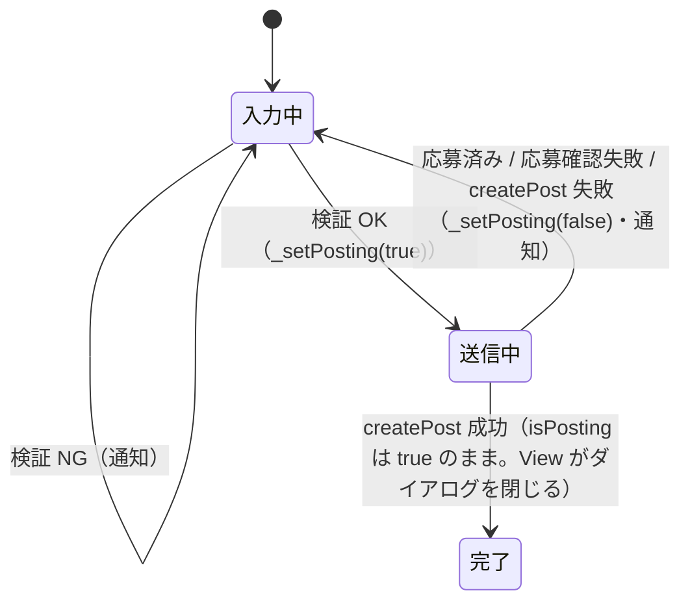
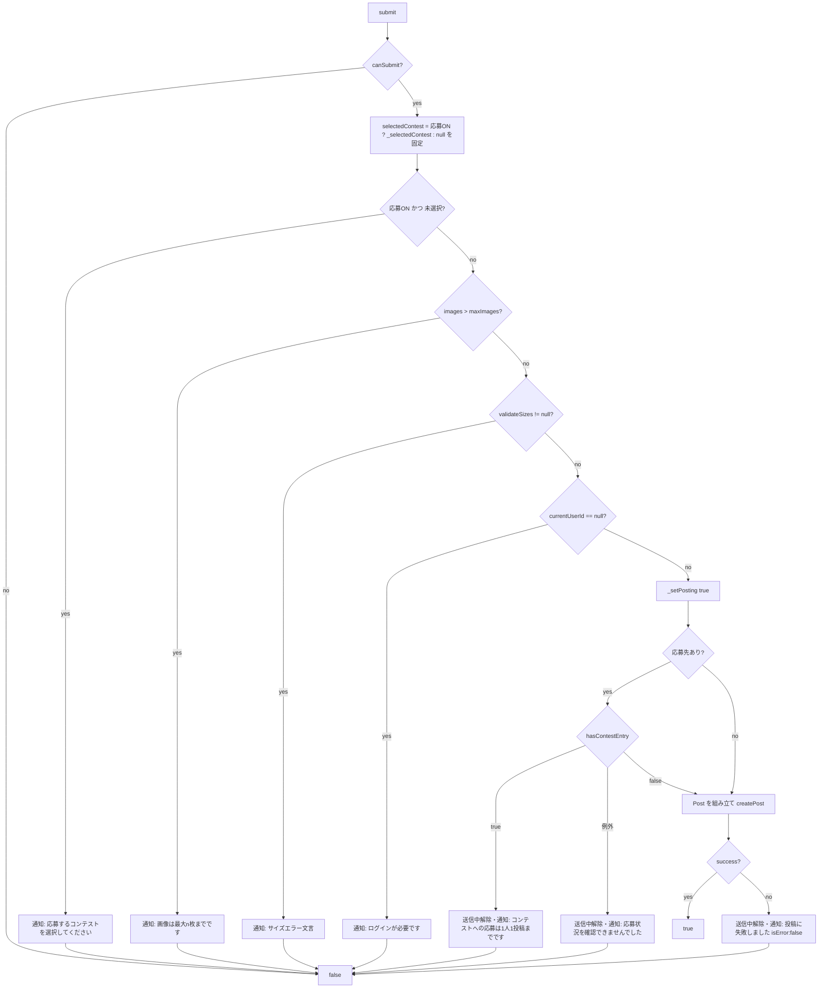

# lib/ui/post/post_add_view_model.dart

| 項目 | 内容 |
|---|---|
| ファイル | `lib/ui/post/post_add_view_model.dart` |
| 基本設計 | [02 地図・投稿作成](../../02_地図・投稿作成.md) の「2.2 PostAddDialog」「3.2 投稿作成」「3.3 撮影場所の提案」「6. 入力チェック・エラー処理」 |
| 関連する基本設計 | [07 コンテスト](../../07_コンテスト.md)（4.1 応募） |
| レイヤ | ViewModel |
| 主な依存先 | `lib/data/repositories/post_repository.dart`, `lib/data/repositories/contest_repository.dart`, `lib/data/repositories/auth_repository.dart`, `lib/data/services/image_service.dart`, `lib/data/models/post.dart`, `lib/data/models/contest.dart`, `lib/ui/post/photo_location_suggestion.dart`, `package:flutter/foundation.dart`（`ChangeNotifier`）, `package:image_picker`（`XFile`）, `package:latlong2`（`LatLng`） |
| 主な利用元 | `lib/ui/post/post_add_dialog.dart` |
| テスト | `test/ui/post/post_add_view_model_test.dart`, `test/ui/post/post_add_dialog_test.dart`（ダイアログ経由） |

## 1. 責務

投稿作成ダイアログ（[post_add_dialog.md](post_add_dialog.md)）の状態とロジックを持つ `ChangeNotifier`。

- 選択画像（`XFile`・プレビュー用バイト列・撮影位置）の追加・削除・並び替え・表示位置
- 撮影場所の提案・採用・無視・元に戻す（Issue #46、判定は [photo_location_suggestion.md](photo_location_suggestion.md)）
- タグの追加・削除（PS_03）
- コンテスト応募の ON/OFF と応募先の選択
- 入力検証と送信（`PostRepository.createPost`）、送信中フラグ
- 利用者への一時的な通知を `notices`（Stream）で流す

`BuildContext` やウィジェットには依存しない。説明・場所名のテキストは View の `TextEditingController` が持ち、`submit` の引数で受け取る。

## 2. 構成要素（クラス・関数・定数の一覧）

| 種別 | 名前 | 概要 |
|---|---|---|
| クラス | `PostAddNotice` | 通知 1 件（`message`, `isError`） |
| クラス | `PostAddViewModel` | 本体（`ChangeNotifier`） |
| 定数 | `PostAddViewModel.defaultMaxImages` | `10`（コンテスト未選択時の枚数上限、PS_01 / NFR_02） |

## 3. 公開インターフェース（コンストラクタ引数・プロパティ・メソッドのシグネチャと説明）

### 3.1 `PostAddNotice`

```dart
const PostAddNotice(String message, {bool isError = true})
```

| プロパティ | 説明 |
|---|---|
| `message` | 表示文言 |
| `isError` | true なら View が赤背景の SnackBar で表示する |

### 3.2 コンストラクタ

```dart
PostAddViewModel({
  required LatLng tappedLocation,
  required PostRepository postRepository,
  required ContestRepository contestRepository,
  required AuthRepository authRepository,
  required ImageService imageService,
})
```

初期化子で `entryOpenContests = contestRepository.getEntryOpenContests()` を 1 回だけ取得して保持する（`ContestRepository` 自体はフィールドに保持しない）。

### 3.3 プロパティ

| プロパティ | 型 | 説明 |
|---|---|---|
| `tappedLocation` | `LatLng`（final） | 地図でタップした投稿地点 |
| `entryOpenContests` | `Stream<List<Contest>>`（final） | 応募受付中のコンテスト一覧 |
| `notices` | `Stream<PostAddNotice>` | 通知（broadcast） |
| `images` | `List<XFile>` | 選択画像（変更不可ビュー） |
| `previewBytes` | `List<Uint8List>` | 各画像の元バイト列（プレビュー・サイズ検証用、変更不可ビュー） |
| `tags` | `List<String>` | タグ（`#` なし、変更不可ビュー） |
| `currentImageIndex` | `int` | プレビューに表示中の画像位置 |
| `isPosting` | `bool` | 送信中 |
| `participateInContest` | `bool` | 「コンテストに応募する」スイッチ |
| `selectedContest` | `Contest?` | 応募先 |
| `photoLocationResult` | `PhotoLocationResult` | 撮影場所の判定結果 |
| `adoptedLocation` | `LatLng?` | 採用中の撮影場所 |
| `maxImages` | `int` | `selectedContest?.maxImages ?? 10` |
| `canAddImages` | `bool` | `images.length < maxImages` |
| `canSubmit` | `bool` | `!isPosting && images.isNotEmpty` |

### 3.4 メソッド

| シグネチャ | 説明 |
|---|---|
| `Future<void> loadInitialImages(List<XFile> images)` | 初期画像（テスト・再表示用）を読み込む。上限超過分は捨てる。拡張子は検証しない |
| `Future<void> addImages(List<XFile> picked)` | ギャラリーで選んだ画像を検証して追加する |
| `bool checkCanPickImages()` | 画像選択を開始してよいか。上限到達なら通知して false |
| `void removeImage(int index)` | 画像を外す |
| `void reorderImage(int oldIndex, int newIndex)` | 画像を並び替える（Issue #40） |
| `void showImageAt(int index)` | 表示位置を切り替える |
| `void usePhotoLocation(LatLng location)` | 撮影場所を採用する |
| `void ignorePhotoLocation(LatLng location)` | 提案を無視する |
| `void restoreTappedLocation()` | 採用をやめてタップ地点に戻す |
| `void addTagsFromInput(String raw)` | 入力文字列からタグを追加する |
| `void removeTag(String tag)` | タグを外す |
| `void setParticipateInContest(bool value)` | 応募スイッチを切り替える |
| `void selectContest(Contest? contest)` | 応募先を選ぶ |
| `Contest? syncSelectedContest(List<Contest>? contests)` | 最新一覧に合わせて選択を補正し、補正後の選択を返す（再描画は要求しない） |
| `Future<bool> submit({required String caption, required String locationName})` | 検証して投稿する。成功で true |
| `void dispose()` | 破棄。以降の通知・状態更新を止める |

## 4. 内部状態（フィールド・状態遷移）

| フィールド | 型 | 初期値 | 説明 |
|---|---|---|---|
| `_postRepository` / `_authRepository` / `_imageService` | — | 注入 | 依存 |
| `_notices` | `StreamController<PostAddNotice>.broadcast()` | — | 通知の発行元 |
| `_disposed` | `bool` | `false` | 破棄済みフラグ。非同期処理の再開時に確認する |
| `_images` | `List<XFile>` | `[]` | 選択画像 |
| `_previewBytes` | `List<Uint8List>` | `[]` | `_images` と同じ並び |
| `_photoLocations` | `List<LatLng?>` | `[]` | `_images` と同じ並び。EXIF GPS（無ければ null） |
| `_adoptedLocation` | `LatLng?` | `null` | 採用中の撮影場所 |
| `_ignoredLocation` | `LatLng?` | `null` | 無視した撮影場所 |
| `_photoLocationResult` | `PhotoLocationResult` | `NoPhotoLocationSuggestion()` | 最新の判定結果 |
| `_tags` | `List<String>` | `[]` | タグ |
| `_currentImageIndex` | `int` | `0` | 表示位置 |
| `_isPosting` | `bool` | `false` | 送信中 |
| `_participateInContest` | `bool` | `false` | 応募スイッチ |
| `_selectedContest` | `Contest?` | `null` | 応募先 |

`_images`・`_previewBytes`・`_photoLocations` は常に同じ長さ・同じ並びを保つ（追加・削除・並び替えを 3 つ同時に行う）。

### 4.1 送信状態の遷移



### 4.2 撮影場所の状態

`usePhotoLocation` / `ignorePhotoLocation` / `restoreTappedLocation` と画像の増減・並び替えのたびに `_refreshPhotoLocation` で再評価する（遷移は [photo_location_suggestion.md](photo_location_suggestion.md) 4 章）。

| 操作 | `_adoptedLocation` | `_ignoredLocation` |
|---|---|---|
| `usePhotoLocation(loc)` | `loc` | `null` |
| `ignorePhotoLocation(loc)` | 変更なし | `loc` |
| `restoreTappedLocation()` | `null` | 直前の `_adoptedLocation` |
| 判定が `RestoreTappedLocation` | `null` | 変更なし |

## 5. 処理詳細（メソッドごとの手順・分岐・呼び出す Repository/SDK）

### 5.1 `loadInitialImages`

1. 空なら何もしない。
2. `images.length > maxImages` なら先頭 `maxImages` 枚に切り詰める（通知なし）。
3. `_appendImages` を呼ぶ。

### 5.2 `addImages`

1. 空なら何もしない（ピッカーのキャンセル）。
2. `_imageService.isAllowedExtension(image.name)` で絞り込む。1 枚でも除外されたら通知「JPEG / PNG / BMP / HEIC 形式の画像のみ選択できます」。許可分が 0 枚なら終了。
3. `remaining = maxImages - _images.length`。許可分が `remaining` を超えたら先頭 `remaining` 枚に切り詰め、通知「画像は最大{maxImages}枚までです」。
4. `_appendImages(toAdd)`。

### 5.3 `checkCanPickImages`

`canAddImages` なら true。そうでなければ通知「画像は最大{maxImages}枚までです」を出して false。

### 5.4 `_appendImages`（private）

1. 全画像の `readAsBytes()` を並列実行。`_disposed` なら中断。
2. 全バイト列について `_imageService.extractGpsLocation` を並列実行。`_disposed` なら中断。
3. `_images`・`_previewBytes`・`_photoLocations` の末尾に追加。
4. `_refreshPhotoLocation()` → `notifyListeners()`。

### 5.5 `removeImage`

1. 範囲外なら何もしない。
2. 3 つのリストから `index` を削除し、`_refreshPhotoLocation()`。
3. 画像が 0 枚なら `_currentImageIndex = 0`、表示位置が末尾を超えたら `length - 1` に補正。
4. `notifyListeners()`。

### 5.6 `reorderImage`

1. `oldIndex == newIndex` または範囲外なら何もしない（`newIndex` は「移動後の位置」で、`0..length-1` の範囲）。
2. 3 つのリストで `insert(newIndex, removeAt(oldIndex))`。`_refreshPhotoLocation()`。
3. 表示中の画像を追従させる:
   - 表示中の画像そのものを動かした → `_currentImageIndex = newIndex`
   - 表示位置より前から後ろ（以降）へ動かした → `-1`
   - 表示位置より後ろから前（以前）へ動かした → `+1`
4. `notifyListeners()`。

### 5.7 `showImageAt`

範囲外または現在位置と同じなら何もしない。それ以外は `_currentImageIndex` を更新して `notifyListeners()`。

### 5.8 `usePhotoLocation` / `ignorePhotoLocation` / `restoreTappedLocation`

4.2 の表のとおりフィールドを更新し、`_refreshPhotoLocation()` → `notifyListeners()`。

### 5.9 `_refreshPhotoLocation`（private）

1. `PhotoLocationSuggestions.evaluate(photoLocations: _photoLocations, tappedLocation:, adoptedLocation: _adoptedLocation, ignoredLocation: _ignoredLocation)` を `_photoLocationResult` に入れる。
2. 結果が `RestoreTappedLocation` なら:
   1. `_adoptedLocation = null`。
   2. `adoptedLocation` 抜きで再評価し `_photoLocationResult` を上書き。
   3. 通知「撮影場所の写真が外されたため、タップした場所に戻しました」（`isError: false`）。

`notifyListeners()` は呼び出し元が行う。

### 5.10 `addTagsFromInput`

1. `raw` を正規表現 `[\s,、]+`（空白・半角カンマ・読点）で分割。
2. 各トークンを `trim()`。先頭が `#` なら除いて再度 `trim()`。
3. 空でなく、既存 `_tags` にも今回追加分にも無ければ追加候補にする。
4. 候補が 0 件なら何もしない。あれば `_tags` に追加して `notifyListeners()`。

`#` 無しの語もタグとして追加される。全角カンマ `，` や全角 `＃` は区切り・除去の対象外。

### 5.11 `removeTag`

`_tags.remove(tag)` が true のときだけ `notifyListeners()`。

### 5.12 `setParticipateInContest` / `selectContest` / `syncSelectedContest`

- `setParticipateInContest(value)`: `_participateInContest = value`。false なら `_selectedContest = null`。`notifyListeners()`。
- `selectContest(contest)`: `_selectedContest = contest`、`notifyListeners()`。
- `syncSelectedContest(contests)`: `contests` の中から `id` が現在の選択と一致するものを探して `_selectedContest` に入れ直す（無ければ null、`contests == null` でも null）。最新の `Contest` インスタンスへ差し替えることで `maxImages` 等の変更も反映する。View の `StreamBuilder` の build 中に呼ばれるため `notifyListeners()` は呼ばない。

### 5.13 `submit`



1. `canSubmit` でなければ `false`（通知なし）。
2. 応募先を**ローカル変数に固定**する（`_participateInContest ? _selectedContest : null`）。送信中に一覧更新で `_selectedContest` が消えても、通常投稿へ切り替えない。
3. 検証（いずれも通知して `false`）:
   1. 応募 ON で応募先が null → 「応募するコンテストを選択してください」
   2. `_images.length > maxImages`（応募先を選んで上限が下がった場合）→ 「画像は最大{maxImages}枚までです」
   3. `_imageService.validateSizes(_previewBytes)` が文言を返した → その文言
   4. `_authRepository.currentUserId == null` → 「ログインが必要です」
4. `_setPosting(true)`。
5. 応募先があれば `_postRepository.hasContestEntry(selectedContest.id, userId)`:
   - true → （破棄済みなら即 false）`_setPosting(false)`、通知「コンテストへの応募は1人1投稿までです」、`false`
   - 例外 → （破棄済みなら即 false）`_setPosting(false)`、通知「応募状況を確認できませんでした」、`false`
6. 破棄済みなら `false`。
7. `Post` を組み立てる:
   - `id`: `DateTime.now().millisecondsSinceEpoch.toString()`
   - `userId`: `currentUserId`
   - `caption`: 引数そのまま（trim しない）
   - `imageUrls`: `[]`（リポジトリがアップロード結果で埋める）
   - `latitude`/`longitude`: `_adoptedLocation ?? tappedLocation`
   - `createdAt`: `DateTime.now()`
   - `locationName`: 引数を `trim()`、空なら `null`
   - `tags`: `_tags` のコピー
8. `_postRepository.createPost(post, List.of(_images), contestId: selectedContest?.id)`。
9. 破棄済みなら `false`。失敗なら `_setPosting(false)`、通知「投稿に失敗しました」（`isError: false`）。
10. `success` を返す。成功時は `_isPosting` を true のまま残す（View がダイアログを閉じる）。

### 5.14 `_setPosting` / `_notify` / `dispose`

- `_setPosting(value)`: `_isPosting = value` → `notifyListeners()`。
- `_notify(message, {isError = true})`: 破棄済みなら何もしない。`_notices.add(PostAddNotice(...))`。
- `dispose()`: `_disposed = true` → `_notices.close()` → `super.dispose()`。

## 6. データ仕様（読み書きする Firestore/Storage のパス・フィールド、定数値）

直接の Firestore / Storage アクセスはない。`createPost` に渡す `Post` の内容は 5.13 の手順 7。書き込まれるドキュメントは [post_repository.md](post_repository.md) 6 章。

| 定数 | 値 |
|---|---|
| `defaultMaxImages` | `10` |
| タグの区切り | `RegExp(r'[\s,、]+')` |

## 7. 例外・エラー処理（例外の扱い・戻り値・表示メッセージ）

通知文言（`notices`）:

| 契機 | 文言 | isError |
|---|---|---|
| 非対応拡張子を含む | JPEG / PNG / BMP / HEIC 形式の画像のみ選択できます | true |
| 枚数上限（追加時・選択開始時・送信時） | 画像は最大{maxImages}枚までです | true |
| 採用写真が外れた | 撮影場所の写真が外されたため、タップした場所に戻しました | false |
| 応募先未選択 | 応募するコンテストを選択してください | true |
| 1 枚 10MB 超 | 1枚あたり10MBを超える画像は投稿できません | true |
| 合計 100MB 超 | 画像の合計サイズが100MBを超えています | true |
| 未ログイン | ログインが必要です | true |
| 応募済み | コンテストへの応募は1人1投稿までです | true |
| 応募状況の確認で例外 | 応募状況を確認できませんでした | true |
| `createPost` が false | 投稿に失敗しました | **false** |

例外の扱い:

- `hasContestEntry` の例外のみ `submit` 内で捕捉する。`createPost` は例外を投げない設計（false を返す）。
- `readAsBytes` / `extractGpsLocation` の例外は捕捉しない（`extractGpsLocation` は内部で捕捉済み）。
- 非同期処理の再開時に `_disposed` を確認し、破棄後に `notifyListeners()` や `_notices.add` を呼ばない。

## 8. テスト観点（既存テストが確認していること / 未テストの観点）

`test/ui/post/post_add_view_model_test.dart`（`_RecordingPostRepository` で送信内容を記録、`_FakeImageService` で GPS を差し替え、`MockFirebaseAuth`）:

- 非対応拡張子を外して通知する
- 上限超過分を追加せず通知し、`canAddImages`・`checkCanPickImages` が false
- 並び替えで表示中の画像を追従し、削除で表示位置を範囲内に収める
- タグの `#`・区切り文字（空白・読点・カンマ）除去と重複無視、`removeTag`
- 撮影場所を採用して送信するとその位置・trim 済みの場所名で `createPost` される
- 画像 0 枚では送信しない、未ログイン通知、応募先未選択通知
- 応募済みなら送信せず送信中を解除して通知
- `createPost` 失敗で送信中を解除して通知

`test/ui/post/post_add_dialog_test.dart` でダイアログ経由に確認していること: 応募トグル・応募先の保持、撮影場所の採用・元に戻す・無視と送信位置、並び替え。

未テストの観点:

- `hasContestEntry` が例外を投げたときの「応募状況を確認できませんでした」
- サイズ検証エラーでの送信中止
- 応募先選択で上限が下がり `_images.length > maxImages` になったときの送信拒否
- 破棄後に非同期処理が戻ったときの無通知

## 9. 備考・既知の課題

- 応募先を選んで `maxImages` が現在の枚数より小さくなっても画像は自動で減らさない。送信時に拒否される（利用者が手で外す必要がある）。
- `addImages` は `remaining` を await 前に計算するため、同時に 2 回呼ばれると上限を超えうる（View 側は 1 回ずつしか呼ばない）。
- `loadInitialImages` は拡張子を検証しない（テスト・再表示用の前提）。
- 「投稿に失敗しました」は `isError: false` で、赤背景にならない（基本設計 6 章の他のエラーと表示が異なる）。
- `hasContestEntry` は `submit` と `PostRepository.createPost` の両方で実行される（二重確認）。
- 投稿 ID がミリ秒時刻のため、同一ミリ秒の同時投稿で衝突しうる（基本設計 7 章）。
- `caption` は空でも送信できる（基本設計 7 章）。
