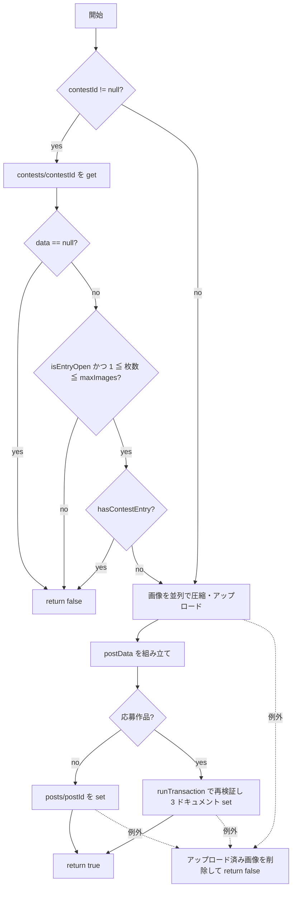

# lib/data/repositories/post_repository.dart

| 項目 | 内容 |
|---|---|
| ファイル | `lib/data/repositories/post_repository.dart` |
| 基本設計 | [02 地図・投稿作成](../../02_地図・投稿作成.md) の「3.2 投稿作成」「4. データ設計」 |
| 関連する基本設計 | [03 フィード・投稿詳細](../../03_フィード・投稿詳細.md)（3.1 ページング / 3.2 編集 / 3.3 削除 / 3.4 権限判定）/ [05 アルバム](../../05_アルバム.md)（3. 処理フロー: 詳細）/ [07 コンテスト](../../07_コンテスト.md)（4.1 応募 / 4.2 投票）/ [08 通知](../../08_通知.md)（通知から投稿を開く）/ [09 プロフィール](../../09_プロフィール.md)（投稿グリッド） |
| レイヤ | Repository |
| 主な依存先 | `lib/data/models/post.dart`, `lib/data/models/contest.dart`, `lib/data/repositories/contest_repository.dart`（コレクション名定数）, `lib/data/services/image_service.dart`, `package:cloud_firestore`, `package:firebase_storage`, `package:image_picker`（`XFile`） |
| 主な利用元 | `lib/app/dependencies.dart`（生成・提供）, `lib/data/repositories/contest_repository.dart`, `lib/ui/post/post_add_view_model.dart`, `lib/ui/post/post_detail_view_model.dart`, `lib/ui/map/map_screen.dart`, `lib/ui/feed/feed_page.dart`, `lib/ui/album/album_detail_page.dart`, `lib/ui/notification/notification_page.dart`, `lib/ui/profile/profile_page.dart` |
| テスト | `test/data/repositories/post_repository_test.dart`（他に `test/ui/post/post_add_view_model_test.dart`・`post_add_dialog_test.dart`・`post_detail_*_test.dart`・`test/ui/feed/feed_page_test.dart`・`test/data/repositories/contest_repository_test.dart` がサブクラス化・注入で利用） |

## 1. 責務

`posts` コレクションと投稿画像（Storage `posts/{userId}/…`）へのアクセスを一手に引き受ける。

- 投稿の作成（画像の圧縮・アップロード → Firestore 書き込み）。コンテスト応募作品はトランザクションで `posts`・`private/author`・`contests/{id}/entries/{uid}` を同時に作る。
- 投稿の更新・削除（Storage 画像の後始末を含む）。
- 地図・フィード・コンテスト・アルバム・プロフィール向けの読み取り（Stream / ページング / ID 指定）。
- コンテスト応募作品の実投稿者の解決（`getAuthorId`）と、応募済み判定（`hasContestEntry`）。

フィードのページ結果を表す値クラス `PostPage` も本ファイルで定義する。

## 2. 構成要素（クラス・関数・定数の一覧）

| 種別 | 名前 | 概要 |
|---|---|---|
| クラス | `PostRepository` | 投稿の CRUD・購読 |
| 定数 | `PostRepository.postsCollection` | `'posts'` |
| 定数 | `PostRepository.privateCollection` | `'private'`（応募作品の非公開サブコレクション） |
| 定数 | `PostRepository.authorDocument` | `'author'`（実投稿者を持つドキュメント ID） |
| 定数 | `PostRepository.feedPageSize` | `20`（フィード 1 ページの件数、§8.2 / NFR_02） |
| private メソッド | `_feedQuery` | フィード用クエリ（`createdAt` 降順 + カーソル + `limit`）の組み立て |
| クラス | `PostPage` | フィード 1 ページ分の結果（`posts` / `lastDocument` / `hasMore`） |

## 3. 公開インターフェース（コンストラクタ引数・プロパティ・メソッドのシグネチャと説明）

### 3.1 コンストラクタ

```dart
PostRepository({
  FirebaseFirestore? firestore,   // 既定: FirebaseFirestore.instance
  FirebaseStorage? storage,       // 既定: FirebaseStorage.instance
  ImageService? imageService,     // 既定: ImageService()
})
```

アプリでは `AppDependencies.postRepository` が `firestore`・`storage`・`imageService` を渡して 1 つだけ生成し、`Provider<PostRepository>` で提供する。`ContestRepository` も同じインスタンスを受け取る（未指定時は `PostRepository(firestore: firestore)` を自前で作る）。

### 3.2 メソッド

| シグネチャ | 説明 | 主な呼び出し元 |
|---|---|---|
| `Future<bool> createPost(Post post, List<XFile> imageFiles, {String? contestId, bool stayAnonymous = false})` | 画像をアップロードして投稿を作成する。成功で true、失敗で false（例外は投げない）。`stayAnonymous` は互換のため残っているが**値は使わない** | `PostAddViewModel.submit` |
| `Future<bool> hasContestEntry(String contestId, String userId)` | そのユーザーがコンテストに応募済み（応募投稿が現存）か | `PostAddViewModel.submit`, `createPost` 内部 |
| `Future<bool> updatePost(Post post, {required String caption, required List<String> imageUrls, required List<String> removedImageUrls, double? latitude, double? longitude})` | 説明・画像一覧・（任意で）位置を更新し、外した画像を Storage から消す | `PostDetailViewModel` |
| `Future<bool> deletePost(Post post)` | 投稿ドキュメントと画像を削除する | `PostDetailViewModel` |
| `Stream<List<Post>> getPosts()` | `posts` 全件を購読する（件数制限なし） | `MapScreen` |
| `Stream<List<Post>> getPostsByContest(String contestId)` | 指定コンテストの応募作品を `createdAt` 降順で購読する | `ContestRepository.getEntries` |
| `Future<String?> getAuthorId(String postId)` | 投稿の実投稿者 UID を返す（応募作品は `private/author` を参照）。取れなければ null | `PostDetailViewModel`, `ContestRepository.voteFor`, `deletePost`・`hasContestEntry` 内部 |
| `Stream<PostPage> watchPosts({int limit = feedPageSize})` | フィード先頭ページ（最新 `limit` 件）を購読する | `FeedPage` |
| `Future<PostPage> getPostsPage({DocumentSnapshot<Map<String, dynamic>>? startAfter, int limit = feedPageSize})` | カーソルの次のページを 1 回取得する | `FeedPage` |
| `Future<List<Post>> getPostsByIds(List<String> postIds)` | ID 指定で投稿を個別取得する（順序維持・削除済みは除外） | `AlbumDetailPage`, `NotificationPage` |
| `Stream<List<Post>> getUserPosts(String userId)` | 指定ユーザーの投稿を `createdAt` 降順で購読する | `ProfilePage`, `AlbumDetailPage`（投稿追加の候補） |

### 3.3 `PostPage`

```dart
const PostPage({
  required List<Post> posts,
  required DocumentSnapshot<Map<String, dynamic>>? lastDocument,
  required bool hasMore,
})
factory PostPage.fromSnapshot(QuerySnapshot<Map<String, dynamic>> snapshot, int limit)
```

| プロパティ | 説明 |
|---|---|
| `posts` | そのページの投稿（クエリ順 = `createdAt` 降順、変更不可リスト） |
| `lastDocument` | 次ページ取得のカーソル。0 件なら null。UI は中身を解釈せず `getPostsPage(startAfter:)` に渡す |
| `hasMore` | `snapshot.docs.length == limit`。件数が limit 未満なら最後のページ |

## 4. 内部状態（フィールド・状態遷移）

| フィールド | 型 | 説明 |
|---|---|---|
| `_firestore` | `FirebaseFirestore` | 注入または `.instance` |
| `_storage` | `FirebaseStorage` | 注入または `.instance` |
| `_imageService` | `ImageService` | 圧縮に使用 |

状態は持たない（ステートレス）。`createPost` 内の `uploadedRefs` はメソッドローカル。

## 5. 処理詳細（メソッドごとの手順・分岐・呼び出す Repository/SDK）

### 5.1 `createPost`



1. 処理全体を `try` で囲む。ローカル `uploadedRefs`（`List<Reference>`）にアップロード済みの参照を記録する。
2. **応募作品の事前検証**（`contestId != null` のとき、アップロード前に止めるため）
   1. `contests/{contestId}` を `get`。`data()` が null なら `false`。
   2. `Contest.fromSnapshot` で組み立て、`!contest.isEntryOpen`・`imageFiles.isEmpty`・`imageFiles.length > contest.maxImages` のいずれかなら `false`。
   3. `hasContestEntry(contestId, post.userId)` が true なら `false`。
3. **画像アップロード**（`Future.wait` で全画像を並列実行。結果の URL リストは `imageFiles` の順序を保つ）。各画像 `index` について:
   1. 参照 `_storage.ref().child('posts/${post.userId}/${post.id}_$index.jpg')` を作る（応募作品でも実投稿者 UID のパス）。
   2. `_imageService.compressImage(imageFile)` で圧縮（短辺 2048px・品質 85%・JPEG）。
   3. `putData(bytes, SettableMetadata(contentType: 'image/jpeg', cacheControl: 'public, max-age=31536000, immutable'))`。
   4. 成功したら `uploadedRefs` に追加し、`uploadTask.ref.getDownloadURL()` を返す。
4. **ドキュメント組み立て**: `postRef = posts/{post.id}`。応募作品なら `userId` を `''`、それ以外は `post.userId`。`likeCount`・`commentCount` は `post` の値によらず `0`。`createdAt` は `Timestamp.fromDate(post.createdAt)`。応募作品のみ `contestId`・`stayAnonymous: false`（引数によらず固定）・`voteCount: 0` を加える（6 章）。
5. **書き込み**
   - 通常投稿: `postRef.set(postData)`。
   - 応募作品: `contestRef = contests/{contestId}`, `entryRef = contestRef/entries/{post.userId}` として `runTransaction`:
     1. `transaction.get(contestRef)`、`transaction.get(entryRef)`。
     2. `entry.exists` なら `entry.data()!['postId']` の投稿を `transaction.get` し、存在すれば `StateError('応募は1人1投稿までです')`（削除済みなら再応募可）。
     3. コンテストの `data()` が null なら `StateError('コンテストが見つかりません')`。
     4. `!contest.isEntryOpen || imageUrls.length > contest.maxImages` なら `StateError('応募条件を満たしていません')`。
     5. `transaction.set(postRef, postData)`、`transaction.set(postRef/private/author, {'userId': post.userId})`、`transaction.set(entryRef, {'postId': post.id})`。
6. `true` を返す。
7. **`catch (_)`**: `uploadedRefs` の各参照を並列に `delete()`（個別の失敗は握りつぶす）してから `false` を返す。

### 5.2 `hasContestEntry`

旧形式（`entries` が無い頃）の応募も検出するため 2 段で確認する。

1. `contests/{contestId}/entries/{userId}` を `get`。存在すれば `postId` の投稿を `get` し、存在すれば `true`。
2. `posts` を `where('contestId', isEqualTo: contestId)` で全件 `get`。各投稿について `getAuthorId(post.id) == userId` なら `true`（逐次・投稿数ぶん Firestore 読み取りが発生）。
3. どれにも該当しなければ `false`。

例外は捕捉しない（呼び出し元へ伝播する。`createPost` 内では 5.1 の `catch` で false になり、`PostAddViewModel` は「応募状況を確認できませんでした」と通知する）。

### 5.3 `updatePost`

1. `posts/{post.id}` を `update`:
   - `caption`、`imageUrls`
   - `latitude`・`longitude` は**両方非 null のときだけ**含める（Issue #37）
   - `updatedAt: Timestamp.fromDate(DateTime.now())`（PS_08）
2. 失敗したら `false` を返す（Storage は触らない）。
3. `removedImageUrls` の各 URL を並列に `_storage.refFromURL(url).delete()`。失敗は握りつぶす（インデックス命名に依存せず URL から参照するため、途中の画像を消しても他とずれない）。
4. `true` を返す。

### 5.4 `deletePost`

1. `authorId = await getAuthorId(post.id) ?? post.userId`（応募作品は `private/author` から実投稿者を得る。ドキュメント削除前に取得する必要がある）。
2. `posts/{post.id}` を `delete`。失敗したら `false`。
3. `List.generate(post.imageUrls.length, …)` で `posts/$authorId/${post.id}_$index.jpg`（index = 0..n-1）を並列に削除。失敗は握りつぶす。
4. `true` を返す。

`private/author` サブコレクションや `contests/{id}/entries/{uid}` は削除しない（9 章）。

### 5.5 `getPosts`

`posts` コレクション全体を `snapshots()` で購読し、`event.docs.reversed` を `Post.fromSnapshot` で変換した**変更不可リスト**を流す。`orderBy` は付けないため、並びは Firestore 既定のドキュメント ID 昇順の逆（ID がミリ秒時刻なので実質新しい順）。

### 5.6 `getPostsByContest`

`posts.where('contestId', isEqualTo: contestId).snapshots()` を購読し、変換後にクライアント側で `createdAt` 降順ソートして流す（複合インデックスを不要にするため）。

### 5.7 `getAuthorId`

1. `posts/{postId}` を `get`。`data()` が null なら `null`。
2. `userId = data['userId'] as String? ?? ''`、`contestId = data['contestId'] as String?`。
3. 通常投稿（`contestId == null`）または匿名解除済み（`userId` 非空）なら、`userId` が空なら `null`、そうでなければ `userId` を返す。
4. 匿名期間中の応募作品は `posts/{postId}/private/author` を `get` し、`data()?['userId']` を返す（ルールで本人・管理者以外は読めず、例外 → null になる）。
5. 例外はすべて捕捉して `null`。

### 5.8 `watchPosts` / `getPostsPage` / `_feedQuery`

- `_feedQuery({required int limit, DocumentSnapshot? startAfter})`: `posts.orderBy('createdAt', descending: true)` → `startAfter` があれば `.startAfterDocument(startAfter)` → 最後に `.limit(limit)`。`limit` をカーソルの後に付けるのは、先に付けるとカーソル適用前に件数が切られる実装があるため。
- `watchPosts`: `_feedQuery(limit: limit).snapshots()` を `PostPage.fromSnapshot(snapshot, limit)` に変換して流す。
- `getPostsPage`: `_feedQuery(limit:, startAfter:).get()` の結果を `PostPage.fromSnapshot` で返す。

### 5.9 `getPostsByIds`

1. `postIds` が空なら `const []`。
2. 各 ID の `posts/{id}` を `Future.wait` で並列 `get`（`whereIn` の 10 件制限を避けるため個別取得）。
3. `exists` のものだけ、引数の順序のまま `Post.fromSnapshot` で変換し、変更不可リストで返す。

### 5.10 `getUserPosts`

`posts.where('userId', isEqualTo: userId).snapshots()` を購読し、クライアント側で `createdAt` 降順ソートして流す。匿名期間中の応募作品は `userId == ''` のため含まれない。

## 6. データ仕様（読み書きする Firestore/Storage のパス・フィールド、定数値）

### 6.1 `posts/{postId}`（`createPost` が書く）

| フィールド | 型 | 通常投稿 | 応募作品 |
|---|---|---|---|
| `userId` | string | `post.userId` | `''` |
| `caption` | string | `post.caption` | 同左 |
| `imageUrls` | string[] | アップロード結果の URL（`imageFiles` 順） | 同左 |
| `latitude` / `longitude` | number | `post.latitude` / `post.longitude` | 同左 |
| `locationName` | string \| null | `post.locationName` | 同左 |
| `tags` | string[] | `post.tags` | 同左 |
| `likeCount` | int | `0` | `0` |
| `commentCount` | int | `0` | `0` |
| `createdAt` | Timestamp | `post.createdAt` | 同左 |
| `contestId` | string | （無し） | `contestId` |
| `stayAnonymous` | bool | （無し） | `false` 固定 |
| `voteCount` | int | （無し） | `0` |

`updatePost` が書くフィールド: `caption`, `imageUrls`, `latitude`/`longitude`（両方指定時のみ）, `updatedAt`。

### 6.2 応募作品の付随ドキュメント（トランザクションで作成）

| パス | フィールド |
|---|---|
| `posts/{postId}/private/author` | `userId`: 実投稿者 UID |
| `contests/{contestId}/entries/{userId}` | `postId`: 応募投稿 ID |

### 6.3 Storage

| 項目 | 値 |
|---|---|
| パス | `posts/{userId}/{postId}_{index}.jpg`（index は 0 始まり、アップロード時の並び順） |
| contentType | `image/jpeg` |
| cacheControl | `public, max-age=31536000, immutable` |

### 6.4 読み取りクエリ

| メソッド | クエリ |
|---|---|
| `getPosts` | `posts` 全件（条件・順序なし） |
| `getPostsByContest` | `where contestId ==`（ソートはクライアント） |
| `getUserPosts` | `where userId ==`（ソートはクライアント） |
| `watchPosts` / `getPostsPage` | `orderBy createdAt desc` [+ `startAfterDocument`] + `limit(20)` |
| `hasContestEntry` | `entries/{uid}` 単体 + `where contestId ==` 全件 + 各 `private/author` |

## 7. 例外・エラー処理（例外の扱い・戻り値・表示メッセージ）

| メソッド | 失敗時 |
|---|---|
| `createPost` | 全例外を捕捉し、アップロード済み画像を削除して `false`。トランザクション内の `StateError` メッセージ（「応募は1人1投稿までです」等）は UI には出ない（UI は一律「投稿に失敗しました」） |
| `hasContestEntry` | 捕捉しない（呼び出し元へ伝播） |
| `updatePost` | Firestore 更新失敗で `false`。Storage 削除失敗は無視して `true` |
| `deletePost` | Firestore 削除失敗で `false`。Storage 削除失敗は無視して `true` |
| `getAuthorId` | 全例外を捕捉して `null` |
| Stream 系 / `getPostsPage` / `getPostsByIds` | 捕捉しない（Stream のエラー・Future の例外として呼び出し元へ） |

## 8. テスト観点（既存テストが確認していること / 未テストの観点）

`test/data/repositories/post_repository_test.dart`（`FakeFirebaseFirestore` + `MockFirebaseStorage` + 圧縮をそのまま返す `_PassthroughImageService`）:

- `createPost` が画像をアップロードし投稿ドキュメントを保存する
- 応募作品: 本体 `userId == ''`・`contestId`・`stayAnonymous == false`（引数 true でも）・`voteCount == 0`、`private/author` と `entries/{uid}` の作成、`getAuthorId` が実投稿者を返す、重複応募は false で本体を作らない、元投稿削除後は再応募できる
- コンテストの枚数（0 枚・上限超過）と締切切れで false
- 複数画像で別々の URL、`posts/{userId}/{postId}_{i}.jpg` のパス
- 画像 0 枚の通常投稿は成功し URL 無しで保存される
- 画像が読めないとき false で何も書かない
- `getPosts` の逆順・空リスト・追加時の再通知
- `deletePost` がドキュメントと画像を消す、画像 0 枚でも成功
- `updatePost` が `updatedAt` を書く、座標両方指定時のみ位置更新
- `watchPosts` の件数制限、`getPostsPage` のカーソル継続・0 件時の `hasMore == false`
- `getPostsByIds` の順序維持・削除済み除外・空入力

未テストの観点:

- `createPost` 失敗時に、アップロード済み画像が削除されること
- `hasContestEntry` の旧形式（`entries` 無し）の検出経路
- `getUserPosts` / `getPostsByContest` のソート
- `getAuthorId` で `private/author` が読めない（ルール拒否）場合
- Firestore ルールとの整合（`fake_cloud_firestore` はルールを評価しない。`test/rules` 側で確認）

## 9. 備考・既知の課題

- **`deletePost` は画像をインデックス命名で消す**ため、`updatePost` で途中の画像を外した投稿（例: `_0`〜`_2` から `_0` を削除 → 残り `_1`,`_2`、`imageUrls.length == 2`）を後で削除すると、`_0`,`_1` を消そうとして `_2` が Storage に残る。`updatePost` と同様に `refFromURL` で消せば解消する。
- `deletePost` は `posts/{id}/private/author` と `contests/{id}/entries/{uid}` を消さない（`hasContestEntry`・トランザクションとも元投稿の存在で判定するため再応募は可能）。
- `hasContestEntry` は応募作品数ぶん `getAuthorId` を逐次呼ぶため、応募数に比例して読み取りが増える。かつ `PostAddViewModel.submit` と `createPost` の両方から呼ばれ、1 回の応募で 2 回走る。
- `createPost` の `stayAnonymous` 引数は未使用（旧クライアント互換で残置）。
- `getPosts` は件数制限が無く、地図で全投稿を購読する（基本設計 7 章の既知の課題）。
- 画像アップロードは並列で、1 枚が失敗しても他の画像のアップロードは継続する。`Future.wait`（`eagerError: false`）は全画像の完了を待ってから例外を返すため、成功分はすべて `uploadedRefs` に入った状態で `catch` に入り削除される。ただし `getDownloadURL()` が失敗した画像は `uploadedRefs` 追加後なので削除対象になる一方、`putData` 自体が失敗した画像は記録されない（そもそも残らない想定）。
- 画像 0 枚の通常投稿もリポジトリ層では受け付ける（UI 側で禁止）。
