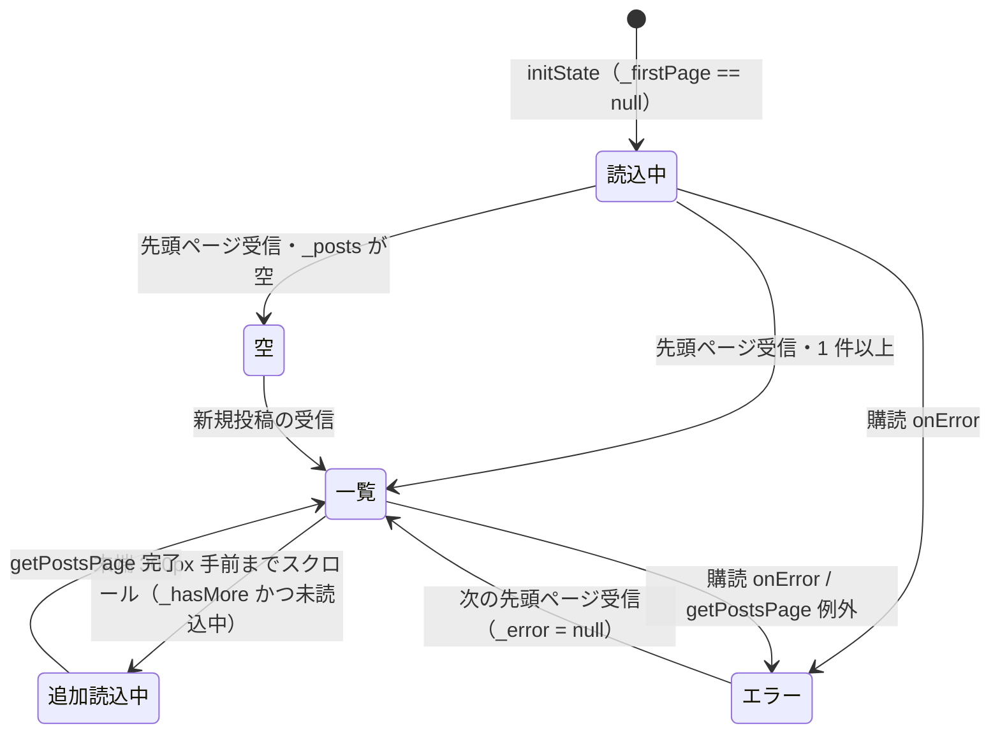

# lib/ui/feed/feed_page.dart

| 項目 | 内容 |
|---|---|
| ファイル | `lib/ui/feed/feed_page.dart` |
| 基本設計 | [03 フィード・投稿詳細](../../03_フィード・投稿詳細.md) の 2.1「FeedPage / PostCard」、3.1「フィードのページング」 |
| 関連する基本設計 | [00 システム概要・共通設計](../../00_システム概要.md)（4 章 画面遷移: 下部タブ Feed） |
| レイヤ | View |
| 主な依存先 | `data/models/post.dart`（`Post`）、`data/repositories/post_repository.dart`（`PostRepository` / `PostPage`）、`ui/post/post_detail_page.dart`、`ui/core/widgets/post_card.dart`、`ui/core/widgets/reaction_bar.dart`、`ui/core/widgets/comment_section.dart`、`provider`、`dart:async` |
| 主な利用元 | `lib/app/main_shell.dart`（下部タブ「Feed」） |
| テスト | `test/ui/feed/feed_page_test.dart` |

## 1. 責務

- フィードタブの画面。全投稿を `createdAt` 降順でカード（`PostCard`）の `ListView` に並べる。
- 先頭ページ（`PostRepository.feedPageSize` = 20 件）は `watchPosts()` で購読し、新規投稿・編集・削除をリアルタイムに反映する。
- スクロールが末端の 300px 手前に達したら `getPostsPage(startAfter:)` で次ページを 1 回取得し、末尾に追加する（無限スクロール）。
- カードのタップで `PostDetailPage` を push する。
- ViewModel は持たず、View が `PostRepository` を直接呼ぶ（[00 システム概要](../../00_システム概要.md) 3.4「上記以外」）。

## 2. 構成要素（クラス・関数・定数の一覧）

| 名前 | 種別 | 概要 |
|---|---|---|
| `FeedPage` | `StatefulWidget`（公開） | フィード画面。引数なし |
| `_FeedPageState` | `State<FeedPage>` | 購読・ページング状態・描画 |
| `_FeedPageState._loadMoreThreshold` | `static const double` = `300` | 末端から何 px 手前で追加読み込みを始めるか |

## 3. 公開インターフェース

```dart
class FeedPage extends StatefulWidget {
  const FeedPage({super.key});
}
```

公開プロパティ・メソッドはない。

## 4. 内部状態（フィールド・状態遷移）

| フィールド | 型 | 初期値 | 説明 |
|---|---|---|---|
| `_postRepository` | `late final PostRepository` | `context.read<PostRepository>()` | 初回アクセス時（`initState` 内）に解決 |
| `_scrollController` | `ScrollController` | 新規 | `ListView` に渡し、`_onScroll` を listener 登録 |
| `_firstPageSubscription` | `StreamSubscription<PostPage>?` | `null` | 先頭ページの購読。`dispose` で cancel |
| `_firstPage` | `PostPage?` | `null` | 購読中の先頭ページ（最新 20 件）。`null` の間は初回読込中 |
| `_olderPosts` | `List<Post>`（final） | `[]` | 追加取得した 2 ページ目以降の投稿（追記のみ） |
| `_cursorPage` | `PostPage?` | `null` | 次ページ取得のカーソル（`lastDocument`）を持つ最後に読んだページ |
| `_isLoadingMore` | `bool` | `false` | 追加読み込み中。多重呼び出し防止とインジケータ表示 |
| `_hasMore` | `bool` | `true` | 続きがあるか（`PostPage.hasMore`） |
| `_error` | `Object?` | `null` | 購読または追加取得のエラー。非 null なら全体をエラー表示 |

算出プロパティ `_posts`（`List<Post>`）:

1. `firstPagePosts = _firstPage?.posts ?? const []`
2. その ID 集合 `firstPageIds` を作る。
3. `[...firstPagePosts, ..._olderPosts.where((p) => !firstPageIds.contains(p.id))]` を返す（先頭ページと ID が重なる追加取得分を除外）。

### 状態遷移（表示）



## 5. 処理詳細

### 5.1 `initState()`

1. `_scrollController.addListener(_onScroll)`。
2. `_postRepository.watchPosts()`（既定 `limit: feedPageSize`）を `listen` し、`_firstPageSubscription` に保持する。
   - **onData(page)**: `mounted` でなければ無視。`setState` で
     - `_firstPage = page`、`_error = null`。
     - `_olderPosts.isEmpty`（まだ追加取得していない）なら `_cursorPage = page`、`_hasMore = page.hasMore`。追加取得後は先頭ページの更新でカーソルを動かさない。
   - **onError(error)**: `mounted` なら `setState(() => _error = error)`。

### 5.2 `dispose()`

`_firstPageSubscription?.cancel()` → `_scrollController.dispose()` → `super.dispose()`。

### 5.3 `_onScroll()`

1. `_scrollController.hasClients` が false なら return。
2. `position.pixels >= position.maxScrollExtent - _loadMoreThreshold`（300）なら `unawaited(_loadMore())`。ガードは `_loadMore` 側で行うため、スクロール中に繰り返し呼ばれてもよい。

### 5.4 `_loadMore()`

1. `cursor = _cursorPage?.lastDocument`。`_isLoadingMore` が true、`_hasMore` が false、`cursor == null` のいずれかなら return。
2. `setState(() => _isLoadingMore = true)`（リスト末尾にインジケータ行が出る）。
3. `try`: `page = await _postRepository.getPostsPage(startAfter: cursor)`。`mounted` でなければ return。`setState` で
   - `_olderPosts.addAll(page.posts)`。
   - `page.lastDocument != null` のときだけ `_cursorPage = page`（空ページならカーソル据え置き）。
   - `_hasMore = page.hasMore`（取得件数 == 20 なら true）。
4. `catch (error)`: `mounted` なら `setState(() => _error = error)`。
5. `finally`: `mounted` なら `setState(() => _isLoadingMore = false)`。

### 5.5 `_openDetail(Post post)`

`Navigator.of(context).push(MaterialPageRoute<void>(builder: (_) => PostDetailPage(post, reactionBar: ReactionBar(post: post), commentSection: CommentSection(post: post))))`。戻り値は使わない。

### 5.6 `build()` / `_buildBody()`

`Scaffold(appBar: AppBar(title: Text('Feed')), body: _buildBody())`。`_buildBody()` は上から順に判定する。

| 条件 | 表示 |
|---|---|
| `_error != null` | `Center(Text('投稿を読み込めませんでした：$_error'))` |
| `_firstPage == null` | `Center(CircularProgressIndicator())` |
| `_posts` が空 | `Center(Text('まだ投稿がありません'))` |
| それ以外 | `ListView.builder(controller: _scrollController, itemCount: posts.length + (_isLoadingMore ? 1 : 0))` |

- `index >= posts.length` の行（追加読込中のみ存在）は `Padding(vertical: 16)` + `CircularProgressIndicator`。
- それ以外は `PostCard(post, key: ValueKey(post.id), onTap: () => _openDetail(post))`。キーを投稿 ID にすることで、先頭に新規投稿が入っても各カードの State（コメント数購読など）がずれない。

## 6. データ仕様

- 読み取りのみ。`PostRepository.watchPosts()` / `getPostsPage()` 経由で `posts` を `orderBy('createdAt', descending: true)` → (`startAfterDocument`) → `limit(20)` で取得する（クエリの詳細は [post_repository.md](../02_地図・投稿作成/post_repository.md)）。
- `PostPage`: `posts`（`List<Post>`）、`lastDocument`（`DocumentSnapshot?`、空なら null）、`hasMore`（`docs.length == limit`）。
- 定数: `_loadMoreThreshold = 300`、ページサイズは `PostRepository.feedPageSize = 20`。

## 7. 例外・エラー処理

| 状況 | 扱い |
|---|---|
| 先頭ページ購読のエラー | `_error` に保持し、画面全体を「投稿を読み込めませんでした：(エラー)」にする。次に正常なスナップショットが届くと `_error = null` で一覧に戻る |
| 追加取得の例外 | 同じく `_error` に保持して全体をエラー表示にする（取得済みの一覧も隠れる）。`_isLoadingMore` は finally で false に戻る |
| 非同期完了時に unmount 済み | `mounted` を確認して `setState` しない |

## 8. テスト観点

既存テスト（`test/ui/feed/feed_page_test.dart`、`FakeFirebaseFirestore` + `withDependencies`）:

- 投稿が無いとき「まだ投稿がありません」を表示する。
- 投稿を新しい順に並べる。
- 20 件を超える投稿で末端までスクロールすると次ページを読み込む。

未テストの観点:

- 購読エラー・追加取得エラー時のエラー表示と、正常スナップショットでの復帰。
- 先頭ページと追加取得分の ID 重複除外。
- `hasMore == false`（最終ページ）以降に追加取得しないこと、空ページでカーソルを据え置くこと。
- カードタップで `PostDetailPage` を開くこと。

## 9. 備考・既知の課題

- 2 ページ目以降は購読せず、リアルタイム更新されない（基本設計 7 章）。
- 追加取得後に先頭ページへ新規投稿が入ると、先頭ページから押し出された投稿（旧 20 件目）は `_olderPosts`（旧 20 件目の次から始まる）にも含まれないため、一覧から一時的に見えなくなる。重複は ID で除外しているが、欠落は補わない。
- 追加取得のエラーで画面全体がエラー表示になり、再試行の導線がない（先頭ページの次のスナップショットまで復帰しない）。
- 追加読み込みはスクロールイベントでのみ発火する。先頭ページが画面に収まりスクロールできない場合は続きを読み込まない。
