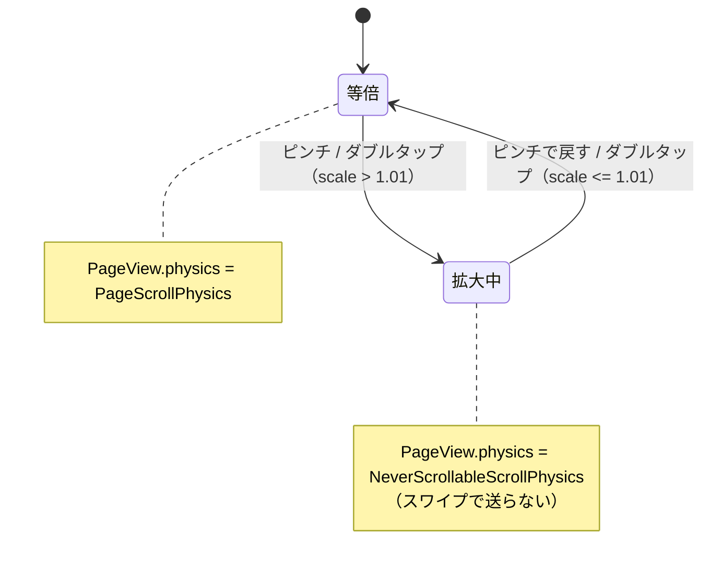

# lib/ui/post/image_viewer_page.dart

| 項目 | 内容 |
|---|---|
| ファイル | `lib/ui/post/image_viewer_page.dart` |
| 基本設計 | [03 フィード・投稿詳細](../../03_フィード・投稿詳細.md) の 2.3「ImageViewerPage（Issue #45）」 |
| 関連する基本設計 | [02 地図・投稿作成](../../02_地図・投稿作成.md)（地図ピンのサマリー表示からも開く） |
| レイヤ | View |
| 主な依存先 | `cached_network_image`、`flutter/material.dart`（プロジェクト内ファイルへの依存なし） |
| 主な利用元 | `lib/ui/post/widgets/post_detail_view.dart`（`_openImageViewer`：写真タップ・拡大ボタン） |
| テスト | `test/ui/post/image_viewer_page_test.dart`、`test/ui/post/post_detail_page_test.dart`（開く導線） |

## 1. 責務

- 写真を黒背景の全画面に `BoxFit.contain` で表示する。
- ピンチ（`InteractiveViewer`、1〜5 倍）とダブルタップ（2.5 倍 ⇔ 等倍）で拡大できる。
- 複数枚は左右スワイプと矢印ボタンで送る。拡大中はスワイプによるページ送りを止め、ドラッグを写真の移動に使う。
- AppBar のタイトルに現在位置（`n / 全体`）を出す。

## 2. 構成要素（クラス・関数・定数の一覧）

| 名前 | 種別 | 概要 |
|---|---|---|
| `ImageViewerPage` | `StatefulWidget`（公開） | 全画面ビューア |
| `ImageViewerPage.pageViewKey` | `static const Key` = `ValueKey('image-viewer-page-view')` | `PageView` のキー（拡大中の physics をテストで確認する） |
| `ImageViewerPage.open` | `static` メソッド | push のヘルパー |
| `_ImageViewerPageState` | `State` | 現在位置・ページ送り・拡大率の管理 |
| `_ImageViewerPageState._overlayButtonSize` | `static const double` = `40` | 矢印ボタンの直径 |
| `_ImageViewerPageState._overlayIconSize` | `static const double` = `22` | 矢印アイコンサイズ |
| `_ZoomableImage` | `StatefulWidget`（private） | 拡大できる 1 枚の写真 |
| `_ZoomableImageState` | `State` + `SingleTickerProviderStateMixin` | 変換行列とダブルタップアニメーション |
| `_ZoomableImageState._doubleTapScale` | `static const double` = `2.5` | ダブルタップ時の倍率 |
| `_ZoomableImageState._maxScale` | `static const double` = `5` | ピンチの上限倍率 |

## 3. 公開インターフェース

```dart
const ImageViewerPage({
  super.key,
  required this.imageUrls,
  this.initialIndex = 0,
});

static Future<void> open(
  BuildContext context, {
  required List<String> imageUrls,
  int initialIndex = 0,
});
```

| 引数 | 型 | 説明 |
|---|---|---|
| `imageUrls` | `List<String>`（必須） | 表示する画像 URL。順序は呼び出し元のギャラリーに揃える |
| `initialIndex` | `int`（既定 0） | 最初に表示する位置。範囲外は範囲内に丸める |

`open` は `Navigator.of(context).push<void>(MaterialPageRoute<void>(builder: (_) => ImageViewerPage(imageUrls: imageUrls, initialIndex: initialIndex)))` を返す。

## 4. 内部状態（フィールド・状態遷移）

### `_ImageViewerPageState`

| フィールド | 型 | 初期値 | 説明 |
|---|---|---|---|
| `_currentIndex` | `late int` | `initialIndex.clamp(0, imageUrls.isEmpty ? 0 : length - 1)` | 表示中の位置 |
| `_pageController` | `late final PageController` | `PageController(initialPage: _currentIndex)` | |
| `_scales` | `Map<int, double>`（final） | `{}` | 画像 index ごとの最新の拡大率 |
| `_isZoomed`（getter） | `bool` | — | `(_scales[_currentIndex] ?? 1) > 1.01` |

### `_ZoomableImageState`

| フィールド | 型 | 説明 |
|---|---|---|
| `_transformationController` | `TransformationController`（final） | `InteractiveViewer` の変換行列 |
| `_animationController` | `late final AnimationController` | duration 200ms、`vsync: this` |
| `_animation` | `Animation<Matrix4>?` | ダブルタップ時の補間 |
| `_doubleTapPosition` | `Offset?` | 直前のダブルタップ位置（ローカル座標） |

### 状態遷移（ページ送り）



## 5. 処理詳細

### 5.1 `_ImageViewerPageState.build()`

```
Scaffold(backgroundColor: black, extendBodyBehindAppBar: true)
├ appBar: AppBar(backgroundColor: black38, foregroundColor: white, elevation 0,
│                title: 複数枚 ? '${_currentIndex + 1} / ${length}' : '写真')
└ body:
  ├ [imageUrls 空] Center(Icon(Icons.image_not_supported, white54, 48))
  └ Stack(alignment: center)
    ├ PageView.builder(key: pageViewKey, controller: _pageController,
    │     physics: _isZoomed ? NeverScrollableScrollPhysics : PageScrollPhysics,
    │     itemCount: length,
    │     onPageChanged: setState(_currentIndex = index),
    │     itemBuilder: _ZoomableImage(imageUrl, onScaleChanged: (s) => _handleScaleChanged(index, s)))
    ├ [複数枚] Positioned(left 8): _overlayButton(chevron_left, '前の写真', index > 0 ? _showPreviousImage : null)
    └ [複数枚] Positioned(right 8): _overlayButton(chevron_right, '次の写真', index < length-1 ? _showNextImage : null)
```

### 5.2 `_handleScaleChanged(int index, double scale)`

1. `wasZoomed = _isZoomed`。
2. `_scales[index] = scale`。
3. `wasZoomed != _isZoomed`（拡大状態が切り替わった）ときだけ `setState(() {})` で physics を切り替える。拡大率の連続変化では再描画しない。

### 5.3 `_showPreviousImage()` / `_showNextImage()`

`_pageController.previousPage` / `nextPage`（200ms, `Curves.easeInOut`）。端での無効化はボタンの `onPressed: null` で行う。拡大中でもボタンでは送れる。

### 5.4 `_overlayButton({required IconData icon, required VoidCallback? onPressed, required String tooltip})`

`Tooltip(message)` → `Material(black54, CircleBorder, antiAlias)` → `InkWell(onTap: onPressed)` → `SizedBox(40×40)` → `Icon(size 22, color: onPressed == null ? white38 : white)`。`IconButton` の 48px 最小タップ領域で丸が大きくなるのを避けるための構成。

### 5.5 `_ZoomableImageState`

- `initState()`: `_transformationController.addListener(_notifyScale)`。`_animationController` の listener で `_animation` が非 null なら `_transformationController.value = _animation.value`。
- `dispose()`: `_transformationController.removeListener(_notifyScale)` → `_transformationController.dispose()` → `_animationController.dispose()`。
- `_notifyScale()`: `widget.onScaleChanged(_transformationController.value.getMaxScaleOnAxis())`。
- `_handleDoubleTap()`:
  1. `isZoomed = getMaxScaleOnAxis() > 1.01`。
  2. 拡大中なら目標 `Matrix4.identity()`（等倍に戻す）。
  3. 等倍なら、`position = _doubleTapPosition ?? Offset.zero` を中心に 2.5 倍: `Matrix4.identity()..translateByDouble(-dx × 1.5, -dy × 1.5, 0, 1)..scaleByDouble(2.5, 2.5, 1, 1)`。
  4. `_animation = Matrix4Tween(begin: 現在値, end: target).animate(CurvedAnimation(easeInOut))`、`_animationController.forward(from: 0)`（200ms で補間。各フレームで変換行列が更新され `_notifyScale` も走る）。
- `build()`: `GestureDetector(onDoubleTapDown: 位置を記録, onDoubleTap: _handleDoubleTap)` → `InteractiveViewer(transformationController, minScale: 1, maxScale: 5)` → `Center` → `CachedNetworkImage(fit: contain, width/height: ∞, placeholder: CircularProgressIndicator, errorWidget: Icon(Icons.broken_image_outlined, white54, 48))`。

## 6. データ仕様

Firestore/Storage には直接アクセスしない。画像は渡された URL（Storage のダウンロード URL）を `CachedNetworkImage` で取得する。

| 定数 | 値 |
|---|---|
| 拡大判定のしきい値 | `1.01` |
| ダブルタップ倍率 | `2.5` |
| ピンチ上限 / 下限 | `5` / `1` |
| ページ送り・ダブルタップのアニメーション | 200ms・`Curves.easeInOut` |
| 矢印ボタン | 直径 40・アイコン 22・左右 8 |

## 7. 例外・エラー処理

- `imageUrls` が空: `_currentIndex` は 0 に丸め、本体に `Icons.image_not_supported` を表示（落ちない）。
- `initialIndex` が範囲外: `clamp` で範囲内に丸める。
- 画像の読込失敗: `Icons.broken_image_outlined`（white54, 48）。

## 8. テスト観点

既存テスト（`test/ui/post/image_viewer_page_test.dart`）:

- 複数枚のとき現在位置と枚数を表示する。
- `initialIndex` で指定した写真から開く。範囲外の `initialIndex` は範囲内に丸める。
- 矢印ボタンで次の写真へ送れる。1 枚のときは矢印を出さず、タイトルが「写真」になる。
- 写真はピンチ操作できる `InteractiveViewer` で表示する。
- ダブルタップで拡大し、もう一度で元に戻る。拡大中は `PageView` の physics が `NeverScrollableScrollPhysics`、戻すと `PageScrollPhysics` になる。
- 画像が無くても落ちない。

`test/ui/post/post_detail_page_test.dart`: 写真タップ・拡大ボタンからビューアが開く。

未テストの観点:

- ピンチ操作による拡大と physics の切り替え。
- 拡大したまま矢印でページを送り、戻ったときのスワイプ可否（9 章）。

## 9. 備考・既知の課題

- `_scales` は index ごとに最後の拡大率を保持し続ける。拡大したまま矢印ボタンで別ページへ送ると、元ページの `_ZoomableImage` は破棄され（変換は等倍に戻る）が `_scales` には拡大率が残る。そのページへ戻ると表示は等倍なのに `_isZoomed` が true となり、ピンチ等で拡大率が更新されるまでスワイプでページ送りできない可能性がある。
