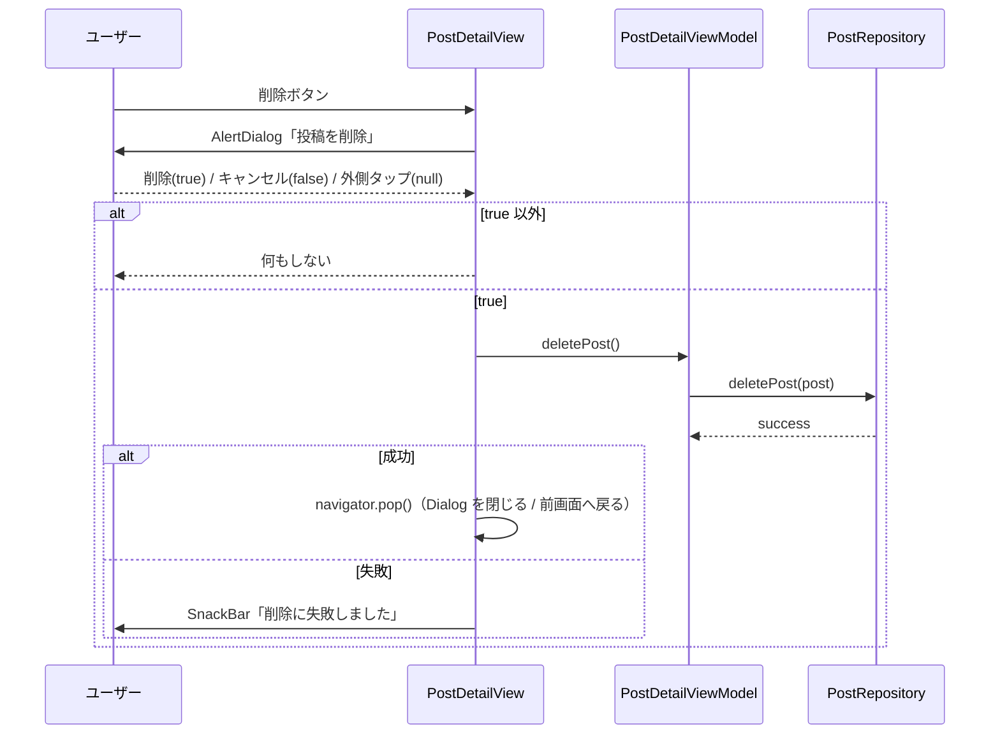

# lib/ui/post/widgets/post_detail_view.dart

| 項目 | 内容 |
|---|---|
| ファイル | `lib/ui/post/widgets/post_detail_view.dart` |
| 基本設計 | [03 フィード・投稿詳細](../../03_フィード・投稿詳細.md) の 2.2「表示モード（PostDetailView）」、3.2「編集」、3.3「削除」、6 章「入力チェック・エラー処理」 |
| 関連する基本設計 | [02 地図・投稿作成](../../02_地図・投稿作成.md)（地図ピンのサマリー表示・`LocationPickerPage` による位置の選び直し）、[07 コンテスト](../../07_コンテスト.md)（`ContestEntryBadge`・匿名表示）、[09 プロフィール](../../09_プロフィール.md)（投稿者タップで遷移） |
| レイヤ | View |
| 主な依存先 | `ui/post/post_detail_view_model.dart`（`PostDetailViewModel`）、`ui/post/image_viewer_page.dart`（`ImageViewerPage`）、`ui/map/location_picker_page.dart`（`LocationPickerPage`）、`ui/profile/profile_page.dart`（`ProfilePage`）、`ui/core/widgets/contest_entry_badge.dart`（`ContestEntryBadge`）、`data/models/post.dart`、`data/models/app_user.dart`、`provider`、`cached_network_image`、`flutter_map`、`latlong2` |
| 主な利用元 | `lib/ui/post/post_detail_page.dart`（`PostViewMode.full`）、`lib/ui/post/widgets/post_widget.dart`（`PostCardView`、`PostViewMode.summary`） |
| テスト | `test/ui/post/post_detail_page_test.dart`（full の振る舞いを網羅）、`test/ui/post/post_widget_test.dart`（summary） |

## 1. 責務

- 投稿詳細の中身を描画する共通ウィジェット。画像ギャラリー・投稿者・コンテストバッジ・説明文・タグを表示し、`mode` に応じて場所名 + 地図ミニプレビューと編集/削除メニューを出し分ける。
- いいね・コメントは差し込み口（`reactionBar` / `commentSection`）に受け取ったウィジェットをそのまま置く。
- 表示器（Dialog / Scaffold）は持たない。`PostCardView`（Dialog）と `PostDetailPage`（フルページ）が包む。高さが有界なコンテナに置く必要がある（内部で `Stack` + `SingleChildScrollView` を使う）。
- 状態とロジックは `PostDetailViewModel` に委譲し、本ファイルは描画・画面遷移（ビューア / 位置選択 / プロフィール / pop）・確認ダイアログ・SnackBar・`PageController` / `TextEditingController` の操作を担う。

## 2. 構成要素（クラス・関数・定数の一覧）

| 名前 | 種別 | 概要 |
|---|---|---|
| `PostViewMode` | `enum`（公開） | `summary`（地図ピンからの軽量表示）/ `full`（詳細ページ） |
| `PostDetailView` | `StatefulWidget`（公開） | 本体 |
| `PostDetailView.singleColumnKey` | `static const Key` = `ValueKey('post-detail-single-column')` | 1 カラムのルート `Column` のキー（テスト用） |
| `PostDetailView.twoColumnKey` | `static const Key` = `ValueKey('post-detail-two-column')` | 2 カラムのルート `Row` のキー（テスト用） |
| `_PostDetailViewState` | `State<PostDetailView>` | 下記の定数・フィールド・ハンドラ・ビルダー |

`_PostDetailViewState` の定数:

| 定数 | 値 | 用途 |
|---|---|---|
| `_mapPreviewHeight` | `160` | 地図ミニプレビューの高さ |
| `_mapPreviewZoom` | `15` | 地図ミニプレビューのズーム |
| `_twoColumnBreakpoint` | `900` | full でこの幅以上なら 2 カラム |
| `_overlayButtonSize` | `32` | ギャラリーに重ねる丸ボタンの直径 |
| `_overlayIconSize` | `18` | 同アイコンサイズ |
| `_galleryColumnFlex` | `3` | 2 カラム時の左（写真）の flex |
| `_infoColumnFlex` | `2` | 2 カラム時の右（情報）の flex |
| `_columnGap` | `24` | 2 カラムの間隔 |

## 3. 公開インターフェース

```dart
enum PostViewMode { summary, full }

const PostDetailView(
  this.post, {
  super.key,
  this.mode = PostViewMode.full,
  this.reactionBar,
  this.commentSection,
});
```

| 引数 | 型 | 既定 | 説明 |
|---|---|---|---|
| `post` | `Post`（位置引数・必須） | — | 表示する投稿 |
| `mode` | `PostViewMode` | `full` | 表示モード |
| `reactionBar` | `Widget?` | null | リアクションバー（#13）。null なら出さない |
| `commentSection` | `Widget?` | null | コメントセクション（#12）。null なら出さない |

モードによる出し分け:

| 要素 | summary | full |
|---|---|---|
| ギャラリー枠線 | あり（`Colors.grey.shade400`, 幅 2） | なし |
| 場所名・地図ミニプレビュー | 出さない | 出す |
| 編集・削除メニュー（`_canEdit`） | 出さない | `canManagePost` のとき出す |
| レイアウト | 常に 1 カラム | 幅 900 以上で 2 カラム |

## 4. 内部状態（フィールド・状態遷移）

| フィールド | 型 | 説明 |
|---|---|---|
| `_pageController` | `PageController`（final） | ギャラリーの `PageView` 用 |
| `_viewModel` | `late final PostDetailViewModel` | `initState` で生成。getter `vm` で参照 |
| `_captionController` | `late final TextEditingController` | 初期値 `widget.post.caption`。説明文の入力値を保持（編集中以外は readOnly） |
| `_canEdit`（getter） | `bool` | `vm.canManagePost && widget.mode == PostViewMode.full` |

状態遷移（閲覧 / 編集中 / 保存中 / 削除中）は ViewModel が持つ。[post_detail_view_model.md](post_detail_view_model.md) 4 章を参照。

### ライフサイクル

- `initState()`: `PostDetailViewModel(post: widget.post, authRepository: context.read(), postRepository: context.read(), userRepository: context.read(), contestRepository: context.read())` を生成し、`loadManagePermission()` を await せずに呼ぶ（判定が終わると `notifyListeners` で編集/削除ボタンが現れる）。
- `dispose()`: `_viewModel.dispose()` → `_pageController.dispose()` → `_captionController.dispose()` → `super.dispose()`。
- `build()`: `ListenableBuilder(listenable: _viewModel, builder: (_, _) => _buildContent())`。ViewModel の通知ごとに全体を再構築する。

## 5. 処理詳細

### 5.1 ウィジェット構成

#### `_buildContent()`

```
Stack
├ AbsorbPointer(absorbing: vm.isBusy)
│ └ LayoutBuilder
│   └ SingleChildScrollView
│     └ isTwoColumn ? _buildTwoColumn() : _buildSingleColumn()
├ [vm.isDeleting] _busyOverlay('削除中...')
└ [vm.isSaving]   _busyOverlay('保存中...')
```

`isTwoColumn = widget.mode == PostViewMode.full && constraints.maxWidth >= 900`。保存中・削除中は `AbsorbPointer` で全操作を無効化し、半透明オーバーレイを重ねる。

#### `_buildSingleColumn()`（summary / 狭い full）

`Column(key: singleColumnKey, mainAxisSize: min, crossAxisAlignment: start)` に上から:

1. `_buildAuthorRow()`
2. `SizedBox(12)` + `_buildGallery()`
3. 編集中のみ: 画像 2 枚以上なら `SizedBox(8)` + `_buildImageOrderControls()`、続けて `SizedBox(8)` + `_buildEditHint()`
4. `reactionBar` があれば `SizedBox(8)` + `reactionBar`
5. `SizedBox(20)` + `_buildCaptionField()`
6. タグがあれば `SizedBox(16)` + `_buildTags()`
7. full のみ `SizedBox(20)` + `_buildLocation()`
8. `commentSection` があれば `SizedBox(24)` + `commentSection`

#### `_buildTwoColumn()`（full かつ幅 900 以上）

`Row(key: twoColumnKey, crossAxisAlignment: start)`:

- 左 `Expanded(flex: 3)`: `_buildGallery()`、編集中は（2 枚以上なら）`_buildImageOrderControls()` と `_buildEditHint()`。
- `SizedBox(width: 24)`
- 右 `Expanded(flex: 2)`: `_buildAuthorRow()` → `SizedBox(12)` + `_buildCaptionField()` → タグ（`SizedBox(16)` + `_buildTags()`）→ `reactionBar`（`SizedBox(8)`）→ `SizedBox(20)` + `_buildLocation()` → `commentSection`（`SizedBox(24)`）。

1 カラムと違い、リアクションバーは説明文・タグの後ろに来る。ページ全体で 1 つのスクロールを共有する。

#### `_buildAuthorRow()`

`Row` に `Expanded(Column[_buildAuthorHeader(), (contestId != null なら) ContestEntryBadge(contestId: post.contestId!, voteCount: post.voteCount)])` と、`_canEdit` のとき `_buildOwnerActions()` の要素を並べる。

#### `_buildAuthorHeader()`

| 条件 | 表示 |
|---|---|
| `post.userId.isEmpty`（匿名期間中のコンテスト投稿） | `CircleAvatar(radius 18, grey.shade200, Icon(Icons.person_outline, 20, grey))` + `'匿名'`。タップ不可・購読しない |
| それ以外 | `StreamBuilder<AppUser?>(stream: vm.author)`。`InkWell(onTap: _openAuthorProfile, radius 8)` の中に、`profileImageUrl` が空でなければ `CachedNetworkImageProvider` の背景画像、空なら `Icon(Icons.person, 20, grey)` のアバターと、ユーザー名（空なら `'不明なユーザー'`）。文字は `titleSmall`・省略記号 |

#### `_buildOwnerActions()`（`_canEdit` のときのみ）

| 状態 | ボタン |
|---|---|
| 編集中 | `TextButton('キャンセル', onPressed: isSaving ? null : _cancelEdit)`、`TextButton('保存', onPressed: isSaving ? null : _saveEdit)` |
| 閲覧中 | `IconButton(Icons.edit_outlined, tooltip: '投稿を編集', onPressed: isDeleting ? null : _enterEditMode)`、`IconButton(Icons.delete_outline, color: red, tooltip: '投稿を削除', onPressed: isDeleting ? null : _confirmDelete)` |

#### `_buildGallery()`

```
Container(width: ∞, border: summary ? grey.shade400 幅2 : null, radius 12)
└ AspectRatio(4 / 3)
  └ Stack(alignment: center)
    ├ Positioned.fill → ClipRRect(radius 10) → PageView.builder
    │    controller: _pageController, itemCount: vm.imageUrls.length,
    │    onPageChanged: vm.showImageAt
    │    item: GestureDetector(onTap: _openImageViewer)
    │          └ CachedNetworkImage(fit: contain, memCacheWidth: 画面幅×DPR, fadeIn 150ms,
    │               placeholder: CircularProgressIndicator, error: Icons.broken_image_outlined 40 grey)
    ├ Positioned(top 6, left 6): _overlayButton(Icons.zoom_out_map, '写真を拡大', _openImageViewer)
    ├ [画像 2 枚以上] Positioned(left 6): chevron_left（index > 0 なら _showPreviousImage、先頭は無効）
    ├ [画像 2 枚以上] Positioned(right 6): chevron_right（末尾以外なら _showNextImage）
    ├ [編集中] Positioned(top 6, right 6): _overlayButton(Icons.delete, 背景 red, _deleteCurrentImage)
    ├ [編集中かつ index == 0] Positioned(bottom 6, left 6): 'サムネイル' バッジ（black54・白 12px）
    └ Positioned(bottom 6): '${currentImageIndex + 1} / ${imageUrls.length}' カウンタ（black54・白 12px）
```

- 写真は縦横比がまちまちなので `BoxFit.contain` で全体を見せ、余白は塗らない（呼び出し元の背景が透ける）。
- `memCacheWidth` は `MediaQuery.size.width × devicePixelRatio` を丸めた値（表示サイズに合わせてデコードしメモリを抑える）。

#### `_overlayButton({required IconData icon, required VoidCallback? onPressed, Color backgroundColor = Colors.black54, String? tooltip})`

`IconButton` は 48px のタップ領域に引き伸ばされるため、`Material(color: backgroundColor, shape: CircleBorder, clip: antiAlias)` + `InkWell(onTap: onPressed)` + `SizedBox(32×32)` + `Icon(size 18)` で組む。`onPressed == null` ならアイコン色 `Colors.white38`（無効表示）、それ以外 `Colors.white`。`tooltip` があれば `Tooltip` で包む。

#### `_buildImageOrderControls()`（編集中かつ 2 枚以上）

`Wrap(spacing 8, runSpacing 8)`:

| ボタン | 有効条件 | 動作 |
|---|---|---|
| `IconButton(Icons.arrow_back, tooltip: '前へ移動')` | `!isSaving && index > 0` | `_moveCurrentImage(index - 1)` |
| `IconButton(Icons.arrow_forward, tooltip: '後ろへ移動')` | `!isSaving && index < length - 1` | `_moveCurrentImage(index + 1)` |
| `OutlinedButton.icon(Icons.image_outlined, 'サムネイルに設定')` | `!isSaving && index > 0` | `_moveCurrentImage(0)` |

#### `_buildEditHint()`（編集中）

`'写真の追加はできません。不要な写真は削除し、並び替えで1枚目（サムネイル）を変更できます。'`（`bodySmall`、`Colors.grey.shade600`）。

#### `_buildCaptionField()`

`TextField(controller: _captionController, readOnly: !vm.isEditing, maxLines: null, minLines: 3, decoration: InputDecoration(labelText: '説明文', floatingLabelBehavior: always, border: OutlineInputBorder(), filled: vm.isEditing))`。閲覧中も TextField で表示し、編集中だけ入力可能・塗りつぶしにする。

#### `_buildTags()`

`Wrap(spacing 8, runSpacing -4)` に `Chip(label: Text('#$tag'))`。タグが空なら呼ばれない。

#### `_buildLocation()`（full のみ）

1. `locationName = widget.post.locationName ?? ''` が空でなければ `Icon(Icons.place_outlined, 18)` + 場所名（`titleSmall`・省略記号）+ `SizedBox(8)`。
2. `ClipRRect(radius 12)` + `SizedBox(height 160)` の `FlutterMap`:
   - `key: ValueKey('${point.latitude},${point.longitude}')`（`point = vm.position`）。`initialCenter` の変更では再センタリングされないため、位置が変わったら再構築させる。
   - `MapOptions(initialCenter: point, initialZoom: 15, interactionOptions: InteractionOptions(flags: InteractiveFlag.none))`（操作不可）。
   - `TileLayer(urlTemplate: 'https://tile.openstreetmap.org/{z}/{x}/{y}.png', userAgentPackageName: 'com.afterglow_app.app')`。
   - `MarkerLayer` に `Marker(point, 40×40, Icon(Icons.location_on, red, 36))`。
3. 編集中のみ `SizedBox(8)` + `OutlinedButton.icon(Icons.edit_location_alt, '位置を変更', onPressed: isSaving ? null : _changeLocation)`。

場所名は `widget.post.locationName` 固定のため、位置を選び直しても場所名は変わらない（9 章）。

#### `_busyOverlay(String label)`

`Positioned.fill` → `ColoredBox(Color(0x66000000))` → 中央に白い角丸（12）の箱（padding 横 24 / 縦 20）で `CircularProgressIndicator` + `SizedBox(12)` + `Text(label)`。

### 5.2 イベントハンドラ

| ハンドラ | トリガー | 手順 |
|---|---|---|
| `_showMessage(String)` | 各処理 | `ScaffoldMessenger.of(context).showSnackBar(SnackBar(content: Text(message)))` |
| `_showPreviousImage()` | 左矢印 | `vm.currentImageIndex > 0` なら `_pageController.previousPage(200ms, easeInOut)`。表示位置は `onPageChanged` → `vm.showImageAt` で VM に反映 |
| `_showNextImage()` | 右矢印 | `vm.currentImageIndex < length - 1` なら `nextPage(200ms, easeInOut)` |
| `_enterEditMode()` | 編集ボタン | `vm.enterEditMode(caption: _captionController.text)` |
| `_cancelEdit()` | キャンセル | `_captionController.text = vm.cancelEdit()` → `_syncPageController()` |
| `_changeLocation()` | 「位置を変更」 | `Navigator.push<LatLng>(MaterialPageRoute(builder: (_) => LocationPickerPage(initialPosition: vm.position)))` を await。`selected == null`（キャンセル）または unmount なら何もしない。それ以外は `vm.changePosition(selected)`（プレビューが新しい座標キーで再構築される） |
| `_deleteCurrentImage()` | 赤い削除ボタン（編集中） | `vm.deleteCurrentImage()` が false なら `_showMessage('写真は最低1枚必要です')` で終了。true なら `_syncPageController()` |
| `_moveCurrentImage(int)` | 並び替えボタン | `vm.moveCurrentImage(targetIndex)` → `_syncPageController()` |
| `_syncPageController()` | 枚数・並び順の変化後 | `addPostFrameCallback` で次フレームに、`_pageController.hasClients` なら `jumpToPage(vm.currentImageIndex)`（VM の index と `PageView` の表示を合わせる） |
| `_saveEdit()` | 保存 | `success = await vm.saveEdit(caption: _captionController.text)`。unmount なら終了。`_showMessage(success ? '投稿を更新しました' : '更新に失敗しました')` |
| `_confirmDelete()` | 削除ボタン | 下記 5.3 |
| `_openAuthorProfile()` | 投稿者行タップ | `post.userId` が空なら何もしない。それ以外は `ProfilePage(userId: widget.post.userId)` を push |
| `_openImageViewer()` | 写真タップ / 拡大ボタン | `vm.imageUrls` が空なら何もしない。`ImageViewerPage.open(context, imageUrls: List.of(vm.imageUrls), initialIndex: vm.currentImageIndex)`（編集中は編集中の並び順で開く） |

### 5.3 `_confirmDelete()`



1. ダイアログ表示前に `navigator = Navigator.of(context)` を取得しておく（await 後に context を使わないため）。
2. `showDialog<bool>` で `AlertDialog(title: '投稿を削除', content: 'この投稿を削除しますか？この操作は取り消せません。', actions: [TextButton('キャンセル') → pop(false), TextButton('削除'（赤字）) → pop(true)])`。
3. 結果が `true` でなければ return。
4. `success = await vm.deletePost()`（この間 `削除中...` オーバーレイ）。unmount なら終了。
5. 成功なら `navigator.pop()`。一覧・地図は Firestore の購読で自動更新される。失敗なら `_showMessage('削除に失敗しました')`。

## 6. データ仕様

本ファイルは Firestore/Storage に直接アクセスしない（ViewModel → Repository 経由）。表示に使う `Post` のフィールド: `imageUrls`（VM がコピーして保持）、`caption`（初期値）、`userId`、`contestId`、`voteCount`、`tags`、`locationName`、`latitude`/`longitude`（VM の `position` 経由）。

外部 URL: 地図タイル `https://tile.openstreetmap.org/{z}/{x}/{y}.png`（`userAgentPackageName: 'com.afterglow_app.app'`）。

## 7. 例外・エラー処理

| 状況 | 表示・扱い |
|---|---|
| 最後の 1 枚を削除しようとした | SnackBar「写真は最低1枚必要です」 |
| 保存成功 / 失敗 | SnackBar「投稿を更新しました」/「更新に失敗しました」（失敗時は編集モードのまま） |
| 削除失敗 | SnackBar「削除に失敗しました」（画面は閉じない） |
| 画像の読込失敗 | `Icons.broken_image_outlined`（grey, 40） |
| 投稿者が取得できない | 「不明なユーザー」 |
| 位置選択のキャンセル | 何もしない |
| 非同期処理後に unmount | `mounted` を確認して SnackBar / VM 更新をしない |
| 保存中・削除中 | `AbsorbPointer` で操作を受け付けない |

## 8. テスト観点

既存テスト（`test/ui/post/post_detail_page_test.dart`、`PostDetailPage` 経由）:

- 幅 1400 で 2 カラム、幅 400 で 1 カラム。2 カラムでも並び替え操作を出す。
- 説明文を表示し、閲覧中は読み取り専用。編集モードで編集可能になる。
- 画像カウンタ「1 / n」、複数枚で矢印を出し 1 枚では出さない。
- 写真は `BoxFit.contain` で表示する。写真タップ・拡大ボタンで `ImageViewerPage` が開く。
- スマホ幅（415）で重ねボタンが小さく収まる。
- 場所名と地図プレビューを表示する。場所名が無くても地図は出す。
- タグを Chip で出し、タグが無ければ出さない。差し込み口のウィジェットを描画する。
- 投稿者本人だけに編集・削除ボタンを出す（他人・未ログインでは出さない）。
- 確認後に削除し、キャンセルなら残る。
- users ドキュメントのユーザー名を表示する。
- 説明文の保存、写真削除後の保存、最後の 1 枚は削除できない。
- 写真の並び替え（Issue #80）: 2 枚目をサムネイルに設定して保存、後ろへ移動して保存、キャンセルで元の順に戻る、先頭では先頭向け操作が無効でサムネイルバッジを出す、1 枚なら並び替え操作を出さない、並び替え + 削除後の順で保存。
- 編集モードで「位置を変更」を出し、選び直して保存すると緯度経度が更新される（Issue #37）。

既存テスト（`test/ui/post/post_widget_test.dart`、summary）: 地図プレビューを出さない、自投稿でも編集・削除を出さない、いいね・コメントを出す。

未テストの観点:

- 保存失敗・削除失敗時の SnackBar。
- 保存中・削除中のオーバーレイと操作無効化。
- 匿名投稿（`userId` 空）の「匿名」表示とプロフィール遷移の抑止。
- 投稿者タップでの `ProfilePage` 遷移。
- コンテスト投稿での `ContestEntryBadge` 表示。

## 9. 備考・既知の課題

- 位置を選び直しても場所名（`post.locationName`）は更新されず、保存しても `locationName` は送られない。地図プレビューと場所名が食い違いうる。
- 保存後も `widget.post` は更新されない。この画面は `_captionController` と VM の `imageUrls` / `position` で保存後の値を出し続けるが、`post` 自体を読む箇所（削除時の Storage パス算出など）は開いた時点の値のまま（[post_detail_view_model.md](post_detail_view_model.md) 9 章）。
- `memCacheWidth` は画面全体の幅から算出しており、2 カラムや Dialog では実表示幅より大きめにデコードする。
- 2 カラムと 1 カラムでリアクションバーの位置（説明文の前 / タグの後）が異なる。
- `loadManagePermission()` は await されず、エラーは捕捉されない（[post_detail_view_model.md](post_detail_view_model.md) 7 章）。
