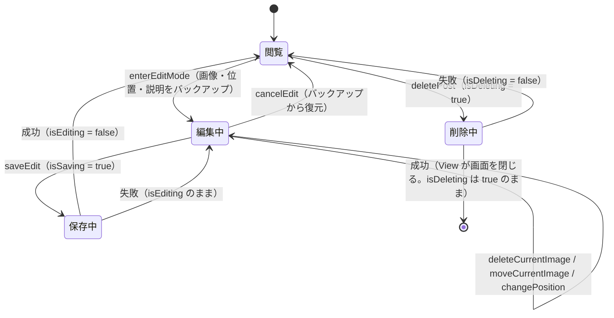

# lib/ui/post/post_detail_view_model.dart

| 項目 | 内容 |
|---|---|
| ファイル | `lib/ui/post/post_detail_view_model.dart` |
| 基本設計 | [03 フィード・投稿詳細](../../03_フィード・投稿詳細.md) の 2.2「表示モード」、3.2「編集」、3.3「削除」、3.4「編集・削除の権限判定（UI）」 |
| 関連する基本設計 | [07 コンテスト](../../07_コンテスト.md)（コンテスト投稿の権限・匿名投稿の実投稿者解決）、[00 システム概要・共通設計](../../00_システム概要.md) 3.4（ViewModel の適用状況） |
| レイヤ | ViewModel |
| 主な依存先 | `data/models/post.dart`（`Post`）、`data/models/app_user.dart`（`AppUser`）、`data/models/contest.dart`（`ContestPhase`）、`data/repositories/auth_repository.dart`、`data/repositories/post_repository.dart`、`data/repositories/user_repository.dart`、`data/repositories/contest_repository.dart`、`package:flutter/foundation.dart`（`ChangeNotifier`）、`latlong2`（`LatLng`） |
| 主な利用元 | `lib/ui/post/widgets/post_detail_view.dart`（`_PostDetailViewState.initState` で生成・`dispose` で破棄） |
| テスト | `test/ui/post/post_detail_view_model_test.dart`、`test/ui/post/post_detail_page_test.dart`（View 経由） |

## 1. 責務

- 投稿詳細 1 件分の状態とロジックを持つ `ChangeNotifier`。
  - 編集/削除の権限判定（通常投稿・コンテスト投稿）。
  - ギャラリーの表示位置。
  - 編集中の画像一覧・並び順（Issue #80）・削除予定画像・位置（Issue #37）と、キャンセル用のバックアップ。
  - 保存・削除の送信と送信中フラグ。
- 説明文の入力値は View の `TextEditingController` が持ち、`enterEditMode` / `cancelEdit` / `saveEdit` の引数・戻り値で受け渡す。`BuildContext` には触れない。成功/失敗は `bool` の戻り値で View に返し、SnackBar は View が出す。

## 2. 構成要素（クラス・関数・定数の一覧）

| 名前 | 種別 | 概要 |
|---|---|---|
| `PostDetailViewModel` | `class extends ChangeNotifier` | 本ファイル唯一のクラス |

定数はない。

## 3. 公開インターフェース

### 3.1 コンストラクタ

```dart
PostDetailViewModel({
  required this.post,
  required AuthRepository authRepository,
  required PostRepository postRepository,
  required UserRepository userRepository,
  required ContestRepository contestRepository,
})
```

初期化リストで `_imageUrls = List.of(post.imageUrls)`、`_position = LatLng(post.latitude, post.longitude)` を作り、本体で `_backupImageUrls = List.of(_imageUrls)`、`_backupPosition = _position` を設定する。権限判定は行わない（View が `loadManagePermission()` を呼ぶ）。

### 3.2 プロパティ

| プロパティ | 型 | 説明 |
|---|---|---|
| `post` | `Post`（final） | 開いた時点の投稿。保存後も更新しない |
| `author` | `late final Stream<AppUser?>` | `_userRepository.watchUser(post.userId)`。初回アクセス時に生成（匿名投稿では View がアクセスしないため購読されない） |
| `canManagePost` | `bool` | 編集・削除してよいか |
| `isDeleting` | `bool` | 削除送信中 |
| `isEditing` | `bool` | 編集モード中 |
| `isSaving` | `bool` | 保存送信中 |
| `isBusy` | `bool` | `isDeleting \|\| isSaving` |
| `currentImageIndex` | `int` | ギャラリーの表示位置 |
| `imageUrls` | `List<String>` | 表示・編集中の画像一覧（`List.unmodifiable` のコピー） |
| `position` | `LatLng` | 表示・編集中の位置。保存後は新しい位置を保持し続ける |

### 3.3 メソッド

| シグネチャ | 戻り値 | 概要 |
|---|---|---|
| `Future<void> loadManagePermission()` | — | 編集/削除の権限を判定して `canManagePost` を設定 |
| `void showImageAt(int index)` | — | ギャラリーの表示位置を更新 |
| `void enterEditMode({required String caption})` | — | 編集開始。現在値をバックアップ |
| `String cancelEdit()` | 復元すべき説明文 | 編集取り消し |
| `void changePosition(LatLng position)` | — | 選び直した位置を反映 |
| `bool deleteCurrentImage()` | 削除したら true | 表示中の画像を削除予定に回す |
| `void moveCurrentImage(int targetIndex)` | — | 表示中の画像を移動 |
| `Future<bool> saveEdit({required String caption})` | 成功で true | 編集内容を保存 |
| `Future<bool> deletePost()` | 成功で true | 投稿を削除 |
| `void dispose()` | — | `_disposed = true` にしてから `super.dispose()` |

## 4. 内部状態（フィールド・状態遷移）

| フィールド | 型 | 初期値 | 説明 |
|---|---|---|---|
| `_disposed` | `bool` | `false` | 非同期処理後の `notifyListeners` 抑止 |
| `_canManagePost` | `bool` | `false` | |
| `_isDeleting` / `_isEditing` / `_isSaving` | `bool` | `false` | |
| `_currentImageIndex` | `int` | `0` | |
| `_imageUrls` | `List<String>` | `post.imageUrls` のコピー | 編集で削除・並べ替えされる |
| `_removedImageUrls` | `List<String>`（final） | `[]` | 編集中に削除した画像 URL。保存時に Storage から消す |
| `_position` | `LatLng` | 投稿の緯度経度 | |
| `_positionChanged` | `bool` | `false` | 編集中に位置を選び直したか |
| `_backupImageUrls` | `late List<String>` | `_imageUrls` のコピー | キャンセル用 |
| `_backupPosition` | `late LatLng` | `_position` | キャンセル用 |
| `_backupCaption` | `String` | `''` | キャンセル用 |

### 状態遷移



## 5. 処理詳細

### 5.1 `loadManagePermission()`

1. `uid = _authRepository.currentUserId`。null（未ログイン）なら何もせず return（`canManagePost` は false のまま、通知もしない）。
2. `contestId = post.contestId` が null（通常投稿）なら `_canManagePost = post.userId == uid` として `notifyListeners()` し return（Firestore アクセスなし）。
3. コンテスト投稿の場合、順に await する。
   1. `authorId = await _postRepository.getAuthorId(post.id)`（匿名期間中は `posts/{postId}/private/author` から実投稿者を解決。失敗時 null）
   2. `currentUser = await _userRepository.getUser(uid)`
   3. `contest = await _contestRepository.getContest(contestId)`
4. `_disposed` なら return。
5. `isEntryOpen = contest?.phase == ContestPhase.entry`。
6. `_canManagePost = (authorId == uid || currentUser?.isAdmin == true) && isEntryOpen`、`notifyListeners()`。

### 5.2 `showImageAt(int index)`

`index == _currentImageIndex` なら何もしない。異なれば更新して `notifyListeners()`。`PageView.onPageChanged` から呼ばれる。

### 5.3 `enterEditMode({required String caption})`

`_backupImageUrls = List.of(_imageUrls)`、`_backupCaption = caption`、`_backupPosition = _position`、`_positionChanged = false`、`_removedImageUrls.clear()`、`_isEditing = true`、`notifyListeners()`。

### 5.4 `cancelEdit()`

1. `_imageUrls = List.of(_backupImageUrls)`、`_position = _backupPosition`、`_positionChanged = false`、`_removedImageUrls.clear()`、`_isEditing = false`。
2. `_currentImageIndex >= _imageUrls.length` なら末尾（`length - 1`）に丸める。
3. `notifyListeners()` し、`_backupCaption` を返す（View が `TextEditingController.text` に戻す）。

### 5.5 `changePosition(LatLng position)`

`_position = position`、`_positionChanged = true`、`notifyListeners()`。

### 5.6 `deleteCurrentImage()`

1. `_imageUrls.length <= 1` なら false を返す（最低 1 枚。状態は変えない）。
2. `_removedImageUrls.add(_imageUrls.removeAt(_currentImageIndex))`。
3. `_currentImageIndex >= _imageUrls.length` なら `length - 1` に丸める。
4. `notifyListeners()`、true を返す。

`_isEditing` は確認しない（View が編集中にしか削除ボタンを出さない）。

### 5.7 `moveCurrentImage(int targetIndex)`

1. 次のいずれかなら何もしない: `!_isEditing`、`_isSaving`、`targetIndex < 0`、`targetIndex >= _imageUrls.length`、`targetIndex == _currentImageIndex`。
2. `_imageUrls.insert(targetIndex, _imageUrls.removeAt(_currentImageIndex))`。
3. `_currentImageIndex = targetIndex`（移動した写真を表示し続ける）、`notifyListeners()`。

先頭（index 0）の画像がサムネイルになるため、`moveCurrentImage(0)` が「サムネイルに設定」になる。

### 5.8 `saveEdit({required String caption})`

1. `_isSaving = true`、`notifyListeners()`。
2. `success = await _postRepository.updatePost(post, caption: caption, imageUrls: List.of(_imageUrls), removedImageUrls: List.of(_removedImageUrls), latitude: _positionChanged ? _position.latitude : null, longitude: _positionChanged ? _position.longitude : null)`。
3. `_disposed` なら `success` をそのまま返す。
4. `_isSaving = false`。成功なら `_isEditing = false`、`_removedImageUrls.clear()`、`_positionChanged = false`（`_position` は新しい位置として残す）。
5. `notifyListeners()`、`success` を返す。失敗時は編集モードと編集内容がそのまま残り、再保存・キャンセルできる。

### 5.9 `deletePost()`

1. `_isDeleting = true`、`notifyListeners()`。
2. `success = await _postRepository.deletePost(post)`。
3. `_disposed` なら `success` を返す。
4. 失敗なら `_isDeleting = false`、`notifyListeners()`。成功時は `_isDeleting` を true のままにする（View が直後に画面を閉じるため、オーバーレイを出したまま閉じる）。
5. `success` を返す。

## 6. データ仕様

本クラスは Repository 経由でのみアクセスする。

| 操作 | Repository | Firestore / Storage |
|---|---|---|
| 権限判定 | `AuthRepository.currentUserId`、`PostRepository.getAuthorId`、`UserRepository.getUser`、`ContestRepository.getContest` | `posts/{postId}`（`userId`, `contestId`）、`posts/{postId}/private/author`（`userId`）、`users/{uid}`（`role`）、`contests/{contestId}`（フェーズ判定） |
| 投稿者表示 | `UserRepository.watchUser` | `users/{userId}` |
| 保存 | `PostRepository.updatePost` | `posts/{postId}` の `caption`・`imageUrls`・（位置変更時のみ）`latitude`/`longitude`・`updatedAt`。削除画像は `refFromURL` で Storage から削除 |
| 削除 | `PostRepository.deletePost` | `posts/{postId}` 削除、`posts/{authorId}/{postId}_{0..n-1}.jpg` 削除 |

Repository 側の詳細は [post_repository.md](../02_地図・投稿作成/post_repository.md) を参照。

## 7. 例外・エラー処理

- `updatePost` / `deletePost` は例外を `false` に変換して返すため、本クラスは try/catch しない。失敗は戻り値 false で View に伝え、View が「更新に失敗しました」「削除に失敗しました」を表示する。
- `loadManagePermission` は try/catch を持たない。`getAuthorId` は例外を null に変換するが、`UserRepository.getUser` / `ContestRepository.getContest` が例外を投げた場合は Future がエラーで完了し、`canManagePost` は false のまま（View は戻り値を待たないため未処理の非同期エラーになる）。
- 非同期処理の完了時に破棄済み（`_disposed`）なら `notifyListeners()` を呼ばない。

## 8. テスト観点

既存テスト（`test/ui/post/post_detail_view_model_test.dart`。`updatePost` / `deletePost` の引数を記録する `_RecordingPostRepository` を注入）:

- 通常投稿は投稿者本人だけが編集・削除できる。
- 画像の移動・削除は取り消すと編集前に戻る。
- 最後の 1 枚は削除できない。
- 保存すると並び順・削除画像・選び直した位置を送り、編集を終える。
- 位置を選び直さなければ緯度経度を送らない。
- 削除に失敗したら削除中を解除する。

未テストの観点:

- コンテスト投稿の権限判定（実投稿者 / 管理者 / エントリー期間外）。
- 未ログイン時に `canManagePost` が false のままであること。
- 保存失敗時に編集モードが維持されること。
- `moveCurrentImage` のガード（編集外・保存中・範囲外）。
- 破棄後に非同期処理が完了しても通知しないこと。

## 9. 備考・既知の課題

- 管理者はルール上いつでもコンテスト投稿を削除できるが、本判定は「エントリー期間中」を必須にしている（コード中のコメントどおり意図的。基本設計 7 章）。
- 保存後も `post`（開いた時点の投稿）は更新されない。そのため同じ画面で編集保存→削除すると、`deletePost(post)` は編集前の `post.imageUrls.length` で Storage の連番パスを消しにいく。連番命名と URL のずれ（基本設計 7 章）と合わせ、Storage に画像が残りうる。
