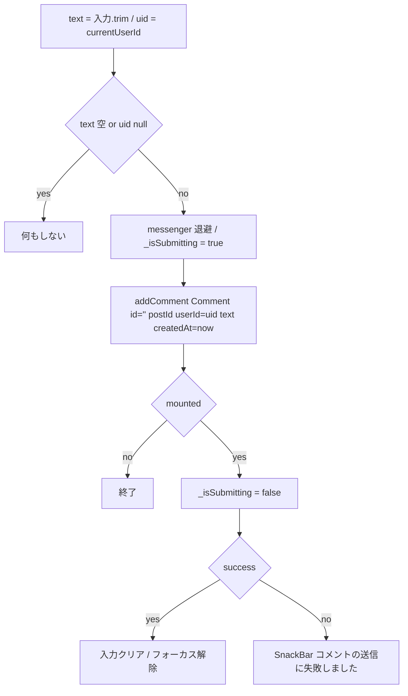

# lib/ui/core/widgets/comment_section.dart

| 項目 | 内容 |
|---|---|
| ファイル | `lib/ui/core/widgets/comment_section.dart` |
| 基本設計 | [04 コメント・リアクション](../../04_コメント・リアクション.md) の「2. 画面・コンポーネント構成」「3.1 コメント」「6. 入力チェック・エラー処理」 |
| 関連する基本設計 | [03 フィード・投稿詳細](../../03_フィード・投稿詳細.md)（投稿詳細のコメントスロット）、[02 地図・投稿作成](../../02_地図・投稿作成.md)（地図のサマリー）、[05 アルバム](../../05_アルバム.md)、[07 コンテスト](../../07_コンテスト.md)、[09 プロフィール](../../09_プロフィール.md)（各画面から投稿詳細を開く際に差し込む） |
| レイヤ | View |
| 主な依存先 | `lib/data/models/{app_user,comment,post}.dart`, `lib/data/repositories/{auth,comment,user}_repository.dart`, `lib/ui/profile/profile_page.dart`, `package:provider`, `package:cached_network_image` |
| 主な利用元 | `lib/ui/feed/feed_page.dart`, `lib/ui/map/map_screen.dart`, `lib/ui/album/album_detail_page.dart`, `lib/ui/contest/contest_detail_page.dart`, `lib/ui/profile/profile_page.dart`（いずれも `PostDetailPage` / `PostDetailView` の `commentSection` 引数に渡す） |
| テスト | なし |

## 1. 責務

投稿 1 件のコメント欄を構成する部品。コメント一覧（古い順）を購読表示し、末尾に投稿フォームを置く。各コメントに投稿者のアイコン・名前・日時を出し、名前／アイコンのタップでプロフィールへ遷移する。自分のコメントにだけ編集・削除メニューを出す。`PostDetailView` のコメントスロットに差し込まれる前提のため、自身はスクロールしない。

## 2. 構成要素（クラス・関数・定数の一覧）

| 名前 | 種別 | 概要 |
|---|---|---|
| `CommentSection` | `StatefulWidget`（公開） | コメント欄 |
| `_CommentSectionState` | `State` | 依存の取得・入力・送信状態の保持と UI 構築 |
| `_submit` / `_editComment` / `_deleteComment` / `_openProfile` | private メソッド | イベントハンドラ |
| `_formatTimestamp` | private メソッド | 日時整形 |
| `_buildCommentTile` / `_buildInputField` | private メソッド | 部分ウィジェット構築 |

## 3. 公開インターフェース（コンストラクタ引数・プロパティ・メソッドのシグネチャと説明）

```dart
const CommentSection({Key? key, required Post post})
```

| プロパティ | 型 | 説明 |
|---|---|---|
| `post` | `Post` | コメント対象の投稿。`post.id` のみ使用する |

依存（`provider` から `context.read` で取得）: `AuthRepository`, `UserRepository`, `CommentRepository`。

## 4. 内部状態（フィールド・状態遷移）

| フィールド | 型 | 初期値 | 内容 |
|---|---|---|---|
| `_authRepository` | `AuthRepository`（`late final`） | `context.read<AuthRepository>()` | 現在 UID の取得 |
| `_userRepository` | `UserRepository`（`late final`） | `context.read<UserRepository>()` | 投稿者情報の購読 |
| `_commentRepository` | `CommentRepository`（`late final`） | `context.read<CommentRepository>()` | コメントの読み書き |
| `_inputController` | `TextEditingController`（final） | 空 | 新規コメント入力欄 |
| `_isSubmitting` | `bool` | `false` | 送信中フラグ。true の間は送信ボタンをスピナーに置き換える |

ライフサイクル:
- `initState` は持たない。Repository は `late final` で初回アクセス時に `context.read` する。
- `dispose` で `_inputController.dispose()`。

## 5. 処理詳細（メソッドごとの手順・分岐・呼び出す Repository/SDK）

### ウィジェット構成（`build`）

```
Column(crossAxisAlignment: start)
├─ Text('コメント', titleMedium)
├─ SizedBox(height: 8)
├─ StreamBuilder<List<Comment>>(stream: getComments(post.id))
│   ├─ waiting → Padding(vertical 16) + Center(CircularProgressIndicator)
│   ├─ 空      → Text('まだコメントはありません', bodySmall / grey.shade600)
│   └─ 1 件以上 → ListView.separated(shrinkWrap, NeverScrollableScrollPhysics,
│                 separator: Divider(height: 16), item: _buildCommentTile)
├─ SizedBox(height: 12)
└─ _buildInputField()
```

`snapshot.data` が null（エラー時含む）の場合は空リストとして扱う。

### `_buildCommentTile(comment)`

1. `isOwn = _authRepository.currentUserId == comment.userId`。
2. `StreamBuilder<AppUser?>(stream: _userRepository.watchUser(comment.userId))` で投稿者を購読する。
   - `hasImage = (author?.profileImageUrl ?? '').isNotEmpty`。
   - `username` は空でなければ `author.username`、空または未取得なら `'不明なユーザー'`。
3. 行の構成（`Row`, `crossAxisAlignment: start`）:
   - `InkWell`（角丸 16、タップで `_openProfile(comment.userId)`）+ `CircleAvatar(radius: 16, backgroundColor: grey.shade200)`。画像があれば `CachedNetworkImageProvider(profileImageUrl)`、無ければ `Icon(Icons.person, size: 18, color: grey)`。
   - `Expanded` の `Column`:
     - 1 行目: 名前（`InkWell` でタップ → `_openProfile`、`titleSmall`、省略表示）・日時（`_formatTimestamp(comment.updatedAt ?? comment.createdAt)`、`bodySmall` / grey.shade600）・`updatedAt != null` のとき `'(編集済み)'`。
     - 2 行目: `Text(comment.text)`。
   - `isOwn` のときのみ `PopupMenuButton<String>`（アイコン `Icons.more_horiz` size 20、tooltip `'コメントの操作'`）。項目は `'edit'` → `'編集'`、`'delete'` → `'削除'`。`onSelected` で `_editComment` / `_deleteComment` を呼ぶ。

### `_buildInputField()`

- `Row(crossAxisAlignment: end)` に `Expanded(TextField)` と送信ボタン。
- `TextField`: `controller: _inputController`, `minLines: 1`, `maxLines: 4`, `textInputAction: TextInputAction.newline`, `hintText: 'コメントを追加...'`, `OutlineInputBorder`, `isDense: true`。
- `_isSubmitting` が true なら 24×24 の `CircularProgressIndicator(strokeWidth: 2)`（Padding 8）、false なら `IconButton(icon: Icons.send, tooltip: 'コメントを送信', onPressed: _submit)`。

### `_submit()`



- `ScaffoldMessenger` は `await` 前に取得しておく。

### `_editComment(comment)`

1. 初期値 `comment.text` の `TextEditingController` を作り、`messenger` を退避する。
2. `showDialog<String>` で `AlertDialog` を表示する。
   - タイトル `'コメントを編集'`。
   - 本文 `TextField(autofocus: true, maxLines: null, minLines: 1, OutlineInputBorder, hintText: 'コメントを入力')`。
   - アクション `'キャンセル'`（`pop()` → null）、`'保存'`（`pop(controller.text.trim())`）。
3. ダイアログ終了後 `controller.dispose()`。
4. `newText` が null・空・元の本文と同一なら何もしない。
5. `_commentRepository.updateComment(post.id, comment.id, newText)`。
6. `mounted` でなければ終了。失敗なら SnackBar `'コメントの更新に失敗しました'`。成功時の表示更新はコメント一覧の購読に任せる。

### `_deleteComment(comment)`

1. `messenger` を退避する。
2. `showDialog<bool>`: タイトル `'コメントを削除'`、本文 `'このコメントを削除しますか？'`、アクション `'キャンセル'`（false）・`'削除'`（true、赤字）。
3. 結果が `true` 以外なら何もしない。
4. `_commentRepository.deleteComment(post.id, comment.id)`。
5. `mounted` でなければ終了。失敗なら SnackBar `'コメントの削除に失敗しました'`。

### `_openProfile(userId)`

`Navigator.push(MaterialPageRoute(builder: (_) => ProfilePage(userId: userId)))`。

### `_formatTimestamp(time)`

`yyyy/MM/dd HH:mm` 形式（例 `2026/07/15 21:30`）。`intl` を使わず、月・日・時・分を `padLeft(2, '0')` で 2 桁にする。端末ローカル時刻のまま整形する。

## 6. データ仕様（読み書きする Firestore/Storage のパス・フィールド、定数値）

本ウィジェットは Firestore を直接触らない。Repository 経由で次を扱う。

| 操作 | Repository メソッド | 対象 |
|---|---|---|
| 一覧購読 | `CommentRepository.getComments(post.id)` | `posts/{postId}/comments`（`createdAt` 昇順） |
| 投稿者購読 | `UserRepository.watchUser(comment.userId)` | `users/{uid}`（`username`, `profileImageUrl`） |
| 作成 | `CommentRepository.addComment` | `id: ''`（自動採番）, `postId`, `userId`, `text`, `createdAt: DateTime.now()` |
| 更新 | `CommentRepository.updateComment` | `text`, `updatedAt` |
| 削除 | `CommentRepository.deleteComment` | — |

## 7. 例外・エラー処理（例外の扱い・戻り値・表示メッセージ）

| 状況 | 挙動 |
|---|---|
| 入力が空白のみ・未ログイン | 何もしない（メッセージなし） |
| 送信失敗（`addComment` が false） | SnackBar「コメントの送信に失敗しました」。入力内容は残す |
| 編集で空文字・変更なし・キャンセル | 何もしない |
| 更新失敗 | SnackBar「コメントの更新に失敗しました」 |
| 削除失敗 | SnackBar「コメントの削除に失敗しました」 |
| コメント購読のエラー | `snapshot.data` が null となり「まだコメントはありません」を表示（エラー表示はない） |
| 投稿者の取得不可・ユーザー削除済み | 名前「不明なユーザー」、人型アイコン |
| await 後に破棄済み | `mounted` を確認して以降の処理を打ち切る |

## 8. テスト観点（既存テストが確認していること / 未テストの観点）

既存: 本ウィジェット専用のテストはない（Repository 単体は `comment_repository_test.dart` で確認）。

未テスト:
- 空入力・未ログインで送信しないこと、送信成功で入力がクリアされること。
- 自分のコメントにだけメニューが出ること、`(編集済み)` 表示と日時が `updatedAt` 優先になること。
- 編集ダイアログで変更なし・空文字のときに更新しないこと、削除確認でキャンセルできること。
- 失敗時の SnackBar 文言。

## 9. 備考・既知の課題

- `getComments` / `watchUser` の Stream を `build` の中で生成しているため、`setState`（送信中フラグの切替）などで再構築されるたびに購読し直す。`StreamBuilder` は購読し直すと `ConnectionState.waiting` に戻るため、送信開始・終了の瞬間に一覧がスピナーに切り替わってちらつく可能性がある。
- コメントの文字数上限はない（基本設計 7 章）。
- ルール上は管理者も他人のコメントを更新・削除できるが、UI は本人にしかメニューを出さない。
- コンテスト投稿でもコメント主は匿名化しない（基本設計 5 章・ADR 0002 §6）。
