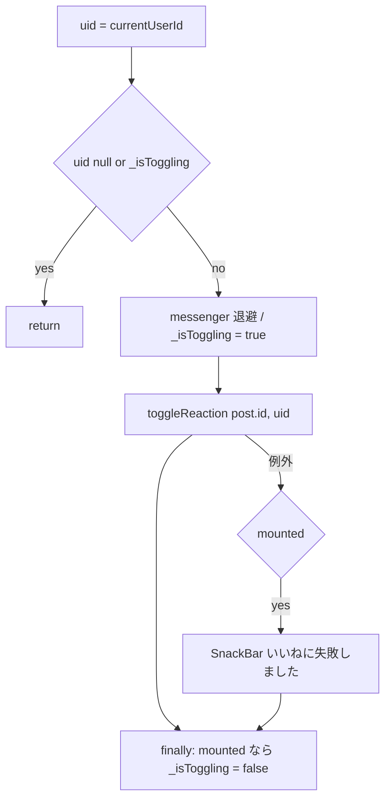

# lib/ui/core/widgets/reaction_bar.dart

| 項目 | 内容 |
|---|---|
| ファイル | `lib/ui/core/widgets/reaction_bar.dart` |
| 基本設計 | [04 コメント・リアクション](../../04_コメント・リアクション.md) の「2. 画面・コンポーネント構成」「3.2 いいね」「6. 入力チェック・エラー処理」 |
| 関連する基本設計 | [03 フィード・投稿詳細](../../03_フィード・投稿詳細.md)（`PostCard` の compact 表示・投稿詳細のスロット）、[02 地図・投稿作成](../../02_地図・投稿作成.md)、[05 アルバム](../../05_アルバム.md)、[07 コンテスト](../../07_コンテスト.md)、[09 プロフィール](../../09_プロフィール.md) |
| レイヤ | View |
| 主な依存先 | `lib/data/models/post.dart`, `lib/data/repositories/{auth,reaction}_repository.dart`, `package:provider` |
| 主な利用元 | `lib/ui/core/widgets/post_card.dart`（`compact: true`）, `lib/ui/feed/feed_page.dart`, `lib/ui/map/map_screen.dart`, `lib/ui/album/album_detail_page.dart`, `lib/ui/contest/contest_detail_page.dart`, `lib/ui/profile/profile_page.dart`（`PostDetailPage` / `PostDetailView` の `reactionBar` 引数） |
| テスト | `test/ui/core/reaction_bar_test.dart`、`test/ui/core/post_card_test.dart`（compact を含むカード） |

## 1. 責務

ハートのトグルボタンといいね数を表示する部品。押下で自分のリアクションを追加／解除し、押下状態と件数は `reactions` サブコレクションの購読で即時に反映する。通常（詳細・サマリー向け）と compact（フィードカード向け）の 2 つの体裁を持つ。

## 2. 構成要素（クラス・関数・定数の一覧）

| 名前 | 種別 | 概要 |
|---|---|---|
| `ReactionBar` | `StatefulWidget`（公開） | いいねバー |
| `_ReactionBarState` | `State` | 連打防止フラグ・購読・描画 |
| `_toggle` | private メソッド | トグル処理 |
| `_buildFull` / `_buildCompact` | private メソッド | 体裁別の描画 |

## 3. 公開インターフェース（コンストラクタ引数・プロパティ・メソッドのシグネチャと説明）

```dart
const ReactionBar({Key? key, required Post post, bool compact = false})
```

| プロパティ | 型 | 既定値 | 説明 |
|---|---|---|---|
| `post` | `Post` | — | 対象投稿。`post.id` と初期表示用の `post.likeCount` を使う |
| `compact` | `bool` | `false` | true でカード内向けの小さい体裁 |

依存（`context.read`）: `AuthRepository`, `ReactionRepository`。

## 4. 内部状態（フィールド・状態遷移）

| フィールド | 型 | 初期値 | 内容 |
|---|---|---|---|
| `_authRepository` | `AuthRepository`（`late final`） | `context.read` | 現在 UID |
| `_reactionRepository` | `ReactionRepository`（`late final`） | `context.read` | 購読・トグル |
| `_isToggling` | `bool` | `false` | トグル処理中フラグ。true の間はボタンを無効化し、`_toggle` も早期 return する（トランザクションの競合防止） |

`initState` / `dispose` は持たない。

## 5. 処理詳細（メソッドごとの手順・分岐・呼び出す Repository/SDK）

### `build`

1. `uid = _authRepository.currentUserId`。
2. 外側 `StreamBuilder<bool>`:
   - `stream`: `uid == null` なら `const Stream<bool>.empty()`（購読しない）、それ以外は `hasReacted(post.id, uid)`。
   - `initialData: false`。`hasReacted = data ?? false`。
3. 内側 `StreamBuilder<int>`:
   - `stream`: `getReactionCount(post.id)`。
   - `initialData: widget.post.likeCount`（購読開始前は非正規化カウントを出してちらつきを防ぐ）。`count = data ?? post.likeCount`。
4. `compact` なら `_buildCompact(hasReacted, count)`、そうでなければ `_buildFull(hasReacted, count, enabled: uid != null)`。

### `_buildFull`

```
Row
├─ IconButton(onPressed: enabled && !_isToggling ? _toggle : null,
│             icon: hasReacted ? Icons.favorite(red) : Icons.favorite_border,
│             tooltip: hasReacted ? 'いいねを取り消す' : 'いいね')
└─ Text('$count', bodyMedium)
```

### `_buildCompact`

- `enabled = _authRepository.currentUserId != null` を自前で計算する。
- `Row(mainAxisSize: min)`: `IconButton`（アイコン size 16、`padding: EdgeInsets.zero`、`visualDensity: compact`、`constraints: BoxConstraints(minWidth: 32, minHeight: 32)`、onPressed・アイコン・色・tooltip は通常と同じ）、`SizedBox(width: 4)`、`Text('$count', labelMedium)`。

### `_toggle()`



表示の更新は `hasReacted` / `getReactionCount` の購読に任せ、楽観的更新はしない。

## 6. データ仕様（読み書きする Firestore/Storage のパス・フィールド、定数値）

Firestore は直接触らない。

| 操作 | Repository メソッド | 対象 |
|---|---|---|
| 状態購読 | `ReactionRepository.hasReacted(post.id, uid)` | `posts/{postId}/reactions/{uid}` の存在 |
| 件数購読 | `ReactionRepository.getReactionCount(post.id)` | `posts/{postId}/reactions` の件数 |
| トグル | `ReactionRepository.toggleReaction(post.id, uid)` | reaction ドキュメント + `posts/{postId}.likeCount` |

## 7. 例外・エラー処理（例外の扱い・戻り値・表示メッセージ）

| 状況 | 挙動 |
|---|---|
| 未ログイン | ボタンを無効化（`onPressed: null`）。状態は常に未リアクション表示 |
| 処理中の再タップ | ボタン無効化＋ `_toggle` の早期 return で無視 |
| `toggleReaction` が例外 | `mounted` なら SnackBar「いいねに失敗しました」 |
| 購読のエラー | エラー表示なし。直前のデータ（なければ initialData）のまま |

未承認ユーザーは `AuthGate` がアプリ本体へ入れないため、本部品には到達しない前提。

## 8. テスト観点（既存テストが確認していること / 未テストの観点）

既存（`reaction_bar_test.dart`）:
- タップでいいねが付き、アイコンといいね数が即時反映されること。
- もう一度タップで解除されること。
- 未ログインではボタンが無効になること。
- compact でもトグルできること。

未テスト:
- 失敗時の SnackBar 表示。
- 処理中の連打が無視されること。
- 購読開始前に `post.likeCount` を表示すること。

## 9. 備考・既知の課題

- Stream を `build` 内で生成しているため、`_isToggling` の `setState` で再構築されるたびに `hasReacted` / `getReactionCount` を購読し直す（`StreamBuilder` は直前のデータを保持するため数字は消えない）。
- `_buildFull` は `enabled` を引数で受け、`_buildCompact` は内部で計算しており、判定箇所が二重になっている（結果は同じ）。
