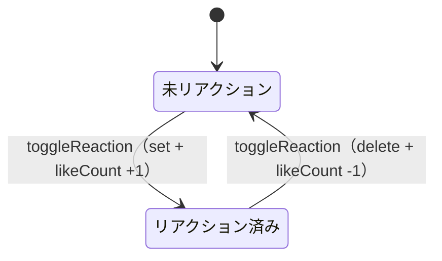

# lib/data/repositories/reaction_repository.dart

| 項目 | 内容 |
|---|---|
| ファイル | `lib/data/repositories/reaction_repository.dart` |
| 基本設計 | [04 コメント・リアクション](../../04_コメント・リアクション.md) の「3.2 いいね」「4. データ設計」「5. 権限・セキュリティ」 |
| 関連する基本設計 | [08 通知](../../08_通知.md)（作成が `onReactionCreated` のトリガー）、[00 システム概要](../../00_システム概要.md)（`firestore.rules` の `likeCount` 例外） |
| レイヤ | Repository |
| 主な依存先 | `package:cloud_firestore` |
| 主な利用元 | `lib/app/dependencies.dart`（生成・提供）, `lib/ui/core/widgets/reaction_bar.dart` |
| テスト | `test/data/repositories/reaction_repository_test.dart`, `test/ui/core/reaction_bar_test.dart`（間接）, `test/ui/core/post_card_test.dart`（間接）、ルールは `test/rules/posts.test.mjs`「いいね（Issue #62）」「リアクション」 |

## 1. 責務

投稿へのいいね（リアクション）の件数購読・本人のリアクション状態の購読・付け外し（トグル）を提供する。リアクションのドキュメント ID を `userId` にすることで「1 ユーザー 1 投稿 1 リアクション」を構造で保証し、トグル時には `posts/{postId}.likeCount` の非正規化カウントをトランザクションで同時に増減する。

## 2. 構成要素（クラス・関数・定数の一覧）

| 名前 | 種別 | 値・概要 |
|---|---|---|
| `ReactionRepository` | クラス | リアクションのデータアクセス |
| `postsCollection` | `static const String` | `'posts'` |
| `reactionsCollection` | `static const String` | `'reactions'` |
| `likeType` | `static const String` | `'like'`（フェーズ 1 の唯一の種別） |
| `_postRef(String postId)` | private メソッド | `posts/{postId}` の `DocumentReference` |
| `_reactionRef(String postId, String userId)` | private メソッド | `posts/{postId}/reactions/{userId}` の `DocumentReference` |
| `getReactionCount` / `hasReacted` / `toggleReaction` | 公開メソッド | 後述 |

## 3. 公開インターフェース（コンストラクタ引数・プロパティ・メソッドのシグネチャと説明）

### コンストラクタ

```dart
ReactionRepository({FirebaseFirestore? firestore})
```

`firestore` 省略時は `FirebaseFirestore.instance`。

### メソッド

| シグネチャ | 戻り値 | 説明 |
|---|---|---|
| `Stream<int> getReactionCount(String postId)` | 件数の Stream | `reactions` サブコレクションのドキュメント数 |
| `Stream<bool> hasReacted(String postId, String userId)` | 状態の Stream | `reactions/{userId}` の存在有無 |
| `Future<void> toggleReaction(String postId, String userId)` | 完了 | 未リアクションなら追加、済みなら解除。失敗時は例外を投げる |

## 4. 内部状態（フィールド・状態遷移）

| フィールド | 型 | 内容 |
|---|---|---|
| `_firestore` | `FirebaseFirestore`（final） | 注入されたインスタンス |

クラス自身は状態を持たない。Firestore 上のリアクション状態は次のように遷移する。



## 5. 処理詳細（メソッドごとの手順・分岐・呼び出す Repository/SDK）

### `getReactionCount(postId)`

`_postRef(postId).collection('reactions').snapshots()` を購読し、`snapshot.docs.length` を流す。

### `hasReacted(postId, userId)`

`_reactionRef(postId, userId).snapshots()` を購読し、`doc.exists` を流す。

### `toggleReaction(postId, userId)`

`_firestore.runTransaction` 内で次を行い、その `Future` をそのまま返す（`async` ではなく `return`）。

1. `reactionRef = _reactionRef(postId, userId)` を `transaction.get` で読む。
2. 分岐:
   - **存在する（解除）**:
     1. `transaction.delete(reactionRef)`。
     2. `transaction.update(_postRef(postId), {'likeCount': FieldValue.increment(-1)})`。
   - **存在しない（追加）**:
     1. `transaction.set(reactionRef, {'userId': userId, 'type': 'like', 'createdAt': Timestamp.fromDate(DateTime.now())})`。
     2. `transaction.update(_postRef(postId), {'likeCount': FieldValue.increment(1)})`。
3. トランザクションのコミットで両方が一括反映される。競合時は SDK がトランザクション関数を再実行する。

**制約**: 投稿ドキュメントの更新は `likeCount` 1 フィールドのみとすること。ルール `isLikeCountOnlyUpdate()` は `affectedKeys().hasOnly(['likeCount'])` かつ ±1 の変化だけを他人に許可しているため、他フィールドを同時に更新すると他人の投稿へのいいねがすべて拒否される（Issue #62）。

追加（reaction ドキュメント作成）をトリガーに Functions `onReactionCreated` が投稿者へ通知を作る。解除時の通知はない。

## 6. データ仕様（読み書きする Firestore/Storage のパス・フィールド、定数値）

| パス | 操作 | フィールド |
|---|---|---|
| `posts/{postId}/reactions/{userId}` | 読取（購読） | 存在有無・件数のみ使用 |
| 同上 | 作成（`set`） | `userId`（= ドキュメント ID）, `type: 'like'`, `createdAt`（Timestamp・クライアント時刻） |
| 同上 | 削除 | — |
| `posts/{postId}` | 更新（`update`） | `likeCount`（`FieldValue.increment(±1)`） |

ルール: `reactions` は読取が承認済み、書込が承認済みかつ `request.auth.uid == reactionUserId`。`posts` は他人でも `likeCount` 単独の ±1 更新のみ可（`likeCount` 欠損時は 0 とみなす）。

## 7. 例外・エラー処理（例外の扱い・戻り値・表示メッセージ）

- `toggleReaction` は例外を捕捉しない。ルール拒否・投稿が存在しない（`update` の `not-found`）・ネットワーク失敗などはトランザクションの `Future` のエラーとして呼び出し側へ伝わる。`ReactionBar` が捕捉して「いいねに失敗しました」を表示する。
- 購読系も例外を捕捉せず、Stream のエラーとして流す。

## 8. テスト観点（既存テストが確認していること / 未テストの観点）

既存（`reaction_repository_test.dart`）:
- `toggleReaction` がリアクションを追加し `likeCount` を増やすこと。
- 同じユーザーの再トグルで解除され `likeCount` が戻ること。
- ドキュメント ID が `userId` になり 1 ユーザー 1 リアクションになること。
- `getReactionCount` / `hasReacted` が変化を通知すること、他ユーザーのリアクションで `hasReacted` が true にならないこと。

既存（`test/rules/posts.test.mjs`）: 他人の投稿へのいいね・解除、`likeCount` を持たない古い投稿へのいいね、未承認ユーザーの拒否、`likeCount` と他フィールドの同時更新・±2 以上・任意値設定の拒否、自分の UID のリアクションドキュメントだけ書けること。

未テスト:
- トランザクション失敗時の例外伝播（`fake_cloud_firestore` はルールを評価しない）。

## 9. 備考・既知の課題

- `likeCount` は ±1 の更新を他人にも許すため正確性は保証されない。画面の表示は `getReactionCount`（実数）を使う。
- `getReactionCount` は全リアクションのスナップショットを購読して数えるため、いいねが多い投稿では読み取りコストが件数に比例する。
- `type` は常に `'like'` で、読み取り側は `type` を参照しない。
