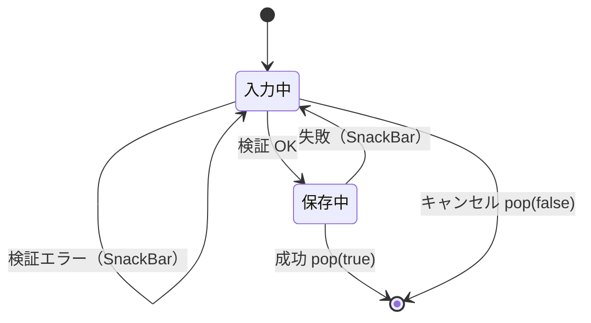

# lib/ui/album/widgets/album_edit_dialog.dart

| 項目 | 内容 |
|---|---|
| ファイル | `lib/ui/album/widgets/album_edit_dialog.dart` |
| 基本設計 | [05 アルバム](../../05_アルバム.md) の「2. 画面・コンポーネント構成」（AlbumEditDialog）「3. 処理フロー」（作成・編集）「6. 入力チェック・エラー処理」 |
| 関連する基本設計 | なし |
| レイヤ | View |
| 主な依存先 | `lib/data/models/album.dart`, `lib/data/repositories/{album,auth}_repository.dart`, `package:provider` |
| 主な利用元 | `lib/ui/album/album_list_page.dart`（作成）, `lib/ui/album/album_detail_page.dart`（編集） |
| テスト | なし |

## 1. 責務

アルバムの作成と編集を兼ねる入力ダイアログ。タイトル（必須）と説明（任意）を入力させ、`album` 引数の有無で作成／編集を切り替えて保存する。保存に成功すると `true` を返して閉じる。所有者判定はしない（呼び出し側が導線を出し分ける）。

## 2. 構成要素（クラス・関数・定数の一覧）

| 名前 | 種別 | 概要 |
|---|---|---|
| `AlbumEditDialog` | `StatefulWidget`（公開） | 作成・編集ダイアログ |
| `_AlbumEditDialogState` | `State` | 入力・保存状態 |
| `_isEditing` | private getter | `widget.album != null` |
| `_showError` | private メソッド | 赤背景の SnackBar 表示 |
| `_save` | private メソッド | 検証と保存 |

## 3. 公開インターフェース（コンストラクタ引数・プロパティ・メソッドのシグネチャと説明）

```dart
const AlbumEditDialog({Key? key, Album? album})
```

| プロパティ | 型 | 説明 |
|---|---|---|
| `album` | `Album?` | 編集対象。`null` なら新規作成 |

戻り値（`showDialog<bool>` の結果）: 保存成功で `true`、キャンセルで `false`、バリア外タップ等で閉じた場合は `null`。

依存（`context.read`）: `AlbumRepository`, `AuthRepository`。

## 4. 内部状態（フィールド・状態遷移）

| フィールド | 型 | 初期値 | 内容 |
|---|---|---|---|
| `_albumRepository` | `AlbumRepository`（`late final`） | `context.read` | 保存先 |
| `_authRepository` | `AuthRepository`（`late final`） | `context.read` | 現在 UID |
| `_titleController` | `TextEditingController`（`late final`） | `widget.album?.title ?? ''` | タイトル入力 |
| `_descriptionController` | `TextEditingController`（`late final`） | `widget.album?.description ?? ''` | 説明入力 |
| `_isSaving` | `bool` | `false` | 保存中。true の間は両ボタンを無効化し、保存ボタンをスピナーに置き換える |

ライフサイクル: `dispose` で 2 つのコントローラを破棄する。`initState` は持たない。



## 5. 処理詳細（メソッドごとの手順・分岐・呼び出す Repository/SDK）

### `build`

```
AlertDialog
├─ title: Text(_isEditing ? 'アルバムを編集' : 'アルバムを作成')
├─ content: Column(mainAxisSize: min)
│   ├─ TextField(_titleController, autofocus: true,
│   │            labelText: 'タイトル', hintText: '例: 春の撮影会')
│   ├─ SizedBox(height: 12)
│   └─ TextField(_descriptionController, maxLines: 3, labelText: '説明（任意）')
└─ actions
    ├─ TextButton('キャンセル', onPressed: _isSaving ? null : pop(false))
    └─ TextButton(onPressed: _isSaving ? null : _save,
                  child: _isSaving ? 16×16 CircularProgressIndicator(strokeWidth 2)
                                   : Text(_isEditing ? '保存' : '作成'))
```

### `_save()`

1. `title = _titleController.text.trim()`。空なら `_showError('タイトルを入力してください')` で終了。
2. `uid = _authRepository.currentUserId`。null なら `_showError('ログイン情報が取得できませんでした')` で終了（編集時も確認する）。
3. `setState(_isSaving = true)`。
4. `description = _descriptionController.text.trim()`。
5. 分岐:
   - **編集**: `updateAlbum(widget.album!.id, title: title, description: description)`（`coverImageUrl` は渡さない＝変更しない）の結果を `succeeded` とする。
   - **作成**: `createAlbum(Album(id: '', ownerId: uid, title: title, description: description, createdAt: DateTime.now()))`。`postIds` は既定の `[]`、`coverImageUrl` は `null`。戻り値が非 null なら成功。
6. `mounted` でなければ終了。
7. 失敗なら `_isSaving = false` に戻し、`_showError(_isEditing ? 'アルバムの更新に失敗しました' : 'アルバムの作成に失敗しました')`。
8. 成功なら `Navigator.of(context).pop(true)`。

### `_showError(message)`

`mounted` でなければ何もしない。`ScaffoldMessenger.of(context).showSnackBar(SnackBar(content: Text(message), backgroundColor: Colors.red))`。

## 6. データ仕様（読み書きする Firestore/Storage のパス・フィールド、定数値）

| 操作 | Repository メソッド | 書き込むフィールド（`albums/{albumId}`） |
|---|---|---|
| 作成 | `AlbumRepository.createAlbum` | `ownerId`（= 現在 UID）, `title`, `description`, `postIds: []`, `coverImageUrl: null`, `createdAt`（クライアント時刻） |
| 編集 | `AlbumRepository.updateAlbum` | `title`, `description` |

タイトル・説明は前後の空白を除去して保存する。文字数上限はない。

## 7. 例外・エラー処理（例外の扱い・戻り値・表示メッセージ）

| 状況 | メッセージ（SnackBar・赤背景） |
|---|---|
| タイトルが空（空白のみ含む） | タイトルを入力してください |
| 未ログイン | ログイン情報が取得できませんでした |
| 作成失敗 | アルバムの作成に失敗しました |
| 更新失敗 | アルバムの更新に失敗しました |

Repository は例外を投げず戻り値で失敗を返すため、本ダイアログで `try/catch` はしない。失敗時はダイアログを閉じず、入力内容を保持して再試行できる。

## 8. テスト観点（既存テストが確認していること / 未テストの観点）

既存: なし（`createAlbum` / `updateAlbum` は `album_repository_test.dart` で確認）。

未テスト:
- 作成／編集でタイトル・ボタン文言が切り替わること、編集時に既存値が入っていること。
- 空タイトル・未ログインで保存しないこと。
- 保存中にボタンが無効化されること、成功で `true` が返ること、失敗で閉じないこと。

## 9. 備考・既知の課題

- SnackBar はダイアログの `context` から取得した `ScaffoldMessenger`（下の画面の Scaffold）に出るため、ダイアログのバリアの背後に表示される。
- カバー画像を入力する項目はない（`coverImageUrl` は常に null）。
- 編集時に所有者かどうかを確認しない。権限はルールと呼び出し側の導線で担保する。
