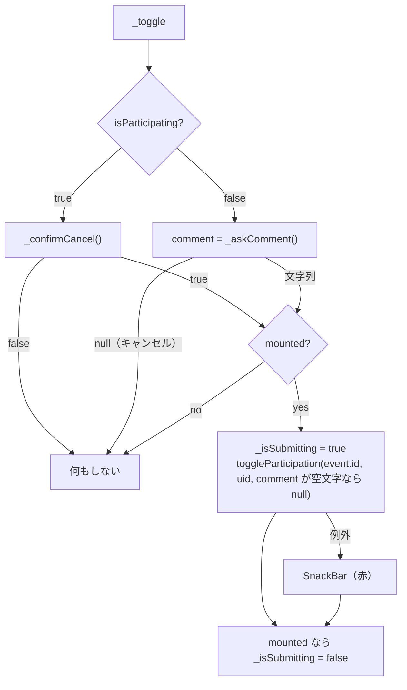

# lib/ui/event/event_detail_page.dart

| 項目 | 内容 |
|---|---|
| ファイル | `lib/ui/event/event_detail_page.dart` |
| 基本設計 | [06 イベント](../../06_イベント.md) の「2. 画面・コンポーネント構成」（EventDetailPage・参加ボタン・参加者一覧）「3. 処理フロー」 |
| 関連する基本設計 | [08 通知](../../08_通知.md)（`event_update` 通知のタップ遷移先）、[09 プロフィール](../../09_プロフィール.md)（参加者タップの遷移先） |
| レイヤ | View |
| 主な依存先 | `lib/data/models/event.dart`, `lib/data/models/app_user.dart`, `lib/data/repositories/auth_repository.dart`, `lib/data/repositories/event_repository.dart`, `lib/data/repositories/user_repository.dart`, `lib/ui/event/widgets/event_edit_dialog.dart`, `lib/ui/core/widgets/event_schedule_text.dart`, `lib/ui/profile/profile_page.dart`, `package:provider`, `package:flutter_map`, `package:latlong2`, `package:cached_network_image` |
| 主な利用元 | `lib/ui/event/event_page.dart`, `lib/ui/notification/notification_page.dart` |
| テスト | なし |

## 1. 責務

- 1 件のイベントを購読して、タイトル・主催者・日時・集合場所（名前と地図ミニプレビュー）・説明を表示する。
- 主催者には AppBar に編集ボタンを出し、`EventEditDialog` を編集モードで開く。
- ログイン中ユーザーの参加表明をトグルする（参加コメントの入力・取消の確認ダイアログ付き）。
- 参加者一覧を参加表明順に表示し、タップでプロフィールへ遷移する。

## 2. 構成要素

| 種別 | 名前 | 概要 |
|---|---|---|
| クラス | `EventDetailPage extends StatelessWidget` | 画面本体。イベントを購読して Scaffold を組む |
| private | `_EventBody extends StatelessWidget` | 本文（スクロール領域） |
| private | `_InfoRow extends StatelessWidget` | アイコン付き情報 1 行 |
| private | `_LocationPreview extends StatelessWidget` | 操作不可の地図ミニプレビュー |
| private | `_ParticipationButton extends StatefulWidget` / `_ParticipationButtonState` | 参加表明トグル |
| private | `_ParticipantList extends StatelessWidget` | 参加者一覧 |
| private | `_ParticipantTile extends StatelessWidget` | 参加者 1 行 |

## 3. 公開インターフェース

```dart
const EventDetailPage({Key? key, required String eventId});
```

| 引数 | 説明 |
|---|---|
| `eventId` | 表示するイベントのドキュメント ID |

## 4. 内部状態

| 所在 | フィールド | 型 | 説明 |
|---|---|---|---|
| `_ParticipationButtonState` | `_eventRepository` | `late final EventRepository` | `context.read<EventRepository>()` を遅延取得 |
| | `_isSubmitting` | `bool`（初期 false） | 通信中は true にしてボタンを無効化（二重押下防止） |

参加状態そのものは `watchIsParticipating` のストリームが持つ（State には保持しない）。

## 5. 処理詳細

### 5.1 ウィジェット構成

```
EventDetailPage
└─ StreamBuilder<Event?>(EventRepository.watchEvent(eventId))
    ├─ waiting → Scaffold(Center(CircularProgressIndicator))
    ├─ null    → Scaffold(AppBar(), Center(Text('イベントが見つかりませんでした')))
    └─ Scaffold
        ├─ AppBar(title: event.title, actions: [isOrganizer なら IconButton(Icons.edit, tooltip 'イベントを編集')])
        └─ _EventBody(event, currentUid)
            └─ SingleChildScrollView(padding: 16) > Column
                ├─ Text(event.title, headlineSmall)
                ├─ StreamBuilder<AppUser?>(watchUser(organizerId)) → Text('主催: …', bodySmall)
                ├─ _InfoRow(Icons.schedule, EventScheduleText(event))
                ├─ [locationName 非空] _InfoRow(Icons.place_outlined, Text(locationName))
                ├─ [hasLocation] _LocationPreview(event)
                ├─ [description 非空] Text(description)
                ├─ [currentUid != null] _ParticipationButton(event, uid)
                ├─ Divider
                └─ _ParticipantList(event)
```

### 5.2 `EventDetailPage.build`

1. `context.read<EventRepository>()` と `context.read<AuthRepository>().currentUserId`（`currentUid`）を取得。
2. `watchEvent(eventId)` の `StreamBuilder` で上記の 3 分岐。
3. `isOrganizer = eventRepository.isOrganizedBy(event, currentUid)`。true のときだけ編集ボタンを出す。
4. 編集ボタン押下で `showDialog<bool>(builder: (_) => EventEditDialog(event: event))`。戻り値は使わず、更新はストリームで反映される。

### 5.3 `_EventBody.build`

- 主催者名: `snapshot.data?.username ?? ''` が空なら `'名無しさん'`。表示は `'主催: <名前>'`。
- 余白: タイトル下 8、主催者下 16、集合場所名の前 8、地図の前 12、説明の前 16、参加ボタンの前後 24、Divider 後 16。
- `currentUid` が null（未ログイン）なら参加ボタンを出さない。

### 5.4 `_InfoRow.build`

`Row(crossAxisAlignment: start)` に `Icon(icon, size: 18, color: Colors.grey.shade600)`・幅 8 の余白・`Expanded(child)`。

### 5.5 `_LocationPreview.build`

- `point = LatLng(event.latitude!, event.longitude!)`（`hasLocation` が true のときだけ生成されるため `!` を使う）。
- 高さ 160、角丸 8 の `ClipRRect` 内に `FlutterMap`。
  - `MapOptions(initialCenter: point, initialZoom: 15, interactionOptions: InteractionOptions(flags: InteractiveFlag.none))`（ドラッグ・ズーム等すべて無効）。
  - `TileLayer(urlTemplate: 'https://tile.openstreetmap.org/{z}/{x}/{y}.png', userAgentPackageName: 'com.afterglow_app.app')`。
  - `MarkerLayer`: 48×48 の `Marker` に `Icon(Icons.location_on, color: Colors.red, size: 40)`。

### 5.6 `_ParticipationButtonState`

#### build

- `StreamBuilder<bool>(watchIsParticipating(event.id, uid))`。`isParticipating = snapshot.data ?? false`。
- 幅いっぱいの `FilledButton.icon`:

| 状態 | アイコン | ラベル | スタイル |
|---|---|---|---|
| 未参加 | `Icons.how_to_reg_outlined` | このイベントに参加する | 既定 |
| 参加中 | `Icons.check_circle` | 参加中（タップで取り消し） | `backgroundColor: Colors.grey.shade600` |

- `_isSubmitting` が true の間は `onPressed: null`（無効）。それ以外は `_toggle(isParticipating)`。

#### `_askComment()` → `Future<String?>`

1. `TextEditingController` を生成。
2. `AlertDialog(title: 'イベントに参加')` を表示。内容は `TextField(autofocus, maxLines: 2, labelText: '参加コメント（任意）', hintText: '例: 現地で合流します')`。
3. 「キャンセル」→ `pop()`（null）。「参加する」→ `pop(controller.text.trim())`（空文字もありうる）。
4. `whenComplete(controller.dispose)` でコントローラを破棄。

#### `_confirmCancel()` → `Future<bool>`

`AlertDialog(title: '参加を取り消し', content: 'このイベントへの参加を取り消しますか？')`。「やめる」→ false、「取り消す」→ true。ダイアログ外タップで閉じた（null）場合も false。

#### `_toggle(bool isParticipating)`



- `ScaffoldMessenger` は `await` 前に取得しておく。
- 失敗メッセージ: 取消時「参加の取り消しに失敗しました」、参加時「参加表明に失敗しました」（`backgroundColor: Colors.red`）。
- 成功時のメッセージはない（ボタン表示がストリームで切り替わる）。

### 5.7 `_ParticipantList.build`

1. `StreamBuilder<List<EventParticipant>>(getParticipants(event.id))`。
2. waiting → 上下 16 の余白付きインジケータ。
3. `participants = snapshot.data ?? const []`。
4. 見出し `'参加者（${participants.length}人）'`（`titleMedium`）。
5. 0 件なら `'まだ参加者はいません'`（`bodySmall`・`Colors.grey.shade600`）。
6. あれば `ListView.separated(shrinkWrap: true, physics: NeverScrollableScrollPhysics(), separator: Divider(height: 8))` で `_ParticipantTile` を並べる（外側の `SingleChildScrollView` でスクロール）。

### 5.8 `_ParticipantTile.build`

- `StreamBuilder<AppUser?>(context.read<UserRepository>().watchUser(participant.userId))`。
- `hasImage = (user?.profileImageUrl ?? '').isNotEmpty`。
- `username`: 空なら `'不明なユーザー'`。
- `ListTile(contentPadding: zero, dense: true)`:
  - leading: `CircleAvatar(radius: 16, backgroundColor: Colors.grey.shade200)`。画像ありなら `CachedNetworkImageProvider(profileImageUrl)`、なしなら `Icon(Icons.person, size: 18, color: Colors.grey)`。
  - title: ユーザー名（ellipsis）。
  - subtitle: `comment` が null または空なら非表示、あれば `Text(comment)`。
  - onTap: `ProfilePage(userId: participant.userId)` へ push。

## 6. データ仕様

| 操作 | パス | 経由 |
|---|---|---|
| 購読 | `events/{eventId}` | `EventRepository.watchEvent` |
| 購読 | `events/{eventId}/participants`（`joinedAt` 昇順） | `EventRepository.getParticipants` |
| 購読 | `events/{eventId}/participants/{uid}` の有無 | `EventRepository.watchIsParticipating` |
| 作成・削除 | `events/{eventId}/participants/{uid}` | `EventRepository.toggleParticipation` |
| 購読 | `users/{organizerId}`, `users/{participantId}` | `UserRepository.watchUser` |

## 7. 例外・エラー処理

| 状況 | 表示 |
|---|---|
| イベントが存在しない（削除済み・ID 誤り） | イベントが見つかりませんでした |
| `watchEvent` のストリームエラー | `snapshot.data` が null になるため同上 |
| 参加表明の失敗 | 参加表明に失敗しました（赤 SnackBar） |
| 参加取消の失敗 | 参加の取り消しに失敗しました（赤 SnackBar） |
| 主催者 / 参加者のユーザー取得不可 | 名無しさん / 不明なユーザー |

## 8. テスト観点

ウィジェットテストはない。未テストの観点:

- 主催者のみ編集ボタンが出ること。
- 参加コメント入力 → 参加、空入力時に null で保存されること、キャンセルで何もしないこと。
- 取消確認ダイアログで「やめる」なら取り消さないこと。
- `hasLocation` が false のとき地図を出さないこと。
- 参加者 0 件表示・件数表示・タップでプロフィール遷移。

## 9. 備考・既知の課題

- 編集ボタンは `isOrganizedBy`（主催者のみ）で出し分けるため、ルール上は更新できる管理者にも UI からの編集導線はない。
- `_askComment` は `showDialog` 完了直後に `TextEditingController` を `dispose` する。ダイアログの閉じるアニメーション中に `TextField` がまだ描画されていると、破棄済みコントローラの使用でアサーションが出る可能性がある。
- 参加表明の取消は主催者に通知しない（基本設計 7 章）。
