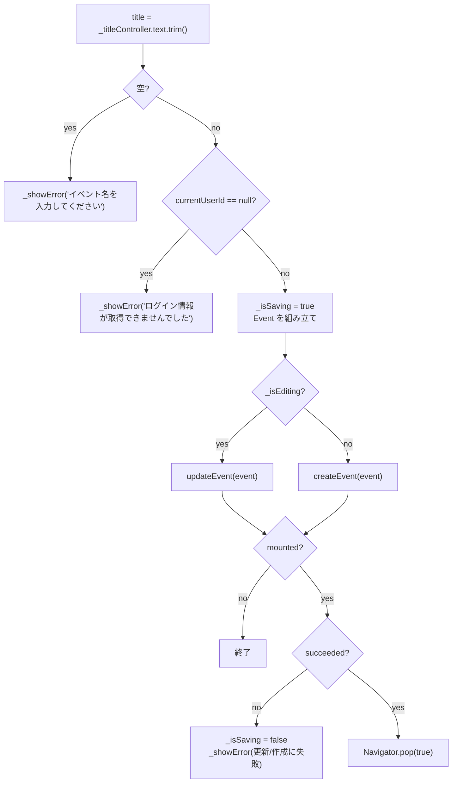

# lib/ui/event/widgets/event_edit_dialog.dart

| 項目 | 内容 |
|---|---|
| ファイル | `lib/ui/event/widgets/event_edit_dialog.dart` |
| 基本設計 | [06 イベント](../../06_イベント.md) の「2. 画面・コンポーネント構成」（EventEditDialog）「3. 処理フロー」（作成・更新）「6. 入力チェック・エラー処理」 |
| 関連する基本設計 | なし |
| レイヤ | View |
| 主な依存先 | `lib/data/models/event.dart`, `lib/data/repositories/auth_repository.dart`, `lib/data/repositories/event_repository.dart`, `lib/ui/core/widgets/event_schedule_text.dart`, `package:provider`, `package:flutter_map`, `package:latlong2` |
| 主な利用元 | `lib/ui/event/event_page.dart`（作成）, `lib/ui/event/event_detail_page.dart`（編集） |
| テスト | なし |

## 1. 責務

- イベントの新規作成・編集を 1 つのダイアログで行う（`event` の有無でモードを切り替え）。
- 入力（イベント名・詳細・集合場所名・開始日時・終了日時・地図上の集合場所）を受け付け、検証して `EventRepository` に保存する。
- 保存に成功したら `true` を返して閉じる。

## 2. 構成要素

| 種別 | 名前 | 概要 |
|---|---|---|
| クラス | `EventEditDialog extends StatefulWidget` | 公開ウィジェット |
| private | `_EventEditDialogState` | 入力状態と保存処理 |
| 定数 | `_defaultLocation = LatLng(34.669478, 133.951104)` | 地図ピッカーの既定中心（`MapScreen` の既定位置に揃える） |

## 3. 公開インターフェース

```dart
const EventEditDialog({Key? key, Event? event});
```

| 引数 | 説明 |
|---|---|
| `event` | 編集対象。null なら新規作成 |

戻り値（`showDialog<bool>` の結果）: 保存成功で `true`、キャンセルで `false`、ダイアログ外タップで閉じた場合は null。現在の呼び出し元はいずれも戻り値を使っていない。

## 4. 内部状態

| フィールド | 型 | 初期値 | 説明 |
|---|---|---|---|
| `_eventRepository` | `late final EventRepository` | `context.read` | |
| `_authRepository` | `late final AuthRepository` | `context.read` | |
| `_titleController` | `TextEditingController` | `event?.title ?? ''` | |
| `_descriptionController` | `TextEditingController` | `event?.description ?? ''` | |
| `_locationNameController` | `TextEditingController` | `event?.locationName ?? ''` | |
| `_startAt` | `DateTime` | `event?.startAt ?? _defaultStartAt()` | 新規は翌日 10:00 |
| `_endAt` | `DateTime?` | `event?.endAt` | 未設定なら null |
| `_pickedLocation` | `LatLng?` | `event.hasLocation` なら `LatLng(lat, lng)`、それ以外 null | |
| `_isSaving` | `bool` | false | 保存中は全操作を無効化 |
| `_isEditing`（getter） | `bool` | `widget.event != null` | |

`_defaultStartAt()`: `DateTime.now().add(1 日)` の年月日で `DateTime(y, m, d, 10)`（10:00:00）。

`dispose()` で 3 つのコントローラを破棄する。

## 5. 処理詳細

### 5.1 ウィジェット構成

```
AlertDialog(title: 'イベントを編集' / 'イベントを作成')
├─ content: SizedBox(width: 360) > SingleChildScrollView > Column(stretch)
│   ├─ TextField(_titleController, autofocus, label 'イベント名', hint '例: 夏の撮影会')
│   ├─ TextField(_descriptionController, maxLines: 3, label '詳細（任意）')
│   ├─ TextField(_locationNameController, label '集合場所（任意）', hint '例: 岡山駅 東口')
│   ├─ _buildDateTimeRow('開始日時', formatDateTime(_startAt), _editStartAt)
│   ├─ _buildDateTimeRow('終了日時', _endAt ? formatDateTime : '未設定', _editEndAt, onClear)
│   └─ _buildLocationPicker()
└─ actions
    ├─ TextButton('キャンセル') → pop(false)
    └─ TextButton(_isSaving ? 16×16 CircularProgressIndicator(strokeWidth: 2) : '保存' / '作成') → _save
```

`_isSaving` 中はキャンセル・保存・日時ボタン・クリアボタン・地図タップをすべて無効化する。

### 5.2 `_buildDateTimeRow({label, value, onPressed, onClear})`

`Row` に `Expanded(Text(label))`、`TextButton(onPressed, Text(value))`、`onClear` があれば `IconButton(Icons.clear, size 18, tooltip '終了日時を未設定にする')`。終了日時行の `onClear` は `_endAt == null || _isSaving` のとき null（ボタン非表示）、それ以外は `setState(() => _endAt = null)`。

### 5.3 `_pickDateTime(DateTime initial)` → `Future<DateTime?>`

1. `showDatePicker(initialDate: initial, firstDate: DateTime(initial.year - 1), lastDate: DateTime(initial.year + 5))`。
2. null（取消）または `!mounted` なら null。
3. `showTimePicker(initialTime: TimeOfDay.fromDateTime(initial))`。null なら null。
4. `DateTime(date.year, date.month, date.day, time.hour, time.minute)` を返す。

### 5.4 `_editStartAt`

1. `picked = _pickDateTime(_startAt)`。null なら終了。
2. `setState` で `_startAt = picked`。`_endAt != null && !_endAt.isAfter(picked)`（終了 ≦ 新しい開始）なら `_endAt = null` に戻す。

### 5.5 `_editEndAt`

1. `picked = _pickDateTime(_endAt ?? _startAt)`。null なら終了。
2. `!picked.isAfter(_startAt)`（終了 ≦ 開始）なら `_showError('終了日時は開始日時より後にしてください')` で終了（値は変えない）。
3. `setState(() => _endAt = picked)`。

### 5.6 `_buildLocationPicker`

```
Column(stretch)
├─ Row: Expanded(Text('集合場所を地図で選択（任意）')) + [picked != null] IconButton(Icons.clear, size 18, tooltip '集合場所の位置を消す')
└─ SizedBox(height: 160) > ClipRRect(radius 8) > FlutterMap
     ├─ MapOptions(initialCenter: picked ?? _defaultLocation, initialZoom: 14,
     │             interactionOptions: InteractiveFlag.all & ~InteractiveFlag.rotate,
     │             onTap: (_, latLng) => _pickedLocation = latLng)
     ├─ TileLayer(OSM タイル, userAgentPackageName 'com.afterglow_app.app')
     └─ [picked != null] MarkerLayer(Marker 48×48, IgnorePointer(Icon(location_on, red, 40)))
```

- 回転ジェスチャーのみ無効（Issue #57）。
- 地図タップでピン位置を置き換える。クリアボタンで `_pickedLocation = null`。
- `initialCenter` は初回生成時のみ効くため、ピンを動かしても地図の中心は追従しない。

### 5.7 `_save`



組み立てる `Event`（`now = DateTime.now()`）:

| フィールド | 値 |
|---|---|
| `id` | `widget.event?.id ?? ''`（新規は空文字 → Repository が採番） |
| `organizerId` | `widget.event?.organizerId ?? uid`（編集時は主催者を引き継ぐ） |
| `title` | トリム済みタイトル |
| `description` / `locationName` | 各コントローラの `text.trim()` |
| `latitude` / `longitude` | `_pickedLocation?.latitude` / `longitude` |
| `startAt` / `endAt` | `_startAt` / `_endAt` |
| `createdAt` | `widget.event?.createdAt ?? now` |
| `updatedAt` | `now`（更新時は Repository が改めて現在時刻を書く） |

### 5.8 `_showError(String message)`

`mounted` のときだけ `ScaffoldMessenger.of(context).showSnackBar(SnackBar(content: Text(message), backgroundColor: Colors.red))`。

## 6. データ仕様

| 操作 | パス | 経由 |
|---|---|---|
| 作成 | `events/{自動採番}` | `EventRepository.createEvent`（`Event.toMap()` 全キー） |
| 更新 | `events/{eventId}` | `EventRepository.updateEvent`（`organizerId`・`createdAt` は書かない） |

既定値: 開始日時 = 翌日 10:00、地図中心 = `LatLng(34.669478, 133.951104)`・ズーム 14、日付ピッカーの範囲 = 初期値の前年 1/1 〜 5 年後 1/1。

## 7. 例外・エラー処理

| 状況 | メッセージ（赤 SnackBar） |
|---|---|
| イベント名が空（空白のみを含む） | イベント名を入力してください |
| 未ログイン | ログイン情報が取得できませんでした |
| 終了日時 ≦ 開始日時を選択 | 終了日時は開始日時より後にしてください |
| 開始日時を終了日時以降に変更 | メッセージなしで終了日時を未設定に戻す |
| 作成失敗（`createEvent` が false） | イベントの作成に失敗しました |
| 更新失敗（`updateEvent` が false） | イベントの更新に失敗しました |

失敗時はダイアログを閉じず、入力を保持したまま `_isSaving` を戻して再試行できるようにする。

## 8. テスト観点

ウィジェットテストはない。未テストの観点:

- 新規時の初期値（翌日 10:00・終了未設定・位置なし）と、編集時に既存値が入ること。
- 各入力チェックのメッセージ、開始変更による終了日時の取消。
- 保存成功で `true` を返して閉じること、失敗でダイアログが残ること。
- 編集時に `organizerId`・`createdAt` が引き継がれること。

## 9. 備考・既知の課題

- SnackBar はダイアログの背後の `Scaffold` に出る（ダイアログ自体は `Scaffold` を持たない）。
- 開始日時・終了日時ともに過去日時を選べる（過去日時の検証はない）。
- 地図で選んだ座標と集合場所名は独立して入力し、相互に補完しない（ジオコーディングしない）。
