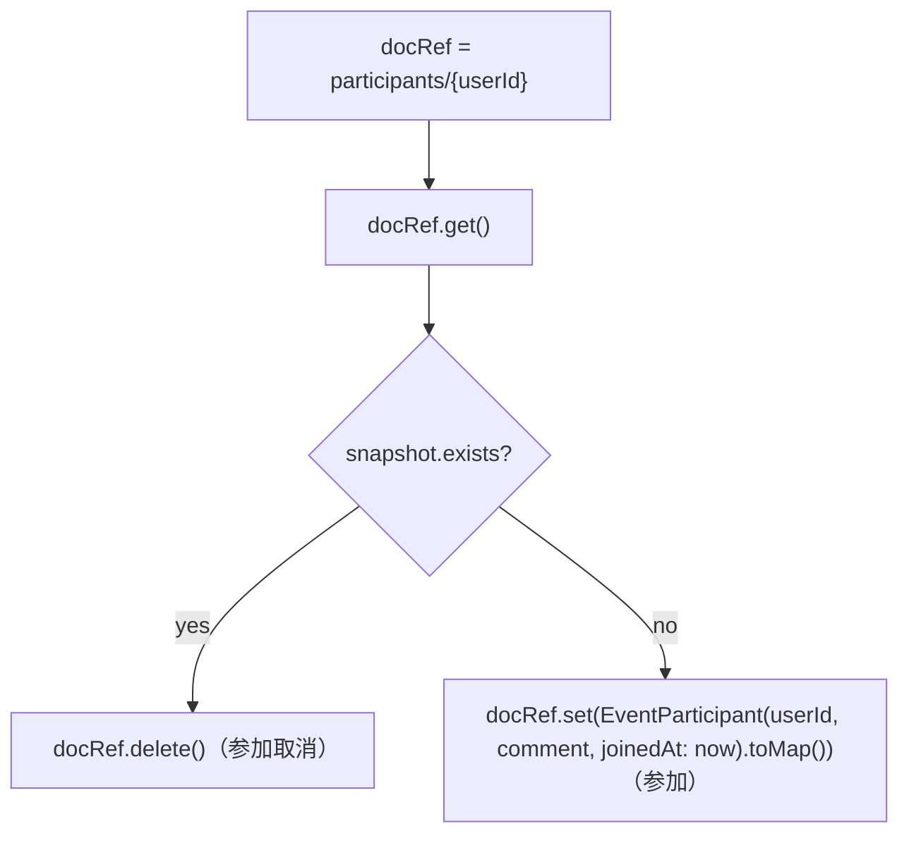

# lib/data/repositories/event_repository.dart

| 項目 | 内容 |
|---|---|
| ファイル | `lib/data/repositories/event_repository.dart` |
| 基本設計 | [06 イベント](../../06_イベント.md) の「3. 処理フロー」「4. データ設計」「5. 権限・セキュリティ」 |
| 関連する基本設計 | [08 通知](../../08_通知.md)（イベント更新が `onEventUpdated` の起点になる） |
| レイヤ | Repository |
| 主な依存先 | `lib/data/models/event.dart`, `package:cloud_firestore` |
| 主な利用元 | `lib/app/dependencies.dart`（生成・提供）, `lib/ui/event/event_page.dart`, `lib/ui/event/event_detail_page.dart`, `lib/ui/event/widgets/event_edit_dialog.dart` |
| テスト | `test/data/repositories/event_repository_test.dart` |

## 1. 責務

- `events` コレクションの購読・作成・更新を行う。
- `events/{eventId}/participants` サブコレクションで参加表明のトグル・参加者一覧・参加状態の購読を行う。
- 主催者判定 `isOrganizedBy` を提供し、UI の編集導線の出し分けに使わせる。
- 権限の強制はしない（Firestore ルールが担保する。[firestore_rules.md](../00_システム概要/firestore_rules.md) 参照）。

## 2. 構成要素

| 種別 | 名前 | 概要 |
|---|---|---|
| クラス | `EventRepository` | 本体 |
| 定数 | `eventsCollection = 'events'` | イベントのコレクション名 |
| 定数 | `participantsCollection = 'participants'` | 参加表明のサブコレクション名 |
| private getter | `_eventsRef` | `_firestore.collection(eventsCollection)` |
| private メソッド | `_participantsRef(String eventId)` | `_eventsRef.doc(eventId).collection(participantsCollection)` |

## 3. 公開インターフェース

```dart
EventRepository({FirebaseFirestore? firestore});
```

`firestore` 省略時は `FirebaseFirestore.instance`。テストは `FakeFirebaseFirestore` を注入する。

| シグネチャ | 説明 |
|---|---|
| `Stream<List<Event>> getEvents()` | 全イベントを `startAt` 昇順で購読 |
| `Stream<Event?> watchEvent(String eventId)` | 単一イベントを購読。存在しなければ null |
| `Future<bool> createEvent(Event event)` | 作成。成功 true / 失敗 false |
| `Future<bool> updateEvent(Event event)` | 編集項目を更新。成功 true / 失敗 false |
| `Future<void> toggleParticipation(String eventId, String userId, String? comment)` | 参加表明のトグル。例外はそのまま投げる |
| `Stream<List<EventParticipant>> getParticipants(String eventId)` | 参加者を `joinedAt` 昇順で購読 |
| `Stream<bool> watchIsParticipating(String eventId, String userId)` | 参加状態を購読 |
| `bool isOrganizedBy(Event event, String? uid)` | `uid != null && event.organizerId == uid` |

## 4. 内部状態

| フィールド | 型 | 説明 |
|---|---|---|
| `_firestore` | `FirebaseFirestore` | 注入されたインスタンス（不変） |

状態遷移はない。

## 5. 処理詳細

### 5.1 `getEvents`

1. `_eventsRef.orderBy('startAt', descending: false).snapshots()` を購読。
2. 各スナップショットの `docs` を `Event.fromSnapshot(doc.id, doc.data())` で変換し、`toList(growable: false)` で流す。

フィルタ・件数上限はない（過去のイベントも含む全件）。

### 5.2 `watchEvent`

1. `_eventsRef.doc(eventId).snapshots()` を購読。
2. `snapshot.data()` が null（ドキュメントなし）なら null を流す。
3. それ以外は `Event.fromSnapshot(snapshot.id, data)` を流す。

### 5.3 `createEvent`

1. `event.id` が空文字なら `_eventsRef.doc()`（自動採番）、そうでなければ `_eventsRef.doc(event.id)` を参照先にする。
2. `docRef.set(event.toMap())`。
3. 成功で true。何らかの例外（ルール拒否・通信失敗を含む）は `catch (_)` で握りつぶして false。

### 5.4 `updateEvent`

1. `_eventsRef.doc(event.id).update({...})` で次のキーだけを書く。

| キー | 値 |
|---|---|
| `title`, `description`, `locationName` | `event` の値 |
| `latitude`, `longitude` | `event` の値（null なら null を書いて位置を消す） |
| `startAt` | `Timestamp.fromDate(event.startAt)` |
| `endAt` | null なら null、あれば `Timestamp.fromDate(event.endAt!)` |
| `updatedAt` | `Timestamp.fromDate(DateTime.now())`（呼び出し時刻で打ち直す。`event.updatedAt` は使わない） |

2. `organizerId` と `createdAt` は書かない（作成時の値を保持する）。
3. 成功で true、例外は握りつぶして false（ドキュメントが存在しない場合の `not-found` も false）。

### 5.5 `toggleParticipation`



- `comment` は参加時のみ保存される（取消時は無視）。空文字を null にする変換は呼び出し側（`EventDetailPage` の `_ParticipationButtonState._toggle`）が行う。
- `try/catch` はなく、Firestore の例外はそのまま呼び出し元に投げる。
- `get` → `set/delete` はトランザクションではない。

### 5.6 `getParticipants`

`_participantsRef(eventId).orderBy('joinedAt', descending: false).snapshots()` を購読し、`EventParticipant.fromSnapshot(doc.id, doc.data())` のリストを流す。

### 5.7 `watchIsParticipating`

`_participantsRef(eventId).doc(userId).snapshots()` を購読し、`snapshot.exists` を流す。

### 5.8 `isOrganizedBy`

`uid != null && event.organizerId == uid`。ルールは管理者にも更新を許すが、このヘルパーは管理者を考慮しない。

## 6. データ仕様

| 操作 | パス | 内容 |
|---|---|---|
| 読み取り | `events` | `orderBy('startAt')` |
| 読み取り | `events/{eventId}` | 単一 |
| 作成 | `events/{eventId}` | `Event.toMap()` の全キー |
| 更新 | `events/{eventId}` | `title, description, locationName, latitude, longitude, startAt, endAt, updatedAt` |
| 読み取り | `events/{eventId}/participants` | `orderBy('joinedAt')` |
| 作成・削除 | `events/{eventId}/participants/{userId}` | `userId, comment, joinedAt` |

ルール（`firestore.rules`）: events は承認済みなら読取可、作成は `organizerId == 自分`、更新・削除は主催者または管理者。participants は承認済みなら読取可、書込はドキュメント ID == 自分。

## 7. 例外・エラー処理

| メソッド | 扱い |
|---|---|
| `createEvent` / `updateEvent` | 全例外を捕捉し false を返す（例外内容は捨てる） |
| `toggleParticipation` | 捕捉しない（呼び出し側が SnackBar を出す） |
| ストリーム系 | 捕捉しない。権限エラー等はストリームのエラーとして流れる |

## 8. テスト観点

既存テスト（`test/data/repositories/event_repository_test.dart`）が確認していること:

- `createEvent` が全フィールドを保存する / `id` が空なら採番される。
- `getEvents` が `startAt` 昇順で全件返す。
- `watchEvent` がイベントを流し、存在しない ID では null を流す。
- `updateEvent` が編集項目を書き換え、`organizerId`・`createdAt` は変えず、`updatedAt` を書き込み時刻にする。
- `toggleParticipation` が 1 回目で作成・2 回目で削除し、他ユーザーの参加に影響しない。
- `getParticipants` が `joinedAt` 昇順。
- `watchIsParticipating` が参加状態を追従する。
- `isOrganizedBy` が主催者 UID のときのみ true。

未テストの観点:

- `createEvent` / `updateEvent` の失敗時に false を返すこと（`fake_cloud_firestore` はルールを評価しないため）。
- events / participants のルール（`test/rules` に events 用のテストはない）。

## 9. 備考・既知の課題

- `toggleParticipation` は読んでから書く非アトミック処理。UI 側は `_isSubmitting` で二重押下を防いでいるが、複数端末から同時に押すと意図と逆の結果になりうる。
- `updateEvent` は内容が変わっていなくても `latitude` 等を書き直す。旧データでキー自体が無かった場合、Functions `onEventUpdated` の比較（`undefined` と `null` は別値）で「変化あり」と判定され、参加者に `event_update` 通知が飛びうる（[functions_index.md](../00_システム概要/functions_index.md)）。
- 削除メソッドはない（基本設計 7 章「イベント削除の UI はない」と対応）。
