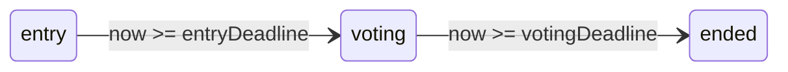

# lib/data/models/contest.dart

| 項目 | 内容 |
|---|---|
| ファイル | `lib/data/models/contest.dart` |
| 基本設計 | [07 コンテスト](../../07_コンテスト.md) の「2. フェーズ」「5. データ設計」 |
| 関連する基本設計 | [02 地図・投稿作成](../../02_地図・投稿作成.md)（応募時の条件確認）、[03 フィード・投稿詳細](../../03_フィード・投稿詳細.md)（応募作品の編集可否判定） |
| レイヤ | Model |
| 主な依存先 | `package:cloud_firestore`（`Timestamp`） |
| 主な利用元 | `lib/data/repositories/contest_repository.dart`, `lib/data/repositories/post_repository.dart`, `lib/ui/contest/contest_list_page.dart`, `lib/ui/contest/contest_detail_page.dart`, `lib/ui/contest/widgets/contest_edit_dialog.dart`, `lib/ui/core/widgets/contest_entry_badge.dart`, `lib/ui/post/post_add_dialog.dart`, `lib/ui/post/post_add_view_model.dart`, `lib/ui/post/post_detail_view_model.dart` |
| テスト | `test/data/models/contest_test.dart` |

## 1. 責務

- `contests/{contestId}` ドキュメント 1 件を表すイミュータブルなデータクラス `Contest` を提供する。
- 締切日時と現在時刻からフェーズ（応募受付中 / 投票受付中 / 終了）を算出する。フェーズ判定の唯一の集約点であり、Firestore ルール（`isContestEntryOpen` / `isContestVotingOpen`）と同じ境界条件を使う。
- Firestore との相互変換（`fromSnapshot` / `toMap`）を行う。

## 2. 構成要素（クラス・関数・定数の一覧）

| 名前 | 種別 | 概要 |
|---|---|---|
| `ContestPhase` | enum | `entry`（応募受付中）/ `voting`（投票受付中）/ `ended`（終了） |
| `Contest` | class | コンテスト 1 件のモデル |

## 3. 公開インターフェース（コンストラクタ引数・プロパティ・メソッドのシグネチャと説明）

### コンストラクタ

```dart
const Contest({
  required String id,
  required String creatorId,
  required String title,
  required String description,
  required DateTime entryDeadline,
  required DateTime votingDeadline,
  required DateTime createdAt,
  required DateTime updatedAt,
  int maxImages = 1,
})
```

### プロパティ

| プロパティ | 型 | 説明 |
|---|---|---|
| `id` | `String` | ドキュメント ID。新規作成前は `''`（`ContestRepository.createContest` が自動採番） |
| `creatorId` | `String` | 作成者 UID |
| `title` | `String` | コンテスト名 |
| `description` | `String` | 説明 |
| `entryDeadline` | `DateTime` | 応募締切 |
| `votingDeadline` | `DateTime` | 投票締切 |
| `createdAt` | `DateTime` | 作成日時 |
| `updatedAt` | `DateTime` | 更新日時 |
| `maxImages` | `int` | 1 投稿あたりの写真枚数上限。既定 1 |

### メソッド・getter

| シグネチャ | 説明 |
|---|---|
| `ContestPhase phaseAt(DateTime now)` | 指定時刻でのフェーズを返す |
| `ContestPhase get phase` | `phaseAt(DateTime.now())`（端末時刻） |
| `bool get isEntryOpen` | `phase == ContestPhase.entry` |
| `bool get isVotingOpen` | `phase == ContestPhase.voting` |
| `factory Contest.fromSnapshot(String id, Map<String, dynamic> document)` | Firestore ドキュメントから生成 |
| `Map<String, dynamic> toMap()` | Firestore 書き込み用 Map を返す |

## 4. 内部状態（フィールド・状態遷移）

フィールドはすべて `final`。フェーズは保存せず、呼び出しのたびに算出する。



## 5. 処理詳細（メソッドごとの手順・分岐・呼び出す Repository/SDK）

### `phaseAt(now)`

1. `now.isBefore(entryDeadline)` なら `ContestPhase.entry`。
2. それ以外で `now.isBefore(votingDeadline)` なら `ContestPhase.voting`。
3. それ以外は `ContestPhase.ended`。

境界はちょうど締切時刻で次のフェーズに入る（`entryDeadline == now` は `voting`、`votingDeadline == now` は `ended`）。ルールの `request.time < entryDeadline`、`entryDeadline <= request.time < votingDeadline` と一致する。

### `fromSnapshot(id, document)`

フォールバックの連鎖で欠損フィールドを補う。

| フィールド | 読み方 | 欠損時 |
|---|---|---|
| `createdAt` | `(document['createdAt'] as Timestamp?)?.toDate()` | `DateTime.now()` |
| `entryDeadline` | `Timestamp` → `DateTime` | `createdAt` |
| `votingDeadline` | `Timestamp` → `DateTime` | `entryDeadline` |
| `updatedAt` | `Timestamp` → `DateTime` | `createdAt` |
| `creatorId` / `title` / `description` | `document['x'] ?? ''` | `''` |
| `maxImages` | `document['maxImages'] ?? 1` | `1` |

`entryLimitVersion` は読み込まない（モデルに保持しない）。

### `toMap()`

次の Map を返す。日時はすべて `Timestamp.fromDate` で変換する。`id` は含めない。

```dart
{
  'creatorId': creatorId,
  'title': title,
  'description': description,
  'entryDeadline': Timestamp,
  'votingDeadline': Timestamp,
  'createdAt': Timestamp,
  'updatedAt': Timestamp,
  'maxImages': maxImages,
  'entryLimitVersion': 1,   // 常に 1（固定値）
}
```

## 6. データ仕様（読み書きする Firestore/Storage のパス・フィールド、定数値）

| パス | フィールド | 型 | 備考 |
|---|---|---|---|
| `contests/{contestId}` | `creatorId` | string | |
| | `title` / `description` | string | |
| | `entryDeadline` / `votingDeadline` | Timestamp | |
| | `createdAt` / `updatedAt` | Timestamp | |
| | `maxImages` | int | ルールで 1〜10 の整数に制限 |
| | `entryLimitVersion` | int | `toMap()` が常に `1` を書く。ルールが作成時に `== 1` を要求する |

このクラス自身は Firestore にアクセスしない。

## 7. 例外・エラー処理（例外の扱い・戻り値・表示メッセージ）

- 例外は投げない。欠損フィールドは上記のとおり既定値で補う。
- `document['maxImages']` は型キャストしていないため、`int` 以外（例: `double`）が保存されていると `int` フィールドへの代入で実行時エラーになる（ルールが `is int` を要求するため通常は起きない）。

## 8. テスト観点（既存テストが確認していること / 未テストの観点）

既存（`test/data/models/contest_test.dart`）:

- `fromSnapshot` → `toMap` の往復で全フィールドが保たれ、`maxImages` 欠損時は 1 になる。
- `phaseAt` が応募締切前で `entry`、応募締切ちょうどで `voting`、投票締切前で `voting`、投票締切ちょうどで `ended` を返す。

未テスト:

- 日時フィールド欠損時のフォールバック連鎖（`createdAt` → `entryDeadline` → `votingDeadline`）。
- `toMap()` が `entryLimitVersion: 1` を含むこと。

## 9. 備考・既知の課題

- `phase` / `isEntryOpen` / `isVotingOpen` は端末時刻を使う。端末時刻がずれているとルールの判定（サーバー時刻）と食い違う。
- 日時欠損時に `DateTime.now()` を使うため、欠損ドキュメントは読み込むたびに `createdAt` が変わり、フェーズが常に `ended` になる。
