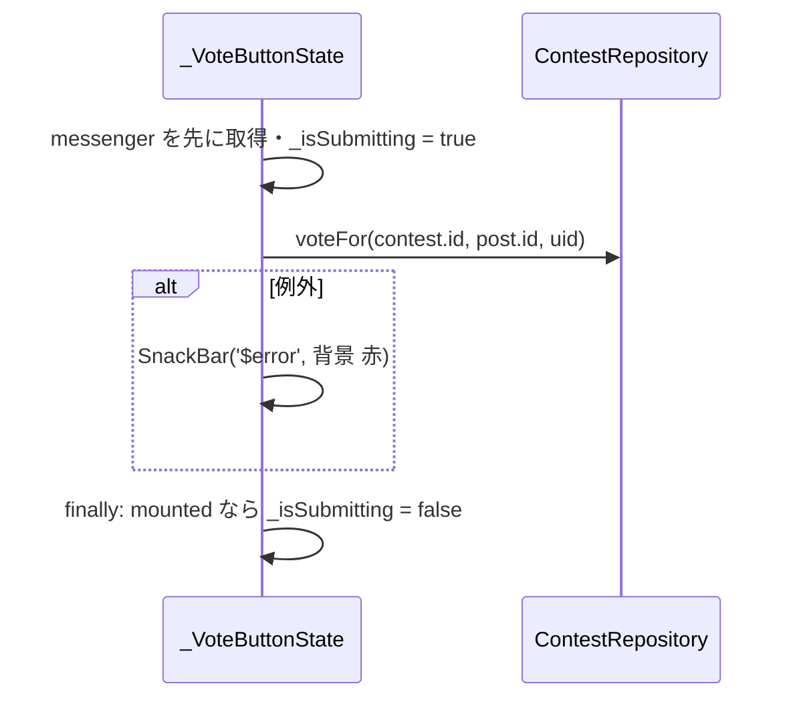

# lib/ui/contest/contest_detail_page.dart

| 項目 | 内容 |
|---|---|
| ファイル | `lib/ui/contest/contest_detail_page.dart` |
| 基本設計 | [07 コンテスト](../../07_コンテスト.md) の「3. 画面・コンポーネント構成」（ContestDetailPage・応募作品一覧）「4.2 投票」 |
| 関連する基本設計 | [03 フィード・投稿詳細](../../03_フィード・投稿詳細.md)（`PostCard`・`PostDetailPage`）、[04 コメント・リアクション](../../04_コメント・リアクション.md)（`ReactionBar`・`CommentSection`） |
| レイヤ | View |
| 主な依存先 | `lib/data/models/contest.dart`, `lib/data/models/post.dart`, `lib/data/repositories/auth_repository.dart`, `lib/data/repositories/contest_repository.dart`, `lib/data/repositories/user_repository.dart`, `lib/ui/contest/widgets/contest_edit_dialog.dart`, `lib/ui/core/widgets/post_card.dart`, `lib/ui/core/widgets/reaction_bar.dart`, `lib/ui/core/widgets/comment_section.dart`, `lib/ui/core/widgets/event_schedule_text.dart`, `lib/ui/post/post_detail_page.dart`, `package:provider` |
| 主な利用元 | `lib/ui/contest/contest_list_page.dart` |
| テスト | なし |

## 1. 責務

- 1 件のコンテストの内容（タイトル・応募条件・フェーズ・説明・締切）と応募作品一覧を表示する。
- 作成者・管理者に編集・削除の操作を出す。
- 投票受付中は各応募作品の下に投票ボタンを出し、投票する。

## 2. 構成要素（クラス・関数・定数の一覧）

| 名前 | 種別 | 概要 |
|---|---|---|
| `ContestDetailPage` | `StatelessWidget`（公開） | 画面本体。コンテスト購読・権限判定・削除 |
| `_ContestBody` | `StatelessWidget` | 本文の `ListView` |
| `_EntryList` | `StatelessWidget` | 応募作品一覧（ストリーム購読） |
| `_EntryTile` | `StatelessWidget` | 応募作品 1 件（`PostCard` + 投票ボタン） |
| `_VoteButton` / `_VoteButtonState` | `StatefulWidget` | 投票ボタン |
| `_InfoRow` | `StatelessWidget` | アイコン + テキストの 1 行 |
| `_phaseLabel(ContestPhase)` | トップレベル関数（private） | フェーズ表示名（応募受付中 / 投票受付中 / 終了） |

## 3. 公開インターフェース（コンストラクタ引数・プロパティ・メソッドのシグネチャと説明）

```dart
const ContestDetailPage({super.key, required String contestId})
```

| 引数 | 説明 |
|---|---|
| `contestId` | 表示するコンテストの ID |

依存は `context.read` で `ContestRepository`・`UserRepository`・`AuthRepository`（`currentUserId`）を取得する。

## 4. 内部状態（フィールド・状態遷移）

`ContestDetailPage` は State を持たず、次の入れ子のビルダーで表示を決める。

| 層 | ビルダー | 状態と表示 |
|---|---|---|
| 1 | `StreamBuilder<Contest?>`（`watchContest(contestId)`） | waiting: `Scaffold` + 中央インジケータ / `data == null`: AppBar のみ + 「コンテストが見つかりませんでした」 / それ以外: 2 層目へ |
| 2 | `FutureBuilder<bool>`（`_canManageContest`） | `data ?? false` を `canManage` とする（判定中は `false`） |
| 3 | `_EntryList` の `StreamBuilder<List<Post>>`（`getEntries`） | waiting: 縦 16 余白付きインジケータ / 空: 「まだ応募作品がありません」 / それ以外: 一覧 |
| 4 | `_VoteButton` の `StreamBuilder<String?>`（`watchUserVote`） | `snapshot.data == post.id` なら投票済み |

`_VoteButtonState` のフィールド:

| フィールド | 型 | 初期値 | 内容 |
|---|---|---|---|
| `_isSubmitting` | `bool` | `false` | 投票送信中。`true` の間ボタンを無効化 |

## 5. 処理詳細（メソッドごとの手順・分岐・呼び出す Repository/SDK）

### ウィジェット構成

```
Scaffold
├─ AppBar(title: contest.title)
│   ├─ [canManage] IconButton(Icons.edit, tooltip: 'コンテストを編集')
│   └─ [canManage] IconButton(Icons.delete_outline, tooltip: 'コンテストを削除')
└─ _ContestBody: ListView(padding: 16)
   ├─ Text(contest.title, headlineSmall)
   ├─ Text('応募は1人1投稿まで・写真は最大{maxImages}枚')
   ├─ Chip(avatar: Icons.flag_outlined, label: フェーズ名, compact)
   ├─ [description が空でない] Text(description)
   ├─ _InfoRow(Icons.login_outlined, '応募締切: yyyy/MM/dd HH:mm')
   ├─ _InfoRow(Icons.how_to_vote_outlined, '投票締切: yyyy/MM/dd HH:mm')
   ├─ Text('応募作品', titleMedium)
   └─ _EntryList: ListView.separated(shrinkWrap, NeverScrollable, 間隔 8)
      └─ _EntryTile: Column
         ├─ PostCard(post, onTap: _openDetail)
         └─ [contest.phase == voting かつ currentUid != null]
            Padding(左右 12・下 8) → _VoteButton
               └─ SizedBox(幅いっぱい) → FilledButton.icon
                  未投票: Icons.how_to_vote_outlined「この投稿に投票」
                  投票済み: Icons.check_circle「投票済み」（無効）
```

応募作品の並びは `getEntries`（`PostRepository.getPostsByContest`）の `createdAt` 降順。

### `_canManageContest(userRepository, contest, uid)`

1. `uid == null` → `false`。
2. `contest.creatorId == uid` → `true`（Firestore アクセスなし）。
3. それ以外は `userRepository.getUser(uid)` を取得し、`user?.isAdmin == true` を返す。

`FutureBuilder` の `future` は `build` 内で生成するため、コンテストのスナップショットが届くたびに再判定される。

### 編集ボタン

`showDialog<bool>(builder: (_) => ContestEditDialog(contest: contest))`。戻り値は使わず、更新は `watchContest` のストリームで画面に反映される。

### `_deleteContest(context, service)`

1. 確認ダイアログを表示する。
   - タイトル: 「コンテストを削除」
   - 本文: 「コンテストを削除しますか？応募投稿と写真は通常投稿として残り、投稿者名が公開されます。」
   - ボタン: 「キャンセル」（`false`）/「削除」（`true`）
2. `confirmed != true` または `context` が unmounted なら終了。
3. `service.deleteContest(contestId)` を呼ぶ。
4. unmounted なら終了。成功なら `Navigator.pop(context)` で一覧へ戻る。失敗なら SnackBar「コンテストの削除に失敗しました」。

応募投稿の匿名解除・`votes`/`entries` の削除は Functions `onContestDeleted`（[functions_index.md](../00_システム概要/functions_index.md)）が行う。

### `_EntryTile._openDetail(context)`

`PostDetailPage(post, reactionBar: ReactionBar(post: post), commentSection: CommentSection(post: post))` を `MaterialPageRoute` で push する。

### `_VoteButtonState._vote()`



投票成功後のボタン表示（「投票済み」）は `watchUserVote` のストリーム更新で切り替わる。別の作品に投票済みの場合も「この投稿に投票」が押せ、押すと票が移る。

## 6. データ仕様（読み書きする Firestore/Storage のパス・フィールド、定数値）

| パス | 操作 | 経由 |
|---|---|---|
| `contests/{contestId}` | 購読・削除 | `ContestRepository.watchContest` / `deleteContest` |
| `posts`（`contestId == contestId`） | 購読 | `ContestRepository.getEntries` |
| `contests/{contestId}/votes/{uid}` | 購読・書き込み | `watchUserVote` / `voteFor` |
| `users/{uid}` | 取得（作成者でない場合のみ） | `UserRepository.getUser` |

## 7. 例外・エラー処理（例外の扱い・戻り値・表示メッセージ）

| 状況 | 表示 |
|---|---|
| コンテストが存在しない・削除された | 「コンテストが見つかりませんでした」 |
| 応募作品が 0 件 | 「まだ応募作品がありません」 |
| 削除失敗 | SnackBar「コンテストの削除に失敗しました」 |
| 投票失敗 | SnackBar（赤）に例外の `toString()` をそのまま表示 |
| 権限判定の失敗 | `FutureBuilder` の `data` が `null` となり、編集・削除を出さない |

- 投票失敗時の表示は `'$error'` のため、`StateError` は「Bad state: 自分の投稿には投票できません。」のように `Bad state: ` が前置される。Firestore の例外（ルール拒否）は `[cloud_firestore/permission-denied] ...` の形で出る。
- 各ストリームの `hasError` は見ていない。コンテスト購読のエラーは「見つかりませんでした」、応募作品購読のエラーは「まだ応募作品がありません」と同じ表示になる。

## 8. テスト観点（既存テストが確認していること / 未テストの観点）

既存テストは無い（`voteFor` 自体は `contest_repository_test.dart` で確認）。

未テストの観点:

- 作成者・管理者・その他で編集・削除ボタンの表示が切り替わること。
- 投票受付中のみ投票ボタンが出ること、投票済みの表示と無効化。
- 削除の確認・成功時の pop・失敗時の SnackBar。

## 9. 備考・既知の課題

- フェーズ（チップ表示・投票ボタンの有無）は再ビルド時の端末時刻で判定する。画面を開いたまま締切を迎えても、コンテストか応募作品のストリームが更新されるまで切り替わらない（`ContestEntryBadge` のような締切タイマーは無い）。期間外に押した場合は `voteFor` が「投票期間外です。」で失敗する。
- 投票の取消 UI は無い。得票順の並び替え・結果表示も無い。
- 削除成功時、`Navigator.pop` より先に `watchContest` が `null` を流すと「コンテストが見つかりませんでした」が一瞬描画されうる。
- `_phaseLabel` は `contest_list_page.dart` と重複している。
