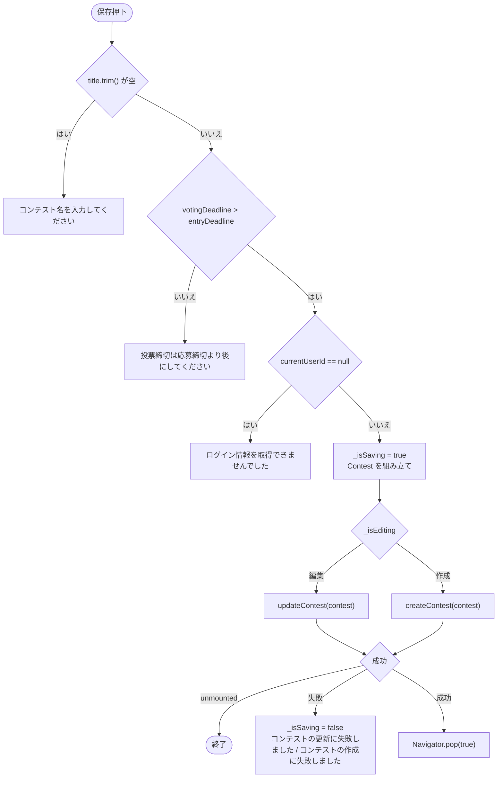

# lib/ui/contest/widgets/contest_edit_dialog.dart

| 項目 | 内容 |
|---|---|
| ファイル | `lib/ui/contest/widgets/contest_edit_dialog.dart` |
| 基本設計 | [07 コンテスト](../../07_コンテスト.md) の「3. 画面・コンポーネント構成」（ContestEditDialog）「7. 入力チェック・エラー処理」 |
| 関連する基本設計 | なし |
| レイヤ | View |
| 主な依存先 | `lib/data/models/contest.dart`, `lib/data/repositories/auth_repository.dart`, `lib/data/repositories/contest_repository.dart`, `lib/ui/core/widgets/event_schedule_text.dart`, `package:provider` |
| 主な利用元 | `lib/ui/contest/contest_list_page.dart`（新規作成）, `lib/ui/contest/contest_detail_page.dart`（編集） |
| テスト | なし |

## 1. 責務

コンテストの作成・編集ダイアログ。入力（コンテスト名・説明・応募締切・写真枚数上限・投票締切）を検証し、`ContestRepository` で保存する。`contest` 引数の有無で作成モードと編集モードを切り替える。

## 2. 構成要素（クラス・関数・定数の一覧）

| 名前 | 種別 | 概要 |
|---|---|---|
| `ContestEditDialog` | `StatefulWidget`（公開） | ダイアログ |
| `_ContestEditDialogState` | `State` | 入力状態・保存処理 |
| `_defaultEntryDeadline()` | `static` メソッド | 新規作成時の応募締切初期値 |
| `_buildDateTimeRow(...)` | メソッド | ラベル + 日時ボタンの行 |

## 3. 公開インターフェース（コンストラクタ引数・プロパティ・メソッドのシグネチャと説明）

```dart
const ContestEditDialog({super.key, Contest? contest})
```

| 引数 | 説明 |
|---|---|
| `contest` | 編集対象。`null` なら新規作成 |

戻り値（`Navigator.pop` の値）: 保存成功で `true`、キャンセルで `false`。呼び出し元はどちらも戻り値を使っていない。

## 4. 内部状態（フィールド・状態遷移）

| フィールド | 型 | 初期値 | 内容 |
|---|---|---|---|
| `_contestRepository` | `ContestRepository`（`late final`） | `context.read` | |
| `_authRepository` | `AuthRepository`（`late final`） | `context.read` | |
| `_titleController` | `TextEditingController` | `contest?.title ?? ''` | |
| `_descriptionController` | `TextEditingController` | `contest?.description ?? ''` | |
| `_entryDeadline` | `DateTime` | `contest?.entryDeadline ?? _defaultEntryDeadline()` | |
| `_votingDeadline` | `DateTime` | `contest?.votingDeadline ?? _entryDeadline + 7 日` | |
| `_maxImages` | `int` | `contest?.maxImages ?? 1` | |
| `_isSaving` | `bool` | `false` | 保存中は全操作を無効化 |
| `_isEditing` | getter | `widget.contest != null` | |

`_defaultEntryDeadline()` は「現在から 7 日後の日付の 23:59」を返す。

ライフサイクル: `dispose` で 2 つの `TextEditingController` を破棄する。

## 5. 処理詳細（メソッドごとの手順・分岐・呼び出す Repository/SDK）

### ウィジェット構成

```
AlertDialog(title: 'コンテストを編集' | 'コンテストを作成')
├─ content: SizedBox(width: 380) → SingleChildScrollView → Column(stretch)
│  ├─ TextField(labelText: 'コンテスト名', autofocus)
│  ├─ TextField(labelText: '説明', maxLines: 3)
│  ├─ _buildDateTimeRow('応募締切', yyyy/MM/dd HH:mm, _editEntryDeadline)
│  ├─ DropdownButtonFormField<int>(labelText: '1投稿の写真枚数上限', 項目 '1枚'〜'10枚')
│  ├─ Text('応募は1人1投稿までです')
│  └─ _buildDateTimeRow('投票締切', yyyy/MM/dd HH:mm, _editVotingDeadline)
└─ actions
   ├─ TextButton('キャンセル') → pop(false)
   └─ TextButton('保存' | '作成')。保存中は 16×16 の CircularProgressIndicator(strokeWidth: 2)
```

保存中（`_isSaving`）は日時ボタン・ドロップダウン・両アクションの `onPressed` を `null` にする。テキスト欄は無効化しない。

### `_pickDateTime(initial)`

1. `showDatePicker(initialDate: initial, firstDate: 現在 - 1 日, lastDate: DateTime(initial.year + 5))`。
2. キャンセル（`null`）または unmounted なら `null`。
3. `showTimePicker(initialTime: TimeOfDay.fromDateTime(initial))`。キャンセルなら `null`。
4. 日付と時刻を合わせた `DateTime` を返す。

### `_editEntryDeadline()`

1. `_pickDateTime(_entryDeadline)`。`null` なら何もしない。
2. `setState` で `_entryDeadline` を更新する。このとき `_votingDeadline` が新しい応募締切より後でなければ、`_votingDeadline = _entryDeadline + 7 日` に自動補正する。

### `_editVotingDeadline()`

1. `_pickDateTime(_votingDeadline)`。`null` なら何もしない。
2. 選んだ日時が応募締切より後でなければ、エラー「投票締切は応募締切より後にしてください」を出して反映しない。
3. それ以外は `_votingDeadline` を更新する。

### `_save()`



組み立てる `Contest`:

| フィールド | 値 |
|---|---|
| `id` | `widget.contest?.id ?? ''`（新規は空 → Repository が自動採番） |
| `creatorId` | `widget.contest?.creatorId ?? uid`（編集時は元の作成者を維持） |
| `title` | 入力値（trim） |
| `description` | 入力値（trim） |
| `entryDeadline` / `votingDeadline` | 状態の値 |
| `createdAt` | `widget.contest?.createdAt ?? now` |
| `updatedAt` | `now`（編集時は Repository が改めて現在時刻を書く） |
| `maxImages` | `_maxImages` |

### `_showError(message)`

mounted のときだけ、`ScaffoldMessenger.of(context)` で背景赤の SnackBar を出す。

## 6. データ仕様（読み書きする Firestore/Storage のパス・フィールド、定数値）

`ContestRepository` 経由で `contests/{contestId}` に書く（作成: `Contest.toMap()`、編集: `title`・`description`・`maxImages`・`entryDeadline`・`votingDeadline`・`updatedAt`）。詳細は [contest_repository.md](contest_repository.md)。

| 定数 | 値 |
|---|---|
| 応募締切の初期値 | 7 日後の 23:59 |
| 投票締切の初期値・自動補正値 | 応募締切 + 7 日 |
| 写真枚数上限の選択肢 | 1〜10（既定 1） |
| 日付ピッカーの範囲 | 現在 - 1 日 〜 `initial.year + 5` 年の 1/1 |
| ダイアログ幅 | 380 |

## 7. 例外・エラー処理（例外の扱い・戻り値・表示メッセージ）

すべて背景赤の SnackBar で表示する。

| 状況 | メッセージ |
|---|---|
| コンテスト名が空 | コンテスト名を入力してください |
| 投票締切 ≦ 応募締切（ピッカー・保存時） | 投票締切は応募締切より後にしてください |
| 未ログイン | ログイン情報を取得できませんでした |
| 作成失敗 | コンテストの作成に失敗しました |
| 更新失敗 | コンテストの更新に失敗しました |

Repository は例外を `false` に変換するため、ダイアログ内で例外は捕捉しない。

## 8. テスト観点（既存テストが確認していること / 未テストの観点）

既存テストは無い。

未テストの観点:

- 新規作成時の初期値（7 日後 23:59、投票締切 +7 日、枚数 1）。
- 応募締切を後ろにずらしたときの投票締切の自動補正。
- 各入力エラーの表示、保存成功時の `pop(true)`、失敗時の再操作可能化。
- 編集時に `creatorId`・`createdAt` が維持されること。

## 9. 備考・既知の課題

- 日付ピッカーの `firstDate` が「現在 - 1 日」固定のため、締切が 1 日以上過去のコンテストを編集して日時ボタンを押すと `initialDate < firstDate` となり、`showDatePicker` のアサーションに失敗する（デバッグビルドで例外）。
- 応募開始後・投票中でも締切・枚数上限を変更できる（ルールも制限しない）。
- SnackBar はダイアログ自身ではなく、背後の画面の `Scaffold`（`ScaffoldMessenger`）に出る。
- 項目の並びは「応募締切 → 写真枚数上限 → 投票締切」で、基本設計の列挙順（写真枚数上限 → 応募締切 → 投票締切）とは異なる。
