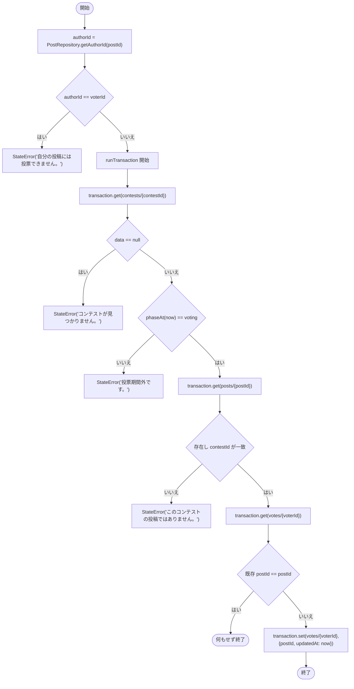

# lib/data/repositories/contest_repository.dart

| 項目 | 内容 |
|---|---|
| ファイル | `lib/data/repositories/contest_repository.dart` |
| 基本設計 | [07 コンテスト](../../07_コンテスト.md) の「4.2 投票」「5. データ設計」 |
| 関連する基本設計 | [02 地図・投稿作成](../../02_地図・投稿作成.md)（応募先コンテスト一覧）、[03 フィード・投稿詳細](../../03_フィード・投稿詳細.md)（応募作品の編集可否判定） |
| レイヤ | Repository |
| 主な依存先 | `lib/data/models/contest.dart`, `lib/data/models/post.dart`, `lib/data/repositories/post_repository.dart`, `package:cloud_firestore` |
| 主な利用元 | `lib/app/dependencies.dart`, `lib/data/repositories/post_repository.dart`（定数のみ）, `lib/ui/contest/contest_list_page.dart`, `lib/ui/contest/contest_detail_page.dart`, `lib/ui/contest/widgets/contest_edit_dialog.dart`, `lib/ui/core/widgets/contest_entry_badge.dart`, `lib/ui/post/post_add_view_model.dart`, `lib/ui/post/post_detail_view_model.dart` |
| テスト | `test/data/repositories/contest_repository_test.dart`（ほか `test/ui/post/post_add_view_model_test.dart`, `test/ui/post/post_detail_view_model_test.dart` が依存として使用） |

## 1. 責務

- `contests` コレクションの購読・取得・作成・更新・削除。
- コンテストの応募作品（`contestId` が一致する `posts`）の購読。実処理は `PostRepository` に委譲する。
- 投票（`contests/{id}/votes/{uid}`）の購読と書き込み。得票数 `voteCount` の更新は行わない（Functions `onContestVoteChange` が担当。[functions_index.md](../00_システム概要/functions_index.md) 参照）。
- コレクション名定数の提供（`PostRepository` も `contestsCollection` / `entriesCollection` を参照する）。

応募（`posts` 作成・`private/author`・`entries` の書き込み）は本クラスではなく `PostRepository.createPost` が行う。

## 2. 構成要素（クラス・関数・定数の一覧）

| 名前 | 種別 | 値 / 概要 |
|---|---|---|
| `ContestRepository` | class | コンテストのデータアクセス |
| `contestsCollection` | `static const String` | `'contests'` |
| `votesCollection` | `static const String` | `'votes'` |
| `entriesCollection` | `static const String` | `'entries'`（本クラス内では未使用。`PostRepository` が参照） |
| `postsCollection` | `static const String` | `PostRepository.postsCollection`（`'posts'`） |
| `_contestsRef` | private getter | `_firestore.collection('contests')` |
| `_votesRef(contestId)` | private | `contests/{contestId}/votes` |
| `_postRef(postId)` | private | `posts/{postId}` |

## 3. 公開インターフェース（コンストラクタ引数・プロパティ・メソッドのシグネチャと説明）

### コンストラクタ

```dart
ContestRepository({
  FirebaseFirestore? firestore,
  PostRepository? postRepository,
})
```

- `firestore` 省略時は `FirebaseFirestore.instance`。
- `postRepository` 省略時は `PostRepository(firestore: firestore)` を生成する（Storage は `PostRepository` 側の既定値）。アプリでは `AppDependencies` が共有の `postRepository` を渡す。

### メソッド

| シグネチャ | 説明 |
|---|---|
| `Stream<List<Contest>> getContests()` | 全コンテストを `entryDeadline` 昇順で購読 |
| `Stream<Contest?> watchContest(String contestId)` | 1 件を購読。存在しなければ `null` |
| `Future<Contest?> getContest(String contestId)` | 1 件を取得。存在しなければ `null` |
| `Stream<List<Contest>> getEntryOpenContests()` | 応募受付中のコンテストだけを購読 |
| `Future<bool> createContest(Contest contest)` | 作成。成功で `true` |
| `Future<bool> updateContest(Contest contest)` | 更新。成功で `true` |
| `Future<bool> deleteContest(String contestId)` | 削除。成功で `true` |
| `Stream<List<Post>> getEntries(String contestId)` | 応募作品（新しい順）を購読 |
| `Stream<String?> watchUserVote(String contestId, String userId)` | 自分の投票先 `postId` を購読。未投票は `null` |
| `Future<void> voteFor(String contestId, String postId, String voterId)` | 投票（変更を含む）。失敗時は `StateError` |

## 4. 内部状態（フィールド・状態遷移）

| フィールド | 型 | 内容 |
|---|---|---|
| `_firestore` | `FirebaseFirestore` | 注入された Firestore |
| `_postRepository` | `PostRepository` | 応募作品の取得・実投稿者の解決に使う |

状態は持たない。

## 5. 処理詳細（メソッドごとの手順・分岐・呼び出す Repository/SDK）

### `getContests()`

1. `contests.orderBy('entryDeadline', descending: false).snapshots()` を購読する。
2. 各ドキュメントを `Contest.fromSnapshot(doc.id, doc.data())` に変換し、固定長リストで流す。

### `watchContest(contestId)` / `getContest(contestId)`

`contests/{contestId}` を購読（`snapshots()`）または取得（`get()`）し、`data()` が `null`（未存在・削除）なら `null`、あれば `Contest.fromSnapshot` を返す。

### `getEntryOpenContests()`

`getContests()` の各イベントで `contest.phase == ContestPhase.entry` のものだけに絞る。フェーズは**イベント受信時点の端末時刻**で判定するため、締切を過ぎてもスナップショットの更新が無ければ一覧から消えない。

### `createContest(contest)`

1. `contest.id` が空なら `_contestsRef.doc()`（自動 ID）、そうでなければ `_contestsRef.doc(contest.id)`。
2. `docRef.set(contest.toMap())`。`entryLimitVersion: 1` が含まれる。
3. 成功で `true`、例外は捕捉して `false`。

### `updateContest(contest)`

`contests/{contest.id}` に次のフィールドだけを `update` する。`creatorId`・`createdAt`・`entryLimitVersion` は送らない（ルールで変更不可のため）。

```dart
{
  'title': contest.title,
  'description': contest.description,
  'maxImages': contest.maxImages,
  'entryDeadline': Timestamp.fromDate(contest.entryDeadline),
  'votingDeadline': Timestamp.fromDate(contest.votingDeadline),
  'updatedAt': Timestamp.fromDate(DateTime.now()),
}
```

`updatedAt` は引数の値ではなく呼び出し時の端末時刻を使う。成功で `true`、例外は `false`。

### `deleteContest(contestId)`

`contests/{contestId}` を `delete()` する。サブコレクション（`votes`・`entries`）と応募投稿の後始末は Functions `onContestDeleted` が行う。成功で `true`、例外は `false`。

### `getEntries(contestId)`

`_postRepository.getPostsByContest(contestId)` をそのまま返す（`posts.where('contestId', isEqualTo: contestId)` を `createdAt` 降順にソート）。

### `watchUserVote(contestId, userId)`

`contests/{contestId}/votes/{userId}` を購読し、`data()?['postId'] as String?` を流す。

### `voteFor(contestId, postId, voterId)`



- 自分の作品かどうかの判定はトランザクションの外で行う。`getAuthorId` は匿名期間中なら `posts/{postId}/private/author` を読む（読めない場合は `null` となり、判定はすり抜けてルール側の `!isPostAuthor` で拒否される）。
- 旧投票先・新投票先の `voteCount` は書き換えない（ルールがクライアントからの `voteCount` 書き込みを許可しない）。

## 6. データ仕様（読み書きする Firestore/Storage のパス・フィールド、定数値）

| パス | 操作 | フィールド |
|---|---|---|
| `contests` | 購読（`orderBy('entryDeadline')`） | 全フィールド |
| `contests/{contestId}` | 取得・購読・作成・更新・削除 | `Contest.toMap()` / 上記 update フィールド |
| `contests/{contestId}/votes/{uid}` | 購読・トランザクション内で取得・`set` | `postId`（string）, `updatedAt`（Timestamp） |
| `posts/{postId}` | トランザクション内で取得 | `contestId` |
| `posts`（`contestId ==`） | 購読（`PostRepository` 経由） | — |
| `posts/{postId}/private/author` | 取得（`PostRepository.getAuthorId` 経由） | `userId` |

## 7. 例外・エラー処理（例外の扱い・戻り値・表示メッセージ）

| メソッド | 扱い |
|---|---|
| `createContest` / `updateContest` / `deleteContest` | すべての例外を捕捉し `false` を返す（原因は呼び出し元に伝わらない） |
| `voteFor` | 下表の `StateError` を投げる。Firestore の例外（ルール拒否等）もそのまま伝播する |
| 購読系 | ストリームのエラーはそのまま流す |

| `StateError` のメッセージ | 条件 |
|---|---|
| `自分の投稿には投票できません。` | 実投稿者 == 投票者 |
| `コンテストが見つかりません。` | コンテストが存在しない |
| `投票期間外です。` | 端末時刻で `voting` フェーズでない |
| `このコンテストの投稿ではありません。` | 投稿が存在しない / `contestId` 不一致 |

## 8. テスト観点（既存テストが確認していること / 未テストの観点）

既存（`test/data/repositories/contest_repository_test.dart`。`fake_cloud_firestore` 上で投票受付中のコンテストと応募投稿 2 件を用意）:

- `voteFor` で `votes/{voter}` に選んだ `postId` が書かれる。
- 別の作品に投票すると `postId` が切り替わる。
- 自分の作品（`private/author.userId == voter`）への投票は `StateError`。

未テスト:

- `getContests` の並び順、`getEntryOpenContests` の絞り込み。
- `createContest` / `updateContest` / `deleteContest` と失敗時の `false`。
- 期間外・別コンテストの投稿・同じ作品への再投票（no-op）の分岐。
- `voteCount` の集計（Functions 側。fake では実行されない）。

## 9. 備考・既知の課題

- 投票取消のメソッドは無い（ルール上は投票期間中に `votes/{uid}` を削除できる）。
- フェーズ判定は端末時刻で行う。ずれている場合はルールが最終的に拒否する。
- `entriesCollection` は本クラスで定義しているが、利用しているのは `PostRepository` のみ。
