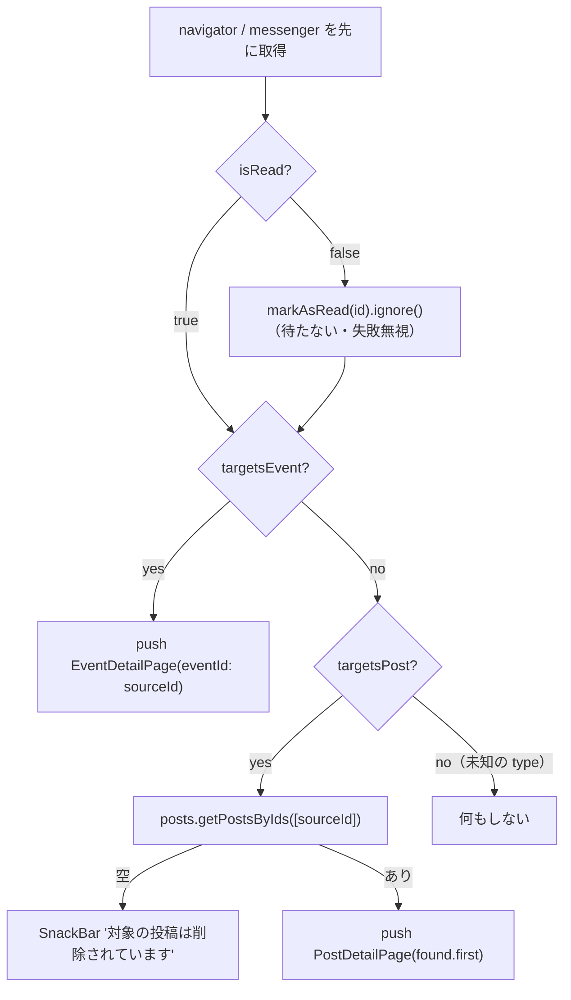

# lib/ui/notification/notification_page.dart

| 項目 | 内容 |
|---|---|
| ファイル | `lib/ui/notification/notification_page.dart` |
| 基本設計 | [08 通知](../../08_通知.md) の「4. 画面・コンポーネント構成」「5.1 プッシュ通知の登録」 |
| 関連する基本設計 | [03 フィード・投稿詳細](../../03_フィード・投稿詳細.md)（投稿詳細へ遷移）、[06 イベント](../../06_イベント.md)（イベント詳細へ遷移） |
| レイヤ | View |
| 主な依存先 | `lib/data/models/notification.dart`, `lib/data/models/app_user.dart`, `lib/data/repositories/auth_repository.dart`, `lib/data/repositories/notification_repository.dart`, `lib/data/repositories/post_repository.dart`, `lib/data/repositories/user_repository.dart`, `lib/data/services/push_notification_service.dart`, `lib/ui/event/event_detail_page.dart`, `lib/ui/post/post_detail_page.dart`, `package:provider` |
| 主な利用元 | `lib/ui/notification/widgets/notification_bell.dart`, `lib/app/main_shell.dart`（フォアグラウンド受信の「見る」・通知タップ起動） |
| テスト | `test/ui/notification/notification_page_test.dart` |

## 1. 責務

- 自分宛ての通知を新しい順（最大 50 件）に表示する。未読は背景色・太字・ドットで区別する。
- 通知タップで既読化し、対象の投稿詳細またはイベント詳細へ遷移する。
- AppBar から全件既読化する。
- 上部の設定欄で、プッシュ通知の有効化と週次メール通知の on/off を切り替える。

## 2. 構成要素

| 種別 | 名前 | 概要 |
|---|---|---|
| クラス | `NotificationPage extends StatelessWidget` | 画面本体 |
| メソッド | `NotificationPage._open(...)` | 既読化と遷移 |
| private | `_NotificationTile extends StatefulWidget` / `_NotificationTileState` | 通知 1 件 |
| static | `_NotificationTileState.message(AppNotification, String)` | 種別ごとの文面 |
| static private | `_NotificationTileState._icon(String)` | 種別ごとのアイコン |
| static private | `_NotificationTileState._formatDate(DateTime)` | `yyyy/MM/dd HH:mm` |
| private | `_NotificationSettings extends StatefulWidget` / `_NotificationSettingsState` | 通知設定欄 |

## 3. 公開インターフェース

```dart
const NotificationPage({Key? key});
```

引数なし。ログイン中ユーザーは `AuthRepository.currentUserId` から取得する。

## 4. 内部状態

| 所在 | フィールド | 型 | 説明 |
|---|---|---|---|
| `_NotificationTileState` | `_actor` | `late Future<AppUser?>` | `userRepository.getUser(actorId)`。再描画のたびに取り直さないよう保持。`didUpdateWidget` で `actorId` が変わったときだけ取り直す |
| `_NotificationSettingsState` | `_push` | `late final PushNotificationService` | `context.read` |
| | `_pushEnabled` | `bool?` | プッシュ許可状態。確認中は null |
| | `_requesting` | `bool`（初期 false） | 許可要求中 |

`_pushEnabled` の遷移: `null`（確認中）→ `initState` の `_loadPushState` で `true` / `false` → 「有効にする」押下の結果で `true` / `false`。

## 5. 処理詳細

### 5.1 ウィジェット構成

```
Scaffold
├─ AppBar(title: '通知', actions: [uid != null なら IconButton(Icons.done_all, tooltip 'すべて既読にする')])
└─ body
    ├─ uid == null → Center(Text('ログイン情報が取得できませんでした'))
    └─ ListView
        ├─ _NotificationSettings(uid, notificationRepository)
        ├─ Divider(height: 1)
        └─ StreamBuilder<List<AppNotification>>(getNotifications(uid))
            ├─ hasError   → Padding(32) Text('通知を読み込めませんでした')
            ├─ !hasData   → Padding(32) CircularProgressIndicator
            ├─ 0 件       → Padding(32) Text('通知はまだありません')
            └─ Column[ _NotificationTile × n ]
```

### 5.2 `NotificationPage.build`

1. `uid`、`notifications`（`NotificationRepository`）を `context.read` で取得。
2. 「すべて既読にする」: `notifications.markAllAsRead(uid)`（Future を待たない）。
3. 各タイルの `onTap` に `_open(context, notification, notifications, context.read<PostRepository>())`、`userRepository` に `context.read<UserRepository>()` を渡す。

### 5.3 `_open(context, notification, notifications, posts)`



### 5.4 `_NotificationTileState.build`

`FutureBuilder<AppUser?>(future: _actor)` の中で `ListTile` を組む。

| 要素 | 内容 |
|---|---|
| `actorName` | `snapshot.data?.username ?? 'だれか'`（読み込み中・ユーザー不在も「だれか」） |
| `tileColor` | 未読なら `colorScheme.primaryContainer.withValues(alpha: 0.35)`、既読は null |
| leading | `CircleAvatar(backgroundColor: secondaryContainer)` に `_icon(type)`（色 `onSecondaryContainer`、サイズ 20） |
| title | `message(notification, actorName)`。未読は `FontWeight.bold` |
| subtitle | `_formatDate(createdAt)`（`yyyy/MM/dd HH:mm`） |
| trailing | 未読なら `Icon(Icons.circle, size: 10, color: primary)` |
| onTap | `widget.onTap` |

#### 文面とアイコン

| type | `message` | `_icon` |
|---|---|---|
| `reaction` | `{actorName}さんがあなたの投稿にいいねしました` | `Icons.favorite` |
| `comment` | `{actorName}さんがあなたの投稿にコメントしました` | `Icons.chat_bubble` |
| `event_update` | `参加予定のイベントが更新されました` | `Icons.event` |
| その他 | `新しい通知があります` | `Icons.notifications` |

### 5.5 `_NotificationSettingsState`

#### `initState` → `_loadPushState()`

1. `_push.isPermissionGranted()`。例外は false 扱い。
2. `mounted` なら `setState(() => _pushEnabled = granted)`。

#### `_enablePush()`

1. `setState(() => _requesting = true)`。
2. `_push.requestPermissionAndRegister(widget.uid)`。例外は false 扱い。
3. `mounted` でなければ終了。
4. `setState`: `_requesting = false`、`_pushEnabled = registered`。
5. `registered == false` なら SnackBar「プッシュ通知を有効にできませんでした。ブラウザの通知設定を確認してください」。

#### build

```
Column
├─ [_push.isSupported] ListTile
│   ├─ leading: Icon(Icons.notifications_active_outlined)
│   ├─ title: 'プッシュ通知'
│   ├─ subtitle: _pushEnabled == true ? 'この端末で受け取ります' : 'この端末（ブラウザ）で通知を受け取ります'
│   └─ trailing: _pushEnabled == true
│        ? Icon(Icons.check_circle, color: Colors.green)
│        : FilledButton.tonal('有効にする', onPressed: _pushEnabled == null || _requesting ? null : _enablePush)
└─ StreamBuilder<bool>(watchEmailNotification(uid))
    └─ SwitchListTile(secondary: Icon(Icons.mail_outline), title: '週次メール通知',
                      subtitle: '1 週間分の未読通知をメールでまとめて受け取ります',
                      value: snapshot.data ?? true,
                      onChanged: hasData ? (v) => setEmailNotification(uid, v) : null)
```

- Web で `FCM_VAPID_KEY` が無いビルドではプッシュ通知の行自体を出さない。
- 一度有効化した後に無効化する UI はない（OS / ブラウザ側の設定で行う）。
- メール通知スイッチは初回データ受信まで操作不可。値はストリーム経由で反映する（楽観更新しない）。

## 6. データ仕様

| 操作 | パス | 経由 |
|---|---|---|
| 購読 | `notifications`（`recipientId == uid`、`createdAt` 降順、50 件） | `NotificationRepository.getNotifications` |
| 更新 | `notifications/{id}.isRead = true` | `markAsRead` / `markAllAsRead` |
| 読み取り | `users/{actorId}` | `UserRepository.getUser` |
| 読み取り | `posts/{sourceId}` | `PostRepository.getPostsByIds` |
| 購読・更新 | `users/{uid}/private/profile.emailNotification` | `watchEmailNotification` / `setEmailNotification` |
| 更新 | `users/{uid}/private/messaging.tokens` | `PushNotificationService.requestPermissionAndRegister` |

## 7. 例外・エラー処理

| 状況 | 動作 / メッセージ |
|---|---|
| 未ログイン | ログイン情報が取得できませんでした（既読ボタンも出さない） |
| 通知一覧のストリームエラー | 通知を読み込めませんでした |
| 既読化の失敗 | `.ignore()` で無視し、遷移を優先する |
| 投稿が削除済み | 対象の投稿は削除されています（SnackBar） |
| プッシュ許可状態の取得失敗 | 未許可扱い（「有効にする」ボタン表示） |
| プッシュ有効化の失敗・拒否 | プッシュ通知を有効にできませんでした。ブラウザの通知設定を確認してください |
| `markAllAsRead` / `setEmailNotification` / `getPostsByIds` の失敗 | 捕捉しない（未処理の非同期エラーになり、画面には何も出ない） |

## 8. テスト観点

既存テスト（`test/ui/notification/notification_page_test.dart`）が確認していること:

- actor のユーザー名を使った文面（いいね・コメント）が表示され、「週次メール通知」が表示される。
- 通知 0 件で「通知はまだありません」。
- タップで既読になり、対象投稿が無い場合「対象の投稿は削除されています」を表示する。
- メール通知スイッチのタップで `emailNotification` が false になる。

未テストの観点:

- `event_update` のタップでイベント詳細へ遷移すること、存在する投稿で投稿詳細へ遷移すること。
- 「すべて既読にする」。
- プッシュ通知行の状態別表示（確認中・未許可・許可済み・非対応）と有効化失敗時の SnackBar。
- 未読の背景色・太字・ドット。

## 9. 備考・既知の課題

- 文面は Functions 側（`notificationMessage`）と二重定義されている（基本設計 8 章）。
- actor の `username` が空文字のユーザーだと「さんがあなたの投稿に…」と名前なしの文面になる（`??` は null にしか効かない）。
- 一覧は最新 50 件のみで、それより古い通知を見る手段はない。
- 「すべて既読にする」は確認なし・結果表示なしで実行する。
