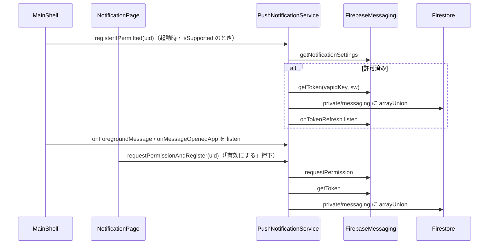

# lib/data/services/push_notification_service.dart

| 項目 | 内容 |
|---|---|
| ファイル | `lib/data/services/push_notification_service.dart` |
| 基本設計 | [08 通知](../../08_通知.md) の「5.1 プッシュ通知の登録」「6. データ設計」「7. 権限・セキュリティ」 |
| 関連する基本設計 | [00 システム概要](../../00_システム概要.md)（起動時のバックグラウンドハンドラ登録） |
| レイヤ | Service |
| 主な依存先 | `package:cloud_firestore`, `package:firebase_messaging`, `package:flutter/foundation.dart`（`kIsWeb`） |
| 主な利用元 | `lib/main.dart`（`firebaseMessagingBackgroundHandler`）, `lib/app/dependencies.dart`（生成・提供）, `lib/app/main_shell.dart`（起動時登録・受信購読）, `lib/ui/notification/notification_page.dart`（有効化ボタン） |
| テスト | `test/data/repositories/notification_repository_test.dart`（`saveToken` のみ） |

## 1. 責務

- FCM（Firebase Cloud Messaging）の許可確認・許可要求・登録トークン取得を薄くラップする。
- 取得したトークンを `users/{uid}/private/messaging.tokens` に保存する（送信は Functions `onNotificationCreated`。[functions_index.md](../00_システム概要/functions_index.md) 参照）。
- フォアグラウンド受信・通知タップ起動のストリームを公開する。
- モバイルのバックグラウンド受信用トップレベルハンドラを提供する。

## 2. 構成要素

| 種別 | 名前 | 値 / 概要 |
|---|---|---|
| クラス | `PushNotificationService` | 本体 |
| 定数 | `usersCollection` | `'users'` |
| 定数 | `privateMessagingDoc` | `'private/messaging'` |
| 定数 | `vapidKey` | `String.fromEnvironment('FCM_VAPID_KEY')`（ビルド時 `--dart-define` で注入。未指定なら `''`） |
| 定数 | `webServiceWorkerPath` | `'firebase-messaging-sw.js'`（`<base href>` 相対。GitHub Pages のサブパス配信に対応） |
| private getter | `_messaging` | `_messagingOverride ?? FirebaseMessaging.instance`（遅延取得） |
| private | `_messagingRef(String userId)` | `doc('users/$userId/private/messaging')` |
| private | `_registerCurrentToken(String userId)` | トークン取得と保存 |
| private static | `_isAuthorized(AuthorizationStatus)` | `authorized` または `provisional` なら true |
| トップレベル関数 | `firebaseMessagingBackgroundHandler(RemoteMessage)` | `@pragma('vm:entry-point')`。何もしない |

## 3. 公開インターフェース

```dart
PushNotificationService({FirebaseFirestore? firestore, FirebaseMessaging? messaging});
```

| シグネチャ | 説明 |
|---|---|
| `bool get isSupported` | `!kIsWeb \|\| vapidKey.isNotEmpty`。Web で VAPID 鍵が無ければ false |
| `Future<bool> isPermissionGranted()` | 通知許可済みか |
| `Future<bool> requestPermissionAndRegister(String userId)` | 許可を求め、許可されたらトークンを保存。保存できたら true |
| `Future<void> registerIfPermitted(String userId)` | 許可済みならトークンを保存し、トークン更新も保存し続ける（ダイアログは出さない） |
| `Stream<RemoteMessage> get onForegroundMessage` | `FirebaseMessaging.onMessage` |
| `Stream<RemoteMessage> get onMessageOpenedApp` | `FirebaseMessaging.onMessageOpenedApp` |
| `Future<void> saveToken(String userId, String token)` | トークンを配列に追加保存 |
| `Future<void> firebaseMessagingBackgroundHandler(RemoteMessage message)` | トップレベル。`main.dart` が Android / iOS のときだけ `FirebaseMessaging.onBackgroundMessage` に登録 |

## 4. 内部状態

| フィールド | 型 | 説明 |
|---|---|---|
| `_firestore` | `FirebaseFirestore` | 注入または `FirebaseFirestore.instance` |
| `_messagingOverride` | `FirebaseMessaging?` | 注入された場合のみ使用 |

`FirebaseMessaging.instance` は生成時にネイティブ / JS 側へアクセスするため、コンストラクタでは取得せず getter で遅延取得する（`saveToken` だけを使うテストで初期化させない）。

## 5. 処理詳細

### 5.1 `isPermissionGranted`

1. `!isSupported` なら false。
2. `_messaging.getNotificationSettings()` の `authorizationStatus` を `_isAuthorized` で判定。

### 5.2 `requestPermissionAndRegister`

1. `!isSupported` なら false。
2. `_messaging.requestPermission()`（ブラウザ / OS の許可ダイアログ。Web ではユーザー操作起点で呼ぶ必要がある）。
3. 許可されなければ false。
4. `_registerCurrentToken(userId)` の結果を返す。

### 5.3 `registerIfPermitted`

1. `isPermissionGranted()` が false なら終了。
2. `_registerCurrentToken(userId)`。
3. `_messaging.onTokenRefresh.listen((token) => saveToken(userId, token))` で以後のトークン更新を保存する（購読は返さず、解除もしない）。

### 5.4 `_registerCurrentToken`

1. `_messaging.getToken(vapidKey: kIsWeb ? vapidKey : null, serviceWorkerScriptPath: kIsWeb ? webServiceWorkerPath : null)`。
2. null または空なら false。
3. `saveToken(userId, token)` して true。

### 5.5 `saveToken`

```dart
_messagingRef(userId).set({
  'tokens': FieldValue.arrayUnion([token]),
  'updatedAt': FieldValue.serverTimestamp(),
}, SetOptions(merge: true));
```

`arrayUnion` により同じトークンは重複しない。複数端末のトークンを配列に蓄積する。

### 5.6 `firebaseMessagingBackgroundHandler`

空実装。`notification` ペイロード付きメッセージは OS が表示するため追加処理不要。`onBackgroundMessage` がトップレベル関数を要求するために存在する。Web のバックグラウンド受信は `web/firebase-messaging-sw.js` が担う。

### 5.7 呼び出しシーケンス



## 6. データ仕様

| パス | フィールド | 型 | 書き方 |
|---|---|---|---|
| `users/{uid}/private/messaging` | `tokens` | string[] | `FieldValue.arrayUnion` |
| | `updatedAt` | Timestamp | `FieldValue.serverTimestamp()` |

ルール: `users/{uid}/private/{document=**}` は本人（`request.auth.uid == uid`）のみ読み書き可。無効トークンの削除は Functions が行う。

## 7. 例外・エラー処理

- 本クラスは例外を捕捉しない。非対応ブラウザ等での `FirebaseMessaging` の例外は呼び出し元が捕捉する（`MainShell._startPushNotifications` は握りつぶす、`NotificationPage` は false 扱いで SnackBar 表示）。
- Web で `vapidKey` が空のときは `isSupported == false` となり、許可確認・要求とも false を返す（FCM に触れない）。

## 8. テスト観点

既存テストが確認していること:

- `saveToken` が同じトークンを重複させずに配列へ追加する（`notification_repository_test.dart` の `PushNotificationService` グループ）。

未テストの観点:

- `isSupported` の判定（Web かつ VAPID 鍵なし）。
- 許可状態ごとの `requestPermissionAndRegister` / `registerIfPermitted` の分岐（`FirebaseMessaging` のモック注入が必要）。
- トークンが null / 空のときに保存しないこと。

## 9. 備考・既知の課題

- `onTokenRefresh` の購読を解除しない。`registerIfPermitted` が複数回呼ばれると（`MainShell` の再生成など）購読が重複する。
- ログアウト時にトークンを削除しないため、同じ端末で別ユーザーにログインし直すと前のユーザー宛てのプッシュが届きうる（基本設計 8 章）。
- 古いトークンは送信失敗時に Functions が削除するまで残る。
