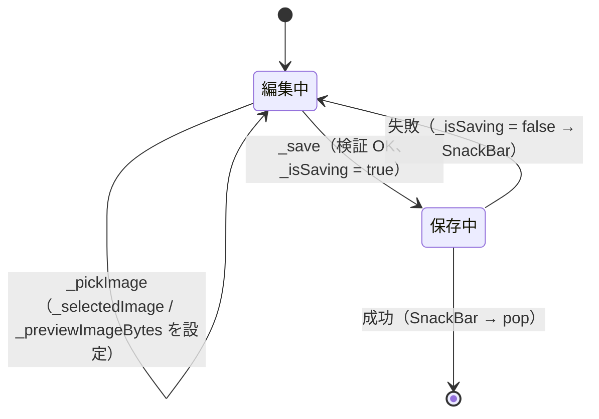
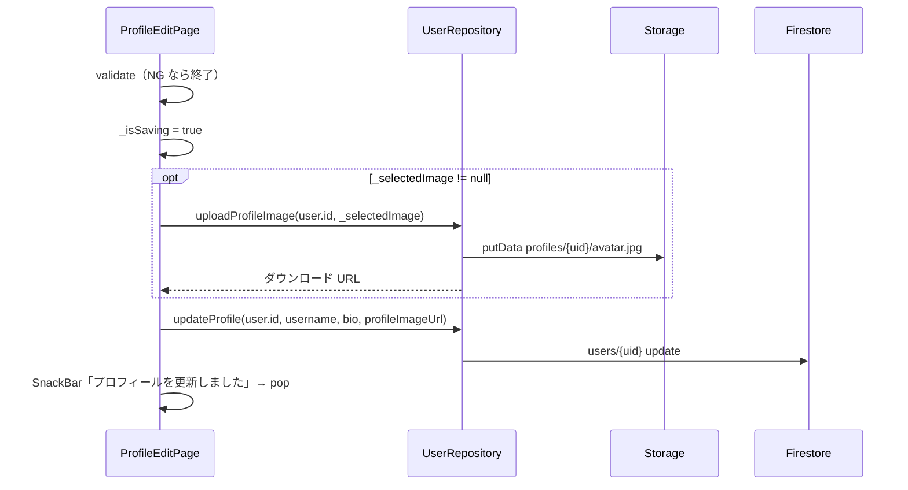

# lib/ui/profile/profile_edit_page.dart

| 項目 | 内容 |
|---|---|
| ファイル | `lib/ui/profile/profile_edit_page.dart` |
| 基本設計 | [09 プロフィール](../../09_プロフィール.md) の「2. 画面・コンポーネント構成」「3. 処理フロー（画像選択・保存）」「6. 入力チェック・エラー処理」 |
| 関連する基本設計 | なし |
| レイヤ | View（ViewModel なし） |
| 主な依存先 | `lib/data/repositories/user_repository.dart`, `lib/data/models/app_user.dart`、`package:provider`、`package:image_picker`、`package:cached_network_image`、`dart:typed_data` |
| 主な利用元 | `lib/ui/profile/profile_page.dart`（「プロフィールを編集」ボタン） |
| テスト | なし |

## 1. 責務

ログイン中ユーザーのユーザー名・自己紹介・プロフィール画像を編集して保存する。

- ギャラリーから画像を 1 枚選び、プレビューする。
- 保存時、画像を選んでいれば Storage にアップロードし、その URL を含めて `users/{uid}` を更新する。
- 保存中は画面全体の操作を止める。

## 2. 構成要素（クラス・関数・定数の一覧）

| 種別 | 名前 | 概要 |
|---|---|---|
| クラス | `ProfileEditPage`（`StatefulWidget`） | 編集画面 |
| クラス | `_ProfileEditPageState` | フォーム状態・画像選択・保存 |
| メソッド | `_pickImage` | ギャラリーから画像選択 |
| メソッド | `_save` | 検証・アップロード・更新 |

## 3. 公開インターフェース（コンストラクタ引数・プロパティ・メソッドのシグネチャと説明）

```dart
const ProfileEditPage({super.key, required this.user});
```

| プロパティ | 型 | 説明 |
|---|---|---|
| `user` | `AppUser` | 編集対象。初期値（ユーザー名・自己紹介・既存画像）と更新先 uid（`user.id`）に使う |

## 4. 内部状態（フィールド・状態遷移）

| フィールド | 型 | 初期値 | 説明 |
|---|---|---|---|
| `_formKey` | `GlobalKey<FormState>` | 新規 | |
| `_userRepository` | `UserRepository`（`late final`） | `context.read<UserRepository>()` | |
| `_imagePicker` | `ImagePicker` | `ImagePicker()` | State が直接生成する |
| `_usernameController` | `TextEditingController`（`late final`） | `text: widget.user.username` | |
| `_bioController` | `TextEditingController`（`late final`） | `text: widget.user.bio` | |
| `_selectedImage` | `XFile?` | `null` | 選択した画像（アップロード用） |
| `_previewImageBytes` | `Uint8List?` | `null` | プレビュー用バイト列 |
| `_isSaving` | `bool` | `false` | 保存中フラグ |

状態遷移:



## 5. 処理詳細（メソッドごとの手順・分岐・呼び出す Repository/SDK）

### ライフサイクル

- `initState`: オーバーライドなし（コントローラは `late final` で初回アクセス時に生成）。
- `dispose`: `_usernameController`・`_bioController` を `dispose` する。

### ウィジェット構成（`build`）

`hasExistingImage = (widget.user.profileImageUrl ?? '').isNotEmpty` を計算する。

```
Scaffold
├─ AppBar(title: 'プロフィール編集')
└─ AbsorbPointer(absorbing: _isSaving)
   └─ Center / SingleChildScrollView(padding 24) / ConstrainedBox(maxWidth 420)
      └─ Form(key: _formKey) / Column(stretch)
         ├─ Center / Stack
         │  ├─ CircleAvatar(radius 48, 背景 grey.shade200)
         │  │    backgroundImage: _previewImageBytes あり → MemoryImage
         │  │                     なし・既存画像あり → CachedNetworkImageProvider(profileImageUrl)
         │  │                     どちらもなし → null
         │  │    child: どちらもなし → Icon(Icons.person, 48, grey)
         │  └─ Positioned(right 0, bottom 0)
         │       Material(primary 色, CircleBorder) / InkWell(onTap: _pickImage)
         │       └─ Padding(6) / Icon(Icons.camera_alt, 18, white)
         ├─ SizedBox(24)
         ├─ TextFormField 'ユーザー名'（validator: trim 後が空 → 'ユーザー名を入力してください'）
         ├─ SizedBox(16)
         ├─ TextFormField '自己紹介'（alignLabelWithHint, maxLines: null, minLines: 3、検証なし）
         ├─ SizedBox(24)
         └─ ElevatedButton  保存中は無効＋20×20 スピナー / 通常は '保存する'
```

### `_pickImage()`（カメラボタン）

1. `_imagePicker.pickImage(source: ImageSource.gallery, maxWidth: 800, maxHeight: 800, imageQuality: 85)` を待つ。
2. `null`（キャンセル）なら終了。
3. `picked.readAsBytes()` を待つ。
4. `mounted` でなければ終了。
5. `setState` で `_selectedImage = picked`、`_previewImageBytes = bytes` を設定する（アバターがプレビューに切り替わる）。

### `_save()`（保存ボタン）



1. `_formKey.currentState!.validate()` が `false` なら終了。
2. `ScaffoldMessenger.of(context)` と `Navigator.of(context)` を先に取得する。
3. `setState(() => _isSaving = true)`（`AbsorbPointer` で全操作を止め、ボタンにスピナー）。
4. `try`:
   1. `imageUrl` を `null` で用意し、`_selectedImage != null` なら `_userRepository.uploadProfileImage(widget.user.id, _selectedImage!)` の結果を入れる。
   2. `_userRepository.updateProfile(widget.user.id, username: _usernameController.text.trim(), bio: _bioController.text.trim(), profileImageUrl: imageUrl)` を待つ。`imageUrl` が `null` のときは `profileImageUrl` を更新しない。
   3. SnackBar「プロフィールを更新しました」を出し、`navigator.pop()` で `ProfilePage` に戻る。
5. `catch (_)`:
   1. `mounted` なら `_isSaving = false`。
   2. 赤 SnackBar「更新に失敗しました」。

成功時は `_isSaving` を戻さない（画面を閉じるため）。

## 6. データ仕様（読み書きする Firestore/Storage のパス・フィールド、定数値）

| 対象 | 操作 | 内容 |
|---|---|---|
| Storage `profiles/{uid}/avatar.jpg` | 書込（画像を選んだときのみ） | `UserRepository.uploadProfileImage`、Content-Type `image/jpeg` |
| Firestore `users/{uid}` | 更新 | `username`（trim）、`bio`（trim）、`profileImageUrl`（画像を選んだときのみ） |

| 定数 | 値 |
|---|---|
| 画像選択元 | `ImageSource.gallery` |
| 最大幅・高さ | 800 × 800 |
| 画質 | 85 |
| アバター半径 | 48 |
| フォーム最大幅 | 420 |

## 7. 例外・エラー処理（例外の扱い・戻り値・表示メッセージ）

| 状況 | 表示 |
|---|---|
| ユーザー名が空白のみ | ユーザー名を入力してください（入力欄の下） |
| アップロードまたは更新が失敗 | 赤 SnackBar「更新に失敗しました」（保存中フラグを解除して編集継続可能） |
| 保存成功 | SnackBar「プロフィールを更新しました」 |
| 画像選択の失敗（権限拒否等） | 捕捉しない（`_pickImage` の例外は未処理） |

## 8. テスト観点（既存テストが確認していること / 未テストの観点）

既存テスト: なし。

未テストの観点:

- 初期値に既存のユーザー名・自己紹介が入ること。
- ユーザー名が空白のみで保存できないこと。
- 画像未選択の保存で `profileImageUrl` が変わらないこと、画像選択時はアップロード URL が保存されること。
- 保存中に操作が止まること、失敗時にフラグが戻り SnackBar が出ること。

## 9. 備考・既知の課題

- アップロード成功後に `updateProfile` が失敗すると、Storage の `avatar.jpg` だけが新しい画像に上書きされ、`users/{uid}.profileImageUrl` は旧 URL のまま残る。
- `ImagePicker` を State が直接生成しており、`ImageService` や DI を経由していない（テストで差し替えられない）。
- 入力検証・送信を持つが ViewModel は無い（基本設計 00 の 3.5 の残課題として明記）。
- 画像形式の制限（基本設計 00 の 8 章「jpg / jpeg / png / bmp / heic のみ」）は本画面では適用していない。
- ユーザー名・自己紹介の長さ制限は無い。
