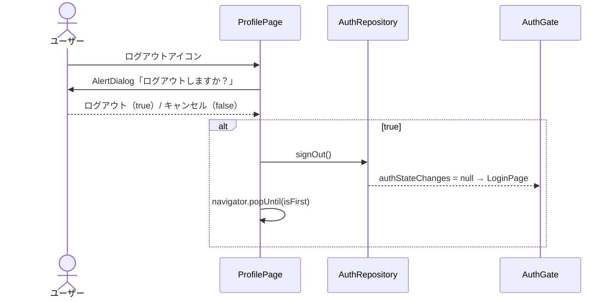

# lib/ui/profile/profile_page.dart

| 項目 | 内容 |
|---|---|
| ファイル | `lib/ui/profile/profile_page.dart` |
| 基本設計 | [09 プロフィール](../../09_プロフィール.md) の「2. 画面・コンポーネント構成」「3. 処理フロー」「6. 入力チェック・エラー処理」 |
| 関連する基本設計 | [01 認証・ユーザー登録承認](../../01_認証・ユーザー登録承認.md)（3.2 ログアウト）、[03 フィード・投稿詳細](../../03_フィード・投稿詳細.md)（投稿詳細への遷移） |
| レイヤ | View（ViewModel なし） |
| 主な依存先 | `lib/data/repositories/auth_repository.dart`, `lib/data/repositories/user_repository.dart`, `lib/data/repositories/post_repository.dart`, `lib/data/models/app_user.dart`, `lib/data/models/post.dart`, `lib/ui/profile/profile_edit_page.dart`, `lib/ui/post/post_detail_page.dart`, `lib/ui/core/widgets/reaction_bar.dart`, `lib/ui/core/widgets/comment_section.dart`、`package:provider`、`package:cached_network_image` |
| 主な利用元 | `lib/ui/map/map_screen.dart`（AppBar のアカウントアイコン、`userId` 省略）, `lib/ui/post/widgets/post_detail_view.dart`（投稿者名）, `lib/ui/core/widgets/comment_section.dart`（コメント主）, `lib/ui/event/event_detail_page.dart`（参加者）。`lib/app/main_shell.dart` は doc コメントでの参照のみ |
| テスト | なし |

## 1. 責務

指定ユーザー（省略時はログイン中ユーザー）のプロフィール画像・ユーザー名・自己紹介と投稿グリッドを表示する。

- 自分のプロフィール: 「プロフィールを編集」ボタンと AppBar のログアウトを出す。見出しは「自分の投稿」。
- 他人のプロフィール: 閲覧のみ。見出しは「投稿」。
- 投稿サムネイルのタップで投稿詳細へ遷移する。

## 2. 構成要素（クラス・関数・定数の一覧）

| 種別 | 名前 | 概要 |
|---|---|---|
| クラス | `ProfilePage`（`StatelessWidget`, 公開） | 画面本体。uid 決定・ユーザー購読・ログアウト |
| メソッド | `ProfilePage._confirmSignOut` | ログアウト確認と実行 |
| クラス | `_ProfileBody`（`StatelessWidget`, 非公開） | プロフィールヘッダと投稿グリッド |

## 3. 公開インターフェース（コンストラクタ引数・プロパティ・メソッドのシグネチャと説明）

```dart
const ProfilePage({super.key, this.userId});
```

| プロパティ | 型 | 説明 |
|---|---|---|
| `userId` | `String?` | 表示するユーザーの UID。`null` ならログイン中ユーザー |

非公開:

```dart
const _ProfileBody({required this.user, required this.isMe});
final AppUser user;
final bool isMe; // 自分のプロフィールなら編集ボタンを表示
Future<void> _confirmSignOut(BuildContext context, AuthRepository authRepository)
```

## 4. 内部状態（フィールド・状態遷移）

いずれも `StatelessWidget` で、`build` 内で次の値を計算する。

| 値 | 計算 |
|---|---|
| `currentUid` | `authRepository.currentUserId` |
| `uid` | `userId ?? currentUid` |
| `isMe` | `uid != null && uid == currentUid` |
| `hasImage`（`_ProfileBody`） | `(user.profileImageUrl ?? '').isNotEmpty` |

表示データは 2 つの `StreamBuilder`（ユーザー・投稿一覧）のスナップショットで決まる。

## 5. 処理詳細（メソッドごとの手順・分岐・呼び出す Repository/SDK）

### `ProfilePage.build`

1. `context.read<AuthRepository>()`・`context.read<UserRepository>()` を取得し、`currentUid`・`uid`・`isMe` を計算する。
2. `Scaffold` を返す。
   - `AppBar(title: 'プロフィール')`。`isMe` のときだけ `actions` に `IconButton(Icons.logout, tooltip 'ログアウト')` を置き、押下で `_confirmSignOut(context, authRepository)`。
   - `body`:
     - `uid == null` →「ログイン情報が取得できませんでした」を中央表示。
     - それ以外 → `StreamBuilder<AppUser?>(stream: userRepository.watchUser(uid))`:
       - `waiting` → 中央にスピナー。
       - `snapshot.data == null` →「プロフィールが見つかりませんでした」。
       - それ以外 → `_ProfileBody(user: user, isMe: isMe)`。

### `_confirmSignOut(context, authRepository)`



1. `Navigator.of(context)` を先に取得する。
2. `showDialog<bool>` で `AlertDialog`（title「ログアウト」、content「ログアウトしますか？」、actions「キャンセル」→ `pop(false)`、「ログアウト」→ `pop(true)`）を出す。
3. 結果が `true` 以外（キャンセル・ダイアログ外タップの `null`）なら終了。
4. `authRepository.signOut()` を待つ。
5. `navigator.popUntil((route) => route.isFirst)`。プロフィールは `MapScreen` からスタックに積まれているため、ルートの `AuthGate`（この時点で `LoginPage` を表示）まで戻す。

### `_ProfileBody.build`

ウィジェット構成:

```
SingleChildScrollView
└─ Column(stretch)
   ├─ Padding(24) / Column
   │  ├─ CircleAvatar(radius 48, 背景 grey.shade200)
   │  │    hasImage → backgroundImage: CachedNetworkImageProvider(profileImageUrl)
   │  │    それ以外 → child: Icon(Icons.person, size 48, grey)
   │  ├─ SizedBox(16)
   │  ├─ Text(user.username, titleLarge, 中央)
   │  ├─ [bio が空でない] SizedBox(12) + Text(user.bio, 中央)
   │  └─ [isMe] SizedBox(16) + OutlinedButton.icon(Icons.edit, 'プロフィールを編集')
   ├─ Divider(height 1)
   ├─ Padding(16,16,16,8) / 左寄せ Text(isMe ? '自分の投稿' : '投稿', titleMedium)
   ├─ StreamBuilder<List<Post>>(postRepository.getUserPosts(user.id))
   └─ SizedBox(24)
```

投稿一覧 `StreamBuilder` の分岐:

| 状態 | 表示 |
|---|---|
| `waiting` | `Padding(32)` 内に中央スピナー |
| `snapshot.data ?? []` が空 | `Padding(32)` 内に「まだ投稿がありません」 |
| それ以外 | `GridView.builder`（下記） |

`GridView.builder` の設定: `shrinkWrap: true`、`NeverScrollableScrollPhysics`（外側の `SingleChildScrollView` でスクロール）、`padding: 8`、`SliverGridDelegateWithFixedCrossAxisCount(crossAxisCount: 5, mainAxisSpacing: 4, crossAxisSpacing: 4)`。

各セル:

- `thumbnailUrl = post.imageUrls.isNotEmpty ? post.imageUrls.first : null`。
- `null` → `Container(grey.shade200)` + `Icon(Icons.image_not_supported_outlined, grey)`。
- 非 `null` → `CachedNetworkImage(imageUrl: thumbnailUrl, fit: BoxFit.cover)`。
  - `placeholder`: grey.shade200 の上に 20×20 スピナー（strokeWidth 2）。
  - `errorWidget`: grey.shade200 + `Icon(Icons.broken_image_outlined, grey)`。
- `GestureDetector.onTap` → `PostDetailPage(post, reactionBar: ReactionBar(post: post), commentSection: CommentSection(post: post))` を push。

### 「プロフィールを編集」ボタン

`Navigator.push(MaterialPageRoute(builder: (_) => ProfileEditPage(user: user)))`。渡す `user` は押下時点の `watchUser` のスナップショット。保存後は `watchUser` が新しい値を流すため、戻ったときに表示が更新される。

## 6. データ仕様（読み書きする Firestore/Storage のパス・フィールド、定数値）

| 対象 | 操作 | 経由 | 使うフィールド |
|---|---|---|---|
| `users/{uid}` | 購読 | `UserRepository.watchUser` | `username`, `bio`, `profileImageUrl` |
| `posts`（`where userId == uid`） | 購読 | `PostRepository.getUserPosts`（クライアントで `createdAt` 降順に並べ替え） | `imageUrls`（先頭のみ）ほか `Post` 全体を詳細画面へ渡す |
| Firebase Auth | ログアウト | `AuthRepository.signOut` | — |
| Storage | 読取（画像表示） | `CachedNetworkImage` | `profiles/{uid}/avatar.jpg`, `posts/...` のダウンロード URL |

| 定数 | 値 |
|---|---|
| アバター半径 | 48 |
| グリッド列数 | 5 |
| グリッド間隔 | 4 |

## 7. 例外・エラー処理（例外の扱い・戻り値・表示メッセージ）

| 状況 | 表示 |
|---|---|
| ログイン中 UID が取得できない（`userId` 省略かつ未ログイン） | ログイン情報が取得できませんでした |
| ユーザードキュメントが無い / 購読エラー | プロフィールが見つかりませんでした |
| 投稿が 0 件 / 購読エラー | まだ投稿がありません |
| サムネイル読み込み失敗 | `Icons.broken_image_outlined` |
| `signOut` の失敗 | 捕捉しない（例外は `_confirmSignOut` の呼び出し元へ伝播し、`popUntil` は実行されない） |

## 8. テスト観点（既存テストが確認していること / 未テストの観点）

既存テスト: なし。

未テストの観点:

- 自分 / 他人で編集ボタン・ログアウト・見出し（「自分の投稿」/「投稿」）が出し分けられること。
- `bio` が空なら自己紹介を表示しないこと。
- 投稿 0 件の表示、画像なし投稿のアイコン表示。
- ログアウト確認でキャンセルすると何もしないこと、ログアウトで最下層まで戻ること。
- サムネイルタップで `PostDetailPage` に遷移すること。

## 9. 備考・既知の課題

- `StatelessWidget` の `build` 内で `watchUser(uid)` / `getUserPosts(user.id)` を呼ぶため、再ビルドのたびに新しいストリームを購読し直す（一瞬スピナーに戻りうる）。
- 投稿一覧は件数制限なしで全件購読し、`GridView` も `shrinkWrap` で全件をレイアウトする（基本設計 09 の 7 章）。
- サムネイルは `cacheWidth` を指定しておらず、原寸の投稿画像をデコードする（基本設計 00 の 7 章「サムネイルは `cacheWidth` で縮小デコード」の方針が適用されていない）。
- 匿名期間中のコンテスト応募作品は `userId` が空のため表示されない（基本設計 09 の 7 章）。
- ウィジェット名 `ProfilePage` の doc コメントに要件番号「FR_06 / §5.8」が残っている。
