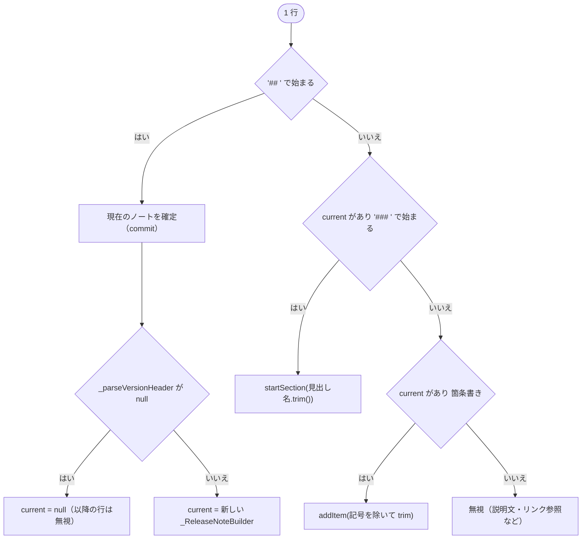

# lib/data/models/release_note.dart

| 項目 | 内容 |
|---|---|
| ファイル | `lib/data/models/release_note.dart` |
| 基本設計 | [10 お知らせ・使い方ガイド・フィードバック](../../10_お知らせ・使い方ガイド.md) の「3.2 CHANGELOG の解析」 |
| 関連する基本設計 | なし |
| レイヤ | Model |
| 主な依存先 | なし（Dart 標準のみ） |
| 主な利用元 | `lib/data/repositories/release_note_repository.dart`, `lib/ui/info/release_notes_page.dart`, `lib/ui/info/widgets/release_note_dialog.dart`, `lib/ui/info/widgets/release_note_view.dart` |
| テスト | `test/data/models/release_note_test.dart` |

## 1. 責務

- 1 バージョン分のリリースノート（`ReleaseNote`）とカテゴリー 1 つ分（`ReleaseNoteSection`）のイミュータブルなデータを表す。
- 同梱の `CHANGELOG.md`（Keep a Changelog 形式）全文を解析し、記載順（新しい順）の `ReleaseNote` 一覧に変換する。

## 2. 構成要素（クラス・関数・定数の一覧）

| 名前 | 種別 | 概要 |
|---|---|---|
| `ReleaseNote` | class（公開） | 1 バージョン分。`parseChangelog` を持つ |
| `ReleaseNoteSection` | class（公開） | カテゴリー名と項目一覧 |
| `_VersionHeader` | class（private） | 見出しから取り出したバージョン・日付 |
| `_ReleaseNoteBuilder` | class（private） | 解析中の可変状態。最後にイミュータブルな `ReleaseNote` を組み立てる |
| `ReleaseNote._bulletPattern` | `static final RegExp` | `^\s*[-*]\s+` |

## 3. 公開インターフェース（コンストラクタ引数・プロパティ・メソッドのシグネチャと説明）

### `ReleaseNote`

```dart
const ReleaseNote({
  required String version,
  String? date,
  List<ReleaseNoteSection> sections = const [],
})
```

| メンバー | 型 | 説明 |
|---|---|---|
| `version` | `String` | バージョン表記（例: `1.0.0+1`）。`pubspec.yaml` の version と同じ形式 |
| `date` | `String?` | リリース日（例: `2026-06-26`）。未記載なら `null` |
| `sections` | `List<ReleaseNoteSection>` | カテゴリー別の変更内容 |
| `hasChanges` | `bool` getter | 項目を 1 つ以上持つセクションがあるか |
| `static List<ReleaseNote> parseChangelog(String markdown)` | | CHANGELOG 全文を解析する |

### `ReleaseNoteSection`

```dart
const ReleaseNoteSection({required String category, List<String> items = const []})
```

| メンバー | 型 | 説明 |
|---|---|---|
| `category` | `String` | CHANGELOG のカテゴリー名（`Added` / `Fixed` など、原文のまま） |
| `items` | `List<String>` | 変更項目 |

## 4. 内部状態（フィールド・状態遷移）

公開クラスはすべて `final` フィールドのみ。`parseChangelog` が組み立てる `sections`・`items` は `List.unmodifiable` で包むため変更不可。

`_ReleaseNoteBuilder` の可変状態:

| フィールド | 型 | 内容 |
|---|---|---|
| `version` / `date` | `String` / `String?` | 見出しの値 |
| `_sections` | `List<ReleaseNoteSection>` | 確定済みセクション |
| `_category` | `String?` | 解析中のカテゴリー（`###` 見出し前は `null`） |
| `_items` | `List<String>` | 解析中カテゴリーの項目 |

## 5. 処理詳細（メソッドごとの手順・分岐・呼び出す Repository/SDK）

### `parseChangelog(markdown)`

`markdown.split('\n')` の各行を `trimRight()` してから次の順で判定する。



最終行の後にもう一度 commit する。戻り値は CHANGELOG の記載順。

- `## ` / `### ` は行頭（インデントなし）でのみ認識する。
- 箇条書きは `^\s*[-*]\s+` に一致する行で、インデントされた入れ子の項目も 1 項目として平坦に追加される。
- `# 変更履歴` のような `#` 1 つの見出し、空行、段落は無視される。

### `_parseVersionHeader(header)`

`header` は `## ` を除いて trim した文字列。

1. 正規表現 `^\[([^\]]+)\](?:\s*-\s*(.+))?$` に一致しなければ `null`。
2. グループ 1 を trim した値が大文字小文字を問わず `unreleased` なら `null`。
3. グループ 2（日付）を trim し、空または未一致なら `null` として `_VersionHeader(version, date)` を返す。

`null` を返した見出しのセクションは丸ごと読み飛ばされる（`[Unreleased]` のほか、`[...]` 形式でない `##` 見出しも同様）。

### `_ReleaseNoteBuilder`

| メソッド | 処理 |
|---|---|
| `startSection(category)` | 進行中セクションを確定し、`_category = category`、`_items = []` |
| `addItem(item)` | `_category == null`（`###` より前）または空文字列なら無視。それ以外は `_items` に追加 |
| `_commitSection()` | `_category != null` かつ項目が 1 つ以上なら `ReleaseNoteSection(category, items: List.unmodifiable(_items))` を `_sections` に追加。その後 `_category`・`_items` をリセット |
| `build()` | `_commitSection()` 後、`ReleaseNote(version, date, sections: List.unmodifiable(_sections))` を返す |

項目が 0 のカテゴリーは捨てられる。セクションが 0 のバージョンも `ReleaseNote` としては返る（`hasChanges == false`）。

### `hasChanges`

`sections.any((section) => section.items.isNotEmpty)`。

## 6. データ仕様（読み書きする Firestore/Storage のパス・フィールド、定数値）

入力は CHANGELOG.md の文字列（読み込みは `ReleaseNoteRepository`）。

| 行の形式 | 解釈 |
|---|---|
| `## [1.0.0+1] - 2026-06-26` | `version: '1.0.0+1'`, `date: '2026-06-26'` |
| `## [1.0.0+1]` | `date: null` |
| `## [Unreleased]` | 対象外 |
| `### Added` | `category: 'Added'` |
| `- 項目` / `* 項目` | 項目 |
| `[1.0.0+1]: https://...` | 無視（リンク参照） |

## 7. 例外・エラー処理（例外の扱い・戻り値・表示メッセージ）

例外は投げない。解釈できない行は無視する。空文字列なら空リストを返す。

## 8. テスト観点（既存テストが確認していること / 未テストの観点）

既存（`test/data/models/release_note_test.dart`）:

- `[Unreleased]` とリンク参照行を除き、記載順に解析する。
- 見出しから日付を取り出す。
- カテゴリーと項目の対応、説明文の段落を項目にしないこと。
- `hasChanges` が項目の有無を反映する。
- 空文字列で空リスト。
- 項目リストが変更不可。

未テスト:

- 日付の無い見出し、`*` 箇条書き、入れ子の箇条書き、`###` より前の箇条書き。
- CRLF 改行（`trimRight` で `\r` は除去される）。

## 9. 備考・既知の課題

- カテゴリー名は原文のまま保持し、日本語化は表示側（`release_note_view.dart`）で行う。
- 項目内の Markdown 記法（バッククォート・リンクなど）は解釈せず文字列のまま保持する。
