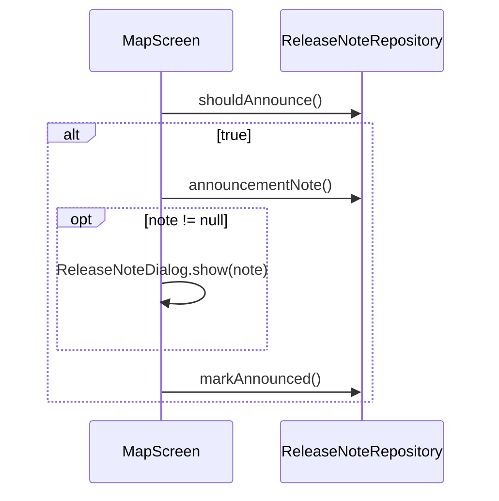

# lib/data/repositories/release_note_repository.dart

| 項目 | 内容 |
|---|---|
| ファイル | `lib/data/repositories/release_note_repository.dart` |
| 基本設計 | [10 お知らせ・使い方ガイド・フィードバック](../../10_お知らせ・使い方ガイド.md) の「3.1 起動時の案内」「3.2 CHANGELOG の解析」「4. データ設計」 |
| 関連する基本設計 | [02 地図・投稿作成](../../02_地図・投稿作成.md)（MapScreen からの起動時表示） |
| レイヤ | Repository |
| 主な依存先 | `lib/data/models/release_note.dart`, `package:flutter/services.dart`（`rootBundle`）, `package:package_info_plus`, `package:shared_preferences` |
| 主な利用元 | `lib/app/dependencies.dart`, `lib/ui/map/map_screen.dart`, `lib/ui/info/release_notes_page.dart` |
| テスト | `test/data/repositories/release_note_repository_test.dart` |

## 1. 責務

- 同梱アセット `CHANGELOG.md` を読み込み、`ReleaseNote` 一覧に変換する。
- 実行中アプリのバージョンと「最後にお知らせを表示したバージョン」（端末ローカル）を突き合わせ、更新後の初回起動でお知らせを出すべきか判定し、既読を記録する。

## 2. 構成要素（クラス・関数・定数の一覧）

| 名前 | 種別 | 値 / 概要 |
|---|---|---|
| `ReleaseNoteRepository` | class | 本体 |
| `changelogAsset` | `static const String` | `'CHANGELOG.md'`（`pubspec.yaml` の `flutter.assets` に登録） |
| `lastSeenVersionKey` | `static const String` | `'release_note_last_seen_version'` |

## 3. 公開インターフェース（コンストラクタ引数・プロパティ・メソッドのシグネチャと説明）

### コンストラクタ

```dart
ReleaseNoteRepository({
  Future<String> Function()? loadChangelog,
  Future<PackageInfo> Function()? packageInfoProvider,
  Future<SharedPreferences> Function()? preferencesProvider,
})
```

| 引数 | 既定値 |
|---|---|
| `loadChangelog` | `() => rootBundle.loadString(changelogAsset)` |
| `packageInfoProvider` | `PackageInfo.fromPlatform` |
| `preferencesProvider` | `SharedPreferences.getInstance` |

テストはこれらを差し替えて、任意の CHANGELOG・バージョン・モック設定で検証する。

### メソッド

| シグネチャ | 説明 |
|---|---|
| `Future<String> currentVersion()` | `'{version}+{buildNumber}'` |
| `Future<List<ReleaseNote>> loadReleaseNotes()` | CHANGELOG を解析した一覧（新しい順） |
| `Future<ReleaseNote?> announcementNote()` | 自動表示すべきノート。無ければ `null` |
| `Future<bool> shouldAnnounce()` | 実行中バージョンが未既読なら `true` |
| `Future<void> markAnnounced()` | 実行中バージョンを既読として保存 |

## 4. 内部状態（フィールド・状態遷移）

| フィールド | 型 |
|---|---|
| `_loadChangelog` | `Future<String> Function()` |
| `_packageInfoProvider` | `Future<PackageInfo> Function()` |
| `_preferencesProvider` | `Future<SharedPreferences> Function()` |

キャッシュは持たない。呼ぶたびにアセット・バージョン・設定を読み直す。

## 5. 処理詳細（メソッドごとの手順・分岐・呼び出す Repository/SDK）

### `currentVersion()`

`PackageInfo` を取得し、`'${info.version}+${info.buildNumber}'` を返す。CHANGELOG の見出し（例: `1.0.0+1`）と同じ形式。

### `loadReleaseNotes()`

`_loadChangelog()` の文字列を `ReleaseNote.parseChangelog` に渡す。

### `announcementNote()`

1. `loadReleaseNotes()`。空なら `null`。
2. `currentVersion()` と `version` が一致するノートがあればその先頭、無ければ一覧の先頭（最新）を選ぶ。
3. 選んだノートが `hasChanges` なら返し、そうでなければ `null`。

### `shouldAnnounce()`

`prefs.getString(lastSeenVersionKey)` と `currentVersion()` を比べ、異なれば `true`（未保存の `null` も `true`）。

### `markAnnounced()`

`prefs.setString(lastSeenVersionKey, currentVersion())`。

### 呼び出し側（`MapScreen`）での使われ方



使い方ガイドを表示した回は、`MapScreen` がお知らせを出さずに `markAnnounced()` だけを呼ぶ。

## 6. データ仕様（読み書きする Firestore/Storage のパス・フィールド、定数値）

| 保存先 | キー | 型 | 内容 |
|---|---|---|---|
| shared_preferences | `release_note_last_seen_version` | String | 最後にお知らせを表示（既読化）したバージョン（`x.y.z+n`） |
| アセット | `CHANGELOG.md` | テキスト | Keep a Changelog 形式の変更履歴 |

Firestore・Storage にはアクセスしない。

## 7. 例外・エラー処理（例外の扱い・戻り値・表示メッセージ）

例外を捕捉しない。アセット読込・`PackageInfo`・`SharedPreferences` の例外は呼び出し元へ伝播する。`MapScreen` は握りつぶし、`ReleaseNotesPage` は「お知らせを読み込めませんでした」を表示する。

## 8. テスト観点（既存テストが確認していること / 未テストの観点）

既存（`test/data/repositories/release_note_repository_test.dart`。CHANGELOG・`PackageInfo` を注入し、`SharedPreferences.setMockInitialValues`）:

- `currentVersion` が `version+buildNumber` を結合する。
- `announcementNote` が実行中バージョンに一致するノートを返し、無ければ最新にフォールバックし、ノートが無ければ `null`。
- `shouldAnnounce` が未読で `true`、`markAnnounced` 後に `false`、バージョンが変わると再び `true`。

未テスト:

- 選んだノートが項目を持たない（`hasChanges == false`）場合に `null` を返すこと。
- 既定の依存（`rootBundle` など）での読み込み。

## 9. 備考・既知の課題

- 一致するバージョンが無いときは最新ノートを出すため、CHANGELOG の見出しとアプリのバージョン表記がずれていても何かしら表示される。
- 既読記録は端末（ブラウザ）単位。
