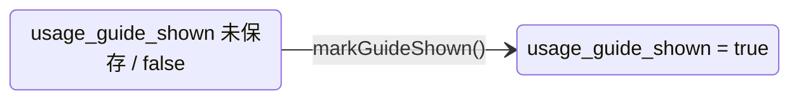

# lib/data/repositories/usage_guide_repository.dart

| 項目 | 内容 |
|---|---|
| ファイル | `lib/data/repositories/usage_guide_repository.dart` |
| 基本設計 | [10 お知らせ・使い方ガイド・フィードバック](../../10_お知らせ・使い方ガイド.md) の「3.1 起動時の案内」「4. データ設計」 |
| 関連する基本設計 | [02 地図・投稿作成](../../02_地図・投稿作成.md)（MapScreen からの起動時表示） |
| レイヤ | Repository |
| 主な依存先 | `package:shared_preferences` |
| 主な利用元 | `lib/app/dependencies.dart`, `lib/ui/map/map_screen.dart` |
| テスト | `test/data/repositories/usage_guide_repository_test.dart` |

## 1. 責務

初回起動で使い方ガイド（Issue #47）を自動表示したかどうかを端末ローカル（`shared_preferences`）に記録・判定する。

## 2. 構成要素（クラス・関数・定数の一覧）

| 名前 | 種別 | 値 / 概要 |
|---|---|---|
| `UsageGuideRepository` | class | 本体 |
| `guideShownKey` | `static const String` | `'usage_guide_shown'` |

## 3. 公開インターフェース（コンストラクタ引数・プロパティ・メソッドのシグネチャと説明）

```dart
UsageGuideRepository({Future<SharedPreferences> Function()? preferencesProvider})
```

`preferencesProvider` の既定値は `SharedPreferences.getInstance`。

| シグネチャ | 説明 |
|---|---|
| `Future<bool> shouldShowGuide()` | まだ自動表示していなければ `true` |
| `Future<void> markGuideShown()` | 自動表示済みとして記録 |

## 4. 内部状態（フィールド・状態遷移）

| フィールド | 型 |
|---|---|
| `_preferencesProvider` | `Future<SharedPreferences> Function()` |



## 5. 処理詳細（メソッドごとの手順・分岐・呼び出す Repository/SDK）

### `shouldShowGuide()`

`prefs.getBool(guideShownKey) != true` を返す。未保存（`null`）・`false` はどちらも `true`。

### `markGuideShown()`

`prefs.setBool(guideShownKey, true)`。

### 呼び出し側（`MapScreen._maybeShowUsageGuide`）

1. `shouldShowGuide()` が `false` なら終了（お知らせ判定へ進む）。
2. `UsageGuideDialog.show(context)` を表示し、閉じられるのを待つ。
3. `markGuideShown()`、続けて `ReleaseNoteRepository.markAnnounced()` を呼ぶ。

記録はダイアログを閉じた後に行うため、表示中にアプリを終了すると次回も表示される。

## 6. データ仕様（読み書きする Firestore/Storage のパス・フィールド、定数値）

| 保存先 | キー | 型 | 内容 |
|---|---|---|---|
| shared_preferences | `usage_guide_shown` | bool | 使い方ガイドを自動表示済みか |

## 7. 例外・エラー処理（例外の扱い・戻り値・表示メッセージ）

例外を捕捉しない。`MapScreen` 側で握りつぶす（ガイドを出さずに続行）。

## 8. テスト観点（既存テストが確認していること / 未テストの観点）

既存（`test/data/repositories/usage_guide_repository_test.dart`）:

- 未記録なら `shouldShowGuide` が `true`。
- `markGuideShown` 後は `false`。
- 記録済みの値（`usage_guide_shown: true`）を読み込んだ状態でも `false`。

未テストの観点は特に無い。

## 9. 備考・既知の課題

- 記録は端末（ブラウザ）単位のため、端末を変えると再表示される。
